# Binary Detection: Brain Tumour Present vs Absent

Nine pretrained image classifiers, one notebook each, trained and benchmarked on the same task: does a brain MRI slice show a tumour (`Tumor`) or not (`No Tumor`)?

All nine notebooks share the same pipeline, data, split, hyperparameters and outputs. The model is the only intended difference.

> **Source of truth.** Every number here comes from the executed notebook outputs and the artefacts in this folder (`metrics/`, `plots/`, `weights/`, `tensorboard/`). Where the evidence does not explain a choice, the README says so instead of guessing.
>
> **Related.** The follow-on three-class tumour-type task is documented in [../Classification/README.md](../Classification/README.md).

## At a glance

|                                  |                                                                                             |
| -------------------------------- | ------------------------------------------------------------------------------------------- |
| **Task**                         | Binary: `No Tumor` (0) vs `Tumor` (1)                                                       |
| **Data**                         | 3,253 images from 2 Kaggle datasets, near-balanced (49.1% / 50.9%), **not deduplicated**    |
| **Split**                        | Stratified 70 / 15 / 15: train 2,277, validation 488, test 488                              |
| **Recipe**                       | 10 epochs, AdamW 3e-4, cosine LR, BCE on 1 logit, AMP fp16, 2x Tesla T4                     |
| **Best test accuracy**           | **0.9939** (3 of 488 wrong), four-way tie: DenseNet121, ResNet50, EfficientNetB0, CoAtNet-0 |
| **Worst**                        | VGG16, 0.8832                                                                               |
| **Pick for sensitivity**         | EfficientNetB0: catches every tumour, lowest compute (0.769 GFLOPs, 15.6 MB)                |
| **Pick for probability quality** | DenseNet121: best log loss (0.0189), ECE (0.0044) and ROC AUC (0.99998)                     |

**Biggest caveats**

1. No duplicate check across the two merged datasets, so train/test leakage cannot be ruled out.
2. InceptionV3 trained on one GPU despite being wrapped for two.
3. MobileNetV3-Large ranks well (AUC 0.998) but misses 45 tumours at the 0.5 threshold.
4. Batch sizes differ per model, so the comparison is not controlled for optimisation budget.
5. Single seed. The top four models cannot be separated statistically.

Full details in [Anomalies and limitations](#anomalies-and-limitations).

## Contents

**Results**

- [Headline results](#headline-results)
- [Training dynamics and per-model notes](#training-dynamics-and-per-model-notes)
- [Visualisations](#visualisations)
- [Anomalies and limitations](#anomalies-and-limitations)

**Method**

- [Folder layout](#folder-layout)
- [End-to-end pipeline](#end-to-end-pipeline)
- [Dataset](#dataset)
- [Shared configuration](#shared-configuration)
- [Per-notebook differences](#per-notebook-differences)
- [Cell-by-cell walkthrough](#cell-by-cell-walkthrough)

**Using it**

- [Reproducing a run](#reproducing-a-run)
- [How Binary Detection relates to Classification](#how-binary-detection-relates-to-classification)
- [Metric glossary](#metric-glossary)

## Headline results

**Test set:** 488 images (240 No Tumor, 248 Tumor). **Positive class:** `Tumor`. **Source:** `metrics/benchmark_summary.json` in each run folder.

Predictions use `argmax`, which for a two-column probability vector equals a 0.5 threshold. Terms are defined in the [metric glossary](#metric-glossary).

### Classification quality (test)

| Model             | Accuracy   | Balanced acc | Sensitivity | Specificity | Missed tumours (FN) | False alarms (FP) | MCC        |
| ----------------- | ---------- | ------------ | ----------- | ----------- | ------------------- | ----------------- | ---------- |
| DenseNet121       | **0.9939** | **0.9940**   | 0.9879      | 1.0000      | 3                   | 0                 | **0.9878** |
| ResNet50          | **0.9939** | **0.9940**   | 0.9879      | 1.0000      | 3                   | 0                 | **0.9878** |
| EfficientNetB0    | **0.9939** | 0.9938       | **1.0000**  | 0.9875      | 0                   | 3                 | **0.9878** |
| CoAtNet-0         | **0.9939** | 0.9938       | **1.0000**  | 0.9875      | 0                   | 3                 | **0.9878** |
| InceptionV3       | 0.9877     | 0.9878       | 0.9798      | 0.9958      | 5                   | 1                 | 0.9755     |
| SwinBase          | 0.9590     | 0.9594       | 0.9355      | 0.9833      | 16                  | 4                 | 0.9192     |
| ViT-B16           | 0.9488     | 0.9485       | 0.9637      | 0.9333      | 9                   | 16                | 0.8978     |
| MobileNetV3-Large | 0.9078     | 0.9093       | 0.8185      | 1.0000      | 45                  | 0                 | 0.8302     |
| VGG16             | 0.8832     | 0.8835       | 0.8629      | 0.9042      | 34                  | 23                | 0.7673     |

### Probability quality (test)

| Model             | ROC AUC     | Log loss   | ECE        | Best epoch |
| ----------------- | ----------- | ---------- | ---------- | ---------- |
| DenseNet121       | **0.99998** | **0.0189** | **0.0044** | 4          |
| ResNet50          | 0.99997     | 0.0217     | 0.0057     | 7          |
| EfficientNetB0    | 0.99983     | 0.0233     | 0.0049     | 4          |
| CoAtNet-0         | 0.99987     | 0.0253     | 0.0084     | 6          |
| InceptionV3       | 0.99861     | 0.0419     | 0.0078     | 3          |
| SwinBase          | 0.99614     | 0.1117     | 0.0235     | 6          |
| ViT-B16           | 0.98616     | 0.1525     | 0.0323     | 10         |
| MobileNetV3-Large | 0.99808     | 0.3698     | 0.0685     | 10         |
| VGG16             | 0.96760     | 0.2448     | 0.0437     | 10         |

### Model size and compute

**Source:** `model_profile.json`.

| Model             | Params (M) | GFLOPs / image | State dict (MB) | Input (px) | Batch size |
| ----------------- | ---------- | -------------- | --------------- | ---------- | ---------- |
| EfficientNetB0    | 4.009      | 0.769          | 15.58           | 224        | 256        |
| MobileNetV3-Large | 4.203      | 0.431          | 16.23           | 224        | 256        |
| DenseNet121       | 6.955      | 5.666          | 27.11           | 224        | 64         |
| ResNet50          | 23.510     | 8.174          | 89.99           | 224        | 256        |
| InceptionV3       | 24.346     | 11.422         | 93.20           | 299        | 128        |
| CoAtNet-0         | 26.667     | 8.416          | 101.86          | 224        | 64         |
| ViT-B16           | 85.799     | 22.541         | 327.36          | 224        | 128        |
| SwinBase          | 86.744     | 30.860         | 331.03          | 224        | 64         |
| VGG16             | 134.265    | 30.932         | 512.19          | 224        | 256        |

### Training and inference speed

**Source:** `training_summary.json`, `inference_benchmark.json`. All runs trained on 2x Tesla T4 (Kaggle). Inference was measured on one T4 with fp16 autocast.

| Model             | Train time | Mean epoch (s) | Peak GPU0 memory (MB) | Latency, batch 1 (ms) | Throughput, batch 32 (img/s) |
| ----------------- | ---------- | -------------- | --------------------- | --------------------- | ---------------------------- |
| EfficientNetB0    | 0:16:17    | 97.69          | 10559.6               | 10.76                 | 1364.24                      |
| MobileNetV3-Large | 0:11:58    | 71.77          | 5415.8                | 8.08                  | 2408.52                      |
| DenseNet121       | 0:08:28    | 50.71          | 4267.1                | 19.43                 | 629.80                       |
| ResNet50          | 0:05:24    | 32.27          | 10838.9               | 7.35                  | 771.21                       |
| InceptionV3       | 0:04:51    | 29.07          | 13518.5               | 14.05                 | 514.15                       |
| CoAtNet-0         | 0:29:08    | 174.68         | 5921.2                | 13.91                 | 520.34                       |
| ViT-B16           | 0:04:41    | 27.62          | 10462.3               | 8.80                  | 286.88                       |
| SwinBase          | 0:06:34    | 38.95          | 10801.8               | 28.99                 | 195.63                       |
| VGG16             | 0:12:28    | 74.06          | 13313.8               | 8.19                  | 338.15                       |

### What the results mean

- **The top four fail in opposite directions.** All four make 3 errors out of 488.
  - DenseNet121 and ResNet50 miss 3 tumours and raise no false alarms.
  - EfficientNetB0 and CoAtNet-0 catch every tumour but raise 3 false alarms.
  - If a missed tumour costs more than a false alarm, **EfficientNetB0** gives 100% sensitivity at the lowest compute.
  - On probability quality (log loss, ECE, ROC AUC), **DenseNet121** is best.
- **Training time mostly measures data loading, not model cost.**
  - EfficientNetB0 (0.77 GFLOPs) took 16 minutes. ResNet50 (8.2 GFLOPs) took 5.
  - Train throughput was 25.8 images/s for EfficientNetB0 and 77.5 for ResNet50.
  - Runs used separate Kaggle sessions (each TensorBoard file has a different host id), so I/O caching was not controlled. Compare training times with caution.
- **MobileNetV3-Large ranks well but thresholds badly.** ROC AUC is 0.998, yet accuracy is only 0.908, because the 0.5 threshold is badly placed. See [anomaly A2](#a-issues-that-affect-results).
- **Three models were still improving at epoch 10.** VGG16, ViT-B16 and MobileNetV3-Large had their best validation AUC at the last epoch. Their scores reflect this 10-epoch budget, not each architecture's ceiling.

## Training dynamics and per-model notes

### Validation AUC per epoch

**Source:** `metrics/training_history.csv`. **Bold** marks the checkpointed (best) epoch. MobileNetV3-Large and VGG16 also show validation accuracy, because their accuracy and AUC diverge.

| Epoch | EffNetB0    | DenseNet   | ResNet50    | Inception  | CoAtNet     | Swin       | ViT        | MobileNet (acc / AUC) | VGG16 (acc / AUC)  |
| ----- | ----------- | ---------- | ----------- | ---------- | ----------- | ---------- | ---------- | --------------------- | ------------------ |
| 1     | 0.9723      | 0.9997     | 0.9643      | 0.9965     | 0.8434      | 0.8100     | 0.7206     | 0.699 / 0.9518        | 0.541 / 0.7569     |
| 2     | 0.9987      | 0.99988    | 0.9948      | 0.99992    | 0.9881      | 0.8479     | 0.7974     | 0.656 / 0.9728        | 0.676 / 0.8633     |
| 3     | 0.99983     | 0.99993    | 0.9972      | **1.0000** | 0.9972      | 0.8653     | 0.8814     | 0.703 / 0.9872        | 0.531 / 0.7319     |
| 4     | **0.99995** | **1.0000** | 0.9963      | 0.99990    | 0.9960      | 0.9576     | 0.9326     | 0.797 / 0.9929        | 0.666 / 0.8194     |
| 5     | 0.99994     | 0.99997    | 0.99982     | 0.99992    | 0.99983     | 0.9923     | 0.9520     | 0.814 / 0.9935        | 0.744 / 0.8572     |
| 6     | 0.99992     | 1.0000     | 0.99983     | 0.9998     | **0.99993** | **0.9973** | 0.9623     | 0.814 / 0.9965        | 0.836 / 0.9039     |
| 7     | 0.99993     | 1.0000     | **0.99992** | 0.99988    | 0.9969      | 0.9961     | 0.9817     | 0.838 / 0.9982        | 0.855 / 0.9482     |
| 8     | 0.99993     | 1.0000     | 0.99990     | 0.99988    | 0.9991      | 0.9951     | 0.9720     | 0.850 / 0.9988        | 0.887 / 0.9580     |
| 9     | 0.99993     | 1.0000     | 0.99990     | 0.99990    | 0.9991      | 0.9960     | 0.9868     | 0.873 / 0.9991        | 0.893 / 0.9680     |
| 10    | 0.99993     | 0.99998    | 0.99990     | 0.99990    | 0.9993      | 0.9957     | **0.9899** | **0.881 / 0.9993**    | **0.898 / 0.9687** |

### Confusion matrices

**Source:** `metrics/confusion_matrix_{test,val}.csv`. Rows are the true class and columns the predicted class, both ordered `[No Tumor, Tumor]`. Each cell shows `row 1 / row 2`.

| Model             | Test              | Validation        |
| ----------------- | ----------------- | ----------------- |
| CoAtNet-0         | 237, 3 / 0, 248   | 234, 5 / 0, 249   |
| DenseNet121       | 240, 0 / 3, 245   | 239, 0 / 0, 249   |
| EfficientNetB0    | 237, 3 / 0, 248   | 237, 2 / 0, 249   |
| InceptionV3       | 239, 1 / 5, 243   | 237, 2 / 0, 249   |
| MobileNetV3-Large | 240, 0 / 45, 203  | 239, 0 / 58, 191  |
| ResNet50          | 240, 0 / 3, 245   | 238, 1 / 2, 247   |
| SwinBase          | 236, 4 / 16, 232  | 238, 1 / 14, 235  |
| VGG16             | 217, 23 / 34, 214 | 222, 17 / 33, 216 |
| ViT-B16           | 224, 16 / 9, 239  | 216, 23 / 6, 243  |

### Youden-optimal thresholds (test)

**Source:** `test_youden_optimal_threshold`.

| Model                 | Threshold   |
| --------------------- | ----------- |
| EfficientNetB0        | 0.845       |
| CoAtNet-0             | 0.999       |
| DenseNet121           | 0.177       |
| ResNet50              | 0.070       |
| InceptionV3           | 0.675       |
| SwinBase              | 0.238       |
| ViT-B16               | 0.633       |
| VGG16                 | 0.728       |
| **MobileNetV3-Large** | **0.00044** |

These thresholds are derived from the test set itself. They describe each model's behaviour and must not be used as tuned operating points.

### Per-model notes

**EfficientNetB0**

- Converges by epoch 3–4.
- Validation accuracy peaks at 0.9959 (epochs 4–6).
- Validation loss keeps drifting down to about 0.012 while AUC is saturated.
- Test: 0 FN, 3 FP.

**DenseNet121**

- Fastest to converge: validation AUC is 0.9997 after one epoch.
- Reaches AUC 1.0000 and 100% validation accuracy at epoch 4.
- Lowest test log loss (0.0189) and ECE (0.0044).

**ResNet50**

- Short 5-minute training.
- The best checkpoint (epoch 7) matches DenseNet121's test confusion matrix exactly.

**InceptionV3**

- Validation AUC reaches 1.0 at epoch 3.
- Test is slightly worse than validation: 0.9877 with 5 FN, vs 0.9959.
- Training accuracy hits 1.0 by epoch 6, which suggests some overfitting on the 299-px inputs.
- Only one GPU was used for compute ([anomaly A1](#a-issues-that-affect-results)).

**CoAtNet-0**

- Slowest run (29 min).
- Validation loss is noisy: 0.13 at epoch 4, then 0.021 at epoch 5.
- Training accuracy reaches 1.0 at epoch 10, while validation loss rises again from 0.021 to 0.040.
- Test: 0 FN, 3 FP.

**SwinBase**

- Slow start: validation AUC stays at or below 0.87 for 3 epochs, then climbs quickly in epochs 4–6.
- Most errors are missed tumours (16 FN).

**ViT-B16**

- Learns steadily but slowly. Validation AUC is still rising at epoch 10 (0.9899).
- Training accuracy only reaches 0.944.
- Clearly under-trained at 10 epochs with this recipe.

**MobileNetV3-Large**

- Training loss falls to about 0.001, and training accuracy reaches 0.999 by epoch 4.
- Validation loss **rises** to 1.06 at epoch 2 and only recovers to 0.40 by epoch 10.
- Validation accuracy creeps from 0.66 to 0.88, while validation AUC stays at or above 0.95 throughout.
- Every error is a missed tumour (45 FN on test, 58 on validation).
- The model ranks cases correctly but pushes tumour probabilities below 0.5. The notebook does not investigate why.

**VGG16**

- Epoch-1 training loss is 2.13.
- Training accuracy stays near chance (0.53–0.63) for 4 epochs before improving.
- Best at the last epoch, with validation AUC 0.969. Worst model overall.
- Batch 256 on this 134M-parameter network used about 14.6 GB on GPU1.

## Visualisations

Each run folder contains the same 13 plots, numbered `01`–`14` with `04` omitted (see [cell walkthrough](#2-data-cells-722)). Examples from a few models are shown below. To view any other model, replace the folder name in the path.

### Training curves

EfficientNetB0 (stable) vs MobileNetV3-Large (validation loss diverges from training loss):

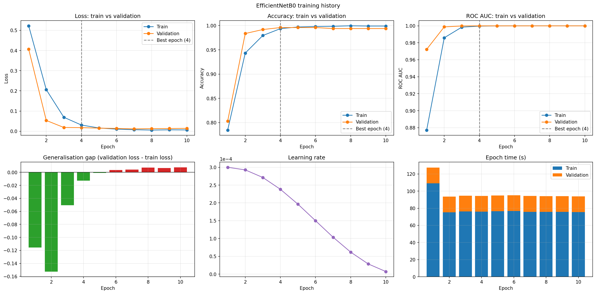
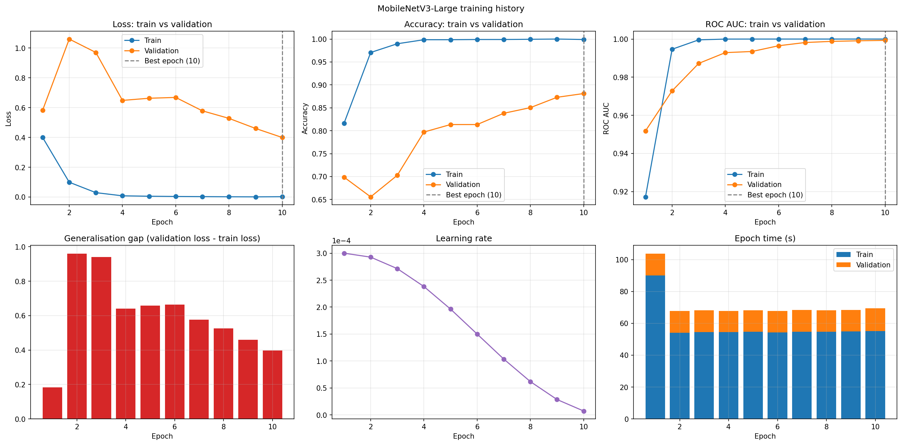

### Confusion matrices

DenseNet121 (best) and VGG16 (worst):

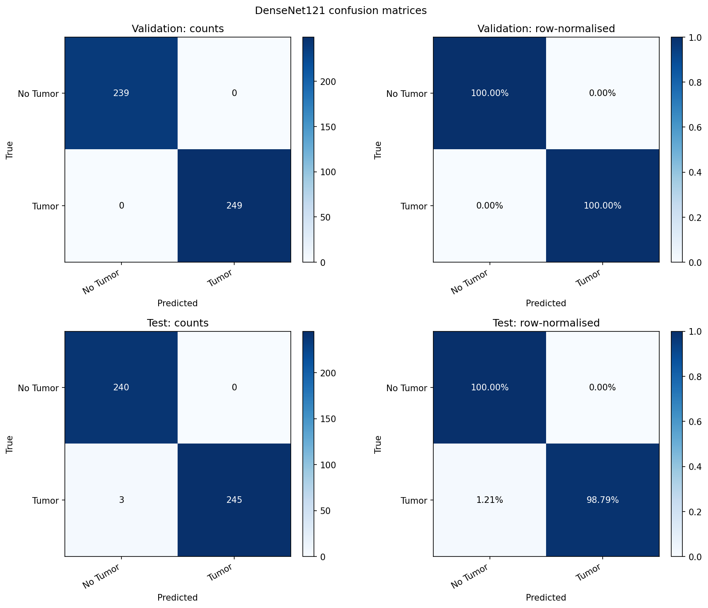
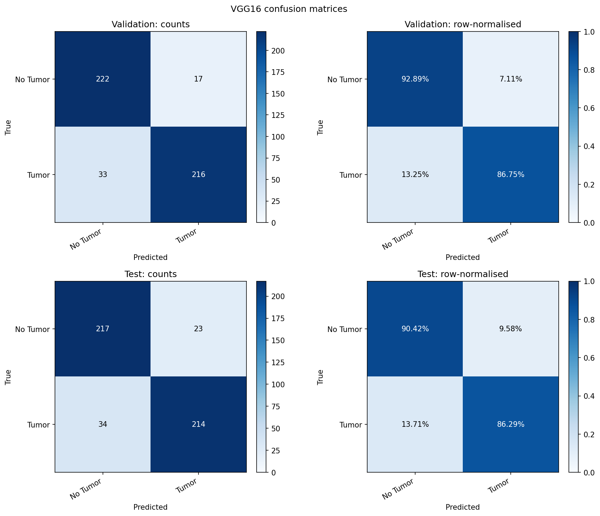

### ROC and precision-recall curves

ResNet50:


### Calibration

MobileNetV3-Large. ECE is 0.0855 on validation and 0.0685 on test. Its 45 test errors spread across confidence bins up to 1.0, so many are confidently wrong:

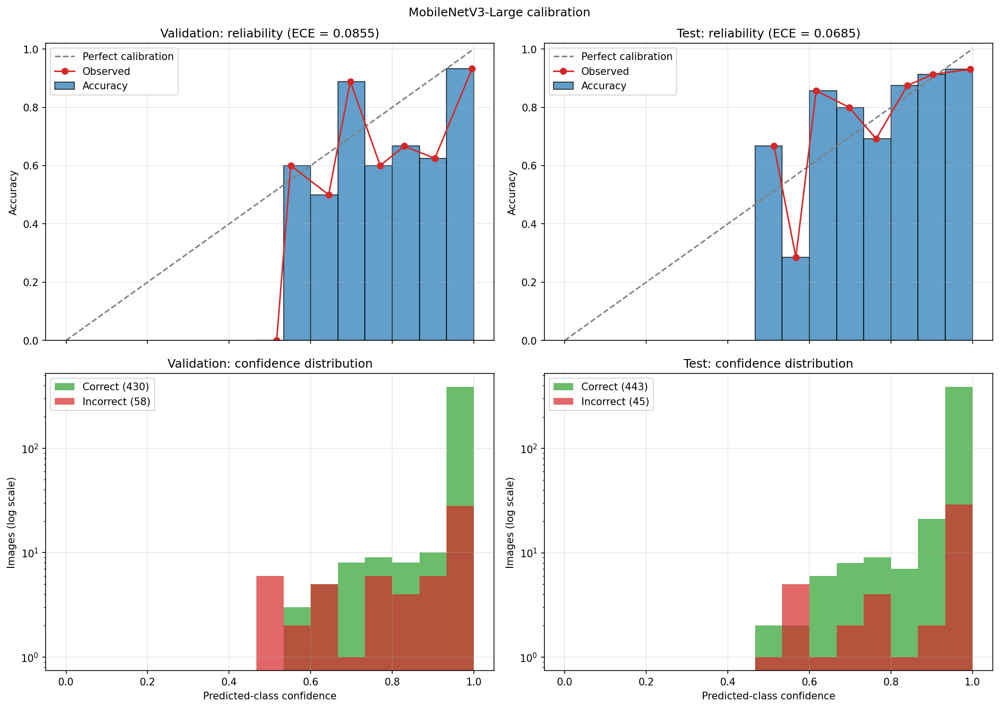

### Per-class metrics and prediction samples

EfficientNetB0:

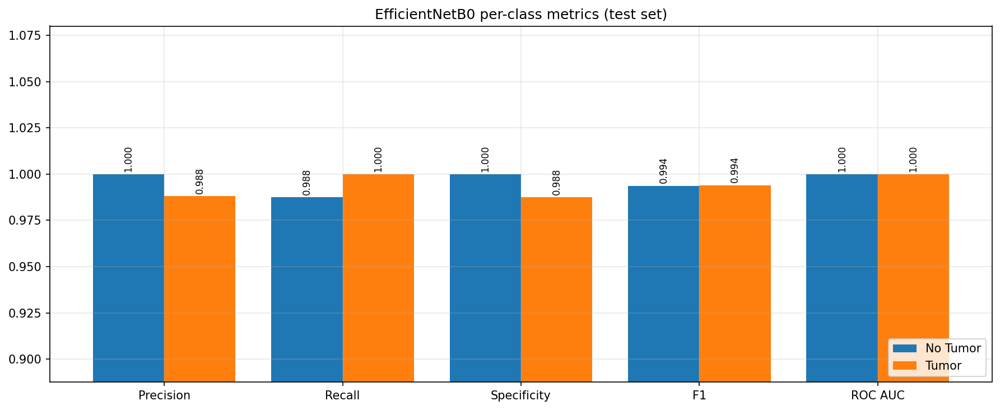
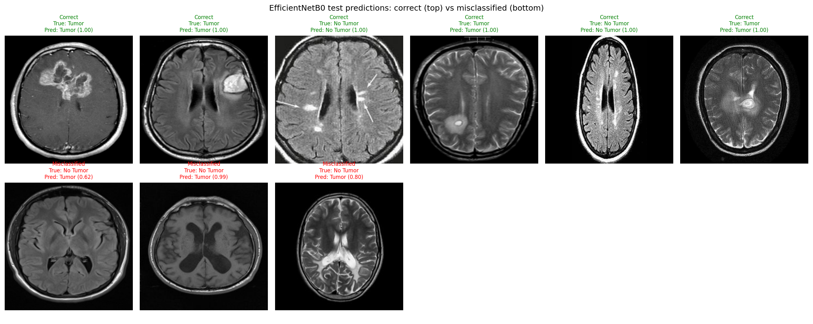

### Augmentation


### Grad-CAM

Correct and misclassified examples from EfficientNetB0, and misclassified examples from SwinBase:

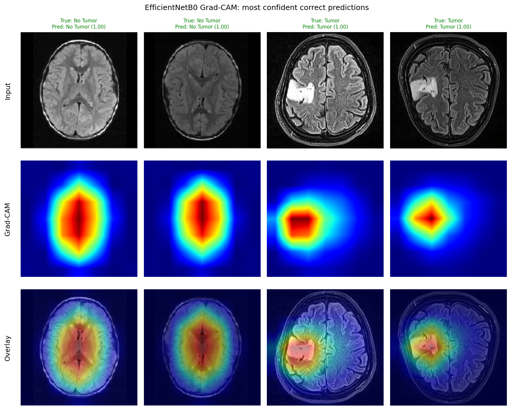
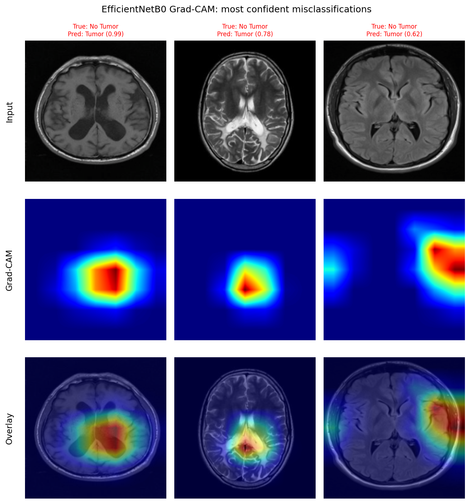
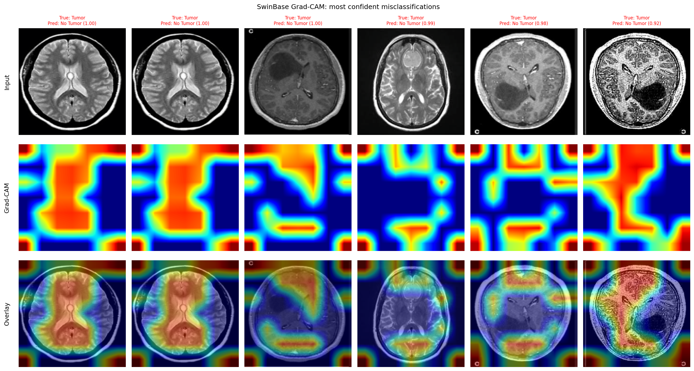

Grad-CAM is for qualitative inspection only. The notebooks do not measure how well the heatmaps localise the tumour, and no dataset here has lesion masks.

## Anomalies and limitations

These issues are grouped by how much they affect the reported results.

### A. Issues that affect results

**A1. InceptionV3 did not use DataParallel for compute.**

- The model is wrapped in `nn.DataParallel`, but `run_epoch` calls the unwrapped module (`m = model.module …; m(images)`) in both training and evaluation.
- Evidence: `training_summary.json` shows `peak_gpu_memory_allocated_mb_cuda1 = 0.0`, against 13518.5 MB on cuda0.
- `model_profile.json` still reports `data_parallel_gpus: 2`, because that field only checks whether the model is wrapped.
- Its training time is therefore single-GPU at batch 128.

**A2. MobileNetV3-Large threshold collapse.**

- AUC is 0.998, but sensitivity at 0.5 is only 0.8185.
- The Youden threshold is 0.00044, and validation loss rose while training loss approached 0.
- The notebook does not test for a cause.
- It is also the only run that pins `IMAGENET1K_V1` weights. That difference is recorded here, but nothing shows it is the cause.

**A3. Unequal batch sizes (64, 128, 256).**

- LR and epoch count are the same, so each model got a different number of optimiser steps: 80 to 350 over 10 epochs.
- The comparison is controlled for data and schedule, but not for optimisation budget.

**A4. No deduplication or leakage check** across the two merged source datasets. See [Dataset](#no-deduplication).

**A5. Only one seed.**

- No repeated runs, so no confidence intervals.
- With 488 test images, one error is 0.2 percentage points of accuracy.
- The top four models are statistically indistinguishable.

### B. Issues that affect interpretation

**B1. Validation is used for model selection.** The checkpoint was chosen on validation AUC, so the reported validation metrics are optimistic. The test set is the unbiased estimate.

**B2. Checkpoints are selected on AUC, not accuracy or loss.** Several models saturate validation AUC early (DenseNet121 hits 1.0 at epoch 4). Later epochs cannot replace the checkpoint, even when their validation loss is lower.

**B3. "Test loss" differs slightly from `log_loss`.**

- Example: EfficientNetB0 prints `Test Loss: 0.0240` but records `log_loss 0.0233`.
- The first is a mean of per-batch fp16 BCE values from the DataParallel model.
- The second is sklearn's log loss on float64 probabilities from the single-GPU re-inference.
- Test accuracy agrees between the two paths in all nine runs.

**B4. The root `EfficientNetB0.pth` has unknown provenance.**

- `Binary Detection/EfficientNetB0.pth` is 16,342,545 bytes, dated 27 Feb 2026.
- It has the same byte size as `binary-detection-efficientnetb0/weights/final_efficientnet_brain_tumor.pth`, but a different MD5 (`f7dadc87…` vs `4709fe14…`).
- No notebook in this folder writes a file with this name, so its metrics are unknown.
- It is most likely an earlier training of the same architecture. That cannot be verified from this folder.

### C. Reproducibility and code hygiene (no effect on results)

**C1. Reproducibility is approximate.** `cudnn.benchmark=True`, TF32 and AMP allow non-deterministic kernels.

**C2. Kaggle paths are hard-coded** (`/kaggle/input/…`, `/kaggle/working/…`). The notebooks will not run elsewhere without editing them.

**C3. Evaluation skips `torch.no_grad()`** in the original `run_epoch`. This wastes memory but does not change results.

**C4. Minor code drift between notebooks:**

- missing `try/except` in some datasets
- unused `classification_report` imports
- `GradScaler()` with and without `"cuda"`
- `non_blocking` sometimes omitted

## Folder layout

| Path                                    | Contents                                                                                                 |
| --------------------------------------- | -------------------------------------------------------------------------------------------------------- |
| `EfficientNetB0.pth`                    | Standalone weights, **not** produced by these notebooks (see [B4](#b-issues-that-affect-interpretation)) |
| `binary-detection-<model>.ipynb`        | 9 notebooks, 65 cells each                                                                               |
| `binary-detection-<model>/`             | Unzipped outputs of that notebook (subfolders below)                                                     |
| `binary-detection-<model>/metrics/`     | 21 files (CSV, JSON, TXT)                                                                                |
| `binary-detection-<model>/plots/`       | 13 PNGs, numbered `01`–`03` and `05`–`14` (`04` exists only in Classification)                           |
| `binary-detection-<model>/tensorboard/` | One run folder `<YYYYMMDD-HHMMSS>/` with the `events.out.tfevents.*` file                                |
| `binary-detection-<model>/weights/`     | `best_<model>.pth` and `final_<model>_brain_tumor.pth`                                                   |

| Notebook                                                                             | Output folder                                                              | Weights                                                                 |
| ------------------------------------------------------------------------------------ | -------------------------------------------------------------------------- | ----------------------------------------------------------------------- |
| [binary-detection-coatnet0.ipynb](binary-detection-coatnet0.ipynb)                   | [binary-detection-coatnet0/](binary-detection-coatnet0/)                   | `best_coatnet.pth`, `final_coatnet_brain_tumor.pth`                     |
| [binary-detection-densenet121.ipynb](binary-detection-densenet121.ipynb)             | [binary-detection-densenet121/](binary-detection-densenet121/)             | `best_densenet121.pth`, `final_densenet121_brain_tumor.pth`             |
| [binary-detection-efficientnetb0.ipynb](binary-detection-efficientnetb0.ipynb)       | [binary-detection-efficientnetb0/](binary-detection-efficientnetb0/)       | `best_efficientnet.pth`, `final_efficientnet_brain_tumor.pth`           |
| [binary-detection-inceptionv3.ipynb](binary-detection-inceptionv3.ipynb)             | [binary-detection-inceptionv3/](binary-detection-inceptionv3/)             | `best_inception.pth`, `final_inception_brain_tumor.pth`                 |
| [binary-detection-mobilenetv3-large.ipynb](binary-detection-mobilenetv3-large.ipynb) | [binary-detection-mobilenetv3-large/](binary-detection-mobilenetv3-large/) | `best_mobilenetv3_large.pth`, `final_mobilenetv3_large_brain_tumor.pth` |
| [binary-detection-resnet50.ipynb](binary-detection-resnet50.ipynb)                   | [binary-detection-resnet50/](binary-detection-resnet50/)                   | `best_resnet50.pth`, `final_resnet50_brain_tumor.pth`                   |
| [binary-detection-swinbase.ipynb](binary-detection-swinbase.ipynb)                   | [binary-detection-swinbase/](binary-detection-swinbase/)                   | `best_swin.pth`, `final_swin_brain_tumor.pth`                           |
| [binary-detection-vgg16.ipynb](binary-detection-vgg16.ipynb)                         | [binary-detection-vgg16/](binary-detection-vgg16/)                         | `best_vgg16.pth`, `final_vgg16_brain_tumor.pth`                         |
| [binary-detection-vit-b16.ipynb](binary-detection-vit-b16.ipynb)                     | [binary-detection-vit-b16/](binary-detection-vit-b16/)                     | `best_vit.pth`, `final_vit_brain_tumor.pth`                             |

**`best_*` vs `final_*` weights.** `final_*.pth` is saved after the best checkpoint has been reloaded. It therefore holds the **best-validation-AUC weights**, not the weights from the last epoch. The two files differ slightly in size and hash only because they are serialised separately.

## End-to-end pipeline


| #   | Stage                 | What happens                                                                                                   | Key numbers                          |
| --- | --------------------- | -------------------------------------------------------------------------------------------------------------- | ------------------------------------ |
| 1   | Collect images        | `os.walk` over the yes/no folders of 2 Kaggle datasets builds a `(path, label)` table                          | 3253 images; 0 = No Tumor, 1 = Tumor |
| 2   | Explore data          | Class distribution, sample images, image sizes, intensity histograms. Read-only: nothing is changed.           | Plots `01`–`03`                      |
| 3   | Split                 | Stratified 70/15/15, seed 42                                                                                   | Train 2277, val 488, test 488        |
| 4   | Prepare inputs        | `BrainDataset`, then resize, flip, rotate, colour jitter and ImageNet normalisation                            | 224 px (299 for InceptionV3)         |
| 5   | Build model           | Pretrained backbone, head replaced with 1 output logit, `nn.DataParallel` over 2 GPUs                          |                                      |
| 6   | Train                 | 10 epochs: AdamW 3e-4, cosine LR, `BCEWithLogitsLoss`, AMP fp16. Saves the epoch with the best validation AUC. | `best_*.pth`                         |
| 7   | Test                  | Reloads the best checkpoint, evaluates the test set, saves the same weights again                              | `final_*.pth`                        |
| 8   | Predict               | Re-runs validation and test on a single-GPU copy and saves per-image predictions                               | `predictions_{val,test}.csv`         |
| 9   | Evaluate              | Metrics, confusion matrices, ROC/PR curves, calibration, per-class bars, sample predictions                    | Plots `08`–`12`                      |
| 10  | Explain               | Grad-CAM on the most confident correct and misclassified test images                                           | Plots `13`–`14`                      |
| 11  | Benchmark and package | Latency and throughput benchmark, one-row `benchmark_summary`, zip of every output                             | 37 files per zip                     |

**Design rule, stated in each notebook's first cell:**

- The data, split, training and testing cells are the original cells.
- The added cells "only observe the run".
- Any randomness in the added cells runs inside `preserved_rng_state()`, so adding them does not change the training outcome.

## Dataset

### Sources

Kaggle paths hard-coded in the data collection cell:

| Label        | Paths                                                                                                                                               |
| ------------ | --------------------------------------------------------------------------------------------------------------------------------------------------- |
| 0 `No Tumor` | `/kaggle/input/datasets/navoneel/brain-mri-images-for-brain-tumor-detection/no`<br>`/kaggle/input/datasets/ahmedhamada0/brain-tumor-detection/no`   |
| 1 `Tumor`    | `/kaggle/input/datasets/navoneel/brain-mri-images-for-brain-tumor-detection/yes`<br>`/kaggle/input/datasets/ahmedhamada0/brain-tumor-detection/yes` |

Folders are walked recursively. Accepted extensions are `.jpg`, `.jpeg`, `.png` and `.tif` (case-insensitive).

### Class distribution

| Class     | Images   | Share |
| --------- | -------- | ----- |
| No Tumor  | 1598     | 49.1% |
| Tumor     | 1655     | 50.9% |
| **Total** | **3253** |       |

The classes are close to balanced, so no class weighting or resampling is used.

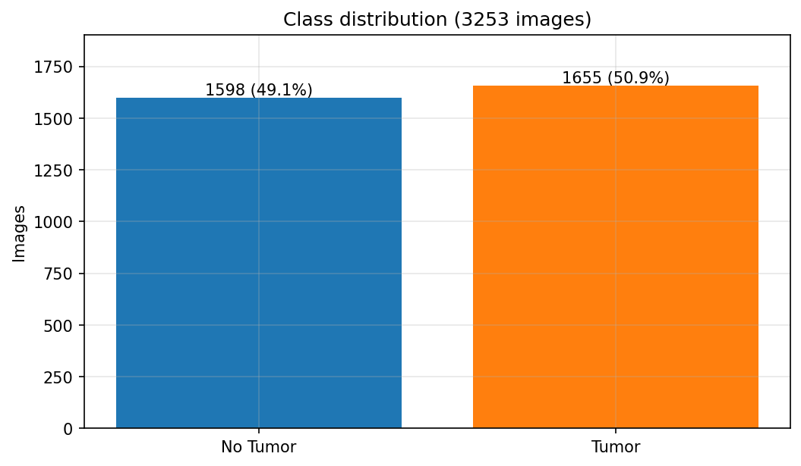

### Split

- Two chained `train_test_split` calls, stratified on `label`, with `random_state=42`.
- 70% goes to train. The remaining 30% is halved into validation and test.
- Identical in all nine runs. Source: `metrics/split_distribution.csv`.

|           | Train    | Validation | Test    |
| --------- | -------- | ---------- | ------- |
| No Tumor  | 1119     | 239        | 240     |
| Tumor     | 1158     | 249        | 248     |
| **Total** | **2277** | **488**    | **488** |


### Image properties

**Source:** `metrics/image_dimension_stats.csv`. Image sizes vary a lot, and the two classes have different size distributions.

| Class    | Width: mean ± std (min–max) | Width median | Height: mean ± std (min–max) | Height median |
| -------- | --------------------------- | ------------ | ---------------------------- | ------------- |
| No Tumor | 302.6 ± 154.9 (150–1920)    | 227          | 308.9 ± 144.9 (168–1080)     | 240           |
| Tumor    | 351.5 ± 195.2 (175–1275)    | 283          | 400.2 ± 208.1 (167–1427)     | 342           |

**Implication:** every image is resized to a fixed square (224 or 299) **without keeping the aspect ratio**. Size differs systematically between classes, so the amount of resize distortion is partly class-dependent. The notebooks do not test whether models exploit this.


The sample grid shows mixed MRI sequences, contrasts, crops and borders across both sources. One `No Tumor` sample (top row, third column) has focal bright spots. This is a visual observation only. The notebooks do not audit labels.

### No deduplication

Unlike [Classification](../Classification/README.md), this pipeline does **not** remove duplicate or near-duplicate images before splitting.

- Two public datasets are merged, and there is no overlap check between or within them.
- Any duplicates could fall on both sides of the train/test split.
- Read the near-perfect scores of the top models with that in mind.

## Shared configuration

These values are identical in every notebook, except where [Per-notebook differences](#per-notebook-differences) says otherwise.

### Optimisation

| Setting         | Value                                                                                                                               |
| --------------- | ----------------------------------------------------------------------------------------------------------------------------------- |
| Seed            | `42` (Python `random`, NumPy, `torch.manual_seed`)                                                                                  |
| Epochs          | `10`                                                                                                                                |
| Learning rate   | `3e-4`                                                                                                                              |
| Optimiser       | `AdamW(model.parameters(), lr=3e-4)`, default weight decay 0.01. All layers trainable, nothing frozen.                              |
| Scheduler       | `CosineAnnealingLR(T_max=10)`, stepped once per epoch after validation. Logged LR runs from 3.0e-4 (epoch 1) to 7.34e-6 (epoch 10). |
| Loss            | `BCEWithLogitsLoss` on a single logit. Labels are `float32`.                                                                        |
| Precision       | `torch.amp.autocast("cuda")` with `GradScaler`. TF32 enabled for matmul and cuDNN. `cudnn.benchmark = True`.                        |
| Checkpoint rule | Save when `val_auc > best_auc`, so the first epoch to reach the maximum wins.                                                       |

### Data loading and augmentation

| Setting              | Value                                                                                                                                                           |
| -------------------- | --------------------------------------------------------------------------------------------------------------------------------------------------------------- |
| Image size (`S`)     | 224 (299 for InceptionV3)                                                                                                                                       |
| Batch size           | 256 by default, overridden for some models                                                                                                                      |
| DataLoader           | `num_workers=4`, `pin_memory=True`, `persistent_workers=True`, `prefetch_factor=4`                                                                              |
| Train loader         | `shuffle=True`, `drop_last=True`                                                                                                                                |
| Val and test loaders | No shuffling, no dropping                                                                                                                                       |
| Train augmentation   | `Resize((S,S))` → `RandomHorizontalFlip()` → `RandomRotation(10)` → `ColorJitter(brightness=0.2, contrast=0.2)` → `ToTensor()` → `Normalize(ImageNet mean/std)` |
| Eval transform       | `Resize((S,S))` → `ToTensor()` → `Normalize(ImageNet mean/std)`                                                                                                 |

**Effect of `drop_last=True`.** Part of the training set is skipped every epoch. Shuffling means the skipped images change from epoch to epoch.

| Batch size | Batches per epoch | Images used per epoch |
| ---------- | ----------------- | --------------------- |
| 256        | 8                 | 2048 (229 dropped)    |
| 128        | 17                | 2176                  |
| 64         | 35                | 2240                  |

### Hardware and environment

| Setting     | Value                                                                                      |
| ----------- | ------------------------------------------------------------------------------------------ |
| Multi-GPU   | `nn.DataParallel` when more than one GPU is present. Every run had 2x T4.                  |
| Environment | Python 3.12.13, torch 2.10.0+cu128, CUDA 12.8, 2x Tesla T4 (from `benchmark_summary.json`) |

## Per-notebook differences

EfficientNetB0 is the reference, as its code is the most canonical version of the template. Differences that are only comments, cell titles (`# CELL 1` vs `# Cell 1: …`) or equivalent reformatting are not listed.

### Architecture, batch size and Grad-CAM layer

| Notebook          | Backbone and head                                                                                             | Batch | Input   | Grad-CAM layer (resolved type)                           |
| ----------------- | ------------------------------------------------------------------------------------------------------------- | ----- | ------- | -------------------------------------------------------- |
| EfficientNetB0    | `torchvision.efficientnet_b0(DEFAULT)`<br>`classifier[1] → Linear(1280,1)`                                    | 256   | 224     | `features[-1]` (Conv2dNormActivation)                    |
| MobileNetV3-Large | `torchvision.mobilenet_v3_large(IMAGENET1K_V1)`<br>`classifier[3] → Linear(·,1)`                              | 256   | 224     | `features[-1]` (Conv2dNormActivation)                    |
| ResNet50          | `torchvision.resnet50(DEFAULT)`<br>`fc → Linear(2048,1)`                                                      | 256   | 224     | `layer4[-1]` (Bottleneck)                                |
| VGG16             | `torchvision.vgg16(DEFAULT)`<br>`classifier[6] → Linear(4096,1)`                                              | 256   | 224     | `features[-1]` (**MaxPool2d**)                           |
| DenseNet121       | `torchvision.densenet121(DEFAULT)`<br>`classifier → Linear(1024,1)`                                           | 64    | 224     | `features[-1]` (BatchNorm2d, i.e. `norm5`)               |
| InceptionV3       | `torchvision.inception_v3(DEFAULT, aux_logits=True)`<br>`fc → Linear(2048,1)`, `AuxLogits.fc → Linear(768,1)` | 128   | **299** | `Mixed_7c` (InceptionE)                                  |
| CoAtNet-0         | `timm.create_model("coatnet_0_rw_224", pretrained=True)`<br>`reset_classifier(1)`                             | 64    | 224     | `stages[-1]` (MaxxVitStage)                              |
| SwinBase          | `timm.create_model("swin_base_patch4_window7_224", pretrained=True, num_classes=1)`                           | 64    | 224     | `layers[-1].blocks[-1].norm1` (LayerNorm, channels-last) |
| ViT-B16           | `torchvision.vit_b_16(DEFAULT)`<br>`heads → Linear(768,1)` (replaces the whole `heads` Sequential)            | 128   | 224     | `encoder.layers[-1].ln_1` (LayerNorm, tokens)            |

### Other code deviations

- **EfficientNetB0:** none, as it is the reference.
- **MobileNetV3-Large:** pins `IMAGENET1K_V1` explicitly. Every other torchvision model uses `.DEFAULT`.
- **ResNet50:** unused `classification_report` import.
- **VGG16:**
  - `BrainDataset` has no `try/except` around image loading.
  - Grad-CAM hooks the final max-pool, not a conv layer.
- **DenseNet121:**
  - no `try/except` in the dataset
  - sigmoid is applied inline
- **InceptionV3:**
  - **Auxiliary loss:** `loss = main + 0.4·aux` while training.
  - **The forward call uses the unwrapped module `m`** ([anomaly A1](#a-issues-that-affect-results)).
  - TF32 flags removed.
  - `GradScaler()` without a device argument.
  - No "Using 2 GPUs" print.
  - No `try/except` in the dataset.
- **CoAtNet-0:**
  - needs `timm`
  - `GradScaler()` without a device argument
  - tensors moved without `non_blocking`
  - no `try/except` in the dataset
- **SwinBase:**
  - Uses **timm**. Classification uses torchvision `swin_b` instead.
  - Weights come from the Hugging Face Hub, and the output warns about an unauthenticated HF request.
  - `GradScaler()` without a device argument.
- **ViT-B16:** unused `classification_report` import.

### Why the notebooks differ (evidence only)

**Batch size**

- The only explicit rationale is in InceptionV3: `# smaller batch due to inception memory`, together with `IMG_SIZE = 299  # Inception default input size`.
- No reason is written for the others (64 for DenseNet121, CoAtNet-0 and SwinBase; 128 for ViT-B16).
- Recorded peak memory shows VGG16 at batch 256 already reaching 13.3 GB on GPU0 and 14.6 GB on GPU1, close to the T4's 16 GB. Memory limits are a plausible but **unstated** reason.
- Batch size changes both the optimiser steps per epoch (8 vs 17 vs 35) and gradient noise at a fixed LR, so **this comparison is not perfectly controlled.**

**Head replacement.** Each architecture exposes its classifier under a different attribute, so this code must differ.

**Grad-CAM layer.** The notebook-settings markdown documents each choice as the last spatial or token stage of that architecture.

**InceptionV3 auxiliary head.** `0.4 × aux` is the standard Inception training recipe. The notebook applies it without comment.

**timm vs torchvision.** CoAtNet has no torchvision implementation. For Swin, the only comment is `# For Swin Transformer`.

## Cell-by-cell walkthrough

Every notebook has 65 cells in markdown/code pairs. Indices are 0-based.

- Code comments `# CELL 1` to `# CELL 10` mark the **original** training cells.
- Unnumbered code cells are the **added** observation, evaluation and benchmarking cells.

| Section                    | Cells | Purpose                                |
| -------------------------- | ----- | -------------------------------------- |
| 1. Setup                   | 0–6   | Config, identity, helpers              |
| 2. Data                    | 7–22  | Collect, explore, split, load, augment |
| 3. Model                   | 23–26 | Build model, profile it                |
| 4. Training                | 27–36 | Epoch loop, tracking, curves           |
| 5. Testing and saving      | 37–40 | Test the best checkpoint, save weights |
| 6. Detailed evaluation     | 41–54 | Predictions, metrics, plots            |
| 7. Explainability          | 55–58 | Grad-CAM                               |
| 8. Benchmark and packaging | 59–64 | Speed benchmark, summary, zip          |

### 1. Setup (cells 0–6)

**Cell 0 (markdown).** Title, the 9-step pipeline, and the statement that the added cells only observe the run. This lets notebooks be compared directly.

**Cell 2: imports and config.** One place for all hyperparameters.

- Imports and config: `SEED`, `BATCH_SIZE`, `EPOCHS`, `LR`, `IMG_SIZE`, loader settings.
- `DEVICE`, seeding, cuDNN benchmark and TF32 flags.
- Prints CUDA availability and GPU count. Output: `True`, `2`.

**Cell 4: identity.** The only per-notebook settings the shared cells need:

- `MODEL_NAME`, `TASK="binary-detection"`, `CLASS_NAMES=["No Tumor","Tumor"]`, `RUN_NAME`
- `get_gradcam_target_layer(net)`

**Cell 6: output folders and helpers.** Makes artefacts consistent and stops the added cells disturbing training randomness.

- Creates `/kaggle/working/outputs/<RUN_NAME>/{plots,metrics}`.
- Saving: `save_fig`, `save_json`, `save_table`, `save_text`.
- Model and tensor utilities: `unwrap_model` (strips the `DataParallel` wrapper), `denormalise`, `sync_cuda`.
- `preserved_rng_state()`: a context manager that snapshots and restores the Python, NumPy, torch and CUDA RNG states.

### 2. Data (cells 7–22)

Outputs are identical in all nine notebooks.

| Cell | What it does                                                                                                        | Output                                                 |
| ---- | ------------------------------------------------------------------------------------------------------------------- | ------------------------------------------------------ |
| 8    | `collect(paths, label)` walks the folders and builds `df[path,label]`                                               | `Total Images: 3253` (label 1: 1655, label 0: 1598)    |
| 10   | Copies `df` to `df_raw`. Plots the class bar chart and 6 random samples per class (`random_state=SEED`).            | `01_class_distribution.png`, `02_sample_images.png`    |
| 12   | Reads every image size. Builds grayscale intensity histograms from 100 sampled images per class (51 bins, density). | `03_image_properties.png`, `image_dimension_stats.csv` |
| 14   | Stratified 70/15/15 split                                                                                           | `Train: 2277 Val: 488 Test: 488`                       |
| 16   | Per-split class counts (grouped bars) and proportions (stacked bars)                                                | `05_split_distribution.png`, `split_distribution.csv`  |
| 18   | `BrainDataset` (details below)                                                                                      |                                                        |
| 20   | Transforms and the three `DataLoader`s                                                                              |                                                        |
| 22   | For 3 train images per class, shows the eval transform (top) and one random train augmentation (bottom)             | `06_augmentation_before_after.png`                     |

`BrainDataset` (cell 18):

- opens the image
- converts it to RGB, so grayscale MRIs are replicated to 3 channels to match ImageNet backbones
- applies the transform
- returns `(img, float32 label)`

**Why plot `04` is missing:** `04` is the deduplication plot, which exists only in Classification.

### 3. Model (cells 23–26)

**Cell 24: model build.**

- Loads the pretrained backbone and replaces the head with a 1-output `Linear`.
- Wraps it in `DataParallel` and moves it to the device.
- Creates the criterion, optimiser, scheduler and `GradScaler`.

**Cell 26: model profile.** Saved as `model_profile.json`.

- Total and trainable parameters (always all trainable) and buffer count.
- Serialised `state_dict` size, measured via `BytesIO`.
- FLOPs for one `1x3xSxS` input, using `torch.utils.flop_counter.FlopCounterMode` on a CPU deep copy.

### 4. Training (cells 27–36)

**Cell 28: `run_epoch(loader, training)`.**

- Sets train or eval mode and runs an autocast forward pass.
- Loss: `BCEWithLogits(logits.squeeze(1), labels)`.
- While training: scaled backward pass and optimiser step.
- Collects sigmoid probabilities. Returns mean batch loss, accuracy at 0.5, and ROC AUC.
- The eval pass does **not** use `torch.no_grad()`. It simply skips the optimiser step.

**Cell 30: training tracker.** Lets the original training cell stay unchanged.

- Rebinds `run_epoch` to a wrapper that identifies the phase (train, val or test) by which loader it receives.
- Times each phase with CUDA syncs.
- Records LR, loss, accuracy, AUC and timings per epoch, and drives an epoch-level tqdm bar.
- Resets GPU peak-memory stats.
- A `_tracks_history` flag prevents double wrapping if the cell is re-run.

**Cell 32: original training loop.**

- 10 epochs of train → val → `scheduler.step()`.
- TensorBoard scalars `Loss/Train`, `Loss/Val`, `AUC/Train`, `AUC/Val`, written to `/kaggle/working/runs/<timestamp>`.
- Saves a checkpoint when validation AUC improves, using `model.module.state_dict()` when there is more than one GPU.

**Cell 34: training summary.** Saved as `training_history.csv` and `training_summary.json`.

- History DataFrame with cumulative time.
- Best epoch via `idxmax`, which returns the first maximum and so matches the `>` checkpoint rule.
- Total and mean times, and time to best epoch.
- Train images/s, computed as `len(train_loader)*BATCH_SIZE / mean train time`.
- Peak allocated and reserved memory per GPU.

**Cell 36: training curves.** A 2x3 figure saved as `07_training_curves.png`:

- loss, accuracy and AUC, train vs val, with the best epoch marked
- generalisation gap (val loss minus train loss)
- learning rate
- stacked train and val time per epoch

**Note:** training accuracy and AUC are measured on **augmented** batches in train mode, with dropout and BatchNorm active. They are not directly comparable to the validation numbers.

### 5. Testing and saving (cells 37–40)

**Cell 38: test.** Loads `best_*.pth` into the (DataParallel) model, runs `run_epoch(test_loader, False)`, and prints `FINAL UNSEEN TEST RESULTS` (loss, accuracy, AUC).

**Cell 40: save.** Saves the reloaded best weights again as `final_*_brain_tumor.pth`.

### 6. Detailed evaluation (cells 41–54)

**Cell 42: predictions.** Saved as `predictions_val.csv` and `predictions_test.csv`.

- Deep-copies the unwrapped model onto one GPU and re-runs val and test under autocast.
- For a single logit it builds the probability pair `[1-σ, σ]`, then renormalises in float64.
- Stores per image: path, true and predicted class, confidence, per-class probabilities, correctness.

**Cell 44: `compute_metrics`.**

- **All runs:** accuracy, balanced accuracy, error rate, precision/recall/F1 (macro, weighted, micro), MCC, Cohen's κ, macro Jaccard, log loss, multi-class Brier score, 15-bin ECE, mean confidence.
- **Binary only:** TP/FP/FN/TN, precision, sensitivity, specificity, NPV, FPR, FNR, F1, F2, ROC AUC, average precision, positive-class Brier score, and Youden J with its optimal threshold, sensitivity and specificity.
- **Also:** per-class one-vs-rest metrics and the sklearn classification report (4 digits).
- **Artefacts:** `metrics_{val,test}.json`, `per_class_metrics_{val,test}.csv`, `classification_report_{val,test}.txt`, `metrics_summary.csv`.

| Cell | What it does                                                                                                                            | Artefacts                                                      |
| ---- | --------------------------------------------------------------------------------------------------------------------------------------- | -------------------------------------------------------------- |
| 46   | Confusion matrices, counts and row-normalised, for validation (top) and test (bottom)                                                   | `confusion_matrix_{val,test}.csv`, `08_confusion_matrices.png` |
| 48   | ROC and PR curves for the positive class, with prevalence lines on the PR plot                                                          | `09_roc_pr_curves.png`                                         |
| 50   | Reliability diagram (15 bins of predicted-class confidence) and confidence histograms for correct vs incorrect predictions (log y-axis) | `calibration_bins_{val,test}.csv`, `10_calibration.png`        |
| 52   | Per-class precision, recall, specificity, F1 and AUC on test                                                                            | `11_per_class_metrics.png`                                     |
| 54   | 6 random correct and 6 random misclassified test images (seeded `RandomState(42)`)                                                      | `12_prediction_samples.png`                                    |

### 7. Explainability (cells 55–58)

**Cell 56: generic `GradCAM` class.**

- A forward hook on the target layer captures activations. A tensor hook captures gradients.
- `to_nchw` converts other layouts to `(B,C,H,W)`:
  - transformer tokens `(B,T,C)`, dropping a class token when T is not a perfect square
  - channels-last maps `(B,H,W,C)`
- The score for a single-logit model is `+logit` for class 1 and `−logit` for class 0.
- The CAM is the ReLU of the gradient-mean-weighted activation sum, bilinearly upsampled and min-max normalised.
- It runs on a float32 deep copy.

**Cell 58: Grad-CAM figures.** Each shows input, heatmap and overlay.

- `13_gradcam_correct.png`: the 2 most confident correct predictions per class.
- `14_gradcam_misclassified.png`: the 6 most confident misclassifications.
- Failures are caught and stored in `gradcam_status`. Every run reports `ok`.

### 8. Benchmark and packaging (cells 59–64)

**Cell 60: inference benchmark.** Synthetic `randn` input under fp16 autocast. Saved as `inference_benchmark.json`.

- Batch 1: 10 warm-up and 100 timed iterations, giving mean, median, p95 and std.
- Batch 32: 3 warm-up and 20 timed iterations, giving throughput.
- Also reports the end-to-end test-set time from cell 42 and the original test-cell time.

**Cell 62: benchmark summary.** Flattens config, profile, training, inference, validation and test metrics, Grad-CAM status and environment into one record. Saved as `benchmark_summary.json` and `.csv`, and shown as a headline table.

**Cell 64: packaging.**

- Zips `outputs/<RUN_NAME>`, every `*.pth` in `/kaggle/working`, and the TensorBoard run into `<RUN_NAME>-outputs.zip`.
- Each zip holds 37 files.
- The run folders in this repository are the unzipped contents of these archives.

## Reproducing a run

1. Create a Kaggle notebook with **GPU T4 x2**.
2. Attach `navoneel/brain-mri-images-for-brain-tumor-detection` and `ahmedhamada0/brain-tumor-detection`, so that the paths in the data collection cell resolve. Adjust the paths if your mount layout differs.
3. Check the environment. The runs used Python 3.12.13, PyTorch 2.10.0 (CUDA 12.8), torchvision, scikit-learn, pandas, matplotlib, Pillow, tqdm and tensorboard.
   - CoAtNet-0 and SwinBase also need `timm`.
   - Internet access is needed to download pretrained weights. Swin pulls from the Hugging Face Hub.
4. Run all cells in order. The tracker cell (30) must run before the training cell (32), or cell 34 raises `No epoch history was recorded`.
5. Download `/kaggle/working/<RUN_NAME>-outputs.zip`. Unzipped, it reproduces the `<RUN_NAME>/` folder layout found here.

### Loading a trained model

EfficientNetB0 example. Other models follow the same pattern with their own head.

```python
import torch, torch.nn as nn
from torchvision.models import efficientnet_b0
m = efficientnet_b0()
m.classifier[1] = nn.Linear(m.classifier[1].in_features, 1)
m.load_state_dict(torch.load("binary-detection-efficientnetb0/weights/best_efficientnet.pth", map_location="cpu"))
m.eval()
# input: RGB, Resize((224,224)), ToTensor, Normalize(ImageNet); P(tumour) = sigmoid(m(x))
```

- Checkpoints have no `module.` prefix, because they were saved from `model.module`.
- For InceptionV3:
  - build the model with `aux_logits=True`
  - replace both `fc` and `AuxLogits.fc` before loading
  - use a 299-px input

## How Binary Detection relates to Classification

|                | Binary Detection (this folder)                 | [Classification](../Classification/README.md)                                                   |
| -------------- | ---------------------------------------------- | ----------------------------------------------------------------------------------------------- |
| Question       | Is there a tumour?                             | Which tumour type is it?                                                                        |
| Classes        | `No Tumor`, `Tumor`                            | `Glioma`, `Meningioma`, `Pituitary` (no "no tumour" class)                                      |
| Data           | navoneel + ahmedhamada0 (3253 images)          | sartajbhuvaji + Jun Cheng (5828 → 4705 after dedup)                                             |
| Deduplication  | None                                           | pHash, Hamming distance ≤ 5                                                                     |
| Head / loss    | 1 logit, `BCEWithLogitsLoss`                   | 3 logits, `CrossEntropyLoss`                                                                    |
| Models         | 9 (adds DenseNet121, MobileNetV3-Large, VGG16) | 6                                                                                               |
| Notebook cells | 65                                             | 75 (the extra cells split imports/config, paths, transforms and loaders, and add deduplication) |

**The two models are meant to work in sequence, but nothing tests that.**

- The classifier has no "no tumour" output, so it is only meaningful on images that already contain a tumour.
- That implies a two-stage design: this detector first, then the type classifier on positive cases.
- **Neither folder implements or evaluates that cascade.**
- The two stages were trained on different source datasets, so combined end-to-end performance is unknown.

## Metric glossary

| Term                 | Meaning                                                                                                         |
| -------------------- | --------------------------------------------------------------------------------------------------------------- |
| Sensitivity (recall) | Share of true tumours detected: TP / (TP + FN)                                                                  |
| Specificity          | Share of tumour-free images correctly cleared: TN / (TN + FP)                                                   |
| FN / FP              | Missed tumours / false alarms                                                                                   |
| Balanced accuracy    | Mean of per-class recall                                                                                        |
| MCC                  | Matthews correlation coefficient. Ranges from −1 to 1 and stays robust when classes are imbalanced.             |
| Cohen's κ            | Agreement with the true labels, corrected for chance                                                            |
| ROC AUC              | Probability that a random tumour image scores higher than a random tumour-free image. Independent of threshold. |
| Log loss             | Penalises confident wrong probabilities. Lower is better.                                                       |
| Brier score          | Mean squared error of the predicted probabilities                                                               |
| ECE                  | Expected calibration error: the weighted gap between confidence and accuracy over 15 bins                       |
| Youden J             | TPR − FPR. The optimal threshold is the one that maximises it.                                                  |
