# Classification: Brain Tumour Type (Glioma / Meningioma / Pituitary)

This folder benchmarks six pretrained image classifiers, one notebook each, on a three-class task. Given a brain MRI slice that **already contains a tumour**, each model predicts whether it is a **Glioma**, **Meningioma** or **Pituitary** tumour.

All six notebooks share the same pipeline, the same deduplicated data and split, and the same hyperparameters. The exceptions are batch size and input size. Every notebook writes the same set of artefacts.

> **Source of truth.** Every number here comes from the executed notebook outputs and the artefacts in this folder. Where the evidence does not explain a choice, the README says so instead of guessing.

## At a glance

|                        |                                                                                                                      |
| ---------------------- | -------------------------------------------------------------------------------------------------------------------- |
| **Task**               | 3-class: Glioma (0), Meningioma (1), Pituitary (2). There is no "no tumour" class.                                   |
| **Data**               | 5,828 images from 2 Kaggle datasets. 4,705 remain after perceptual-hash (pHash) deduplication, which removes 19.27%. |
| **Split**              | Stratified 70 / 15 / 15: train 3,293, validation 706, test 706                                                       |
| **Recipe**             | 10 epochs, AdamW 3e-4, cosine LR schedule, cross-entropy loss, AMP fp16, 2x Tesla T4                                 |
| **Best test accuracy** | **SwinBase, 0.9858** (10 of 706 wrong). CoAtNet-0 (0.9844) and InceptionV3 (0.9830) are statistically tied.          |
| **Worst**              | ViT-B16, 0.9051 (under-trained)                                                                                      |
| **Best efficiency**    | EfficientNetB0 matches ResNet50's accuracy (0.9759) with about 1/10 of the FLOPs                                     |
| **Hardest class**      | Meningioma, for every model                                                                                          |

**Biggest caveats**

1. Deduplication runs across classes and depends on processing order. Glioma always wins when a duplicate crosses classes.
2. The dataset's official Testing split is merged into the pool before re-splitting.
3. Every model scores higher on test than on validation. The notebooks do not explain why.
4. SwinBase's Grad-CAM highlights image borders for some classes.
5. Batch sizes range from 32 to 256, so the models do not get the same optimisation budget.
6. Every result comes from a single seed.

Full details are in [Anomalies and limitations](#anomalies-and-limitations).

## Contents

**Results**

- [Headline results](#headline-results)
- [Training dynamics and per-model notes](#training-dynamics-and-per-model-notes)
- [Visualisations](#visualisations)
- [Anomalies and limitations](#anomalies-and-limitations)

**Method**

- [Folder layout](#folder-layout)
- [End-to-end pipeline](#end-to-end-pipeline)
- [Dataset and deduplication](#dataset-and-deduplication)
- [Shared configuration](#shared-configuration)
- [Per-notebook differences](#per-notebook-differences)
- [Cell-by-cell walkthrough](#cell-by-cell-walkthrough)

**Using it**

- [Reproducing a run](#reproducing-a-run)
- [Metric glossary](#metric-glossary)

## Headline results

**Test set:** 706 images (300 Glioma, 196 Meningioma, 210 Pituitary).
**Source:** `metrics/benchmark_summary.json` in each run folder.
**AUC:** one-vs-rest (OvR), macro-averaged.
Terms are defined in the [metric glossary](#metric-glossary).

### Classification quality (test)

| Model          | Accuracy   | Errors | Balanced acc | Macro F1   | MCC        | Cohen's κ  | Top-2 acc  |
| -------------- | ---------- | ------ | ------------ | ---------- | ---------- | ---------- | ---------- |
| SwinBase       | **0.9858** | **10** | **0.9842**   | **0.9847** | **0.9784** | **0.9783** | 0.9986     |
| CoAtNet-0      | 0.9844     | 11     | 0.9821       | 0.9835     | 0.9762     | 0.9761     | **1.0000** |
| InceptionV3    | 0.9830     | 12     | 0.9829       | 0.9822     | 0.9741     | 0.9740     | 0.9986     |
| ResNet50       | 0.9759     | 17     | 0.9757       | 0.9746     | 0.9633     | 0.9632     | 0.9986     |
| EfficientNetB0 | 0.9759     | 17     | 0.9750       | 0.9745     | 0.9632     | 0.9632     | 0.9972     |
| ViT-B16        | 0.9051     | 67     | 0.9037       | 0.9034     | 0.8550     | 0.8550     | 0.9943     |

### Probability quality (test)

| Model          | ROC AUC (OvR macro) | PR AUC (macro) | Log loss   | ECE        | Best epoch |
| -------------- | ------------------- | -------------- | ---------- | ---------- | ---------- |
| SwinBase       | 0.99929             | 0.99848        | **0.0410** | **0.0076** | 7          |
| CoAtNet-0      | 0.99892             | 0.99773        | 0.0521     | 0.0084     | 9          |
| InceptionV3    | **0.99938**         | **0.99872**    | 0.0471     | 0.0077     | 8          |
| ResNet50       | 0.99883             | 0.99752        | 0.0593     | 0.0116     | 9          |
| EfficientNetB0 | 0.99877             | 0.99719        | 0.0588     | 0.0112     | 9          |
| ViT-B16        | 0.97594             | 0.95159        | 0.2637     | 0.0266     | 10         |

### Model size and compute

**Source:** `model_profile.json`.

| Model          | Params (M) | GFLOPs / image | State dict (MB) | Input (px) | Batch size |
| -------------- | ---------- | -------------- | --------------- | ---------- | ---------- |
| EfficientNetB0 | 4.011      | 0.769          | 15.59           | 224        | 256        |
| ResNet50       | 23.514     | 8.174          | 90.00           | 224        | 256        |
| InceptionV3    | 25.118     | 11.422         | 96.15           | 299        | 128        |
| CoAtNet-0      | 26.669     | 8.416          | 101.87          | 224        | 128        |
| ViT-B16        | 85.801     | 22.541         | 327.36          | 224        | 32         |
| SwinBase       | 86.746     | 30.860         | 331.47          | 224        | 64         |

### Training and inference speed

**Source:** `training_summary.json` and `inference_benchmark.json`.
Training ran on 2x Tesla T4 (Kaggle). Inference ran on 1 GPU with fp16 autocast.

| Model          | Train time | Mean epoch (s) | Peak GPU0 memory (MB) | Latency, batch 1 (ms) | Throughput, batch 32 (img/s) |
| -------------- | ---------- | -------------- | --------------------- | --------------------- | ---------------------------- |
| EfficientNetB0 | 0:26:53    | 161.20         | 11078.2               | 13.85                 | 1470.84                      |
| ResNet50       | 0:08:07    | 48.52          | 11374.0               | 7.82                  | 791.58                       |
| InceptionV3    | 0:12:14    | 73.26          | 7104.8                | 14.15                 | 532.64                       |
| CoAtNet-0      | 0:28:01    | 167.99         | 11257.0               | 13.23                 | 498.58                       |
| ViT-B16        | 0:07:23    | 43.79          | 3875.8                | 8.39                  | 289.50                       |
| SwinBase       | 0:09:28    | 56.42          | 10784.5               | 35.13                 | 202.41                       |

### What the results mean

- **The top three are effectively tied.**
  - SwinBase, CoAtNet-0 and InceptionV3 make 10, 11 and 12 test errors, a spread of 0.3 percentage points.
  - With a single seed and 706 test images, that gap is not meaningful.
  - Each leads on a different measure. SwinBase is best on accuracy and calibration. InceptionV3 is best on ranking (AUC). CoAtNet-0 is the only model whose top-2 prediction is always correct.
- **EfficientNetB0 is the efficiency pick.** It makes the same 17 errors as ResNet50 with about 1/10 of the FLOPs and 1/6 of the storage. It also has the highest batched throughput of the models tested here. MobileNet-class models, which might beat it, are not tested in this folder.
- **ViT-B16 lags far behind** with 67 errors. Its best epoch is the last one and validation AUC is still rising, so it is under-trained with this recipe.
- **Training time mostly measures data loading, not model cost.** EfficientNetB0 (0.77 GFLOPs) took longer to train than SwinBase (30.9 GFLOPs), at 23.5 vs 67.4 training images per second. Timings come from separate Kaggle sessions.
- **Meningioma is the hardest class for every model.** It is the smallest class, and it absorbs most of the confusion with Glioma (see [confusion matrices](#confusion-matrices-test)).

## Training dynamics and per-model notes

### Validation AUC per epoch

**Source:** `training_history.csv`. Values are macro OvR AUC. **Bold** marks the checkpointed epoch.

| Epoch | EffNetB0   | ResNet50   | InceptionV3 | CoAtNet-0  | SwinBase   | ViT-B16    |
| ----- | ---------- | ---------- | ----------- | ---------- | ---------- | ---------- |
| 1     | 0.9382     | 0.9523     | 0.9738      | 0.8942     | 0.9853     | 0.8154     |
| 2     | 0.9687     | 0.9686     | 0.9914      | 0.9307     | 0.9937     | 0.8239     |
| 3     | 0.9801     | 0.9901     | 0.9950      | 0.9841     | 0.9943     | 0.8556     |
| 4     | 0.9900     | 0.9928     | 0.9912      | 0.9946     | 0.9970     | 0.8551     |
| 5     | 0.9929     | 0.9966     | 0.9952      | 0.9945     | 0.9973     | 0.8885     |
| 6     | 0.9939     | 0.9975     | 0.9906      | 0.9961     | 0.9966     | 0.9255     |
| 7     | 0.9952     | 0.9979     | 0.9961      | 0.9969     | **0.9974** | 0.9332     |
| 8     | 0.9957     | 0.9980     | **0.9963**  | 0.9969     | 0.9973     | 0.9567     |
| 9     | **0.9959** | **0.9981** | 0.9963      | **0.9975** | 0.9970     | 0.9644     |
| 10    | 0.9958     | 0.9981     | 0.9963      | 0.9973     | 0.9972     | **0.9689** |

### Validation vs test accuracy

| Model          | Validation acc (best epoch) | Test acc |
| -------------- | --------------------------- | -------- |
| EfficientNetB0 | 0.9547                      | 0.9759   |
| ResNet50       | 0.9731                      | 0.9759   |
| InceptionV3    | 0.9745                      | 0.9830   |
| CoAtNet-0      | 0.9660                      | 0.9844   |
| SwinBase       | 0.9731                      | 0.9858   |
| ViT-B16        | 0.8810                      | 0.9051   |

Every model scores **higher on test than on validation**. The notebooks give no explanation. At these sample sizes, the gap is consistent with the validation split being slightly harder by chance.

### Confusion matrices (test)

**Source:** `metrics/confusion_matrix_test.csv`. Each row is a true class. The three numbers in a row are the counts predicted as Glioma, Meningioma and Pituitary, in that order.

| Model          | Glioma row | Meningioma row | Pituitary row | Meningioma recall | Errors |
| -------------- | ---------- | -------------- | ------------- | ----------------- | ------ |
| SwinBase       | 298, 2, 0  | 3, 188, 5      | 0, 0, 210     | 0.959             | 10     |
| CoAtNet-0      | 299, 1, 0  | 6, 188, 2      | 0, 2, 208     | 0.959             | 11     |
| InceptionV3    | 295, 5, 0  | 3, 192, 1      | 0, 3, 207     | 0.980             | 12     |
| ResNet50       | 293, 7, 0  | 3, 190, 3      | 0, 4, 206     | 0.969             | 17     |
| EfficientNetB0 | 294, 5, 1  | 4, 188, 4      | 0, 3, 207     | 0.959             | 17     |
| ViT-B16        | 272, 27, 1 | 22, 167, 7     | 4, 6, 200     | 0.852             | 67     |

- Glioma and Pituitary are almost never confused with each other. Apart from ViT-B16, no model mixes them up more than once.
- Nearly all errors involve Meningioma.

### Per-class metrics: EfficientNetB0 (test)

**Source:** `per_class_metrics_test.csv`.

| Class      | Support | Precision | Recall | Specificity | F1     | AUC    |
| ---------- | ------- | --------- | ------ | ----------- | ------ | ------ |
| Glioma     | 300     | 0.9866    | 0.9800 | 0.9901      | 0.9833 | 0.9989 |
| Meningioma | 196     | 0.9592    | 0.9592 | 0.9843      | 0.9592 | 0.9977 |
| Pituitary  | 210     | 0.9764    | 0.9857 | 0.9899      | 0.9810 | 0.9997 |

### Per-model notes

**SwinBase**

- Strongest from the start, with validation AUC 0.985 after epoch 1.
- The checkpoint is from epoch 7, but validation accuracy keeps rising to 0.9816 at epoch 10.
- Pituitary recall on test is perfect (210/210).

**CoAtNet-0**

- Slow start: validation accuracy is 0.62 at epoch 1 and 0.69 at epoch 2. It then converges.
- Slowest wall-clock run (28 min).
- Top-2 accuracy on test is 1.0.

**InceptionV3**

- Validation loss is noisy (0.218 at epoch 4, 0.253 at epoch 6) before settling at about 0.10.
- Best test ROC AUC and PR AUC.

**ResNet50**

- Smooth, monotonic training.
- Best validation AUC of all six (0.9981), but only mid-table on test accuracy.

**EfficientNetB0**

- Lowest validation accuracy among the strong models (0.955).
- Validation AUC plateaus at about 0.996 from epoch 8.

**ViT-B16**

- Training accuracy only reaches 0.881, and validation AUC is still climbing at epoch 10.
- Its batch size of 32 is the smallest, so it takes the most optimiser steps, yet it still underfits.
- With this learning rate and 10 epochs, the recipe does not suit ViT-B16 on this data.

## Visualisations

Each run folder contains 14 plots. The examples below come from a few models. To view any other model, change the folder name in the path.

### Training curves

SwinBase vs ViT-B16:

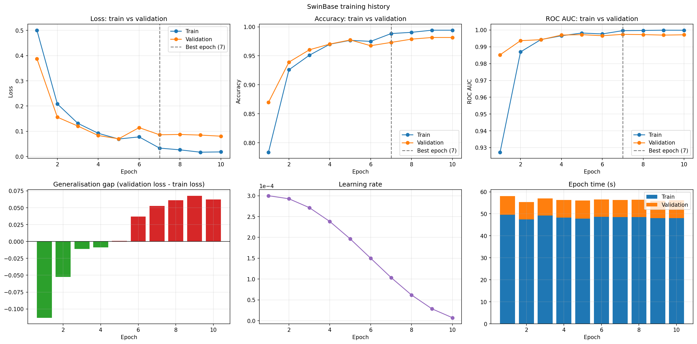
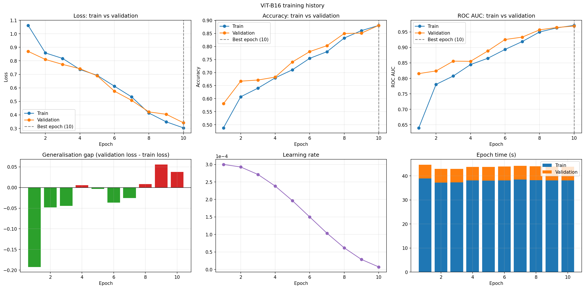

### Confusion matrices

SwinBase and ViT-B16:

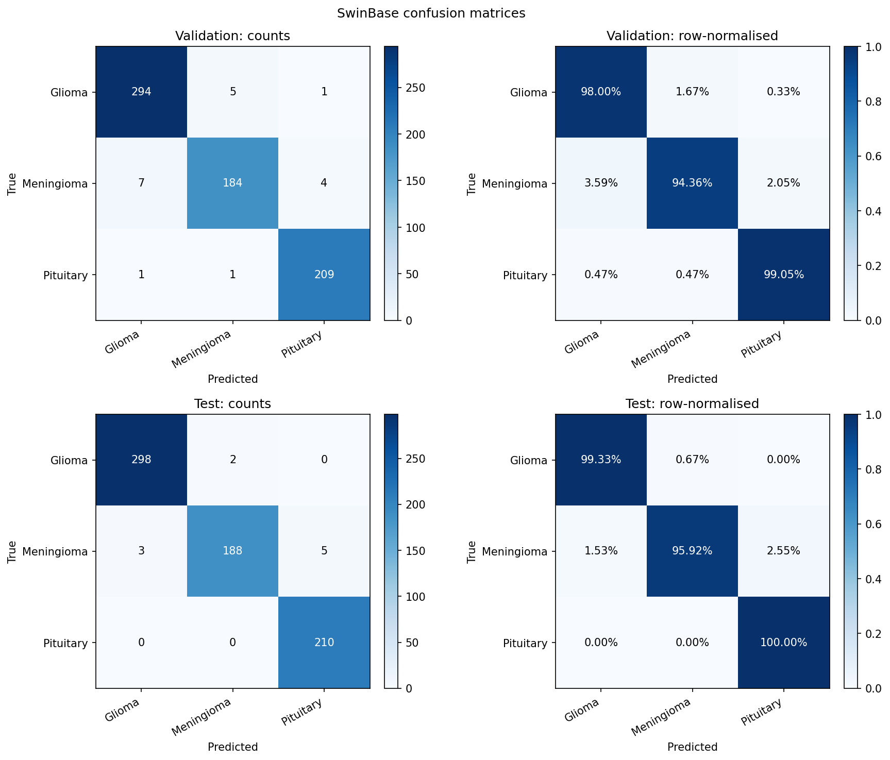
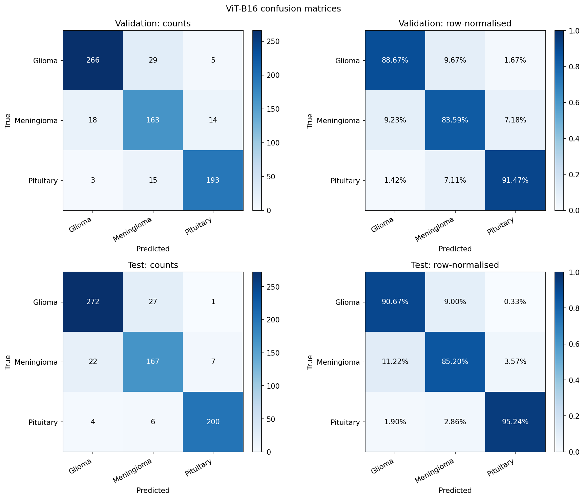

### One-vs-rest ROC and PR curves with micro-average

InceptionV3:

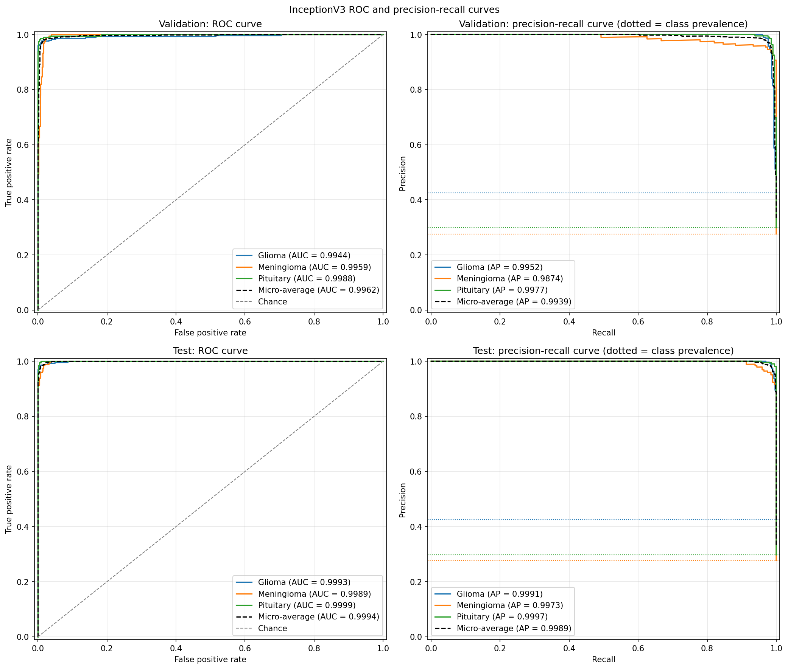

### Calibration and per-class metrics

CoAtNet-0:

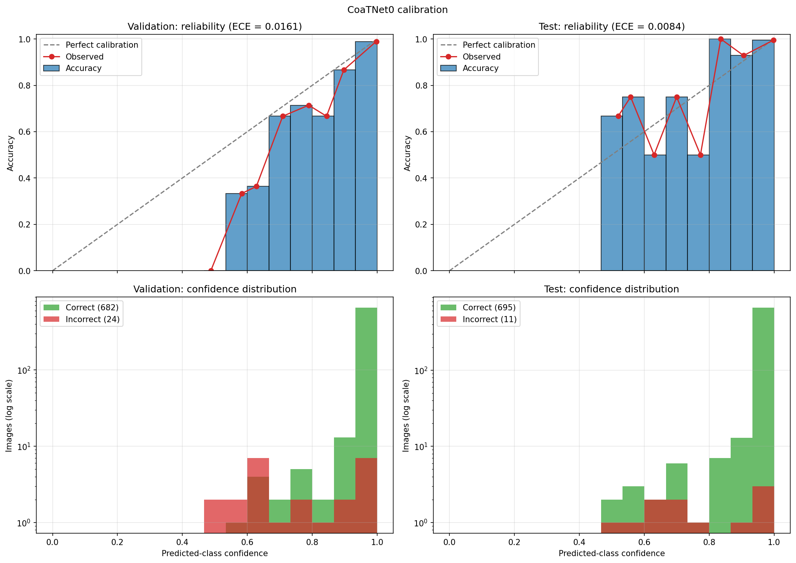
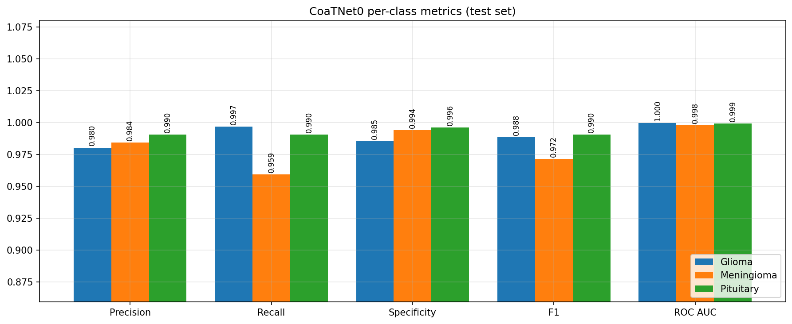

### Augmentation and prediction samples

EfficientNetB0 (augmentation) and ResNet50 (prediction samples):


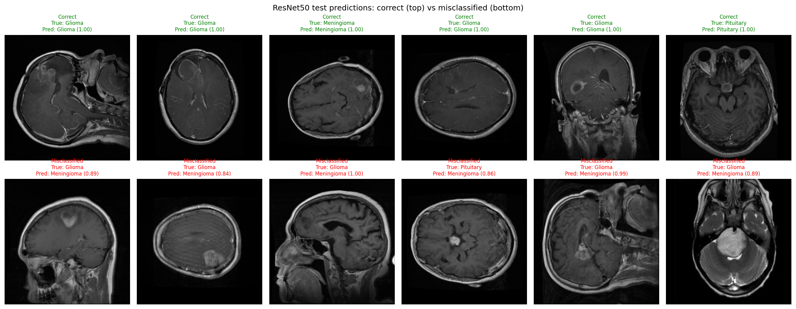

### Grad-CAM

SwinBase, correct and misclassified predictions:

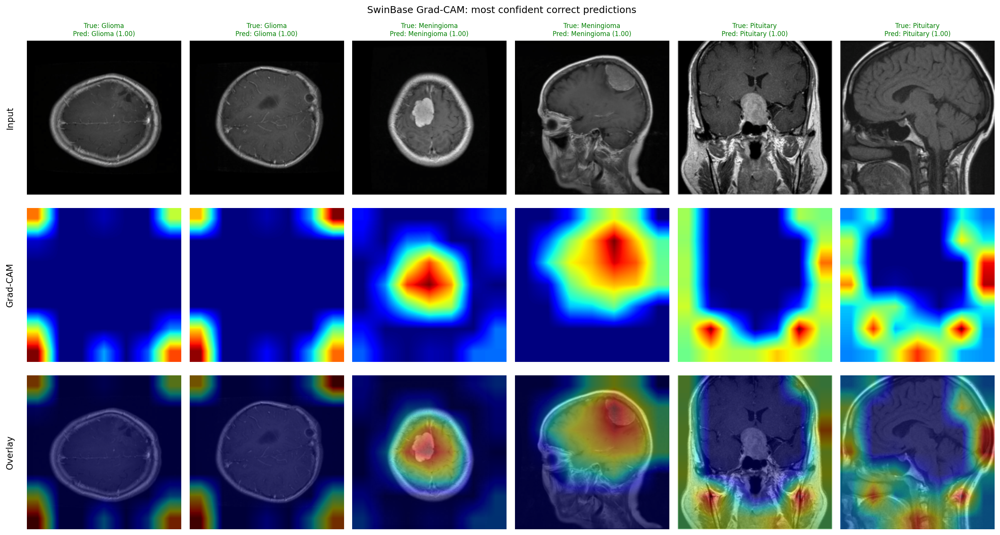
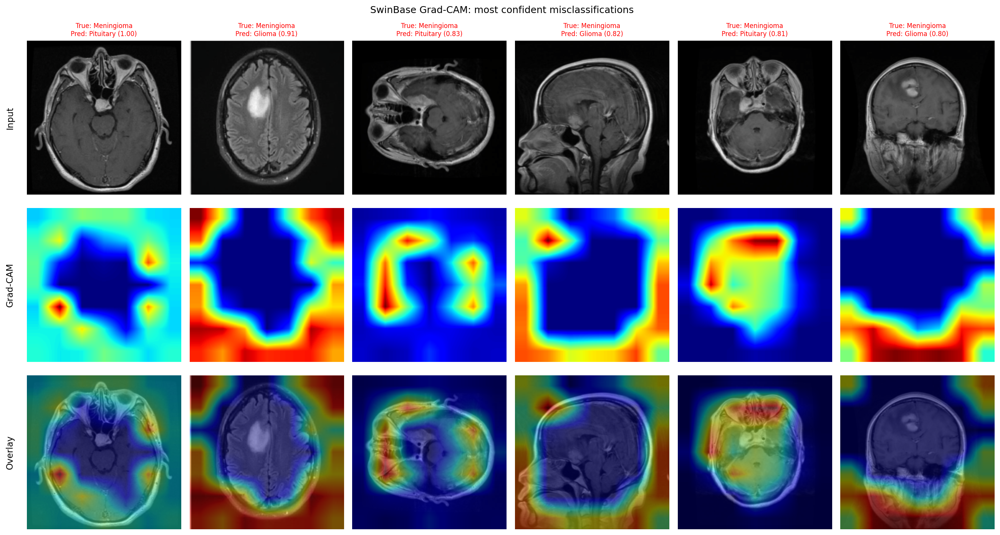

**What the SwinBase "most confident correct" panel shows:**

- For Meningioma, the heatmaps sit on the visible lesion.
- For Glioma and Pituitary, they mostly highlight image corners and borders outside the brain.
- This is a visual observation from one figure, not a measured result.
- It may point to background or acquisition cues that differ between sources or classes. That is plausible because the classes come from datasets with different image sizes and framing, but the notebooks do not test it.

For comparison, ResNet50 (a CNN):

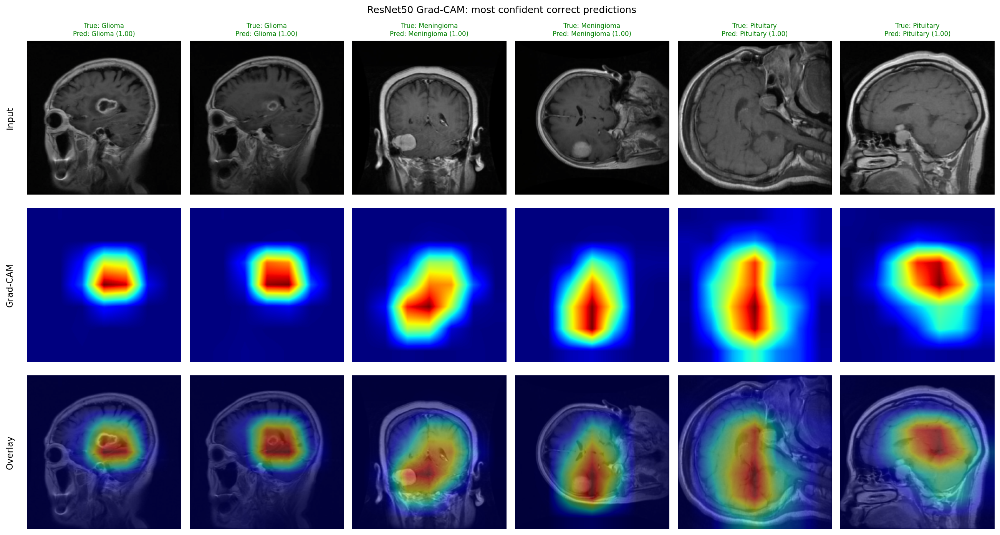

## Anomalies and limitations

The issues are grouped by how much they affect the reported results.

### A. Issues that affect results

**A1. Deduplication runs across classes and depends on order.**

- Glioma images always win ties, because they are processed first.
- Removals that cross labels are neither counted nor flagged, which could hide mislabelled duplicates.
- Details: [Deduplication](#deduplication).

**A2. The official sartajbhuvaji Testing split is merged into the training pool.** Results are not comparable with published numbers that use that split.

**A3. Batch sizes differ (32 to 256).**

- The learning rate and epoch count are the same for every model, so the optimisation budget is not controlled.
- ViT-B16's small batch size (32) has no stated reason.

**A4. SwinBase Grad-CAM focuses outside the brain for some classes** ([see above](#grad-cam)). The model may partly rely on cues that are not anatomical.

**A5. The test-cell accuracy for EfficientNetB0 disagrees with the metrics files.**

- The original test cell prints `Test Accuracy: 0.9773` (690/706).
- `metrics_test.json` and `benchmark_summary.json` report 0.9759 (689/706).
- The first number comes from the DataParallel model under fp16 autocast. The second comes from the single-GPU deep copy in cell 52.
- The likely cause is a near-tied prediction that flipped because of numerical differences. The notebook does not show which image.
- The other five runs agree between the two paths. This README uses the metrics files.

### B. Issues that affect interpretation

**B1. Every model scores higher on test than on validation.** The notebooks do not explain this. All runs use a single seed with no confidence intervals. With 706 test images, one error is 0.14 percentage points.

**B2. Checkpoints are selected on validation macro AUC.** That metric saturates near 0.997, so it barely distinguishes between late epochs that differ in accuracy.

**B3. The exploratory plots describe the data before deduplication.** Plots `01`–`03` and `image_dimension_stats.csv` cover 5,828 images, not the 4,705 used for training.

**B4. There is no "no tumour" class.** The model always outputs one of three tumour types, even for a healthy scan.

**B5. InceptionV3 keeps an unused auxiliary head.**

- Only `fc` is replaced. `AuxLogits.fc` still maps 768 inputs to the 1000 ImageNet classes.
- With `aux_logits=False` the head is never called, but its 769,000 parameters (768·1000 weights + 1000 biases) are still counted in the profile's 25.118 M total.
- The head is also stored in the checkpoint. Anyone loading the weights must build the model with the same unmodified auxiliary head.

**B6. The provenance of `Classification/EfficientNetB0.pth` is unknown.**

- It is 16,359,363 bytes, dated 1 Mar 2026.
- It matches the size of `classification-efficientnetb0/weights/final_efficientnet_b0_brain_tumor_multi_class.pth`, but the MD5 differs (`15162bc9…` vs `4ae7790e…`).
- No notebook here writes this file, so its performance is also unknown.

### C. Reproducibility and code hygiene (no effect on results)

**C1. Runs are only approximately reproducible:** `cudnn.benchmark`, TF32 and AMP allow non-deterministic kernels.

**C2. Kaggle paths are hard-coded.**

**C3. Evaluation in `run_epoch` does not use `torch.no_grad()`.**

## Folder layout

| Path                                  | Contents                                                                                                 |
| ------------------------------------- | -------------------------------------------------------------------------------------------------------- |
| `EfficientNetB0.pth`                  | Standalone weights, **not** produced by these notebooks (see [B6](#b-issues-that-affect-interpretation)) |
| `classification-<model>.ipynb`        | 6 notebooks, 75 cells each                                                                               |
| `classification-<model>/`             | Unzipped outputs of that notebook (subfolders below)                                                     |
| `classification-<model>/metrics/`     | 22 files (CSV, JSON, TXT), including `deduplication_summary.csv`                                         |
| `classification-<model>/plots/`       | 14 PNGs, numbered `01`–`14`, including `04_deduplication_before_after.png`                               |
| `classification-<model>/tensorboard/` | One run folder `<YYYYMMDD-HHMMSS>/` with the `events.out.tfevents.*` file                                |
| `classification-<model>/weights/`     | `best_<model>_multi_class.pth` and `final_<model>_brain_tumor_multi_class.pth`                           |

| Notebook                                                                   | Output folder                                                    | Weights                                                                                     |
| -------------------------------------------------------------------------- | ---------------------------------------------------------------- | ------------------------------------------------------------------------------------------- |
| [classification-coatnet0.ipynb](classification-coatnet0.ipynb)             | [classification-coatnet0/](classification-coatnet0/)             | `best_coatnet0_multi_class.pth`, `final_coatnet0_brain_tumor_multi_class.pth`               |
| [classification-efficientnetb0.ipynb](classification-efficientnetb0.ipynb) | [classification-efficientnetb0/](classification-efficientnetb0/) | `best_efficientnet_b0_multi_class.pth`, `final_efficientnet_b0_brain_tumor_multi_class.pth` |
| [classification-inceptionv3.ipynb](classification-inceptionv3.ipynb)       | [classification-inceptionv3/](classification-inceptionv3/)       | `best_inceptionv3_multi_class.pth`, `final_inceptionv3_brain_tumor_multi_class.pth`         |
| [classification-resnet50.ipynb](classification-resnet50.ipynb)             | [classification-resnet50/](classification-resnet50/)             | `best_resnet50_multi_class.pth`, `final_resnet50_brain_tumor_multi_class.pth`               |
| [classification-swinbase.ipynb](classification-swinbase.ipynb)             | [classification-swinbase/](classification-swinbase/)             | `best_swinbase_multi_class.pth`, `final_swinbase_brain_tumor_multi_class.pth`               |
| [classification-vit-b16.ipynb](classification-vit-b16.ipynb)               | [classification-vit-b16/](classification-vit-b16/)               | `best_vitb16_multi_class.pth`, `final_vitb16_brain_tumor_multi_class.pth`                   |

**`best_*` vs `final_*` weights.** The `final_*` files are written after the best checkpoint has been reloaded. Both therefore hold the **best-validation-AUC weights**, not the weights from the last epoch.

## End-to-end pipeline


| #   | Stage                       | What happens                                                                                                                                   | Key numbers                       |
| --- | --------------------------- | ---------------------------------------------------------------------------------------------------------------------------------------------- | --------------------------------- |
| 1   | Collect images              | `os.walk` over 3 tumour folders in each of 2 Kaggle datasets, `.jpg` only. The sartajbhuvaji Training and Testing folders are merged.          | 5828 images                       |
| 2   | Explore data                | Class distribution, sample images, image sizes, intensity histograms, run on the data **before** deduplication                                 | Plots `01`–`03`                   |
| 3   | Remove near-duplicates      | pHash every image, then greedily drop any image within Hamming distance 5 of an already-kept one                                               | 5828 → 4705 (plot `04`)           |
| 4   | Split                       | Stratified 70/15/15, seed 42                                                                                                                   | Train 3293, val 706, test 706     |
| 5   | Prepare inputs              | `BrainDataset` (long labels) with resize, flip, rotate, colour jitter and ImageNet normalisation                                               | 224 px (299 for InceptionV3)      |
| 6   | Build model                 | Pretrained backbone, head replaced with 3 output logits, DataParallel over 2 GPUs                                                              |                                   |
| 7   | Train                       | 10 epochs: AdamW 3e-4, cosine LR, `CrossEntropyLoss`, AMP fp16. Saves the epoch with the best macro OvR validation AUC.                        | `best_*_multi_class.pth`          |
| 8   | Test                        | Reloads the best checkpoint, evaluates the test set, saves the same weights again                                                              | `final_*_multi_class.pth`         |
| 9   | Evaluate                    | Single-GPU re-inference, then metrics, confusion matrices, per-class and micro-average ROC/PR, calibration, per-class bars, sample predictions | Plots `08`–`12`                   |
| 10  | Explain, benchmark, package | Grad-CAM, latency and throughput benchmark, `benchmark_summary`, zip of every output                                                           | Plots `13`–`14`; 39 files per zip |

## Dataset and deduplication

### Sources

The paths come from the data paths cell (cell 10). All are prefixed with `/kaggle/input/datasets/`.

| Label | Class      | Paths                                                                                                                                                                                                                            |
| ----- | ---------- | -------------------------------------------------------------------------------------------------------------------------------------------------------------------------------------------------------------------------------- |
| 0     | Glioma     | `sartajbhuvaji/brain-tumor-classification-mri/Testing/glioma_tumor`<br>`sartajbhuvaji/brain-tumor-classification-mri/Training/glioma_tumor`<br>`moundir8/jun-cheng-brain-tumor-mri-dataset-jpg/brain tumor mri dataset/2_glioma` |
| 1     | Meningioma | `…/Testing/meningioma_tumor`<br>`…/Training/meningioma_tumor`<br>`…/1_meningioma`                                                                                                                                                |
| 2     | Pituitary  | `…/Testing/pituitary_tumor`<br>`…/Training/pituitary_tumor`<br>`…/3_pituitary_tumor`                                                                                                                                             |

**Collection rules**

- Only `.jpg` files are collected (`VALID_EXTENSIONS = (".jpg",)`).
- The sartajbhuvaji `no_tumor` folders are not used.
- The sartajbhuvaji official `Training`/`Testing` split is **discarded**. Both halves go into one pool, which is then re-split.

### Class distribution before and after deduplication

**Source:** `metrics/deduplication_summary.csv`. The figures are identical in all six runs.

| Class      | Before   | Share | After    | Share | Removed  | Removed % |
| ---------- | -------- | ----- | -------- | ----- | -------- | --------- |
| Glioma     | 2352     | 40.4% | 2000     | 42.5% | 352      | 14.97     |
| Meningioma | 1645     | 28.2% | 1304     | 27.7% | 341      | 20.73     |
| Pituitary  | 1831     | 31.4% | 1401     | 29.8% | 430      | 23.48     |
| **Total**  | **5828** |       | **4705** |       | **1123** | **19.27** |


### Deduplication

**Algorithm (cell 18)**

1. Compute a 64-bit perceptual hash (pHash) of every image with `imagehash.phash` on the RGB image. Unreadable files get `None` and are dropped.
2. Walk the DataFrame in collection order: all Glioma paths, then Meningioma, then Pituitary.
3. Keep an image only if its Hamming distance to **every** previously kept hash is `> HAMMING_TOLERANCE = 5`. The code comment reads `0 = exact, higher = more lenient`.
4. Keep the surviving rows and drop the hash column.

**Implications**

- **About 19% of images were near-duplicates.**
  - The likely reason is overlap between the two sources. The sartajbhuvaji dataset is commonly described as partly derived from the Jun Cheng figshare data.
  - The notebook does **not** verify that overlap. It only reports per-class counts.
  - Either way, deduplicating **before** splitting stops the same scan from appearing in both train and test.
- **Comparison runs across classes, and the first image kept wins.** If a Meningioma or Pituitary image is within distance 5 of an already-kept Glioma image, the later one is silently removed. Label conflicts are not reported, so how many removals crossed classes is unknown.
- **The loop is O(n²) in Python**, about 11 million hash comparisons.
- **The exploratory cells run before deduplication.** Cells 14 and 16 (plots `01`–`03` and `image_dimension_stats.csv`) use `df_raw`, the 5,828-image set. The split and all training use the 4,705 deduplicated images.


### Image properties (before deduplication)

**Source:** `metrics/image_dimension_stats.csv`. Most images are 512x512, which matches the Jun Cheng data. The outliers come from sartajbhuvaji.

| Class      | Width: mean ± std (min–max) | Median | Height: mean ± std (min–max) | Median |
| ---------- | --------------------------- | ------ | ---------------------------- | ------ |
| Glioma     | 507.6 ± 33.0 (175–640)      | 512    | 508.4 ± 30.6 (167–665)       | 512    |
| Meningioma | 483.1 ± 90.4 (174–1275)     | 512    | 485.9 ± 85.1 (195–1427)      | 512    |
| Pituitary  | 512.5 ± 84.4 (201–1365)     | 512    | 512.2 ± 81.3 (202–1365)      | 512    |

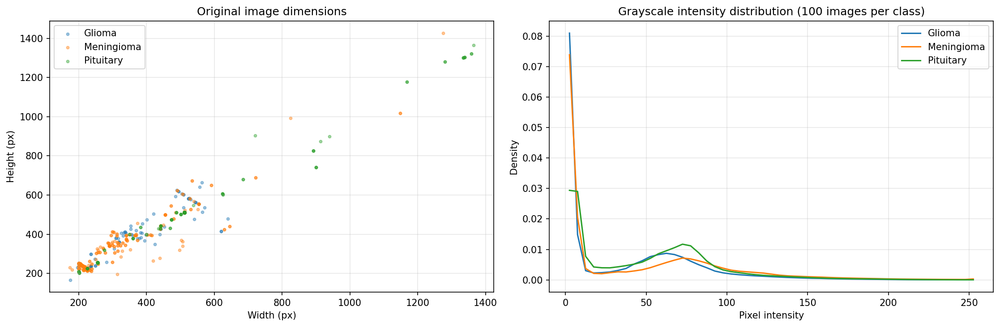

The sample and Grad-CAM panels mix axial, coronal and sagittal slices, mainly T1 contrast-enhanced scans.

### Split

The split is stratified 70/15/15 with `random_state=42`, applied to the deduplicated data. **Source:** `metrics/split_distribution.csv`.

|            | Train    | Validation | Test    |
| ---------- | -------- | ---------- | ------- |
| Glioma     | 1400     | 300        | 300     |
| Meningioma | 913      | 195        | 196     |
| Pituitary  | 980      | 211        | 210     |
| **Total**  | **3293** | **706**    | **706** |

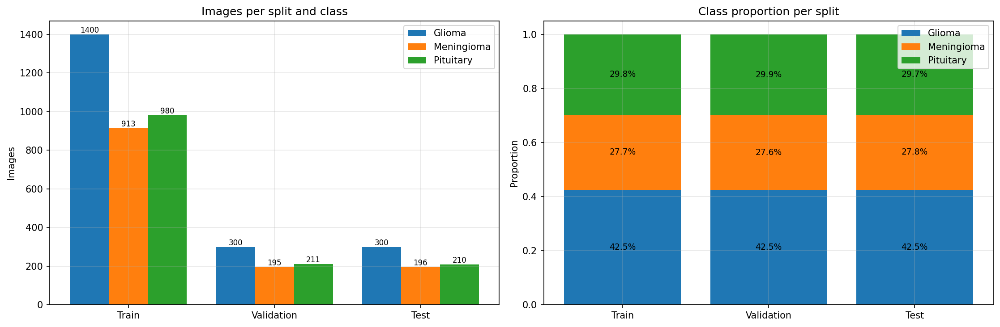

The classes are moderately imbalanced (Glioma 42.5%, Meningioma 27.7%). No class weighting is used.

## Shared configuration

### Optimisation

| Setting         | Value                                                                                  |
| --------------- | -------------------------------------------------------------------------------------- |
| Seed            | 42                                                                                     |
| Epochs / LR     | 10 / 3e-4                                                                              |
| Optimiser       | `AdamW` with default weight decay 0.01. All parameters are trainable.                  |
| Scheduler       | `CosineAnnealingLR(T_max=10)`, stepped once per epoch. LR goes from 3.0e-4 to 7.34e-6. |
| Loss            | `CrossEntropyLoss` on 3 logits. Labels are `torch.long`.                               |
| Precision       | AMP autocast, `GradScaler("cuda")`, TF32, `cudnn.benchmark=True`                       |
| Checkpoint rule | Save when `val_auc > best_auc`                                                         |

### Data loading and augmentation

| Setting            | Value                                                                                                                       |
| ------------------ | --------------------------------------------------------------------------------------------------------------------------- |
| Image size         | 224 (299 for InceptionV3)                                                                                                   |
| Batch size         | 256 by default. Some models override it, see [Per-notebook differences](#per-notebook-differences).                         |
| Loaders            | `num_workers=4`, `pin_memory`, `persistent_workers`, `prefetch_factor=4`. The train loader shuffles, with `drop_last=True`. |
| Train augmentation | `Resize` → `RandomHorizontalFlip` → `RandomRotation(10)` → `ColorJitter(0.2, 0.2)` → `ToTensor` → ImageNet `Normalize`      |
| Eval transform     | `Resize` → `ToTensor` → `Normalize`                                                                                         |

**Training batches per epoch after `drop_last`**

| Batch size | Batches | Images used |
| ---------- | ------- | ----------- |
| 256        | 12      | 3072        |
| 128        | 25      | 3200        |
| 64         | 51      | 3264        |
| 32         | 102     | 3264        |

### Per-epoch metrics and environment

| Setting        | Value                                                                                                                                  |
| -------------- | -------------------------------------------------------------------------------------------------------------------------------------- |
| Epoch accuracy | `argmax` of the softmax output                                                                                                         |
| Epoch AUC      | `roc_auc_score(np.eye(3)[labels], probs, multi_class="ovr")`. The one-hot target makes sklearn compute a macro-averaged per-class AUC. |
| Environment    | Python 3.12.13, torch 2.10.0+cu128, CUDA 12.8, 2x Tesla T4                                                                             |
| Extra packages | `imagehash` for all notebooks. `timm` for CoAtNet-0.                                                                                   |

## Per-notebook differences

EfficientNetB0 is the reference. Differences that are only comments, `# ===== … =====` banners or print wording are not listed.

### Architecture, batch size and Grad-CAM layer

| Notebook       | Backbone and head                                                                             | Batch   | Input   | Grad-CAM layer (resolved)                           |
| -------------- | --------------------------------------------------------------------------------------------- | ------- | ------- | --------------------------------------------------- |
| EfficientNetB0 | `torchvision.efficientnet_b0(DEFAULT)`<br>`classifier[1] → Linear(1280,3)`                    | 256     | 224     | `features[-1]` (Conv2dNormActivation)               |
| ResNet50       | `torchvision.resnet50(DEFAULT)`<br>`fc → Linear(2048,3)`                                      | 256     | 224     | `layer4[-1]` (Bottleneck)                           |
| InceptionV3    | `torchvision.inception_v3(DEFAULT)`<br>`fc → Linear(2048,3)`, then `model.aux_logits = False` | 128     | **299** | `Mixed_7c` (InceptionE)                             |
| CoAtNet-0      | `timm.create_model("coatnet_0_rw_224", pretrained=True)`<br>`reset_classifier(3)`             | **128** | 224     | `stages[-1]` (MaxxVitStage)                         |
| SwinBase       | **torchvision** `swin_b(Swin_B_Weights.DEFAULT)`<br>`head → Linear(1024,3)`                   | 64      | 224     | `features[-1][-1].norm1` (LayerNorm, channels-last) |
| ViT-B16        | `torchvision.vit_b_16(DEFAULT)`<br>`heads.head → Linear(768,3)`                               | **32**  | 224     | `encoder.layers[-1].ln_1` (LayerNorm, tokens)       |

### Other code deviations

- **EfficientNetB0:** the reference. It has an unused `models` import.
- **ResNet50:** unused `classification_report` import.
- **InceptionV3:**
  - **No auxiliary loss** is used during training.
  - `AuxLogits` is left as an unused 1000-class head ([B5](#b-issues-that-affect-interpretation)).
  - `import imagehash` sits in the imports cell instead of the deduplication cell.
- **CoAtNet-0:**
  - Needs `timm`.
  - Ran a day after the others (18 Sep vs 17 Sep 2026).
- **SwinBase:**
  - Uses the **torchvision** `swin_b` implementation and weights.
  - Prints two extra lines: `Model loaded successfully on cuda` and the parameter count.
  - Imports `swin_b` twice.
- **ViT-B16:** replaces only `heads.head`, the final linear layer inside the `heads` module.

### Why the notebooks differ

This section uses only evidence from the notebooks.

- **Image size 299 for InceptionV3.** This is the Inception default input size.
- **Head replacement.** Each architecture exposes its classifier under a different attribute, so this code must differ.
- **Grad-CAM layer.** The notebook-settings markdown documents each choice as the last spatial or token stage of that architecture.
- **Batch sizes.**
  - No notebook states a reason.
  - CoAtNet-0 uses 128 (peak 11.3 GB on GPU0).
  - ViT-B16 uses 32 (peak 3.9 GB, far below the GPU limit), so memory does not explain its small batch. The reason is **unknown**.
  - Because batch sizes range from 32 to 256, optimiser steps range from 120 to 1,020 over 10 epochs. The comparison is not controlled for optimisation budget.
- **No Inception auxiliary loss.**
  - No reason is given.
  - Setting `aux_logits=False` after construction makes torchvision return a plain tensor in train mode, so the shared `run_epoch`, which expects a single output, works unchanged.
- **timm for CoAtNet-0.** CoAtNet has no torchvision implementation.

## Cell-by-cell walkthrough

Every notebook has 75 cells in markdown/code pairs. Indices are 0-based.

- Code comments `# Cell 1` to `# Cell 14` mark the **original** training cells. Most models also use `# ===== SECTION =====` banners.
- Unnumbered code cells are the **added** observation, evaluation and benchmarking cells. The first markdown cell states that these added cells "only observe the run". Any randomness in them runs inside `preserved_rng_state()`, so they do not change the training outcome.

| Section                                 | Cells | Purpose                                                 |
| --------------------------------------- | ----- | ------------------------------------------------------- |
| 1. Setup                                | 0–8   | Imports, config, identity, helpers                      |
| 2. Data                                 | 9–32  | Collect, explore, **deduplicate**, split, load, augment |
| 3. Model and training                   | 33–46 | Build, profile, train, summarise                        |
| 4. Test, save, evaluate                 | 47–64 | Test, predictions, metrics and plots                    |
| 5. Explainability, benchmark, packaging | 65–74 | Grad-CAM, speed benchmark, summary, zip                 |

### 1. Setup (cells 0–8)

**Cell 0 (markdown).** Title, the 9-step pipeline, and the statement that the added cells only observe the run.

**Cell 2: imports.** Libraries for data handling, modelling, metrics and logging.

**Cell 4: config.** One place for all hyperparameters.

- `SEED`, `BATCH_SIZE`, `EPOCHS`, `LR`, `IMG_SIZE`, loader settings.
- `DEVICE`, seeding, cuDNN benchmark and TF32 flags.
- Prints `CUDA available: True` and `GPU count: 2`.

**Cell 6: identity.** The only per-notebook settings the shared cells need:

- `MODEL_NAME`, `TASK="classification"`, `CLASS_NAMES=["Glioma","Meningioma","Pituitary"]`, `RUN_NAME`
- `get_gradcam_target_layer(net)`

**Cell 8: output folders and helpers.**

- Creates `/kaggle/working/outputs/<RUN_NAME>/{plots,metrics}`.
- Saving: `save_fig`, `save_json`, `save_table`, `save_text`.
- Utilities: `unwrap_model` (strips the `DataParallel` wrapper), `denormalise`, `sync_cuda`.
- `preserved_rng_state()`: snapshots and restores the Python, NumPy, torch and CUDA RNG states.
- `NUM_CLASSES=3` makes `IS_BINARY=False`, which selects the multi-class branch in every later cell.

### 2. Data (cells 9–32)

| Cell | Content                                                                                                      | Output                                                             |
| ---- | ------------------------------------------------------------------------------------------------------------ | ------------------------------------------------------------------ |
| 10   | Data paths for each tumour class                                                                             |                                                                    |
| 12   | `collect(paths, label)` walks the folders and builds `df[path,label]`                                        | `Total Images before deduplication: 5828` (G 2352, M 1645, P 1831) |
| 14   | Copies `df` to `df_raw`. Class bar chart and 6 random samples per class (`random_state=SEED`).               | `01`, `02`                                                         |
| 16   | Reads every image size. Grayscale intensity histograms from 100 sampled images per class (51 bins, density). | `03`, `image_dimension_stats.csv`                                  |
| 18   | **pHash deduplication** ([details](#deduplication))                                                          | `Total Images after deduplication: 4705`                           |
| 20   | Before/after class counts on shared axes, and a summary table                                                | `04_deduplication_before_after.png`, `deduplication_summary.csv`   |
| 22   | Stratified 70/15/15 split                                                                                    | `Train: 3293 Val: 706 Test: 706`                                   |
| 24   | Per-split class counts (grouped bars) and proportions (stacked bars)                                         | `05`, `split_distribution.csv`                                     |
| 26   | `BrainDataset` (details below)                                                                               |                                                                    |
| 28   | Training augmentation and evaluation transforms                                                              |                                                                    |
| 30   | Train, validation and test `DataLoader`s                                                                     |                                                                    |
| 32   | For 2 train images per class, the eval transform (top) and one random train augmentation (bottom)            | `06`                                                               |

`BrainDataset` (cell 26):

- opens the image
- converts it to RGB, so grayscale MRIs are replicated to 3 channels to match ImageNet backbones
- applies the transform
- returns `(img, torch.long label)`

### 3. Model and training (cells 33–46)

**Cell 34: model build.** Pretrained backbone with a 3-output head, `DataParallel`, `CrossEntropyLoss`, AdamW, cosine schedule and `GradScaler`.

**Cell 36: model profile.** Saved as `model_profile.json`.

- Total and trainable parameters (always all trainable) and buffer count.
- Serialised `state_dict` size, measured via `BytesIO`.
- FLOPs for one `1x3xSxS` input, using `torch.utils.flop_counter.FlopCounterMode` on a CPU deep copy.

**Cell 38: `run_epoch(loader, training)`.**

- Autocast forward pass: `outputs = model(images)`, loss `CrossEntropyLoss(outputs, labels)`.
- While training: scaled backward pass and optimiser step.
- Collects `softmax(dim=1)` probabilities. Returns mean batch loss, argmax accuracy and one-vs-rest AUC.
- The eval pass does **not** use `torch.no_grad()`. It simply skips the optimiser step.

**Cell 40: training tracker.** Lets the original training cell stay unchanged.

- Rebinds `run_epoch` to a wrapper that identifies the phase (train, val or test) by which loader it receives.
- Times each phase with CUDA syncs, records LR, loss, accuracy, AUC and timings per epoch, and drives an epoch-level progress bar.
- Resets GPU peak-memory stats. A `_tracks_history` flag prevents double wrapping if the cell is re-run.

**Cell 42: training loop.**

- 10 epochs of train → val → `scheduler.step()`.
- TensorBoard scalars `Loss/Train`, `Loss/Val`, `AUC/Train`, `AUC/Val`.
- Saves a checkpoint when validation AUC improves, using `model.module.state_dict()` with more than one GPU.

**Cell 44: training summary.** Saved as `training_history.csv` and `training_summary.json`:

- per-epoch history
- best epoch (the first maximum, matching the `>` checkpoint rule)
- total and mean times, and time to best epoch
- train images/s and peak memory per GPU

**Cell 46: training curves** (`07_training_curves.png`):

- loss, accuracy and macro OvR AUC, train vs val, with the best epoch marked
- generalisation gap (val loss minus train loss)
- learning rate
- time per epoch

**Note:** training accuracy and AUC are measured on **augmented** batches in train mode. They are not directly comparable to the validation numbers.

### 4. Test, save, evaluate (cells 47–64)

**Cell 48: test.** Loads the best checkpoint into the (DataParallel) model, runs the test pass and prints `FINAL UNSEEN TEST RESULTS`.

**Cell 50: save.** Saves the reloaded best weights again as `final_*_multi_class.pth`.

**Cell 52: predictions.** Saved as `predictions_val.csv` and `predictions_test.csv`.

- Deep-copies the unwrapped model onto one GPU and re-runs val and test under autocast.
- Applies softmax, then renormalises in float64.
- Stores per image: path, true and predicted class, confidence, `prob_glioma`, `prob_meningioma`, `prob_pituitary`, correctness.

**Cell 54: metrics.**

- **Core:** accuracy, balanced accuracy, error rate, precision/recall/F1 (macro, weighted, micro), MCC, Cohen's κ, macro Jaccard, log loss, Brier score, 15-bin ECE, mean confidence.
- **Multi-class:** `roc_auc_ovr_macro`, `roc_auc_ovr_weighted`, `roc_auc_ovo_macro`, `pr_auc_macro`, `pr_auc_micro`, `specificity_macro`, `top_2_accuracy`.
- **Also:** per-class one-vs-rest metrics and the sklearn classification report (4 digits).
- **Artefacts:** `metrics_{val,test}.json`, `per_class_metrics_{val,test}.csv`, `classification_report_{val,test}.txt`, `metrics_summary.csv`.

| Cell | Content                                                                                                    | Artefacts                               |
| ---- | ---------------------------------------------------------------------------------------------------------- | --------------------------------------- |
| 56   | 3x3 confusion matrices, counts and row-normalised, validation (top) and test (bottom)                      | `confusion_matrix_{val,test}.csv`, `08` |
| 58   | One-vs-rest ROC and PR per class, plus the **micro-average** curve                                         | `09`                                    |
| 60   | Reliability diagram (15 bins of max-softmax confidence) and confidence histograms for correct vs incorrect | `calibration_bins_{val,test}.csv`, `10` |
| 62   | Per-class precision, recall, specificity, F1 and AUC on test                                               | `11`                                    |
| 64   | 6 random correct and 6 random misclassified test images (seeded)                                           | `12`                                    |

### 5. Explainability, benchmark, packaging (cells 65–74)

**Cell 66: generic `GradCAM` class.**

- A forward hook captures activations and a tensor hook captures gradients on the target layer.
- `to_nchw` converts other layouts to `(B,C,H,W)`:
  - transformer tokens `(B,T,C)`, dropping a class token when T is not a perfect square
  - channels-last maps `(B,H,W,C)`
- The score is the logit of the predicted class.
- The CAM is the ReLU of the gradient-mean-weighted activation sum, bilinearly upsampled and min-max normalised. It runs on a float32 deep copy.

**Cell 68: Grad-CAM figures.** Each shows input, heatmap and overlay.

- `13`: the 2 most confident correct predictions per class.
- `14`: the 6 most confident errors.
- Failures are caught in `gradcam_status`. Every run reports `ok`.

**Cell 70: inference benchmark** (`inference_benchmark.json`), synthetic input under fp16 autocast.

- Batch 1: 10 warm-up and 100 timed iterations (mean, median, p95, std).
- Batch 32: 3 warm-up and 20 timed iterations (throughput).
- Also the end-to-end test-set time from cell 52 and the original test-cell time.

**Cell 72: benchmark summary.** Config, profile, training, inference, validation and test metrics and environment in one record (`benchmark_summary.json` and `.csv`). The headline set uses `test_roc_auc_ovr_macro`, `test_pr_auc_macro` and `test_top_2_accuracy`.

**Cell 74: packaging.** Zips the outputs, all weights and the TensorBoard run into `<RUN_NAME>-outputs.zip` (39 files). The run folders here are the unzipped archives.

## Reproducing a run

1. Create a Kaggle notebook with **GPU T4 x2**.
2. Attach `sartajbhuvaji/brain-tumor-classification-mri` and `moundir8/jun-cheng-brain-tumor-mri-dataset-jpg`, so that the paths in cell 10 resolve.
3. Install or check `imagehash`, plus `timm` for CoAtNet-0. The runs used Python 3.12.13, torch 2.10.0+cu128 and CUDA 12.8.
4. Run all cells in order.
   - The tracker (cell 40) must run before training (cell 42).
   - The pHash pass over 5,828 images and its O(n²) comparison finish before training starts.
5. Download `/kaggle/working/<RUN_NAME>-outputs.zip`. Unzipped, it matches the run folders here.

### Loading a trained model

```python
import torch, torch.nn as nn
from torchvision.models import swin_b
m = swin_b()
m.head = nn.Linear(m.head.in_features, 3)
m.load_state_dict(torch.load("classification-swinbase/weights/best_swinbase_multi_class.pth", map_location="cpu"))
m.eval()
# RGB → Resize((224,224)) → ToTensor → ImageNet Normalize; softmax over [Glioma, Meningioma, Pituitary]
```

**InceptionV3 needs extra steps:**

- build `inception_v3()` with the default 1000-class auxiliary head
- replace only `fc`, with `Linear(2048, 3)`
- load the checkpoint
- use a 299-px input

## Metric glossary

| Term                | Meaning                                                                                   |
| ------------------- | ----------------------------------------------------------------------------------------- |
| Balanced accuracy   | Mean of per-class recall                                                                  |
| Macro F1            | Unweighted mean of per-class F1                                                           |
| MCC                 | Matthews correlation coefficient (multi-class form). Ranges from −1 to 1.                 |
| Cohen's κ           | Agreement with the true labels, corrected for chance                                      |
| Top-2 accuracy      | Share of images where the true class is among the two highest-scoring predictions         |
| ROC AUC (OvR macro) | Each class scored against the rest, then averaged without weighting                       |
| OvO                 | One-vs-one: every pair of classes compared                                                |
| PR AUC              | Area under the precision-recall curve (average precision)                                 |
| Micro-average       | Pools all class/image decisions before computing the curve                                |
| Log loss            | Penalises confident wrong probabilities. Lower is better.                                 |
| Brier score         | Mean squared error of the predicted probability vector                                    |
| ECE                 | Expected calibration error: the weighted gap between confidence and accuracy over 15 bins |
