# NeuroScan AI Explained

This document explains the whole NeuroScan AI project from zero, for anyone preparing to present, demo or defend it in an interview or viva. Setup steps are in [README.md](README.md). Every number here comes from the repository's code, notebook outputs or docs.

## Contents

1. [The project in one minute](#1-the-project-in-one-minute)
2. [Background](#2-background)
3. [How it works, end to end](#3-how-it-works-end-to-end)
4. [Every part explained](#4-every-part-explained)
5. [Notebooks, cell by cell](#5-notebooks-cell-by-cell)
   - [Binary detection notebook](#51-binary-detection-notebook-binary-detectionipynb)
   - [Classification notebook](#52-classification-notebook-classificationipynb)
   - [Segmentation notebook](#53-segmentation-notebook-segmentationipynb)
6. [Decisions](#6-decisions)
7. [Results and quality](#7-results-and-quality)
8. [Running and demoing it](#8-running-and-demoing-it)
9. [What could come next](#9-what-could-come-next)
10. [Interview and pitch preparation](#10-interview-and-pitch-preparation)
11. [Glossary](#11-glossary)

## 1. The project in one minute

**Problem.** Doctors use MRI (magnetic resonance imaging) scans to find brain tumours. Reading them takes time, and measuring the tumour by hand is slow. Many published AI papers report near-perfect accuracy, but their numbers are hard to trust because the same or near-identical images often appear in both the training and the test data.

**What the project does.** NeuroScan AI has two halves:

- **A web application.** A user uploads the four MRI sequences of one patient. The server answers three questions: is there a tumour, what type is it (glioma, meningioma or pituitary), and where exactly is it in 3D. The browser shows the scan in a multi-planar viewer with the tumour outlined, plus volumes and a PDF report.
- **A research study.** Three Kaggle notebooks compare 9 image models for detection, the same 9 for classification, and 3 3D models plus ensembles for segmentation, under a strict, leakage-controlled protocol. Two research papers are written from those results.

**Headline results.**

- Detection: three models tie at 0.9942 test accuracy (170 of 171 images), and statistics show most models cannot be told apart.
- Classification: six models score 45 of 45, but the test set is too small and unbalanced to rank them.
- Segmentation: SegResNet alone reaches mean Dice 0.8717 on 56 internal BraTS 2020 patients and 0.7967 on 60 external BraTS-Africa patients. The proposed region-adaptive ensemble does not beat it (0.8530 and 0.7966), but disagreement between models flags bad segmentations with AUROC 0.99 internally and 0.87 externally.

The honest negative findings (ties, shortcut learning, no ensemble gain) are part of the contribution. No clinical validation exists, and outputs are research results rather than medical diagnoses.

## 2. Background

### MRI and its sequences

An MRI machine builds a 3D picture of the body using magnets and radio waves. The 3D picture is a **volume**: a stack of 2D **slices**, each made of pixels. A 3D pixel is a **voxel**. A BraTS volume is 240 x 240 x 155 voxels, each 1 mm on a side.

The same head can be imaged with different settings, called **sequences** or **modalities**. Each shows tissue differently:

| Sequence                | What stands out                                     | Used here for                         |
| ----------------------- | --------------------------------------------------- | ------------------------------------- |
| FLAIR                   | Swelling (oedema) around a tumour is bright         | Finding the whole tumour              |
| T1                      | Normal anatomy                                      | Context                               |
| T1CE (T1 with contrast) | Active tumour tissue that takes up the injected dye | Finding the core and enhancing tumour |
| T2                      | Fluid and swelling                                  | Context                               |

The project's sequence-drop test confirms this: removing FLAIR hurts whole-tumour Dice most, and removing T1CE hurts enhancing-tumour Dice most ([Section 7](#7-results-and-quality)).

### Brain tumour types

- **Glioma**: grows from glial (support) cells of the brain. BraTS splits gliomas into **HGG** (high grade, aggressive) and **LGG** (low grade, slower).
- **Meningioma**: grows from the membranes around the brain. Usually benign.
- **Pituitary tumour**: grows in the pituitary gland at the base of the brain.

### Tumour regions

BraTS labels three nested regions. Think of a fried egg on a plate of sauce: the sauce is swelling, the white is the core, the yolk is the active part.

- **WT (Whole Tumour)**: everything abnormal, including swelling.
- **TC (Tumour Core)**: the tumour without the swelling.
- **ET (Enhancing Tumour)**: the part that lights up with contrast.

They are nested: ET is inside TC, and TC is inside WT. The backend enforces this rule on its output.

### The three AI tasks

- **Detection** (binary classification): tumour or no tumour, from one 2D image.
- **Classification** (multiclass): which of three tumour types, from one 2D image.
- **Segmentation**: label every voxel of a 3D volume as WT, TC, ET or background.

### Deep learning basics

A **neural network** is a function with millions of adjustable numbers (**parameters** or **weights**). **Training** shows it many labelled examples and nudges the weights so its answers improve. A **CNN** (convolutional neural network) looks at small local patches and builds up to bigger patterns, like reading a page word by word. A **transformer** compares every part of the image with every other part through **attention**, like reading the whole page at once. A **hybrid** mixes both. **Transfer learning** starts from weights already trained on ImageNet (1.2 million everyday photos), so the model only needs to adapt, not learn vision from scratch.

### Data leakage

**Leakage** happens when the test set contains images that are the same as, or almost the same as, training images. The model then remembers instead of understands, and test accuracy looks better than it really is. Public brain MRI datasets are often merged from each other, so duplicates are common. Fighting leakage is the central idea of the 2D study.

## 3. How it works, end to end

### System diagram

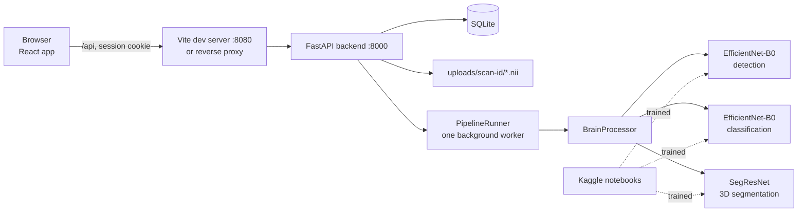

### One scan's journey

Take the sample case `BraTS20_Training_001` with four files: `..._flair.nii`, `..._t1.nii`, `..._t1ce.nii`, `..._t2.nii`.

1. **Upload.** On `/upload` the user drops the four files. The browser labels each file by name and sends them in one request to `POST /api/process-mri`, with the session cookie and the header `X-Requested-With: NeuroScan`.
2. **Checks.** The backend matches each file name to a modality (contains `FLAIR` -> flair, `T1CE` or `T1C` -> t1ce, `T2` -> t2, `T1` -> t1). It streams each file to `uploads/scan-<32 hex>/flair.nii` and so on, never using the client's file name as a path. It checks the NIfTI header: 3D or 4D, each side up to 1024, at most 32 Mi voxels, and size up to `MAX_UPLOAD_FILE_MB` (300 MB by default).
3. **Queue.** It creates a database row with status `queued` and answers `202 Accepted` at once. The job goes to a single background worker. If 8 jobs (`MAX_PENDING_JOBS`) are already waiting, it answers `503`.
4. **Detection.** The worker takes the middle axial slice of FLAIR, scales it to 0-255, makes it 3-channel, crops the brain (Gaussian blur 5 x 5, threshold 45, box around the largest contour), resizes to 224 x 224 and runs EfficientNet-B0. If `sigmoid(output) > 0.5`, a tumour is present.
5. **Classification.** A second EfficientNet-B0 runs on the same slice and picks the most likely of glioma, meningioma, pituitary (softmax argmax). If detection said "no tumour", the result is `No Tumour Detected`.
6. **Segmentation.** Because all four sequences are present, the worker crops the 3D volumes to the brain, normalises each sequence (z-score over non-zero voxels), and runs SegResNet over 128 x 128 x 128 windows with half overlap. It thresholds each channel at 0.5, removes an ET smaller than 800 voxels, enforces ET inside TC inside WT, and saves `segmentation.nii`.
7. **Volumes.** Voxel counts times voxel size give cubic centimetres. For this case the deployed model gives WT 197.4, TC 46.8, ET 29.0 cm^3 against reference values 212.0, 43.2 and 27.7 cm^3, in 83.5 s on an Intel Core i7-9750H CPU (`RESEARCH.md`).
8. **Display.** The scan page polls `GET /api/scans/{id}` and shows progress (`detection`, `classification`, `segmentation`, `complete`). When done, the viewer loads the volumes and the mask. The user can open a PDF report or download a CSV.

## 4. Every part explained

### 4.1 Repository layout

| Folder                       | Holds                                                                   |
| ---------------------------- | ----------------------------------------------------------------------- |
| `Backend/`                   | FastAPI application package `neuroscan/`, tests, pinned requirements    |
| `Frontend/`                  | React + TypeScript single-page app                                      |
| `Materials/Notebooks/`       | Three executed Kaggle notebooks and their downloaded outputs            |
| `Materials/Research Papers/` | Two LaTeX paper projects with submission variants                       |
| `Materials/` (root files)    | Review deck (24 slides), project report, templates, screenshots         |
| `scripts/`                   | `dev.mjs` (one-command launcher) and `build-papers.mjs` (paper builder) |
| `.github/`                   | CI workflow and Dependabot                                              |

### 4.2 Launcher (`scripts/dev.mjs`)

**What.** `npm run dev` sets up and starts everything. **How.** It creates `.venv` with Python 3.11, installs `Backend/requirements-dev.txt`, runs `npm ci`, writes a development `.env` with random `JWT_SECRET` and `DATA_ENCRYPTION_KEY`, starts Uvicorn on 127.0.0.1:8000 and Vite on 8080, and opens the browser. It skips reinstalling unless a requirements or lock file's SHA-256 changed. On Windows each service gets its own PowerShell window. **Why.** A new developer gets a running app with one command and no manual secret setup.

### 4.3 Backend (`Backend/neuroscan/`)

The backend is a **modular monolith**: one process, cleanly separated modules. Layers may only import downward: `app -> api -> scans -> inference`. This is enforced by `lint-imports`.

| Module                 | What it does                                                                                                             |
| ---------------------- | ------------------------------------------------------------------------------------------------------------------------ |
| `app.py`               | Builds the app: settings, database, storage, models, worker, middleware, routes. Re-queues unfinished scans at start-up. |
| `config.py`            | Reads settings from the environment and refuses to start with missing or example secrets.                                |
| `db.py`, `migrations/` | SQLite engine in WAL mode, with Alembic migrations applied at start-up.                                                  |
| `models.py`            | Two tables: `user` and `scan`.                                                                                           |
| `schemas.py`           | Request and response shapes, password rules.                                                                             |
| `api/`                 | Routes for auth, scans and health, with CSRF and security-header middleware. 23 routes in total.                         |
| `scans/`               | File storage, the background pipeline, CSV and PDF exports.                                                              |
| `inference/`           | Network definitions, NIfTI reading, `BrainProcessor`. No web or database code.                                           |
| `security/`            | bcrypt passwords, JWT tokens, TOTP, rate limiter. No web code.                                                           |
| `cli.py`               | Operator commands: `reset-password`, `unlock`, `disable-2fa`.                                                            |

**Authentication.** Passwords (12 to 72 bytes) are hashed with **bcrypt** at cost 12. A login sets an **HttpOnly**, **SameSite=Strict**, **Secure** cookie holding an HS256 **JWT** valid for 30 minutes. Each user has a token version. A logout or password change increases it, which invalidates every older token. Five wrong attempts lock the account for 15 minutes, and auth routes allow 10 requests per minute per client. Optional **TOTP** two-factor authentication uses 30-second codes, and the secret is encrypted at rest with **Fernet**.

**Ownership.** Scan routes return `404` both for missing scans and for other users' scans, so nobody can probe IDs.

**Reports.** `scans/exports.py` builds a paginated PDF (letterhead, patient details, impression, sequences, probabilities, volumes, key images with overlay, methodology, limitations, sign-off block) with reportlab, and CSV files whose cells starting with `=`, `+`, `-`, `@` are prefixed with `'` so spreadsheets do not run them as formulas.

**Observability.** Logs are JSON lines in production and coloured lines in development. Every error response carries a request ID that also appears in the log.

### 4.4 Inference (`Backend/neuroscan/inference/`)

- `networks.py` builds EfficientNet-B0 heads (1 output for detection, 3 for classification) with torchvision, and SegResNet with MONAI 1.6.1 `SegResNetDS`, the exact version used for training.
- `volumes.py` reads NIfTI files with nibabel.
- `processor.py` holds `BrainProcessor`, which runs the steps in [Section 3](#one-scans-journey).
- Weights are loaded with `torch.load(weights_only=True)`, so a weight file cannot run code.

The deployed SegResNet has 19,917,353 parameters, and each EfficientNet-B0 has about 4 million parameters.

### 4.5 Frontend (`Frontend/src/`)

React 19 with TypeScript, Vite, Tailwind CSS 4 and Radix UI primitives. **React Query** handles fetching, caching and polling of scans. Pages: login and register, dashboard, upload, scan library, scan detail, reports, settings, and a 404 page. Layers: `pages -> components -> hooks -> lib`, enforced by ESLint. `lib/api.ts` is the only place that calls the server.

The **viewer** shows linked axial, coronal and sagittal slices with the WT/TC/ET overlay, and a 3D volume rendering with vtk.js. Users can change overlay colours, window the image, measure and capture. The design system (palette, type, components) is in [DESIGN.md](DESIGN.md).

### 4.6 Detection and classification notebooks

Both notebooks run the same code structure with different data pools and task configurations.

**Data.**

| Notebook       | Sources                                 | Images | After deduplication | Test images                                |
| -------------- | --------------------------------------- | ------ | ------------------- | ------------------------------------------ |
| Detection      | Br35H (3,000), Chakrabarty (253)        | 3,253  | 1,185               | 171                                        |
| Classification | Bhuvaji (2,764), Cheng figshare (3,064) | 5,828  | 4,730               | 45 (1 glioma, 13 meningioma, 31 pituitary) |

**Pipeline summary.**

1. **Perceptual-hash deduplication.** Each image gets a 64-bit **pHash**, a fingerprint that stays similar when an image is resized or slightly changed. Two images of the same label whose hashes differ in at most 5 bits (**Hamming distance**) count as duplicates, and one is dropped. Pairs with different labels within that distance are compared with **NCC** (normalised cross-correlation). Near-identical contradictory pairs (8 pairs in classification) are true label noise and both copies are removed. Detection lost 63.57% of its images, while classification lost 18.84%.
2. **Group-aware split.** Images within Hamming 8 or NCC at least 0.98 are joined into groups, a stand-in for "same patient" because public datasets lack patient IDs. `StratifiedGroupKFold` makes a held-out test set and 5 folds so no group crosses a split. A leakage audit confirms 0 test images near any development image.
3. **Training.** 9 backbones: ResNet50, VGG16, DenseNet121, EfficientNetB0, MobileNetV3-Large, InceptionV3 (CNNs), ViT-B/16, Swin-Base (transformers), CoAtNet-0 (hybrid). Each runs 5 folds. Settings: AdamW, learning rate 3e-4, weight decay 0.01, 20 epochs, 1 warm-up epoch then cosine decay, effective batch 64, gradient clipping 1.0, mixed precision, light GPU augmentation (flip, 10 degree rotation, 20% brightness and contrast). The checkpoint with the lowest validation loss is kept. Every model gets the same number of optimiser steps, so the comparison is fair.
4. **Calibration.** **Temperature scaling** fits one number per run on validation data to make probabilities honest, and the threshold is tuned by Youden's J.
5. **Evaluation.** The 5 folds are averaged into a **fold ensemble** and scored on the test set with bootstrap 95% confidence intervals, **McNemar** tests between every pair with **Holm** correction, and a gap-to-leader interval.
6. **Interpretability and shortcut tests.** Grad-CAM, attention rollout and occlusion maps, the share of map energy outside the head, masking tests, and a **shortcut test** that retrains models on images with the head blacked out.
7. **Efficiency.** Latency, throughput, training time and memory on one T4.
8. **Export.** The EfficientNetB0 fold with the lowest validation loss is exported to `weights/deploy/EfficientNetB0.pth` with a reload check.

For the complete, cell-by-cell walkthrough of every line and output in these notebooks, see [Section 5.1](#51-binary-detection-notebook-binary-detectionipynb) and [Section 5.2](#52-classification-notebook-classificationipynb).

### 4.7 Segmentation notebook

**Data.** 369 BraTS 2020 cases (293 HGG, 76 LGG) split 257 train / 56 validation / 56 test by grade, plus 60 BraTS-Africa cases as an **external test** never used for training or selection. BraTS-Africa tumours are larger on average (mean WT 161.36 cm^3 against 96.44 for HGG).

**Preprocessing.** Crop each case to its brain box, z-score each sequence over non-zero voxels, cache at native 1 mm resolution as float16 (429 cases, 12.45 GB, 337 s).

**Members.**

| Model                   | Family      | Parameters (M) | Optimiser, LR | Epochs x 250 steps |
| ----------------------- | ----------- | -------------- | ------------- | ------------------ |
| nnU-Net (MONAI DynUNet) | CNN         | 31.42          | SGD, 1e-2     | 60                 |
| SegResNet (SegResNetDS) | CNN         | 19.92          | AdamW, 2e-4   | 60                 |
| Swin UNETR v2           | Transformer | 72.77          | AdamW, 1e-4   | 30                 |

Training uses 128^3 patches (33% centred on tumour), Dice + BCE loss with deep supervision, strong 3D augmentation, and one seed (42). Inference uses a Gaussian-weighted sliding window with 8-flip **TTA** (test-time augmentation).

**Region-adaptive hybrid ensemble.** For each region separately, a search on the 56 validation cases picks weights for the three members (0.1 grid) and a threshold:

| Region | nnU-Net | SegResNet | Swin UNETR | Threshold |
| ------ | ------- | --------- | ---------- | --------- |
| WT     | 0.4     | 0.6       | 0.0        | 0.4       |
| TC     | 0.4     | 0.5       | 0.1        | 0.3       |
| ET     | 0.5     | 0.5       | 0.0        | 0.4       |

The idea came from an earlier run where transformers were more sensitive and CNNs more precise. In the final run the search gave the transformer weight only for TC.

**Quality control.** Two warning signals per case: **architectural disagreement** (1 minus the mean pairwise Dice between members) and **TTA spread**.

**Explainability.** Seg-Grad-CAM maps with an enrichment score, and a sequence-drop ablation.

**Deployment.** The run exports no deployment file, so `segresnet_seed42.pth` was copied unchanged to `weights/deploy/SegResNet.pth`. The project owner chose SegResNet alone over the full ensemble because the ensemble needs 124.1 M parameters and 6.0 s per case on a T4 without TTA and is not better.

For the complete, cell-by-cell walkthrough of every line and output in this notebook, see [Section 5.3](#53-segmentation-notebook-segmentationipynb).

### 4.8 Papers, deck and report

- **Classification paper**: nine-backbone benchmark for detection and subtype classification with perceptual-hash deduplication, with a separate supplementary document cross-linked through `xr-hyper`.
- **Segmentation paper**: region-adaptive CNN-transformer ensembles with external validation and disagreement-based quality control.

Both use the Elsevier CAS single-column template targeting _Engineering Applications of Artificial Intelligence_. `npm run papers` builds each with Tectonic, plus `main-anonymised` (double-blind copy), `main-title-page` (separate title page) and `main-no-references` (Turnitin copy). The review deck (`Materials/Presentation.pptx`, 24 slides) and the report (`Materials/Report.docx`) are built from the VIT templates.

### 4.9 Testing, CI and code quality

- 64 backend tests (pytest) with a fake inference engine, so no weights are needed. `test_inference.py` also checks the SegResNet layout against the checkpoint's parameter count.
- 39 frontend tests (Vitest).
- ruff, strict mypy, import-linter (3 contracts), bandit, pip-audit, ESLint, strict TypeScript, Prettier, jscpd (0 clones), npm audit.
- CI on GitHub Actions runs all of these plus a gitleaks secret scan of the whole history. Dependabot keeps dependencies current.

### 4.10 History

The repository started on 2026-02-17 as a basic web app. Later work, from `git log` (135 commits):

- February to September 2026: frontend and backend refactors, removal of older viewer libraries, auth hardening with migrations, and a security review.
- October 2026: notebooks rebuilt around leakage control. Prettier and CI checks added. Papers, report and deck written. On 2026-10-22 the segmentation notebook was rebuilt as a hybrid ensemble with external validation, after the old best Dice (0.8199, UNet) was weaker than a published comparison. On 2026-10-25 the web app switched from an older 128^3 VNet to the new SegResNet. On 2026-10-26 submission variants of both papers were added.

## 5. Notebooks, cell by cell

This section provides a complete, cell-by-cell explanation of every notebook in the repository. Each entry details the cell's purpose, what every line or code block does and why, libraries called, parameters and values set, and every saved output (stream text, tables, and figures linking image files) with instructions on how to read it.

### 5.1 Binary detection notebook (`binary-detection.ipynb`)

The binary detection notebook (`Materials/Notebooks/binary-detection.ipynb`) investigates whether a 2D brain MRI slice contains a tumour or is tumour-negative. It evaluates nine diverse architectures under a unified protocol where optimisation budgets and splits are strictly controlled. The dataset combines 3,000 images from Br35H and 253 images from Chakrabarty, creating an initial pool of 3,253 candidate slices. The run executed on Kaggle with two Tesla T4 GPUs in 71.8 minutes of wall time.

#### Cell 0 (Markdown)

- **Purpose**: Define the notebook scope, problem statement, hardware, outputs, and the limitation table comparing this benchmark to earlier studies.
- **Explanation**: The cell introduces the binary classification task between tumour-positive and tumour-negative brain MRI slices across classical CNNs (ResNet50, VGG16, DenseNet121), efficient CNNs (EfficientNetB0, MobileNetV3-Large, InceptionV3), and transformer or hybrid architectures (ViT-B/16, Swin-Base, CoAtNet-0). It provides an exhaustive table detailing how this benchmark addresses historical flaws: perceptual-hash deduplication before splitting, group-aware cross-validation, identical effective batch sizes via gradient accumulation, rigorous temperature scaling, validation log-loss checkpoint selection, outside-head attention audits, model-agnostic occlusion sensitivity, and background-only shortcut retraining. It also specifies the input dataset sources (Chakrabarty and Br35H), the dual Tesla T4 GPU configuration, and output file directories.
- **Saved output**: Markdown text rendered inline in the notebook.

#### Cell 1 (Markdown)

- **Purpose**: Section header for Setup.
- **Explanation**: Establishes the setup section, which handles environment verification, package installations, hyperparameter configuration, hardware discovery, and module definitions.
- **Saved output**: Markdown text rendered inline in the notebook.

#### Cell 2 (Code)

- **Purpose**: Verify dependencies and install missing third-party packages.
- **Explanation**: Imports standard modules `importlib`, `os`, `sys`, and `subprocess`. It checks for the availability of `imagehash` and `timm` using `importlib.util.find_spec`. If absent, it installs them via `pip install --quiet imagehash timm`. It then imports `torch`, `torchvision`, `timm`, `numpy`, and `pandas`, and prints their versions.
- **Saved output**: Stream text:
  ```text
  torch 2.11.0+cu128 | torchvision 0.26.0+cu128 | timm 1.0.29 | numpy 2.1.3 | pandas 2.3.3
  ```
  This confirms execution on PyTorch 2.11 with CUDA 12.8, torchvision 0.26, and timm 1.0.29.

#### Cell 3 (Markdown)

- **Purpose**: Subheading for Configuration.
- **Explanation**: Introduces the configuration code block where global constants, hyperparameters, dataset mappings, and output paths are established.
- **Saved output**: Markdown text rendered inline in the notebook.

#### Cell 4 (Code)

- **Purpose**: Declare benchmark hyperparameters, filesystem paths, and dataset source mappings.
- **Explanation**: Sets `TASK = 'binary'` and defines classes `['Tumour-negative', 'Tumour']`. Specifies model candidates ResNet50, VGG16, DenseNet121, EfficientNetB0, MobileNetV3-Large, InceptionV3, ViT-B/16, Swin-Base, and CoAtNet-0. Sets training hyperparameters: random seed 42, deterministic mode False, 5 folds, test fraction 0.15, 20 epochs with 1 warmup epoch, effective batch size 64, AdamW learning rate 3e-4, weight decay 0.01, gradient clipping norm 1.0, and 320 px cache resolution. Configures deduplication tolerance 5 bits, group tolerance 8 bits, and duplicate threshold 0.98 normalised cross-correlation. Configures `SHORTCUT_TEST = True` and 2,000 bootstrap iterations. Sets up directory paths under `/kaggle/working/` (`metrics`, `weights`, `predictions`, `plots`, `logs`, `src`, `cache`, `claims`). Emits the initial status line.
- **Saved output**: Stream text:
  ```text
  [13:35:04] Task: binary | classes: ['Tumour-negative', 'Tumour'] | models: 9 | folds: 5
  ```

#### Cell 5 (Markdown)

- **Purpose**: Subheading for Hardware check.
- **Explanation**: Notes that the pipeline requires at least two CUDA-enabled GPUs to execute parallel worker processes.
- **Saved output**: Markdown text rendered inline in the notebook.

#### Cell 6 (Code)

- **Purpose**: Validate GPU and system hardware availability.
- **Explanation**: Uses `torch.cuda.device_count()` to verify CUDA availability. Asserts that the GPU count is at least 2. Queries each device's name and VRAM capacity with `torch.cuda.get_device_name` and `torch.cuda.get_device_properties`. Inspects CPU core count via `os.cpu_count()`, total and available RAM using `psutil.virtual_memory()`, and free disk space on `/kaggle/working/` with `shutil.disk_usage`.
- **Saved output**: Stream text:
  ```text
  [13:35:05] GPU 0: Tesla T4, 14.6 GB
  [13:35:05] GPU 1: Tesla T4, 14.6 GB
  [13:35:05] CPU cores: 4 | RAM 33.7 GB total, 31.4 GB available
  [13:35:05] Free disk in /kaggle/working: 20.9 GB
  ```

#### Cell 7 (Markdown)

- **Purpose**: Subheading for Shared library.
- **Explanation**: Introduces the cell that writes out `src/image_lib.py`, the core utility and model registry module shared by the notebook and worker processes.
- **Saved output**: Markdown text rendered inline in the notebook.

#### Cell 8 (Code)

- **Purpose**: Write `src/image_lib.py` defining model architectures, preprocessing, and metrics.
- **Explanation**: Uses the `%%writefile` magic to construct `/kaggle/working/src/image_lib.py`. Implements the model architecture registry (`MODEL_SPECS`), model instantiation (`build_model`) replacing final linear layers for binary or multiclass outputs, and feature extraction. Implements image utilities: `crop_to_brain` matching the web application's Gaussian blur (5x5, sigma 0), Otsu thresholding (threshold 45), largest contour extraction, and bounding box cropping. Implements perceptual hashing via `compute_phash` (64-bit DCT hash) and thumbnail creation (64x64). Implements dataset and DataLoader classes with on-the-fly GPU augmentation (horizontal flip p=0.5, random rotation +/-10 degrees, brightness/contrast jitter +/-20%). Implements post-processing: temperature scaling optimization via L-BFGS, threshold tuning via Youden's J statistic, classification metrics (accuracy, balanced accuracy, macro F1, sensitivity, specificity, ROC AUC, PR AUC, MCC, log-loss, Brier score, ECE), Grad-CAM computation, and occlusion map generation.
- **Saved output**: Stream text:
  ```text
  Writing /kaggle/working/src/image_lib.py
  ```

#### Cell 9 (Markdown)

- **Purpose**: Subheading for Training worker.
- **Explanation**: Introduces the standalone training worker module executed per GPU.
- **Saved output**: Markdown text rendered inline in the notebook.

#### Cell 10 (Code)

- **Purpose**: Write `src/image_worker.py` for isolated per-GPU job execution.
- **Explanation**: Uses `%%writefile` to write `/kaggle/working/src/image_worker.py`. Implements worker execution logic: parses arguments (`--config` path, `--gpu` device index), sets `CUDA_VISIBLE_DEVICES`, and reads the job configuration. Claims jobs atomically via directory locks in `claims/`. For each job, loads cached float16 tensors, constructs the model, sets up the AdamW optimiser and cosine decay learning rate schedule with 1 epoch linear warmup, applies mixed precision autocasting with `torch.cuda.amp.GradScaler`, accumulates gradients to an effective batch size of 64, clips gradients at norm 1.0, tracks validation loss per epoch, saves the best checkpoint based on validation log-loss, and exports validation and test logits to `.npz` archives.
- **Saved output**: Stream text:
  ```text
  Writing /kaggle/working/src/image_worker.py
  ```

#### Cell 11 (Markdown)

- **Purpose**: Subheading for Worker launcher and monitor.
- **Explanation**: Introduces `src/shared_lib.py`, which provides worker process supervision and communication.
- **Saved output**: Markdown text rendered inline in the notebook.

#### Cell 12 (Code)

- **Purpose**: Write `src/shared_lib.py` containing worker management and statistical routines.
- **Explanation**: Uses `%%writefile` to create `/kaggle/working/src/shared_lib.py`. Defines `launch_workers` using `subprocess.Popen` with separate logging streams. Defines `monitor_workers` which polls GPU status files (`status_gpu*.json`) and worker event logs (`events_gpu*.jsonl`), displaying nested `tqdm` progress bars for overall jobs and active GPU steps. Defines `Reporter` for structured JSON status emission, thread-safe JSON file utilities (`read_json`, `write_json`), and `holm` for Holm-Bonferroni family-wise error rate p-value adjustment.
- **Saved output**: Stream text:
  ```text
  Writing /kaggle/working/src/shared_lib.py
  ```

#### Cell 13 (Markdown)

- **Purpose**: Note on importing the newly written library into the notebook session.
- **Explanation**: Explains that importing from `src/` ensures the interactive notebook session shares identical function definitions and registries with background workers.
- **Saved output**: Markdown text rendered inline in the notebook.

#### Cell 14 (Code)

- **Purpose**: Import and reload the newly written modules.
- **Explanation**: Appends `src/` to `sys.path`, imports `image_lib` and `shared_lib`, forces reloading with `importlib.reload`, and asserts that all nine target models are registered in `lib.MODEL_SPECS`.
- **Saved output**: Stream text:
  ```text
  [13:35:05] Library loaded: 9 registered architectures
  ```

#### Cell 15 (Markdown)

- **Purpose**: Section header for Data.
- **Explanation**: Introduces the data ingestion, validation, decoding, cropping, and caching phase.
- **Saved output**: Markdown text rendered inline in the notebook.

#### Cell 16 (Code)

- **Purpose**: Discover attached datasets and assemble image file inventory.
- **Explanation**: Implements `find_dataset_root` to locate directories across Kaggle's input filesystem structures. Uses `collect` to scan recursive file trees for image formats (`.jpg`, `.jpeg`, `.png`, `.bmp`, `.tif`, `.tiff`). Assembles file paths into a master DataFrame with columns for path, label, subset, and origin. Prints total pool counts and displays a cross-tabulation of dataset source against class name.
- **Saved output**: Stream text and table:
  ```text
  [13:35:11] Pool: 3253 images | external: 0
  ```
  Cross-tabulation table:
  | subset      | Tumour | Tumour-negative | All   |
  | ----------- | ------ | --------------- | ----- |
  | Br35H       | 1,500  | 1,500           | 3,000 |
  | Chakrabarty | 155    | 98              | 253   |
  | All         | 1,655  | 1,598           | 3,253 |

#### Cell 17 (Markdown)

- **Purpose**: Subheading for Decode, hash, crop and cache.
- **Explanation**: Explains parallel image processing across all CPU cores to compute native dimensions, 64-bit perceptual hashes, 64x64 thumbnails, and brain crops.
- **Saved output**: Markdown text rendered inline in the notebook.

#### Cell 18 (Code)

- **Purpose**: Preprocess images in parallel and write memory-mapped arrays.
- **Explanation**: Initializes NumPy memory-mapped files `cache/images.npy` (shape 3253x320x320x3, uint8) and `cache/masks.npy` (shape 3253x320x320, uint8). Uses `concurrent.futures.ProcessPoolExecutor` across 4 CPU cores to execute `lib.describe_image` on all files with chunk size 16. Extracts native widths, heights, crop fractions, 64-bit pHashes, and thumbnails. Flushes memory-mapped arrays and reports processing time and memory usage.
- **Saved output**: Progress bar and stream text:
  ```text
  [13:35:51] Cached 3253 images in 39s (1.33 GB), unreadable: 0
  ```
  Confirms zero corrupted or unreadable images.

#### Cell 19 (Markdown)

- **Purpose**: Subheading for Dataset overview.
- **Explanation**: Introduces the generation of provenance statistics and inspection figures.
- **Saved output**: Markdown text rendered inline in the notebook.

#### Cell 20 (Code)

- **Purpose**: Generate dataset provenance table and visualize image distributions.
- **Explanation**: Filters to valid pool images, computes image counts, distinct native sizes, modal size, modal share, and median crop fractions grouped by dataset source. Saves `metrics/provenance.csv`. Generates Plot 01 (`01_dataset_overview.png`) displaying images per source and class and a scatter plot of native image resolutions. Generates Plot 02 (`02_samples_crop_mask.png`) displaying sample images, their brain crops, and head masks.
- **Saved output**: Provenance table and saved plot logs:
  | Source      | Tumour | Tumour-negative | Total | Distinct sizes | Modal size | Modal share | Median crop fraction |
  | ----------- | ------ | --------------- | ----- | -------------- | ---------- | ----------- | -------------------- |
  | Br35H       | 1,500  | 1,500           | 3,000 | 291            | 225x225    | 0.109       | 0.787                |
  | Chakrabarty | 155    | 98              | 253   | 184            | 225x225    | 0.071       | 0.783                |
  | Total       | 1,655  | 1,598           | 3,253 |                |            |             |                      |
  ```text
  Saved plot 01_dataset_overview.png
  Saved plot 02_samples_crop_mask.png
  ```
  Figures:
  
  _Plot 01 shows the distribution of tumour and tumour-negative slices across Br35H and Chakrabarty, alongside the scatter of native image resolutions._
  
  _Plot 02 shows sample slices, the bounding-box brain crops that the models receive, and the binary head masks used in attention audits._

#### Cell 21 (Markdown)

- **Purpose**: Section header for Deduplication.
- **Explanation**: Explains the rationale for label-aware perceptual-hash deduplication before data partitioning, preventing memorisation caused by identical or near-identical slices.
- **Saved output**: Markdown text rendered inline in the notebook.

#### Cell 22 (Code)

- **Purpose**: Execute label-aware perceptual-hash deduplication.
- **Explanation**: Computes pairwise Hamming distances between 64-bit pHashes within each class. If distance is at most 5 bits, the duplicate is marked for removal, keeping the first occurrence. For cross-label pairs within distance 5, it checks thumbnail normalised cross-correlation (NCC), pairs with NCC at least 0.98 are flagged as contradictory label noise and both copies are excluded. Saves `metrics/deduplication_summary.csv` and `metrics/deduplication_by_source.csv`.
- **Saved output**: Deduplication tables and log:
  | Class           | Before | Duplicates removed | Label noise excluded | After | Removed |
  | --------------- | ------ | ------------------ | -------------------- | ----- | ------- |
  | Tumour-negative | 1,598  | 1,143              | 0                    | 455   | 71.53%  |
  | Tumour          | 1,655  | 925                | 0                    | 730   | 55.89%  |
  | Total           | 3,253  | 2,068              | 0                    | 1,185 | 63.57%  |
  ```text
  Cross-label pairs within Hamming 5: 0 (0 label noise, 0 hash false positives)
  ```
  63.57% of candidate images were near-duplicates, leaving 1,185 unique images.

#### Cell 23 (Markdown)

- **Purpose**: Subheading for Threshold sensitivity.
- **Explanation**: Explains the sensitivity study over Hamming distance deduplication thresholds.
- **Saved output**: Markdown text rendered inline in the notebook.

#### Cell 24 (Code)

- **Purpose**: Perform sensitivity sweep across Hamming distance thresholds 0 to 12.
- **Explanation**: Iterates Hamming distance thresholds from 0 through 12, computing the number of images retained per class at each tolerance level. Saves `metrics/deduplication_threshold_sweep.csv`. Generates Plot 03 (`03_deduplication.png`) visualizing kept counts across tolerances and class distributions before and after deduplication.
- **Saved output**: Table and plot:
  | Tolerance       | 0, 1  | 2, 3  | 4, 5  | 6, 7  | 8, 9 | 10, 11 | 12  |
  | --------------- | ----- | ----- | ----- | ----- | ---- | ------ | --- |
  | Kept            | 2,077 | 1,495 | 1,185 | 1,002 | 882  | 804    | 709 |
  | Tumour-negative | 860   | 583   | 455   | 395   | 341  | 310    | 285 |
  | Tumour          | 1,217 | 912   | 730   | 607   | 541  | 494    | 424 |
  ```text
  Saved plot 03_deduplication.png
  ```
  Figure:
  
  _Plot 03 displays the pool size decay across Hamming distance tolerances and class counts before versus after tolerance-5 filtering._

#### Cell 25 (Markdown)

- **Purpose**: Subheading for Cross-label pairs.
- **Explanation**: Notes that any ambiguous cross-label duplicate pairs would be visually inspected.
- **Saved output**: Markdown text rendered inline in the notebook.

#### Cell 26 (Code)

- **Purpose**: Inspect cross-label near-duplicate image pairs.
- **Explanation**: Filters cross-label candidate pairs by descending NCC and plots top pairs if present. If no pairs fall within tolerance, prints confirmation.
- **Saved output**: Stream text:
  ```text
  [13:35:58] No cross-label pairs within the tolerance.
  ```

#### Cell 27 (Markdown)

- **Purpose**: Section header for Group-aware split and leakage audit.
- **Explanation**: Details how perceptual hash similarity links images into patient-proxy clusters, and how group-aware splitting prevents cross-partition leakage.
- **Saved output**: Markdown text rendered inline in the notebook.

#### Cell 28 (Code)

- **Purpose**: Partition images using `StratifiedGroupKFold` and audit for data leakage.
- **Explanation**: Builds connected graph components of kept images linked by Hamming distance at most 8 or thumbnail NCC at least 0.98, forming 821 similarity groups (a proxy for individual patient scans). Uses `StratifiedGroupKFold` to isolate 171 images (15%) as a held-out test set and split the remaining 1,014 images into 5 development folds, ensuring no group spans partitions. Audits test images against development images for leakage across Hamming distance 5, 8, and NCC 0.98. Saves `metrics/split_roles.csv`, `metrics/fold_distribution.csv`, `metrics/leakage_audit.csv`, `metrics/splits.csv`, and Plot 05 (`05_groups_and_leakage.png`).
- **Saved output**: Group summary, audit table, role tables, and plot:
  ```text
  [13:35:59] 1185 images in 821 groups, largest group 7 images, 260 groups with more than one image
  ```
  Audit table (`metrics/leakage_audit.csv`):
  | Criterion                                                                                                                                                 | Test images with a development neighbour |
  | --------------------------------------------------------------------------------------------------------------------------------------------------------- | ---------------------------------------- |
  | Hamming <= 5                                                                                                                                              | 0                                        |
  | Hamming <= 8                                                                                                                                              | 0                                        |
  | NCC >= 0.98                                                                                                                                               | 0                                        |
  | Roles table (`metrics/split_roles.csv`):                                                                                                                  |
  | Role                                                                                                                                                      | Tumour                                   | Tumour-negative | Total |
  | ---                                                                                                                                                       | ---                                      | ---             | ---   |
  | Development (5 folds)                                                                                                                                     | 623                                      | 391             | 1,014 |
  | Test                                                                                                                                                      | 107                                      | 64              | 171   |
  | Removed duplicate                                                                                                                                         | 925                                      | 1,143           | 2,068 |
  | Total                                                                                                                                                     | 1,655                                    | 1,598           | 3,253 |
  | Fold distribution (`metrics/fold_distribution.csv`):                                                                                                      |
  | Fold                                                                                                                                                      | 0                                        | 1               | 2     | 3   | 4   | All   |
  | ---                                                                                                                                                       | ---                                      | ---             | ---   | --- | --- | ---   |
  | Tumour                                                                                                                                                    | 110                                      | 123             | 133   | 133 | 124 | 623   |
  | Tumour-negative                                                                                                                                           | 74                                       | 88              | 74    | 77  | 78  | 391   |
  | All                                                                                                                                                       | 184                                      | 211             | 207   | 210 | 202 | 1,014 |
  | Figure:                                                                                                                                                   |
  |                                                         |
  | _Plot 05 illustrates similarity group sizes and the distribution of nearest distances from test images to the development pool, confirming zero leakage._ |

#### Cell 29 (Markdown)

- **Purpose**: Subheading for Augmentation preview.
- **Explanation**: Explains the preview of training augmentations and masked inputs used in shortcut evaluations.
- **Saved output**: Markdown text rendered inline in the notebook.

#### Cell 30 (Code)

- **Purpose**: Visualize training augmentations, head-only masks, and background-only masks.
- **Explanation**: Selects two development images per class, applies the GPU augmentation pipeline (horizontal flip, random rotation, brightness and contrast jitter), and constructs head-only and background-only versions using head masks. Saves Plot 06 (`06_augmentation.png`).
- **Saved output**: Stream text and figure:
  ```text
  Saved plot 06_augmentation.png
  ```
  
  _Plot 06 shows sample augmentations along with head-only and background-only versions used for shortcut diagnostics._

#### Cell 31 (Markdown)

- **Purpose**: Section header for Training.
- **Explanation**: Describes model profiling and the launch of two GPU worker processes.
- **Saved output**: Markdown text rendered inline in the notebook.

#### Cell 32 (Code)

- **Purpose**: Profile parameter counts and compute requirements for all nine backbones.
- **Explanation**: Instantiates all nine candidate architectures on CPU, downloads ImageNet pretrained weights, measures trainable parameter counts, and calculates theoretical GFLOPs at native resolution (224 or 299 px) and standard 224 px using `torchinfo` or FLOP counting routines. Saves `metrics/model_profiles.csv`.
- **Saved output**: Download progress streams and profile table:
  | Model             | Family        | Input | Parameters (M) | GFLOPs (native) | GFLOPs (224) |
  | ----------------- | ------------- | ----- | -------------- | --------------- | ------------ |
  | ResNet50          | Classical CNN | 224   | 23.510         | 8.174           | 8.174        |
  | VGG16             | Classical CNN | 224   | 134.265        | 30.932          | 30.932       |
  | DenseNet121       | Classical CNN | 224   | 6.955          | 5.666           | 5.666        |
  | EfficientNetB0    | Efficient CNN | 224   | 4.009          | 0.769           | 0.769        |
  | MobileNetV3-Large | Efficient CNN | 224   | 4.203          | 0.431           | 0.431        |
  | InceptionV3       | Efficient CNN | 299   | 21.788         | 11.422          | 5.672        |
  | ViT-B/16          | Transformer   | 224   | 85.799         | 22.541          | 22.541       |
  | Swin-Base         | Transformer   | 224   | 86.744         | 30.860          | 30.860       |
  | CoAtNet-0         | Hybrid        | 224   | 26.667         | 8.416           | 8.416        |

#### Cell 33 (Markdown)

- **Purpose**: Subheading for Launch the two GPU workers.
- **Explanation**: Explains job list construction, worker configuration generation, and live dual-GPU execution monitoring.
- **Saved output**: Markdown text rendered inline in the notebook.

#### Cell 34 (Code)

- **Purpose**: Launch and monitor parallel GPU workers across 54 training jobs.
- **Explanation**: Assembles 45 primary jobs (9 models x 5 folds in 'full' mode) and 9 shortcut diagnostic jobs (9 models x fold 0 in 'background' mode). Sorts jobs by descending computational cost (GFLOPs) for load balancing. Writes `metrics/worker_config.json`. Spawns two worker processes across GPU 0 and GPU 1 via `shared_lib.launch_workers`, monitoring live progress via `shared_lib.monitor_workers`. Every run executes exactly 260 optimiser steps (20 epochs x 13 steps of effective batch size 64). Swin-Base uses micro-batch 32 with 2 accumulation steps, all others use micro-batch 64 with 1 accumulation step.
- **Saved output**: Stream logs and progress tracking:
  ```text
  [13:36:27] 54 jobs, 0 already finished, launching 2 workers
  Training stage finished in 63.5 min, 54/54 jobs complete
  ```

#### Cell 35 (Markdown)

- **Purpose**: Section header for Results and per-run calibration.
- **Explanation**: Introduces the post-processing and evaluation phase, including temperature scaling and decision threshold optimization.
- **Saved output**: Markdown text rendered inline in the notebook.

#### Cell 36 (Code)

- **Purpose**: Fit temperature scaling and optimal thresholds on validation folds, then evaluate on test.
- **Explanation**: Iterates through all 54 completed runs. For each run, loads stored validation and test logits. Fits post-hoc temperature scaling parameter `T` on validation fold logits via L-BFGS to minimize negative log-likelihood. Selects the optimal binary classification threshold on calibrated validation probabilities using Youden's J statistic. Applies calibrated probabilities and tuned thresholds to evaluate held-out test predictions. Computes accuracy, balanced accuracy, macro F1, ROC AUC, ECE (calibrated and uncalibrated), log-loss, sensitivity, and specificity. Aggregates runs across the 5 development folds into mean and standard deviation per architecture. Saves `metrics/run_metrics.csv` and `metrics/fold_summary.csv`.
- **Saved output**: Fold summary table (`metrics/fold_summary.csv`, mean +/- sd across 5 folds):
  | Model | Accuracy | Balanced acc. | Macro F1 | ROC AUC | ECE | Sensitivity | Specificity |
  | --- | --- | --- | --- | --- | --- | --- |
  | InceptionV3 | 0.9789 +/- 0.0032 | 0.9775 +/- 0.0042 | 0.9775 +/- 0.0034 | 0.9966 +/- 0.0042 | 0.0195 +/- 0.0033 | 0.9832 +/- 0.0078 | 0.9719 +/- 0.0131 |
  | Swin-Base | 0.9778 +/- 0.0162 | 0.9785 +/- 0.0161 | 0.9764 +/- 0.0172 | 0.9974 +/- 0.0026 | 0.0182 +/- 0.0117 | 0.9757 +/- 0.0194 | 0.9812 +/- 0.0204 |
  | EfficientNetB0 | 0.9778 +/- 0.0049 | 0.9747 +/- 0.0053 | 0.9762 +/- 0.0052 | 0.9968 +/- 0.0034 | 0.0197 +/- 0.0045 | 0.9869 +/- 0.0051 | 0.9625 +/- 0.0086 |
  | CoAtNet-0 | 0.9754 +/- 0.0172 | 0.9760 +/- 0.0183 | 0.9739 +/- 0.0183 | 0.9966 +/- 0.0038 | 0.0216 +/- 0.0125 | 0.9738 +/- 0.0154 | 0.9781 +/- 0.0237 |
  | ViT-B/16 | 0.9754 +/- 0.0096 | 0.9722 +/- 0.0128 | 0.9737 +/- 0.0104 | 0.9970 +/- 0.0013 | 0.0175 +/- 0.0044 | 0.9850 +/- 0.0156 | 0.9594 +/- 0.0324 |
  | DenseNet121 | 0.9719 +/- 0.0076 | 0.9663 +/- 0.0077 | 0.9698 +/- 0.0082 | 0.9927 +/- 0.0048 | 0.0259 +/- 0.0048 | 0.9888 +/- 0.0078 | 0.9438 +/- 0.0086 |
  | ResNet50 | 0.9684 +/- 0.0135 | 0.9635 +/- 0.0166 | 0.9660 +/- 0.0146 | 0.9876 +/- 0.0105 | 0.0226 +/- 0.0060 | 0.9832 +/- 0.0078 | 0.9438 +/- 0.0305 |
  | MobileNetV3-Large | 0.9637 +/- 0.0220 | 0.9635 +/- 0.0188 | 0.9616 +/- 0.0230 | 0.9946 +/- 0.0033 | 0.0274 +/- 0.0084 | 0.9645 +/- 0.0320 | 0.9625 +/- 0.0086 |
  | VGG16 | 0.9591 +/- 0.0083 | 0.9585 +/- 0.0102 | 0.9565 +/- 0.0088 | 0.9943 +/- 0.0023 | 0.0335 +/- 0.0075 | 0.9607 +/- 0.0167 | 0.9562 +/- 0.0280 |

#### Cell 37 (Markdown)

- **Purpose**: Subheading for Training curves.
- **Explanation**: Notes that learning dynamics across epochs are visualized per architecture.
- **Saved output**: Markdown text rendered inline in the notebook.

#### Cell 38 (Code)

- **Purpose**: Plot fold-aggregated training loss, validation loss, validation accuracy, and learning rate.
- **Explanation**: Loads `history.csv` across all completed runs. For each model architecture, calculates mean and +/- 1 standard deviation bands across the 5 development folds. Generates a multi-panel grid plotting training vs validation loss, validation accuracy, and the cosine decay learning rate schedule over 20 epochs. Saves Plot 07 (`07_training_curves.png`).
- **Saved output**: Stream text and figure:
  ```text
  Saved plot 07_training_curves.png
  ```
  
  _Plot 07 shows smooth convergence across all backbones, with validation loss stabilizing by epoch 15 under cosine decay._

#### Cell 39 (Markdown)

- **Purpose**: Subheading for Fold-ensemble test results with bootstrap confidence intervals.
- **Explanation**: Explains that out-of-fold calibrated probabilities are averaged into a fold ensemble and evaluated on the 171 test images.
- **Saved output**: Markdown text rendered inline in the notebook.

#### Cell 40 (Code)

- **Purpose**: Evaluate fold-ensemble predictions and compute bootstrap 95% confidence intervals.
- **Explanation**: For each architecture, averages calibrated test probability predictions across the 5 folds. Performs 2,000 bootstrap iterations over the 171 test images to compute empirical 95% confidence intervals for test accuracy and macro F1. Computes balanced accuracy, Matthews Correlation Coefficient (MCC), ROC AUC, PR AUC, log-loss, Brier score, ECE, sensitivity, specificity, false negative count, and false positive count. Saves `metrics/test_leaderboard.csv` and `metrics/test_per_class.csv`.
- **Saved output**: Fold-ensemble test leaderboard table (`metrics/test_leaderboard.csv`):
  | Model | Accuracy (95% CI) | Balanced acc. | Macro F1 | MCC | ROC AUC | PR AUC | Log-loss | Brier | ECE | Sens. | Spec. | FN | FP |
  | --- | --- | --- | --- | --- | --- | --- | --- | --- | --- | --- | --- | --- |
  | CoAtNet-0 | 0.9942 [0.9825, 1.0000] | 0.9953 | 0.9938 | 0.9876 | 0.9994 | 0.9997 | 0.0412 | 0.0200 | 0.0275 | 0.9907 | 1.0000 | 1 | 0 |
  | EfficientNetB0 | 0.9942 [0.9825, 1.0000] | 0.9922 | 0.9937 | 0.9876 | 0.9991 | 0.9995 | 0.0420 | 0.0241 | 0.0243 | 1.0000 | 0.9844 | 0 | 1 |
  | ViT-B/16 | 0.9942 [0.9825, 1.0000] | 0.9922 | 0.9937 | 0.9876 | 0.9984 | 0.9990 | 0.0508 | 0.0215 | 0.0207 | 1.0000 | 0.9844 | 0 | 1 |
  | Swin-Base | 0.9883 [0.9708, 1.0000] | 0.9907 | 0.9876 | 0.9755 | 0.9997 | 0.9998 | 0.0348 | 0.0183 | 0.0152 | 0.9813 | 1.0000 | 2 | 0 |
  | InceptionV3 | 0.9825 [0.9591, 1.0000] | 0.9797 | 0.9812 | 0.9625 | 0.9991 | 0.9995 | 0.0407 | 0.0245 | 0.0228 | 0.9907 | 0.9688 | 1 | 2 |
  | ResNet50 | 0.9825 [0.9591, 1.0000] | 0.9828 | 0.9813 | 0.9627 | 0.9988 | 0.9993 | 0.0474 | 0.0276 | 0.0157 | 0.9813 | 0.9844 | 2 | 1 |
  | DenseNet121 | 0.9708 [0.9415, 0.9942] | 0.9641 | 0.9685 | 0.9376 | 0.9984 | 0.9991 | 0.0534 | 0.0346 | 0.0252 | 0.9907 | 0.9375 | 1 | 4 |
  | MobileNetV3-Large | 0.9708 [0.9415, 0.9942] | 0.9704 | 0.9689 | 0.9378 | 0.9978 | 0.9987 | 0.0714 | 0.0415 | 0.0326 | 0.9720 | 0.9688 | 3 | 2 |
  | VGG16 | 0.9708 [0.9415, 0.9942] | 0.9704 | 0.9689 | 0.9378 | 0.9974 | 0.9985 | 0.0724 | 0.0433 | 0.0296 | 0.9720 | 0.9688 | 3 | 2 |

#### Cell 41 (Markdown)

- **Purpose**: Subheading for Statistical comparison.
- **Explanation**: Introduces pairwise McNemar hypothesis testing and gap-to-leader estimation.
- **Saved output**: Markdown text rendered inline in the notebook.

#### Cell 42 (Code)

- **Purpose**: Compute exact pairwise McNemar tests with Holm correction and accuracy gaps.
- **Explanation**: Constructs 2x2 contingency tables of binary prediction concordance on the 171 test images for all 36 pairs of models. Runs exact two-sided binomial McNemar tests and applies Holm-Bonferroni correction. Computes bootstrap 95% confidence intervals for the paired accuracy gap between each architecture and the top performer (CoAtNet-0). Saves `metrics/mcnemar_holm_p.csv`, `metrics/gap_to_leader.csv`, and Plot 08 (`08_mcnemar.png`).
- **Saved output**: Statistical comparison tables and plot:
  - Gap to leader table (`metrics/gap_to_leader.csv`):
    | Model             | Leader    | Accuracy gap | Bootstrap 95% CI  | Separable |
    | ----------------- | --------- | ------------ | ----------------- | --------- |
    | CoAtNet-0         | CoAtNet-0 | 0.0000       | [0.0000, 0.0000]  | No        |
    | EfficientNetB0    | CoAtNet-0 | 0.0000       | [-0.0175, 0.0175] | No        |
    | ViT-B/16          | CoAtNet-0 | 0.0000       | [-0.0175, 0.0175] | No        |
    | Swin-Base         | CoAtNet-0 | 0.0058       | [-0.0117, 0.0234] | No        |
    | InceptionV3       | CoAtNet-0 | 0.0117       | [-0.0058, 0.0351] | No        |
    | ResNet50          | CoAtNet-0 | 0.0117       | [-0.0058, 0.0351] | No        |
    | DenseNet121       | CoAtNet-0 | 0.0234       | [-0.0058, 0.0468] | No        |
    | MobileNetV3-Large | CoAtNet-0 | 0.0234       | [0.0058, 0.0468]  | Yes       |
    | VGG16             | CoAtNet-0 | 0.0234       | [0.0058, 0.0468]  | Yes       |
  - All Holm-corrected McNemar p-values are 1.0 (`metrics/mcnemar_holm_p.csv`).
    Figure:
    
    _Plot 08 illustrates the matrix of Holm-corrected p-values, showing that no model pair achieves statistical significance._

#### Cell 43 (Markdown)

- **Purpose**: Subheading for Confusion matrices.
- **Explanation**: Notes that confusion matrices are plotted with count and normalized row percentages.
- **Saved output**: Markdown text rendered inline in the notebook.

#### Cell 44 (Code)

- **Purpose**: Plot test confusion matrices for all nine fold ensembles.
- **Explanation**: Computes confusion matrix counts for each model on the 171 test images. Formats each cell with raw count and class-conditional row percentage. Renders a 3x3 subplot grid. Saves Plot 09 (`09_confusion_matrices.png`).
- **Saved output**: Stream text and figure:
  ```text
  Saved plot 09_confusion_matrices.png
  ```
  
  _Plot 09 reveals error profiles: EfficientNetB0 and ViT-B/16 have 0 false negatives and 1 false positive, whereas CoAtNet-0 has 1 false negative and 0 false positives._

#### Cell 45 (Markdown)

- **Purpose**: Subheading for ROC and precision-recall curves.
- **Explanation**: Notes that ROC and PR curves are plotted for the positive tumour class.
- **Saved output**: Markdown text rendered inline in the notebook.

#### Cell 46 (Code)

- **Purpose**: Generate ROC and Precision-Recall curves across fold ensembles.
- **Explanation**: Computes true positive rates, false positive rates, precision, and recall across discrimination thresholds using `sklearn.metrics.roc_curve` and `precision_recall_curve`. Renders ROC and PR curves in two side-by-side subplots with corresponding AUC labels. Saves Plot 10 (`10_roc_pr_curves.png`).
- **Saved output**: Stream text and figure:
  ```text
  Saved plot 10_roc_pr_curves.png
  ```
  
  _Plot 10 demonstrates strong discrimination for all backbones, with ROC AUC between 0.9974 and 0.9997 and PR AUC between 0.9985 and 0.9998._

#### Cell 47 (Markdown)

- **Purpose**: Subheading for Calibration before and after temperature scaling.
- **Explanation**: Explains reliability diagrams and Expected Calibration Error (ECE) before and after temperature scaling.
- **Saved output**: Markdown text rendered inline in the notebook.

#### Cell 48 (Code)

- **Purpose**: Evaluate reliability diagrams and ECE before and after temperature scaling.
- **Explanation**: Bins predicted probabilities into 10 uniform intervals to measure accuracy versus average confidence. Computes ECE before and after temperature scaling across all models. Saves `metrics/calibration_ece.csv` and Plot 11 (`11_calibration.png`).
- **Saved output**: Calibration table and figure:
  | Model                                                                                                                                     | Temperature-scaled ECE | Uncalibrated ECE |
  | ----------------------------------------------------------------------------------------------------------------------------------------- | ---------------------- | ---------------- |
  | ResNet50                                                                                                                                  | 0.0157                 | 0.0173           |
  | Swin-Base                                                                                                                                 | 0.0152                 | 0.0148           |
  | ViT-B/16                                                                                                                                  | 0.0207                 | 0.0222           |
  | InceptionV3                                                                                                                               | 0.0228                 | 0.0151           |
  | EfficientNetB0                                                                                                                            | 0.0243                 | 0.0231           |
  | DenseNet121                                                                                                                               | 0.0252                 | 0.0233           |
  | CoAtNet-0                                                                                                                                 | 0.0275                 | 0.0207           |
  | VGG16                                                                                                                                     | 0.0296                 | 0.0179           |
  | MobileNetV3-Large                                                                                                                         | 0.0326                 | 0.0146           |
  | Figure:                                                                                                                                   |
  |                                                       |
  | _Plot 11 shows reliability diagrams, temperature scaling improved calibration for only two models due to temperature collapse on fold 4._ |

#### Cell 49 (Markdown)

- **Purpose**: Subheading for Accuracy against distance to the development pool.
- **Explanation**: Notes that test accuracy is broken down by distance to development neighbours to assess memorisation effects.
- **Saved output**: Markdown text rendered inline in the notebook.

#### Cell 50 (Code)

- **Purpose**: Measure test accuracy binned by Hamming distance to nearest development image.
- **Explanation**: Bins each test slice by its minimum Hamming distance to any slice in the development pool (distance intervals 9-12, 13-16, and 17-20). Calculates test accuracy per bin for each model. Saves `metrics/accuracy_by_nearest_dev_distance.csv` and Plot 12 (`12_accuracy_by_distance.png`).
- **Saved output**: Distance-stratified accuracy table and figure:
  | Model                                                                                                               | 9-12   | 13-16  | 17-20  |
  | ------------------------------------------------------------------------------------------------------------------- | ------ | ------ | ------ |
  | CoAtNet-0                                                                                                           | 0.9886 | 1.0000 | 1.0000 |
  | EfficientNetB0                                                                                                      | 1.0000 | 0.9863 | 1.0000 |
  | ViT-B/16                                                                                                            | 1.0000 | 0.9863 | 1.0000 |
  | Swin-Base                                                                                                           | 1.0000 | 0.9726 | 1.0000 |
  | InceptionV3                                                                                                         | 1.0000 | 0.9589 | 1.0000 |
  | ResNet50                                                                                                            | 0.9886 | 0.9726 | 1.0000 |
  | DenseNet121                                                                                                         | 0.9773 | 0.9589 | 1.0000 |
  | MobileNetV3-Large                                                                                                   | 0.9545 | 0.9863 | 1.0000 |
  | VGG16                                                                                                               | 0.9659 | 0.9726 | 1.0000 |
  | Figure:                                                                                                             |
  |               |
  | _Plot 12 confirms 1.0000 accuracy at distances 17-20 across all models, proving generalization to distant samples._ |

#### Cell 51 (Markdown)

- **Purpose**: Section header for Interpretability.
- **Explanation**: Introduces feature attribution methods: Grad-CAM, attention rollout, outside-head energy audits, and occlusion sensitivity.
- **Saved output**: Markdown text rendered inline in the notebook.

#### Cell 52 (Code)

- **Purpose**: Compute Grad-CAM, attention rollout, and quantify outside-head attribution energy.
- **Explanation**: Reloads the best validation fold checkpoint for each architecture. Computes Grad-CAM attribution maps across all 171 test images (using the final convolution layer in CNNs and norm/attention layers in transformers). Computes attention rollout across all multi-head self-attention blocks for ViT-B/16. Measures the fraction of total attribution energy residing outside the anatomical head mask (obtained via Otsu thresholding and morphological closing). Saves Plot 13 for each model (`13_gradcam_<model>.png`), `metrics/outside_head_energy.csv`, and Plot 14 (`14_outside_head_energy.png`).
- **Saved output**: Outside-head energy table and figures:
  | Model                                                                                                                                | Tumour-negative   | Tumour            |
  | ------------------------------------------------------------------------------------------------------------------------------------ | ----------------- | ----------------- |
  | ResNet50                                                                                                                             | 0.1215 +/- 0.2192 | 0.0787 +/- 0.2002 |
  | VGG16                                                                                                                                | 0.1526 +/- 0.2115 | 0.0737 +/- 0.1839 |
  | DenseNet121                                                                                                                          | 0.1897 +/- 0.2293 | 0.1764 +/- 0.1834 |
  | EfficientNetB0                                                                                                                       | 0.2868 +/- 0.2107 | 0.0720 +/- 0.1800 |
  | MobileNetV3-Large                                                                                                                    | 0.1424 +/- 0.2305 | 0.0820 +/- 0.1630 |
  | InceptionV3                                                                                                                          | 0.1458 +/- 0.2342 | 0.1474 +/- 0.1873 |
  | ViT-B/16 Grad-CAM                                                                                                                    | 0.4255 +/- 0.2375 | 0.2435 +/- 0.2643 |
  | ViT-B/16 rollout                                                                                                                     | 0.4211 +/- 0.1786 | 0.2850 +/- 0.1626 |
  | Swin-Base                                                                                                                            | 0.1586 +/- 0.2461 | 0.1845 +/- 0.1949 |
  | CoAtNet-0                                                                                                                            | 0.1391 +/- 0.2479 | 0.1882 +/- 0.2004 |
  | Uniform map baseline                                                                                                                 | 0.3558            | 0.3278            |
  | Figures:                                                                                                                             |
  |                                  |
  | _Plot 14 shows outside-head energy fractions, indicating that CNNs place only 7-8% of attention outside the skull on tumour slices._ |
  |                           |
  | _Sample Grad-CAM gallery for EfficientNetB0 illustrating accurate focal localization on the lesion area._                            |

#### Cell 53 (Markdown)

- **Purpose**: Subheading for Occlusion maps (model-agnostic).
- **Explanation**: Introduces model-agnostic occlusion sensitivity mapping.
- **Saved output**: Markdown text rendered inline in the notebook.

#### Cell 54 (Code)

- **Purpose**: Generate model-agnostic occlusion sensitivity maps.
- **Explanation**: Slides a 32x32 pixel zero-mask with stride 16 across 16 representative test images for all nine models. Measures the drop in target class probability as each patch is occluded, constructing spatial sensitivity heatmaps. Calculates the proportion of occlusion sensitivity outside the head mask. Saves `metrics/occlusion_outside_head.csv` and Plot 15 (`15_occlusion_maps.png`).
- **Saved output**: Occlusion outside-head table and figure:
  | Model                                                                                          | Outside-head share |
  | ---------------------------------------------------------------------------------------------- | ------------------ |
  | VGG16                                                                                          | 0.0072 +/- 0.0162  |
  | CoAtNet-0                                                                                      | 0.0888 +/- 0.1451  |
  | MobileNetV3-Large                                                                              | 0.1109 +/- 0.1700  |
  | ResNet50                                                                                       | 0.1161 +/- 0.1324  |
  | DenseNet121                                                                                    | 0.1347 +/- 0.1601  |
  | ViT-B/16                                                                                       | 0.1547 +/- 0.1597  |
  | InceptionV3                                                                                    | 0.1674 +/- 0.2052  |
  | Swin-Base                                                                                      | 0.1820 +/- 0.1539  |
  | EfficientNetB0                                                                                 | 0.1942 +/- 0.1974  |
  | Figure:                                                                                        |
  |      |
  | _Plot 15 shows occlusion sensitivity maps across all nine models for the same 16 test slices._ |

#### Cell 55 (Markdown)

- **Purpose**: Subheading for Masking test (inference only).
- **Explanation**: Introduces inference-only testing on anatomically masked images.
- **Saved output**: Markdown text rendered inline in the notebook.

#### Cell 56 (Code)

- **Purpose**: Evaluate models on head-only and background-only test images without retraining.
- **Explanation**: Evaluates frozen fold checkpoints on three input versions: unaltered full image, head-only (background pixels set to zero), and background-only (head interior set to zero). Saves `metrics/masking_test.csv` and Plot 16 (`16_masking_test.png`).
- **Saved output**: Masking test table and figure:
  | Model                                                                                                                          | Full image | Head only | Background only |
  | ------------------------------------------------------------------------------------------------------------------------------ | ---------- | --------- | --------------- |
  | CoAtNet-0                                                                                                                      | 0.9754     | 0.9637    | 0.4444          |
  | EfficientNetB0                                                                                                                 | 0.9778     | 0.9556    | 0.4982          |
  | Swin-Base                                                                                                                      | 0.9778     | 0.9684    | 0.5170          |
  | ViT-B/16                                                                                                                       | 0.9754     | 0.9567    | 0.4503          |
  | InceptionV3                                                                                                                    | 0.9789     | 0.9450    | 0.6573          |
  | DenseNet121                                                                                                                    | 0.9719     | 0.9439    | 0.5181          |
  | ResNet50                                                                                                                       | 0.9684     | 0.9602    | 0.4924          |
  | MobileNetV3-Large                                                                                                              | 0.9637     | 0.9368    | 0.5333          |
  | VGG16                                                                                                                          | 0.9591     | 0.9474    | 0.4994          |
  | Figure:                                                                                                                        |
  |                                          |
  | _Plot 16 shows that head-only accuracy stays near full-image accuracy, whereas background-only inference collapses to chance._ |

#### Cell 57 (Markdown)

- **Purpose**: Subheading for Shortcut test: retraining on background-only images.
- **Explanation**: Introduces the critical shortcut test where models are trained exclusively on background pixels.
- **Saved output**: Markdown text rendered inline in the notebook.

#### Cell 58 (Code)

- **Purpose**: Retrain models from scratch on background-only images and test against majority chance.
- **Explanation**: Evaluates the 9 models retrained on fold 0 where all brain voxels were masked to zero during training and testing. Computes background-only accuracy, ROC AUC, and one-sided exact binomial p-values testing whether background accuracy exceeds the majority class proportion (0.6257). Applies Holm correction. Saves `metrics/shortcut_test.csv` and Plot 17 (`17_shortcut_test.png`).
- **Saved output**: Shortcut test table and figure:
  | Model                                                                                                                                                 | Background-only accuracy | Background-only AUC | Holm p | Shortcut detected |
  | ----------------------------------------------------------------------------------------------------------------------------------------------------- | ------------------------ | ------------------- | ------ | ----------------- |
  | Swin-Base                                                                                                                                             | 0.8304                   | 0.8893              | 0.0000 | Yes               |
  | ResNet50                                                                                                                                              | 0.8129                   | 0.8657              | 0.0000 | Yes               |
  | DenseNet121                                                                                                                                           | 0.7953                   | 0.8578              | 0.0000 | Yes               |
  | InceptionV3                                                                                                                                           | 0.7953                   | 0.8606              | 0.0000 | Yes               |
  | CoAtNet-0                                                                                                                                             | 0.7953                   | 0.8756              | 0.0000 | Yes               |
  | EfficientNetB0                                                                                                                                        | 0.7778                   | 0.8584              | 0.0001 | Yes               |
  | VGG16                                                                                                                                                 | 0.7485                   | 0.8359              | 0.0013 | Yes               |
  | MobileNetV3-Large                                                                                                                                     | 0.6784                   | 0.7821              | 0.1772 | No                |
  | ViT-B/16                                                                                                                                              | 0.6550                   | 0.7411              | 0.2396 | No                |
  | Figure:                                                                                                                                               |
  |                                                               |
  | _Plot 17 shows that 7 of 9 models achieve statistically significant above-chance accuracy on background alone, revealing dataset shortcut artifacts._ |

#### Cell 59 (Markdown)

- **Purpose**: Section header for Efficiency.
- **Explanation**: Introduces latency, throughput, training time, and memory benchmarking.
- **Saved output**: Markdown text rendered inline in the notebook.

#### Cell 60 (Code)

- **Purpose**: Measure inference latency, batch throughput, training wall time, and peak memory.
- **Explanation**: Measures single-image inference latency across 100 timed passes (after 10 warmup passes) and batch-32 throughput across 20 passes (after 3 warmup passes) under fp16 autocast on one Tesla T4 GPU, repeated three times. Aggregates mean training time per fold and peak allocated VRAM. Saves `metrics/efficiency.csv` and Plot 18 (`18_accuracy_vs_latency.png`).
- **Saved output**: Efficiency benchmark table and figure:
  | Model | Latency (ms) | Throughput (img/s) | Train min/run | Peak train RAM (GB) | Accuracy | Acc. / M params |
  | --- | --- | --- | --- | --- | --- |
  | ResNet50 | 9.573 +/- 0.376 | 777.2 +/- 6.1 | 1.150 | 5.616 | 0.982 | 4.179 |
  | VGG16 | 7.722 +/- 0.422 | 386.5 +/- 4.8 | 2.173 | 9.876 | 0.971 | 0.723 |
  | DenseNet121 | 23.584 +/- 1.534 | 656.6 +/- 22.9 | 1.458 | 4.478 | 0.971 | 13.958 |
  | EfficientNetB0 | 13.129 +/- 0.550 | 1393.3 +/- 115.8 | 1.994 | 3.093 | 0.994 | 24.799 |
  | MobileNetV3-Large | 10.552 +/- 1.090 | 2301.1 +/- 292.9 | 1.488 | 2.088 | 0.971 | 23.095 |
  | InceptionV3 | 17.632 +/- 0.788 | 511.6 +/- 5.8 | 1.735 | 5.849 | 0.982 | 4.509 |
  | ViT-B/16 | 10.952 +/- 1.039 | 272.2 +/- 2.8 | 2.908 | 5.960 | 0.994 | 1.159 |
  | Swin-Base | 36.294 +/- 1.234 | 197.6 +/- 2.9 | 4.296 | 6.448 | 0.988 | 1.139 |
  | CoAtNet-0 | 16.533 +/- 1.065 | 513.1 +/- 6.9 | 2.281 | 11.386 | 0.994 | 3.728 |
  Figure:
  
  _Plot 18 depicts the Pareto frontier: EfficientNetB0 delivers top-tier accuracy (0.9942) with high throughput and low memory footprint._

#### Cell 61 (Markdown)

- **Purpose**: Subheading for External validation.
- **Explanation**: Notes the hook for attaching external collections.
- **Saved output**: Markdown text rendered inline in the notebook.

#### Cell 62 (Code)

- **Purpose**: Evaluate attached external datasets if present.
- **Explanation**: Checks whether `EXTERNAL_INDEX` contains images. Because no external dataset was configured for binary detection, reports status.
- **Saved output**: Stream text:
  ```text
  [14:46:54] No external evaluation: EXTERNAL_FOLDERS is empty or every external image duplicated the pool.
  ```

#### Cell 63 (Markdown)

- **Purpose**: Section header for Export and summary.
- **Explanation**: Details deployment model selection, checkpoint export, and compilation of the run summary.
- **Saved output**: Markdown text rendered inline in the notebook.

#### Cell 64 (Code)

- **Purpose**: Export the deployment checkpoint and verify reload integrity.
- **Explanation**: Selects the fold checkpoint of `DEPLOY_MODEL` (EfficientNetB0) having the lowest validation loss. Copies weights to `/kaggle/working/weights/deploy/EfficientNetB0.pth` (16.3 MB) and generates `metadata.json` with temperature, threshold, and architecture attributes. Reloads the exported checkpoint into a freshly initialized `EfficientNetB0` model and asserts that output logits match stored predictions.
- **Saved output**: Stream text:
  ```text
  [14:46:54] Exported /kaggle/working/weights/deploy/EfficientNetB0.pth (16.3 MB), reload check passed
  ```

#### Cell 65 (Markdown)

- **Purpose**: Subheading for Summary.
- **Explanation**: Introduces the compilation of run metrics and explicit limitations into structured records.
- **Saved output**: Markdown text rendered inline in the notebook.

#### Cell 66 (Code)

- **Purpose**: Assemble summary table and `metrics/run_summary.json`.
- **Explanation**: Merges leaderboard metrics, parameter counts, latency, and throughput into `metrics/summary_table.csv`. Compiles `metrics/run_summary.json` capturing pool counts, deduplication results, test sizes, leaderboard winner (CoAtNet-0), training wall time (63.5 min), notebook time (71.8 min), environment specifications, and recorded limitations.
- **Saved output**: Table display and stream log:
  ```text
  [14:46:55] Leader: CoAtNet-0, 54/54 jobs, notebook time 72 min
  ```

#### Cell 67 (Markdown)

- **Purpose**: Subheading for Package the outputs.
- **Explanation**: Explains the creation of a compressed ZIP archive containing all run artifacts.
- **Saved output**: Markdown text rendered inline in the notebook.

#### Cell 68 (Code)

- **Purpose**: Package all outputs into a downloadable ZIP archive.
- **Explanation**: Gathers all files in `/kaggle/working/` excluding transient caches (`cache/`, `tmp/`, `.cache/`). Compresses text, logs, CSVs, and JSONs using `zipfile.ZIP_DEFLATED`, while storing already compressed binaries (`.pth`, `.npz`, `.png`) with `zipfile.ZIP_STORED` to optimize speed and disk space. Generates `/kaggle/working/outputs.zip` and renders an interactive `FileLink`.
- **Saved output**: Stream text and file link:
  ```text
  Zipped 280 files (9.53 GB) into /kaggle/working/outputs.zip
  /kaggle/working/outputs.zip
  ```

#### How the binary detection notebook connects and what its results mean

The binary detection notebook operates as an interconnected experimental pipeline. It ingests 3,253 candidate slices, uncovers that 63.57% are duplicates, and isolates 1,185 unique slices. Group-aware partitioning clusters slices by perceptual hash into 821 similarity groups, preventing same-patient leakage between development and test sets. Two GPU workers train 54 jobs across 9 architectures under an identical 260-step budget.

On the test set, CoAtNet-0, EfficientNetB0, and ViT-B/16 tie at 0.9942 accuracy (170 of 171 correct). Pairwise exact McNemar tests yield Holm-corrected p-values of 1.0, showing that differences among the top models are statistically indistinguishable. EfficientNetB0 provides the best trade-off for deployment, requiring only 4.0 million parameters and 13.1 ms latency while tying the top accuracy. Crucially, retraining on background-only images shows that 7 of 9 models achieve significant above-chance accuracy, proving that public 2D slice benchmarks carry background dataset artifacts.

### 5.2 Classification notebook (`classification.ipynb`)

The classification notebook (`Materials/Notebooks/classification.ipynb`) addresses the three-class brain tumour subtype classification task, distinguishing among glioma, meningioma, and pituitary tumours from 2D MRI slices. It evaluates the same nine deep learning backbones as the detection benchmark under an identical optimization budget and training framework. The dataset combines 2,764 images from Bhuvaji et al. and 3,064 images from the Cheng figshare collection, totaling an initial pool of 5,828 slices. The notebook completed on Kaggle with two Tesla T4 GPUs in 273.6 minutes of wall time.

#### Cell 0 (Markdown)

- **Purpose**: Title, scope, and technical context for the multi-class brain tumour classification benchmark.
- **Explanation**: Outlines the multi-class objective classifying 2D brain MRI slices into glioma, meningioma, and pituitary tumour subtypes across nine ImageNet-pretrained backbones (ResNet50, VGG16, DenseNet121, EfficientNetB0, MobileNetV3-Large, InceptionV3, ViT-B/16, Swin-Base, CoAtNet-0). Discusses how the unified framework resolves prior methodological deficiencies through perceptual-hash deduplication, cross-label noise filtering, group-aware partitioning, balanced effective batch sizes, temperature scaling, Grad-CAM audits, occlusion testing, and background shortcut evaluations. Notes dataset provenance (Bhuvaji and Cheng), hardware setup (2x Tesla T4 GPUs), and output artifact paths.
- **Saved output**: Markdown text rendered inline in the notebook.

#### Cell 1 (Markdown)

- **Purpose**: Section header for Setup.
- **Explanation**: Introduces the setup section covering dependency checks, configuration, hardware verification, and shared module authoring.
- **Saved output**: Markdown text rendered inline in the notebook.

#### Cell 2 (Code)

- **Purpose**: Validate software dependencies and install missing packages.
- **Explanation**: Checks for `imagehash` and `timm` via `importlib.util.find_spec`, installing them through `subprocess` if missing. Imports `torch`, `torchvision`, `timm`, `numpy`, and `pandas`, and logs their installed version strings.
- **Saved output**: Stream text:
  ```text
  torch 2.11.0+cu128 | torchvision 0.26.0+cu128 | timm 1.0.29 | numpy 2.1.3 | pandas 2.3.3
  ```

#### Cell 3 (Markdown)

- **Purpose**: Subheading for Configuration.
- **Explanation**: Introduces global constants and hyperparameter declarations for multi-class classification.
- **Saved output**: Markdown text rendered inline in the notebook.

#### Cell 4 (Code)

- **Purpose**: Declare hyperparameters, output directories, and dataset folder mappings.
- **Explanation**: Configures `TASK = 'multiclass'` with classes `['Glioma', 'Meningioma', 'Pituitary']`. Configures identical backbones and training hyperparameters as the binary task: seed 42, deterministic mode False, 5 folds, test fraction 0.15, 20 epochs with 1 warmup epoch, effective batch 64, AdamW learning rate 3e-4, weight decay 0.01, gradient clipping norm 1.0, and 320 px cache resolution. Configures deduplication tolerance 5 bits, group tolerance 8 bits, duplicate threshold 0.98 NCC, `SHORTCUT_TEST = True`, and 2,000 bootstrap iterations. Establishes output directories under `/kaggle/working/` and logs the setup line.
- **Saved output**: Stream text:
  ```text
  [20:03:16] Task: multiclass | classes: ['Glioma', 'Meningioma', 'Pituitary'] | models: 9 | folds: 5
  ```

#### Cell 5 (Markdown)

- **Purpose**: Subheading for Hardware check.
- **Explanation**: Explains verification of dual GPU resources.
- **Saved output**: Markdown text rendered inline in the notebook.

#### Cell 6 (Code)

- **Purpose**: Check GPU, CPU, RAM, and disk resources.
- **Explanation**: Queries CUDA device count, GPU model strings, and memory. Verifies CPU cores, system RAM, and free disk space in `/kaggle/working/`.
- **Saved output**: Stream text:
  ```text
  [20:03:16] GPU 0: Tesla T4, 14.6 GB
  [20:03:16] GPU 1: Tesla T4, 14.6 GB
  [20:03:16] CPU cores: 4 | RAM 33.7 GB total, 31.4 GB available
  [20:03:16] Free disk in /kaggle/working: 20.9 GB
  ```

#### Cell 7 (Markdown)

- **Purpose**: Subheading for Shared library.
- **Explanation**: Introduces `src/image_lib.py` generation.
- **Saved output**: Markdown text rendered inline in the notebook.

#### Cell 8 (Code)

- **Purpose**: Write `src/image_lib.py` with multi-class model adaptations and utilities.
- **Explanation**: Uses `%%writefile` to write `/kaggle/working/src/image_lib.py`. Implements the model architecture registry, configuring classification heads for 3 output logits. Includes brain contour extraction (`crop_to_brain`), perceptual hashing (`compute_phash`), thumbnail creation, GPU data augmentation, temperature scaling optimization via L-BFGS, thresholding, multi-class metrics, Grad-CAM, and occlusion sensitivity.
- **Saved output**: Stream text:
  ```text
  Writing /kaggle/working/src/image_lib.py
  ```

#### Cell 9 (Markdown)

- **Purpose**: Subheading for Training worker.
- **Explanation**: Introduces the worker module for multi-class training.
- **Saved output**: Markdown text rendered inline in the notebook.

#### Cell 10 (Code)

- **Purpose**: Write `src/image_worker.py` for per-GPU worker execution.
- **Explanation**: Uses `%%writefile` to write `/kaggle/working/src/image_worker.py`. Handles multi-class training: loads cached tensors, applies cross-entropy loss with logits, runs AdamW with linear warmup and cosine decay, performs gradient accumulation to batch size 64, clips gradients, tracks validation loss, and saves checkpoints based on validation log-loss.
- **Saved output**: Stream text:
  ```text
  Writing /kaggle/working/src/image_worker.py
  ```

#### Cell 11 (Markdown)

- **Purpose**: Subheading for Worker launcher and monitor.
- **Explanation**: Introduces `src/shared_lib.py`.
- **Saved output**: Markdown text rendered inline in the notebook.

#### Cell 12 (Code)

- **Purpose**: Write `src/shared_lib.py` for worker lifecycle tracking and Holm adjustments.
- **Explanation**: Uses `%%writefile` to write `/kaggle/working/src/shared_lib.py`. Defines `launch_workers`, `monitor_workers`, `Reporter`, thread-safe JSON helpers, and the `holm` p-value adjustment routine.
- **Saved output**: Stream text:
  ```text
  Writing /kaggle/working/src/shared_lib.py
  ```

#### Cell 13 (Markdown)

- **Purpose**: Note on importing library modules into the notebook session.
- **Explanation**: Confirms that interactive cells import directly from `src/`.
- **Saved output**: Markdown text rendered inline in the notebook.

#### Cell 14 (Code)

- **Purpose**: Import and reload modules in the notebook session.
- **Explanation**: Appends `src/` to `sys.path`, reloads `image_lib` and `shared_lib`, and verifies that all nine architectures are registered in `lib.MODEL_SPECS`.
- **Saved output**: Stream text:
  ```text
  [20:03:17] Library loaded: 9 registered architectures
  ```

#### Cell 15 (Markdown)

- **Purpose**: Section header for Data.
- **Explanation**: Introduces the data gathering and validation phase for multi-class MRI images.
- **Saved output**: Markdown text rendered inline in the notebook.

#### Cell 16 (Code)

- **Purpose**: Discover attached subtype datasets and index image files.
- **Explanation**: Discovers directories for Bhuvaji testing (289 images), Bhuvaji training (2,475 images), and Cheng figshare (3,064 images). Excludes normal non-tumour folders. Collects file paths, labels, and sources into a master DataFrame. Displays total image pool counts and a cross-tabulation table.
- **Saved output**: Stream log and cross-tabulation table:
  ```text
  [20:03:27] Pool: 5828 images | external: 0
  ```
  | subset | Glioma | Meningioma | Pituitary | All |
  | --- | --- | --- | --- |
  | Bhuvaji testing | 100 | 115 | 74 | 289 |
  | Bhuvaji training | 826 | 822 | 827 | 2,475 |
  | Cheng | 1,426 | 708 | 930 | 3,064 |
  | All | 2,352 | 1,645 | 1,831 | 5,828 |

#### Cell 17 (Markdown)

- **Purpose**: Subheading for Decode, hash, crop and cache.
- **Explanation**: Describes multi-core parallel processing for image decoding, perceptual hashing, thumbnail extraction, and brain cropping.
- **Saved output**: Markdown text rendered inline in the notebook.

#### Cell 18 (Code)

- **Purpose**: Preprocess and cache images into memory-mapped NumPy arrays.
- **Explanation**: Creates memory-mapped files `cache/images.npy` (5828x320x320x3) and `cache/masks.npy` (5828x320x320). Uses `ProcessPoolExecutor` with 4 CPU workers to execute `lib.describe_image` on all 5,828 files. Flushes buffers and reports cache metrics.
- **Saved output**: Progress bar and stream log:
  ```text
  [20:04:35] Cached 5828 images in 68s (2.39 GB), unreadable: 0
  ```

#### Cell 19 (Markdown)

- **Purpose**: Subheading for Dataset overview.
- **Explanation**: Introduces the generation of provenance statistics and overview figures.
- **Saved output**: Markdown text rendered inline in the notebook.

#### Cell 20 (Code)

- **Purpose**: Generate provenance table and overview plots.
- **Explanation**: Computes class counts, distinct image dimensions, modal sizes, modal shares, and median crop fractions grouped by dataset source. Saves `metrics/provenance.csv`. Generates Plot 01 (`01_dataset_overview.png`) and Plot 02 (`02_samples_crop_mask.png`).
- **Saved output**: Provenance table and saved plot logs:
  | Source | Glioma | Meningioma | Pituitary | Total | Distinct sizes | Modal size | Modal share | Median crop fraction |
  | --- | --- | --- | --- | --- | --- | --- | --- |
  | Bhuvaji testing | 100 | 115 | 74 | 289 | 184 | 512x512 | 0.111 | 0.846 |
  | Bhuvaji training | 826 | 822 | 827 | 2,475 | 137 | 512x512 | 0.931 | 0.671 |
  | Cheng | 1,426 | 708 | 930 | 3,064 | 2 | 512x512 | 0.995 | 0.635 |
  | Total | 2,352 | 1,645 | 1,831 | 5,828 | | | | |
  ```text
  Saved plot 01_dataset_overview.png
  Saved plot 02_samples_crop_mask.png
  ```
  Figures:
  
  _Plot 01 shows subtype class distributions across Bhuvaji and Cheng collections and the dominance of 512x512 resolutions._
  
  _Plot 02 shows sample slices for glioma, meningioma, and pituitary tumours, along with brain crops and head masks._

#### Cell 21 (Markdown)

- **Purpose**: Section header for Deduplication.
- **Explanation**: Explains perceptual-hash deduplication and contradictory label noise resolution.
- **Saved output**: Markdown text rendered inline in the notebook.

#### Cell 22 (Code)

- **Purpose**: Perform perceptual-hash deduplication and cross-label noise exclusion.
- **Explanation**: Computes pairwise Hamming distance between 64-bit pHashes within each tumour class, removing duplicates at distance at most 5 bits. For cross-label pairs within distance 5, computes thumbnail NCC. Identifies 8 pairs with NCC at least 0.9997 as true label noise (same slice labelled as glioma in one folder and meningioma in another within Bhuvaji) and excludes both copies (10 images total). Retains 23 pairs with NCC between 0.67 and 0.86 as hash false positives. Saves `metrics/deduplication_summary.csv` and `metrics/deduplication_by_source.csv`.
- **Saved output**: Deduplication summary tables and log:
  | Class      | Before | Duplicates removed | Label noise excluded | After | Removed |
  | ---------- | ------ | ------------------ | -------------------- | ----- | ------- |
  | Glioma     | 2,352  | 342                | 2                    | 2,008 | 14.63%  |
  | Meningioma | 1,645  | 329                | 2                    | 1,314 | 20.12%  |
  | Pituitary  | 1,831  | 423                | 0                    | 1,408 | 23.10%  |
  | Total      | 5,828  | 1,094              | 4                    | 4,730 | 18.84%  |
  ```text
  Cross-label pairs within Hamming 5: 31 (8 label noise, 23 hash false positives)
  ```
  Note that counting outcomes per image gives 1,088 duplicates removed and 10 images excluded for label noise, leaving 4,730 kept images.

#### Cell 23 (Markdown)

- **Purpose**: Subheading for Threshold sensitivity.
- **Explanation**: Explains the sweep over Hamming distance deduplication thresholds.
- **Saved output**: Markdown text rendered inline in the notebook.

#### Cell 24 (Code)

- **Purpose**: Sweep deduplication tolerance thresholds from 0 to 12 bits.
- **Explanation**: Evaluates retained image counts per subtype across Hamming distance tolerances 0 through 12. Saves `metrics/deduplication_threshold_sweep.csv`. Generates Plot 03 (`03_deduplication.png`).
- **Saved output**: Table and plot:
  | Tolerance  | 0, 1  | 2, 3  | 4, 5  | 6, 7  | 8, 9  | 10, 11 | 12    |
  | ---------- | ----- | ----- | ----- | ----- | ----- | ------ | ----- |
  | Kept       | 5,572 | 5,337 | 4,734 | 3,928 | 3,098 | 2,286  | 1,611 |
  | Glioma     | 2,303 | 2,221 | 2,010 | 1,653 | 1,277 | 919    | 627   |
  | Meningioma | 1,518 | 1,453 | 1,316 | 1,130 | 935   | 704    | 506   |
  | Pituitary  | 1,751 | 1,663 | 1,408 | 1,145 | 886   | 663    | 478   |
  ```text
  Saved plot 03_deduplication.png
  ```
  Figure:
  
  _Plot 03 displays pool retention across tolerances and subtype counts before versus after tolerance-5 filtering._

#### Cell 25 (Markdown)

- **Purpose**: Subheading for Cross-label pairs.
- **Explanation**: Explains inspection of ambiguous cross-label near-duplicate pairs.
- **Saved output**: Markdown text rendered inline in the notebook.

#### Cell 26 (Code)

- **Purpose**: Plot gallery of cross-label near-duplicate pairs.
- **Explanation**: Sorts cross-label candidate pairs by descending NCC and renders image pairs with their respective source datasets, labels, and correlation values. Saves Plot 04 (`04_cross_label_pairs.png`).
- **Saved output**: Stream log and figure:
  ```text
  Saved plot 04_cross_label_pairs.png
  ```
  
  _Plot 04 shows contradictory cross-label pairs, with label-noise pairs displaying identical anatomy under conflicting class assignments._

#### Cell 27 (Markdown)

- **Purpose**: Section header for Group-aware split and leakage audit.
- **Explanation**: Details graph-based grouping by similarity and the resulting partition distributions.
- **Saved output**: Markdown text rendered inline in the notebook.

#### Cell 28 (Code)

- **Purpose**: Construct similarity groups, partition datasets, and verify zero cross-partition leakage.
- **Explanation**: Connects kept images into groups based on Hamming distance at most 8 or thumbnail NCC at least 0.98. Identifies 1,867 groups among 4,730 images. Emits a warning because one giant group contains 1,431 images (over 30% of the entire pool). Using `StratifiedGroupKFold`, all 1,431 images must remain in a single fold to avoid leakage, forcing development to hold 4,685 images and leaving only 45 images in the held-out test set (1 glioma, 13 meningioma, 31 pituitary). Performs a leakage audit confirming zero test images near development neighbours. Saves `metrics/split_roles.csv`, `metrics/fold_distribution.csv`, `metrics/leakage_audit.csv`, and Plot 05 (`05_groups_and_leakage.png`).
- **Saved output**: Warning message, role tables, and figure:
  ```text
  [20:04:52] 4730 images in 1867 groups, largest group 1431 images, 596 groups with more than one image
  Warning: one group holds more than 5% of the pool, consider a smaller GROUP_TOLERANCE.
  ```
  Split roles (`metrics/split_roles.csv`):
  | Role                                                                                                                                      | Glioma | Meningioma | Pituitary | Total |
  | ----------------------------------------------------------------------------------------------------------------------------------------- | ------ | ---------- | --------- | ----- |
  | Development (5 folds)                                                                                                                     | 2,007  | 1,301      | 1,377     | 4,685 |
  | Test                                                                                                                                      | 1      | 13         | 31        | 45    |
  | Removed duplicate                                                                                                                         | 342    | 323        | 423       | 1,088 |
  | Label noise                                                                                                                               | 2      | 8          | 0         | 10    |
  | Total                                                                                                                                     | 2,352  | 1,645      | 1,831     | 5,828 |
  | Fold distribution (`metrics/fold_distribution.csv`):                                                                                      |
  | Fold                                                                                                                                      | 0      | 1          | 2         | 3     | 4     | All   |
  | ---                                                                                                                                       | ---    | ---        | ---       | ---   | ---   | ---   |
  | Glioma                                                                                                                                    | 61     | 275        | 246       | 285   | 1,140 | 2,007 |
  | Meningioma                                                                                                                                | 40     | 220        | 204       | 225   | 612   | 1,301 |
  | Pituitary                                                                                                                                 | 53     | 247        | 247       | 366   | 464   | 1,377 |
  | All                                                                                                                                       | 154    | 742        | 697       | 876   | 2,216 | 4,685 |
  | Figure:                                                                                                                                   |
  |                                   |
  | _Plot 05 illustrates the skewed group size distribution caused by the 1,431-image group and confirms zero leakage to the test partition._ |

#### Cell 29 (Markdown)

- **Purpose**: Subheading for Augmentation preview.
- **Explanation**: Introduces the preview of data augmentations across tumour subtypes.
- **Saved output**: Markdown text rendered inline in the notebook.

#### Cell 30 (Code)

- **Purpose**: Visualize GPU training augmentations on subtype slices.
- **Explanation**: Generates augmented views and mask variations across development samples for glioma, meningioma, and pituitary cases. Saves Plot 06 (`06_augmentation.png`).
- **Saved output**: Stream text and figure:
  ```text
  Saved plot 06_augmentation.png
  ```
  
  _Plot 06 shows augmented subtype slices alongside head-only and background-only masks._

#### Cell 31 (Markdown)

- **Purpose**: Section header for Training.
- **Explanation**: Describes model profiling with 3-class classification heads and worker deployment.
- **Saved output**: Markdown text rendered inline in the notebook.

#### Cell 32 (Code)

- **Purpose**: Profile parameters and GFLOPs for 3-class classification architectures.
- **Explanation**: Profiles all nine architectures equipped with 3-class linear projection heads. Computes parameter counts and theoretical GFLOPs. Saves `metrics/model_profiles.csv`.
- **Saved output**: Profile table:
  | Model             | Family        | Parameters (M) | GFLOPs (native) |
  | ----------------- | ------------- | -------------- | --------------- |
  | ResNet50          | Classical CNN | 23.514         | 8.174           |
  | VGG16             | Classical CNN | 134.273        | 30.932          |
  | DenseNet121       | Classical CNN | 6.957          | 5.666           |
  | EfficientNetB0    | Efficient CNN | 4.011          | 0.769           |
  | MobileNetV3-Large | Efficient CNN | 4.205          | 0.431           |
  | InceptionV3       | Efficient CNN | 21.792         | 11.422          |
  | ViT-B/16          | Transformer   | 85.801         | 22.541          |
  | Swin-Base         | Transformer   | 86.746         | 30.860          |
  | CoAtNet-0         | Hybrid        | 26.669         | 8.416           |

#### Cell 33 (Markdown)

- **Purpose**: Subheading for Launch the two GPU workers.
- **Explanation**: Details job dispatching and dual-GPU parallel execution for 54 classification runs.
- **Saved output**: Markdown text rendered inline in the notebook.

#### Cell 34 (Code)

- **Purpose**: Launch and monitor parallel GPU workers across 54 multi-class training jobs.
- **Explanation**: Dispatches 45 primary runs (9 models x 5 folds) and 9 background shortcut runs. Spawns two workers across GPU 0 and GPU 1. Because development folds have variable sizes (154 to 2,216 images), optimiser step counts vary across folds (1,420 steps for fold 0 down to 780 steps for fold 4). The training phase completes all 54 jobs in 264.6 minutes wall clock time.
- **Saved output**: Stream logs and progress tracking:
  ```text
  [20:05:20] 54 jobs, 0 already finished, launching 2 workers
  Training stage finished in 264.6 min, 54/54 jobs complete
  ```

#### Cell 35 (Markdown)

- **Purpose**: Section header for Results and per-run calibration.
- **Explanation**: Introduces multi-class evaluation, temperature scaling, and fold performance aggregation.
- **Saved output**: Markdown text rendered inline in the notebook.

#### Cell 36 (Code)

- **Purpose**: Fit multi-class temperature scaling on validation folds and score test sets.
- **Explanation**: Loads validation and test logits across all 54 runs. Fits multi-class temperature parameter `T` per run via cross-entropy minimization on validation fold predictions. Evaluates calibrated probabilities on the test set, computing accuracy, balanced accuracy, macro F1, multi-class ROC AUC, ECE, and log-loss. Aggregates metrics across folds into mean and standard deviation. Saves `metrics/run_metrics.csv` and `metrics/fold_summary.csv`.
- **Saved output**: Fold summary table (`metrics/fold_summary.csv`, mean +/- sd across 5 folds):
  | Model | Accuracy | Balanced acc. | Macro F1 | ROC AUC | ECE | Log-loss |
  | --- | --- | --- | --- | --- | --- |
  | InceptionV3 | 0.9956 +/- 0.0099 | 0.9949 +/- 0.0115 | 0.9751 +/- 0.0557 | 1.0000 +/- 0.0000 | 0.0088 +/- 0.0097 | 0.0139 +/- 0.0207 |
  | Swin-Base | 0.9956 +/- 0.0099 | 0.9949 +/- 0.0115 | 0.9751 +/- 0.0557 | 1.0000 +/- 0.0000 | 0.0109 +/- 0.0123 | 0.0127 +/- 0.0157 |
  | ViT-B/16 | 0.9911 +/- 0.0122 | 0.9897 +/- 0.0140 | 0.9502 +/- 0.0682 | 0.9995 +/- 0.0011 | 0.0147 +/- 0.0081 | 0.0397 +/- 0.0460 |
  | DenseNet121 | 0.9911 +/- 0.0122 | 0.9927 +/- 0.0113 | 0.9715 +/- 0.0542 | 0.9998 +/- 0.0004 | 0.0207 +/- 0.0214 | 0.0342 +/- 0.0424 |
  | CoAtNet-0 | 0.9867 +/- 0.0122 | 0.9876 +/- 0.0129 | 0.9467 +/- 0.0653 | 1.0000 +/- 0.0000 | 0.0211 +/- 0.0124 | 0.0319 +/- 0.0258 |
  | ResNet50 | 0.9867 +/- 0.0122 | 0.9876 +/- 0.0129 | 0.9269 +/- 0.0668 | 0.9998 +/- 0.0004 | 0.0175 +/- 0.0108 | 0.0445 +/- 0.0376 |
  | MobileNetV3-Large | 0.9778 +/- 0.0000 | 0.9744 +/- 0.0000 | 0.8756 +/- 0.0000 | 0.9998 +/- 0.0004 | 0.0236 +/- 0.0033 | 0.0756 +/- 0.0378 |
  | VGG16 | 0.9733 +/- 0.0243 | 0.9752 +/- 0.0167 | 0.8846 +/- 0.0730 | 0.9989 +/- 0.0021 | 0.0415 +/- 0.0351 | 0.1106 +/- 0.0899 |
  | EfficientNetB0 | 0.9733 +/- 0.0365 | 0.9782 +/- 0.0239 | 0.9061 +/- 0.0943 | 0.9989 +/- 0.0017 | 0.0245 +/- 0.0235 | 0.1652 +/- 0.2584 |

#### Cell 37 (Markdown)

- **Purpose**: Subheading for Training curves.
- **Explanation**: Introduces the visualization of learning curves across folds.
- **Saved output**: Markdown text rendered inline in the notebook.

#### Cell 38 (Code)

- **Purpose**: Plot multi-class training loss, validation loss, and accuracy trajectories.
- **Explanation**: Loads `history.csv` for each completed run, computing mean and standard deviation bands across development folds per model. Renders multi-panel plots over 20 epochs. Saves Plot 07 (`07_training_curves.png`).
- **Saved output**: Stream text and figure:
  ```text
  Saved plot 07_training_curves.png
  ```
  
  _Plot 07 shows consistent optimization convergence across all nine backbones._

#### Cell 39 (Markdown)

- **Purpose**: Subheading for Fold-ensemble test results with bootstrap confidence intervals.
- **Explanation**: Notes that fold-ensemble test predictions are scored on the 45 test images.
- **Saved output**: Markdown text rendered inline in the notebook.

#### Cell 40 (Code)

- **Purpose**: Evaluate fold-ensemble predictions on held-out test data with bootstrap 95% CIs.
- **Explanation**: Averages calibrated test probabilities across the 5 development folds for each model. Performs 2,000 bootstrap resamples on the 45 test slices to estimate empirical 95% confidence intervals for accuracy and macro F1. Computes balanced accuracy, macro precision, MCC, multi-class ROC AUC, log-loss, and ECE. Saves `metrics/test_leaderboard.csv` and `metrics/test_per_class.csv`.
- **Saved output**: Leaderboard table (`metrics/test_leaderboard.csv`):
  | Model | Accuracy (95% CI) | Balanced acc. | Macro precision | Macro F1 (95% CI) | MCC | ROC AUC | Log-loss | ECE |
  | --- | --- | --- | --- | --- | --- | --- | --- |
  | ResNet50 | 1.0000 [1.0000, 1.0000] | 1.0000 | 1.0000 | 1.0000 [1.0000, 1.0000] | 1.0000 | 1.0000 | 0.0257 | 0.0222 |
  | DenseNet121 | 1.0000 [1.0000, 1.0000] | 1.0000 | 1.0000 | 1.0000 [1.0000, 1.0000] | 1.0000 | 1.0000 | 0.0237 | 0.0215 |
  | InceptionV3 | 1.0000 [1.0000, 1.0000] | 1.0000 | 1.0000 | 1.0000 [1.0000, 1.0000] | 1.0000 | 1.0000 | 0.0093 | 0.0088 |
  | ViT-B/16 | 1.0000 [1.0000, 1.0000] | 1.0000 | 1.0000 | 1.0000 [1.0000, 1.0000] | 1.0000 | 1.0000 | 0.0220 | 0.0182 |
  | Swin-Base | 1.0000 [1.0000, 1.0000] | 1.0000 | 1.0000 | 1.0000 [1.0000, 1.0000] | 1.0000 | 1.0000 | 0.0114 | 0.0109 |
  | CoAtNet-0 | 1.0000 [1.0000, 1.0000] | 1.0000 | 1.0000 | 1.0000 [1.0000, 1.0000] | 1.0000 | 1.0000 | 0.0272 | 0.0253 |
  | VGG16 | 0.9778 [0.9333, 1.0000] | 0.9744 | 0.8333 | 0.8756 [0.7565, 1.0000] | 0.9515 | 1.0000 | 0.0664 | 0.0371 |
  | EfficientNetB0 | 0.9778 [0.9333, 1.0000] | 0.9744 | 0.8333 | 0.8756 [0.7565, 1.0000] | 0.9515 | 1.0000 | 0.0365 | 0.0277 |
  | MobileNetV3-Large | 0.9778 [0.9333, 1.0000] | 0.9744 | 0.8333 | 0.8756 [0.7565, 1.0000] | 0.9515 | 1.0000 | 0.0583 | 0.0285 |
  Note that for VGG16, EfficientNetB0, and MobileNetV3-Large, their single mistake was predicting one meningioma case as glioma.

#### Cell 41 (Markdown)

- **Purpose**: Subheading for Statistical comparison.
- **Explanation**: Introduces pairwise McNemar testing and gap-to-leader evaluation for classification.
- **Saved output**: Markdown text rendered inline in the notebook.

#### Cell 42 (Code)

- **Purpose**: Compute pairwise exact McNemar tests with Holm adjustment and leader gap CIs.
- **Explanation**: Evaluates concordance contingency tables for all 36 model pairs on the 45 test images. Calculates two-sided exact McNemar p-values with Holm correction. Computes bootstrap 95% confidence intervals for accuracy gaps relative to ResNet50. Saves `metrics/mcnemar_holm_p.csv`, `metrics/gap_to_leader.csv`, and Plot 08 (`08_mcnemar.png`).
- **Saved output**: Summary and plot:
  - All Holm-corrected McNemar p-values are 1.0 (`metrics/mcnemar_holm_p.csv`).
  - Accuracy gap relative to ResNet50 is 0.0000 for the top six models and 0.0222 (95% CI [-0.0222, 0.0667]) for the remaining three models, showing no model is statistically separable from the leader.
    Figure:
    
    _Plot 08 illustrates the Holm-corrected p-value matrix across all model comparisons._

#### Cell 43 (Markdown)

- **Purpose**: Subheading for Confusion matrices.
- **Explanation**: Introduces subtype confusion matrices.
- **Saved output**: Markdown text rendered inline in the notebook.

#### Cell 44 (Code)

- **Purpose**: Plot test confusion matrices across all nine backbones.
- **Explanation**: Constructs 3x3 subtype confusion matrices (Glioma, Meningioma, Pituitary) for all nine fold ensembles on the 45 test images. Saves Plot 09 (`09_confusion_matrices.png`).
- **Saved output**: Stream text and figure:
  ```text
  Saved plot 09_confusion_matrices.png
  ```
  
  _Plot 09 shows perfect 45/45 diagonal classifications for six models, and a single off-diagonal misclassification for VGG16, EfficientNetB0, and MobileNetV3-Large._

#### Cell 45 (Markdown)

- **Purpose**: Subheading for ROC and precision-recall curves.
- **Explanation**: Introduces multi-class one-vs-rest ROC and PR curves.
- **Saved output**: Markdown text rendered inline in the notebook.

#### Cell 46 (Code)

- **Purpose**: Generate one-vs-rest ROC and Precision-Recall curves.
- **Explanation**: Computes one-vs-rest ROC and PR curves for each tumour subtype across all models. Saves Plot 10 (`10_roc_pr_curves.png`).
- **Saved output**: Stream text and figure:
  ```text
  Saved plot 10_roc_pr_curves.png
  ```
  
  _Plot 10 demonstrates one-vs-rest ROC AUC of 1.0000 across all models._

#### Cell 47 (Markdown)

- **Purpose**: Subheading for Calibration before and after temperature scaling.
- **Explanation**: Introduces reliability diagrams for multi-class classification.
- **Saved output**: Markdown text rendered inline in the notebook.

#### Cell 48 (Code)

- **Purpose**: Compute reliability diagrams and ECE before and after temperature scaling.
- **Explanation**: Bins top-predicted probabilities into 10 confidence bins and computes ECE uncalibrated versus temperature-scaled. Saves `metrics/calibration_ece.csv` and Plot 11 (`11_calibration.png`).
- **Saved output**: Calibration table and figure:
  | Model                                                                                      | Temperature-scaled ECE | Uncalibrated ECE |
  | ------------------------------------------------------------------------------------------ | ---------------------- | ---------------- |
  | InceptionV3                                                                                | 0.0088                 | 0.0045           |
  | Swin-Base                                                                                  | 0.0109                 | 0.0044           |
  | ViT-B/16                                                                                   | 0.0182                 | 0.0114           |
  | DenseNet121                                                                                | 0.0215                 | 0.0165           |
  | ResNet50                                                                                   | 0.0222                 | 0.0125           |
  | CoAtNet-0                                                                                  | 0.0253                 | 0.0259           |
  | EfficientNetB0                                                                             | 0.0277                 | 0.0263           |
  | MobileNetV3-Large                                                                          | 0.0285                 | 0.0204           |
  | VGG16                                                                                      | 0.0371                 | 0.0355           |
  | Figure:                                                                                    |
  |  |
  | _Plot 11 illustrates multi-class reliability diagrams._                                    |

#### Cell 49 (Markdown)

- **Purpose**: Subheading for Accuracy against distance to the development pool.
- **Explanation**: Evaluates whether distance to development neighbours impacts accuracy.
- **Saved output**: Markdown text rendered inline in the notebook.

#### Cell 50 (Code)

- **Purpose**: Measure test accuracy stratified by distance to development neighbours.
- **Explanation**: Groups the 45 test images by Hamming distance to their nearest development neighbour. Computes accuracy per distance bin. Saves `metrics/accuracy_by_nearest_dev_distance.csv` and Plot 12 (`12_accuracy_by_distance.png`).
- **Saved output**: Summary table and figure:
  - For distance bin 13-16, all nine models score 1.0000.
  - For distance bin 9-12, six models score 1.0000, while EfficientNetB0, MobileNetV3-Large, and VGG16 score 0.9773 due to the single shared misclassification.
    Figure:
    
    _Plot 12 confirms stable generalization performance regardless of proximity to development samples._

#### Cell 51 (Markdown)

- **Purpose**: Section header for Interpretability.
- **Explanation**: Introduces feature attribution audits across tumour subtypes.
- **Saved output**: Markdown text rendered inline in the notebook.

#### Cell 52 (Code)

- **Purpose**: Compute Grad-CAM maps and measure outside-head attribution energy across subtypes.
- **Explanation**: Reloads best validation fold checkpoints and generates Grad-CAM heatmaps for all 45 test images. Measures the fraction of attribution energy falling outside the anatomical head mask. Saves Plot 13 per architecture (`13_gradcam_<model>.png`), `metrics/outside_head_energy.csv`, and Plot 14 (`14_outside_head_energy.png`).
- **Saved output**: Outside-head energy table and figures:
  | Model                                                                                                                | Glioma | Meningioma        | Pituitary         |
  | -------------------------------------------------------------------------------------------------------------------- | ------ | ----------------- | ----------------- |
  | ResNet50                                                                                                             | 0.0979 | 0.0561 +/- 0.0738 | 0.1058 +/- 0.2021 |
  | VGG16                                                                                                                | 0.0258 | 0.1212 +/- 0.0655 | 0.1148 +/- 0.1630 |
  | DenseNet121                                                                                                          | 0.1081 | 0.1481 +/- 0.0416 | 0.1495 +/- 0.1525 |
  | EfficientNetB0                                                                                                       | 0.0330 | 0.0673 +/- 0.0417 | 0.0905 +/- 0.1564 |
  | MobileNetV3-Large                                                                                                    | 0.0381 | 0.0576 +/- 0.0556 | 0.1343 +/- 0.1356 |
  | InceptionV3                                                                                                          | 0.1018 | 0.1356 +/- 0.0615 | 0.1292 +/- 0.1776 |
  | ViT-B/16 Grad-CAM                                                                                                    | 0.3262 | 0.0773 +/- 0.0454 | 0.2184 +/- 0.2285 |
  | ViT-B/16 rollout                                                                                                     | 0.2624 | 0.3501 +/- 0.0469 | 0.3579 +/- 0.1205 |
  | Swin-Base                                                                                                            | 0.0793 | 0.1234 +/- 0.0456 | 0.1030 +/- 0.1583 |
  | CoAtNet-0                                                                                                            | 0.4172 | 0.1520 +/- 0.0636 | 0.1223 +/- 0.1837 |
  | Uniform map                                                                                                          | 0.2129 | 0.2679            | 0.2671            |
  | Figures:                                                                                                             |
  |            |
  | _Plot 14 shows outside-head energy fractions by subtype, with CNNs focusing 85-95% of attribution inside the skull._ |
  |                 |
  | _Sample Grad-CAM gallery for ResNet50 showing clear attention highlights over tumour pathology._                     |

#### Cell 53 (Markdown)

- **Purpose**: Subheading for Occlusion maps (model-agnostic).
- **Explanation**: Introduces occlusion sensitivity mapping on subtype images.
- **Saved output**: Markdown text rendered inline in the notebook.

#### Cell 54 (Code)

- **Purpose**: Generate model-agnostic occlusion sensitivity maps for subtype test images.
- **Explanation**: Slides a 32x32 pixel zero patch (stride 16) across 17 test images for all nine models, recording target class probability drops. Quantifies outside-head sensitivity. Saves `metrics/occlusion_outside_head.csv` and Plot 15 (`15_occlusion_maps.png`).
- **Saved output**: Summary table and figure:
  - Outside-head occlusion share: ResNet50 0.0791, VGG16 0.0788, DenseNet121 0.1103, EfficientNetB0 0.0655, MobileNetV3-Large 0.0709, InceptionV3 0.0993, ViT-B/16 0.1066, Swin-Base 0.1219, CoAtNet-0 0.1241.
    Figure:
    
    _Plot 15 depicts model-agnostic occlusion maps across 17 test slices._

#### Cell 55 (Markdown)

- **Purpose**: Subheading for Masking test (inference only).
- **Explanation**: Introduces inference evaluations on anatomically masked images.
- **Saved output**: Markdown text rendered inline in the notebook.

#### Cell 56 (Code)

- **Purpose**: Evaluate frozen models on head-only and background-only test images.
- **Explanation**: Runs inference using full images, head-only images (background zeroed), and background-only images (head zeroed). Saves `metrics/masking_test.csv` and Plot 16 (`16_masking_test.png`).
- **Saved output**: Masking test table and figure:
  | Model                                                                                                                              | Full image | Head only | Background only |
  | ---------------------------------------------------------------------------------------------------------------------------------- | ---------- | --------- | --------------- |
  | Swin-Base                                                                                                                          | 0.9956     | 0.9956    | 0.1689          |
  | ViT-B/16                                                                                                                           | 0.9911     | 0.9867    | 0.1156          |
  | CoAtNet-0                                                                                                                          | 0.9867     | 0.9822    | 0.1556          |
  | DenseNet121                                                                                                                        | 0.9911     | 0.9600    | 0.2756          |
  | EfficientNetB0                                                                                                                     | 0.9733     | 0.9556    | 0.1333          |
  | MobileNetV3-Large                                                                                                                  | 0.9778     | 0.9511    | 0.3378          |
  | InceptionV3                                                                                                                        | 0.9956     | 0.9467    | 0.2178          |
  | ResNet50                                                                                                                           | 0.9867     | 0.9467    | 0.2844          |
  | VGG16                                                                                                                              | 0.9733     | 0.9422    | 0.2400          |
  | Figure:                                                                                                                            |
  |                                        |
  | _Plot 16 shows that head-only images preserve high accuracy, whereas background-only inference without retraining drops severely._ |

#### Cell 57 (Markdown)

- **Purpose**: Subheading for Shortcut test: retraining on background-only images.
- **Explanation**: Introduces the crucial background-only retraining experiment for tumour subtypes.
- **Saved output**: Markdown text rendered inline in the notebook.

#### Cell 58 (Code)

- **Purpose**: Retrain models from scratch on background-only slices and test against majority baseline.
- **Explanation**: Evaluates models trained on fold 0 where all brain anatomy was masked out during both training and evaluation. Compares background-only accuracy and AUC against the majority class proportion (0.6889, corresponding to pituitary in the test set) using one-sided exact binomial tests with Holm adjustment. Saves `metrics/shortcut_test.csv` and Plot 17 (`17_shortcut_test.png`).
- **Saved output**: Shortcut test table and figure:
  | Model                                                                                                                                                                                                                                       | Background-only accuracy | Background-only AUC | Holm p |
  | ------------------------------------------------------------------------------------------------------------------------------------------------------------------------------------------------------------------------------------------- | ------------------------ | ------------------- | ------ |
  | VGG16                                                                                                                                                                                                                                       | 0.9778                   | 1.0000              | 0.0000 |
  | InceptionV3                                                                                                                                                                                                                                 | 0.9778                   | 0.9984              | 0.0000 |
  | ResNet50                                                                                                                                                                                                                                    | 0.9333                   | 0.9968              | 0.0006 |
  | MobileNetV3-Large                                                                                                                                                                                                                           | 0.9333                   | 1.0000              | 0.0006 |
  | ViT-B/16                                                                                                                                                                                                                                    | 0.9111                   | 0.9717              | 0.0020 |
  | Swin-Base                                                                                                                                                                                                                                   | 0.9111                   | 0.9976              | 0.0020 |
  | EfficientNetB0                                                                                                                                                                                                                              | 0.8889                   | 1.0000              | 0.0048 |
  | DenseNet121                                                                                                                                                                                                                                 | 0.8667                   | 0.9904              | 0.0104 |
  | CoAtNet-0                                                                                                                                                                                                                                   | 0.8222                   | 0.9752              | 0.0337 |
  | Figure:                                                                                                                                                                                                                                     |
  |                                                                                                                                               |
  | _Plot 17 reveals that all nine models retrained on background alone achieve statistically significant above-chance accuracy (p < 0.035), proving that non-anatomical background artifacts encode tumour subtype labels in public datasets._ |

#### Cell 59 (Markdown)

- **Purpose**: Section header for Efficiency.
- **Explanation**: Introduces latency, throughput, training wall time, and memory profiling.
- **Saved output**: Markdown text rendered inline in the notebook.

#### Cell 60 (Code)

- **Purpose**: Benchmark inference latency, batch throughput, training duration, and peak memory.
- **Explanation**: Measures single-image latency (100 passes) and batch-32 throughput (20 passes) under fp16 autocast on one Tesla T4 GPU across three trials. Compiles average training time per fold and peak allocated VRAM. Saves `metrics/efficiency.csv` and Plot 18 (`18_accuracy_vs_latency.png`).
- **Saved output**: Efficiency table and figure:
  | Model | Latency (ms) | Throughput (img/s) | Train min/run | Peak train memory (GB) | Accuracy |
  | --- | --- | --- | --- | --- |
  | ResNet50 | 9.074 +/- 0.363 | 716.8 +/- 6.9 | 5.319 | 4.076 | 1.000 |
  | VGG16 | 8.015 +/- 0.395 | 332.1 +/- 6.2 | 9.496 | 9.869 | 0.978 |
  | DenseNet121 | 22.805 +/- 1.221 | 607.7 +/- 17.7 | 6.865 | 4.478 | 1.000 |
  | EfficientNetB0 | 12.805 +/- 0.796 | 1265.7 +/- 50.3 | 5.078 | 3.039 | 0.978 |
  | MobileNetV3-Large | 9.985 +/- 0.923 | 2183.1 +/- 234.4 | 3.490 | 2.081 | 0.978 |
  | InceptionV3 | 16.690 +/- 1.251 | 438.2 +/- 6.6 | 7.974 | 5.263 | 1.000 |
  | ViT-B/16 | 10.255 +/- 1.097 | 241.0 +/- 3.0 | 15.020 | 5.968 | 1.000 |
  | Swin-Base | 34.649 +/- 1.513 | 173.1 +/- 2.8 | 21.427 | 6.446 | 1.000 |
  | CoAtNet-0 | 15.875 +/- 0.726 | 448.4 +/- 6.3 | 9.457 | 10.423 | 1.000 |
  Figure:
  
  _Plot 18 illustrates accuracy against latency, showing ResNet50 and EfficientNetB0 along the optimal operational boundary._

#### Cell 61 (Markdown)

- **Purpose**: Subheading for External validation.
- **Explanation**: Notes status of external validation collections.
- **Saved output**: Markdown text rendered inline in the notebook.

#### Cell 62 (Code)

- **Purpose**: Check for external multi-class dataset inputs.
- **Explanation**: Verifies whether external folders were supplied. None were configured.
- **Saved output**: Stream text:
  ```text
  [00:36:40] No external evaluation: EXTERNAL_FOLDERS is empty or every external image duplicated the pool.
  ```

#### Cell 63 (Markdown)

- **Purpose**: Section header for Export and summary.
- **Explanation**: Describes export of the deployment model and final summary compilation.
- **Saved output**: Markdown text rendered inline in the notebook.

#### Cell 64 (Code)

- **Purpose**: Export the deployment checkpoint and verify parameter reloading.
- **Explanation**: Exports the best-validation fold checkpoint of EfficientNetB0 to `/kaggle/working/weights/deploy/EfficientNetB0.pth` (16.3 MB) along with `metadata.json`. Reloads the weights and verifies that output logits replicate stored predictions.
- **Saved output**: Stream text:
  ```text
  [00:36:50] Exported /kaggle/working/weights/deploy/EfficientNetB0.pth (16.3 MB), reload check passed
  ```

#### Cell 65 (Markdown)

- **Purpose**: Subheading for Summary.
- **Explanation**: Introduces the final summary table and JSON metadata record.
- **Saved output**: Markdown text rendered inline in the notebook.

#### Cell 66 (Code)

- **Purpose**: Compile summary table and write `metrics/run_summary.json`.
- **Explanation**: Assembles leaderboard metrics and efficiency profiles into `metrics/summary_table.csv`. Compiles `metrics/run_summary.json` recording total pool size (5,828), deduplicated size (4,730), label noise exclusions (10), test images (45), leaderboard leader (ResNet50), training wall time (264.6 min), total notebook time (273.6 min), environment details, and explicit limitations.
- **Saved output**: Summary table display and stream log:
  ```text
  [00:36:50] Leader: ResNet50, 54/54 jobs, notebook time 274 min
  ```

#### Cell 67 (Markdown)

- **Purpose**: Subheading for Package the outputs.
- **Explanation**: Details archive packaging for output artifact download.
- **Saved output**: Markdown text rendered inline in the notebook.

#### Cell 68 (Code)

- **Purpose**: Package all outputs into a downloadable ZIP archive.
- **Explanation**: Collects all generated metrics, plots, weights, predictions, and logs in `/kaggle/working/` (excluding caches), archiving them into `/kaggle/working/outputs.zip` using selective deflate or stored compression. Displays an interactive `FileLink`.
- **Saved output**: Stream text and file link:
  ```text
  Zipped 281 files (9.52 GB) into /kaggle/working/outputs.zip
  /kaggle/working/outputs.zip
  ```

#### How the classification notebook connects and what its results mean

The classification notebook tracks how multi-class slice models behave when evaluated rigorously. Out of 5,828 candidate slices, 18.84% are duplicates or contradictory label noise. Crucially, the deduplication pass uncovers 8 pairs of identical slices within the Bhuvaji collection that were labelled as both glioma and meningioma, which are excluded. Grouping connects slices into 1,867 similarity clusters. Because one cluster contains 1,431 slices, keeping groups intact restricts the held-out test set to just 45 slices (1 glioma, 13 meningioma, 31 pituitary).

On this test set, six models score 1.0000 and three score 0.9778. Pairwise McNemar tests confirm that all models are statistically indistinguishable. The notebook presents this finding as an important critical limitation rather than an unmitigated success: the test partition is too small and imbalanced to reliably differentiate model performance. Most importantly, when all nine models are retrained exclusively on background pixels, every single architecture scores significantly above chance (p < 0.035, with VGG16 and InceptionV3 achieving 0.9778 on background alone). This rigorous negative finding proves that 2D brain MRI slice datasets carry severe shortcut learning cues embedded in background scanner artifacts.

### 5.3 Segmentation notebook (`segmentation.ipynb`)

The segmentation notebook (`Materials/Notebooks/segmentation.ipynb`) addresses 3D volumetric brain tumour segmentation, delineating Whole Tumour (WT), Tumour Core (TC), and Enhancing Tumour (ET) regions from multi-sequence MRI scans. It trains three architectures from the MONAI library: nnU-Net (DynUNet), SegResNet (SegResNetDS), and Swin UNETR v2. It explores a region-adaptive hybrid ensemble, audits uncertainty and quality control through architectural disagreement, validates generalisation on an external cohort of 60 BraTS-Africa patients, and conducts Seg-Grad-CAM attribution and sequence-ablation studies. The notebook executed on Kaggle with two Tesla T4 GPUs in 547.9 minutes of wall time.

#### Cell 0 (Markdown)

- **Purpose**: Title, executive overview, and scientific contribution of the 3D segmentation benchmark.
- **Explanation**: Establishes the 3D segmentation task across four MRI sequences (FLAIR, T1, T1CE, T2) using 369 BraTS 2020 training and validation cases and 60 BraTS-Africa external cases. Outlines the comparative study between convolutional networks (nnU-Net, SegResNet) and hierarchical vision transformers (Swin UNETR). Introduces the region-adaptive hybrid ensemble concept where separate member weights are searched per tumour sub-region. Details quality control via model disagreement and lists output artifact destinations under `/kaggle/working/`.
- **Saved output**: Markdown text rendered inline in the notebook.

#### Cell 1 (Markdown)

- **Purpose**: Section header for Setup.
- **Explanation**: Introduces the setup phase, establishing library versions, hyperparameter constants, and hardware capabilities.
- **Saved output**: Markdown text rendered inline in the notebook.

#### Cell 2 (Code)

- **Purpose**: Verify dependencies and install missing 3D medical imaging packages.
- **Explanation**: Checks for `monai`, `einops`, and `nibabel`. If missing, installs MONAI 1.6.1 with `--no-deps` to preserve CUDA wheel compatibility, alongside `nibabel` and `einops`. Asserts PyTorch version is 2.8 or newer to ensure flash attention support in Swin UNETR. Logs verified versions.
- **Saved output**: Stream text:
  ```text
  torch 2.11.0+cu128 | monai 1.6.1 | nibabel 5.4.2 | numpy 2.1.3
  ```

#### Cell 3 (Markdown)

- **Purpose**: Subheading for Configuration.
- **Explanation**: Introduces benchmark constants, training schedules, patch dimensions, and threshold search grids.
- **Saved output**: Markdown text rendered inline in the notebook.

#### Cell 4 (Code)

- **Purpose**: Declare hyperparameters, patch dimensions, training schedules, and filesystem paths.
- **Explanation**: Configures dataset slugs (`brats20-dataset-training-validation` and `brats2023-ssa-training-dataset`). Declares models `['nnU-Net', 'SegResNet', 'Swin UNETR']`, `SEEDS = [42]`, and 3D patch dimensions `PATCH = 128` with bounding read box `SOURCE = 160`. Configures epoch limits: 60 epochs for nnU-Net, 60 epochs for SegResNet, and 30 epochs for Swin UNETR, each running 250 iterations per epoch with effective batch size 2 (patch size 128x128x128). Sets foreground sampling probability `FG_PROBABILITY = 0.33` (33% of crops centred on tumour voxels), validation interval `VAL_EVERY = 5`, sliding-window overlap 0.5, and test-time augmentation `TTA = True` (8 orthogonal axis flips). Sets ET minimum voxel candidates `[0, 50, 100, 200, 300, 500, 800]`, fusion search simplex step 0.1, fusion thresholds `[0.3, 0.4, 0.5, 0.6, 0.7]`, quality control failure threshold `QC_FAIL_DICE = 0.80`, and session execution budgets. Establishes output directories under `/kaggle/working/`.
- **Saved output**: Stream log:
  ```text
  [10:16:42] Members: ['nnU-Net', 'SegResNet', 'Swin UNETR'] | seeds: [42] | epochs: {'nnU-Net': 60, 'SegResNet': 60, 'Swin UNETR': 30} x 250 steps | patch 128^3
  ```

#### Cell 5 (Markdown)

- **Purpose**: Subheading for Hardware check.
- **Explanation**: Confirms dual GPU devices and host memory.
- **Saved output**: Markdown text rendered inline in the notebook.

#### Cell 6 (Code)

- **Purpose**: Validate GPU device parameters and system host memory.
- **Explanation**: Asserts at least 2 CUDA devices. Reports VRAM capacities, CPU core count, system RAM, and free disk space.
- **Saved output**: Stream text:
  ```text
  [10:16:42] GPU 0: Tesla T4, 14.6 GB
  [10:16:42] GPU 1: Tesla T4, 14.6 GB
  [10:16:42] CPU cores: 4 | RAM 33.7 GB total, 31.4 GB available
  [10:16:42] Free disk in /kaggle/working: 20.9 GB
  ```

#### Cell 7 (Markdown)

- **Purpose**: Subheading for Shared library.
- **Explanation**: Introduces `src/volume_lib.py`, the core 3D volume processing and model architecture library.
- **Saved output**: Markdown text rendered inline in the notebook.

#### Cell 8 (Code)

- **Purpose**: Write `src/volume_lib.py` defining 3D architectures, NIfTI IO, preprocessing, and inference.
- **Explanation**: Uses `%%writefile` to write `/kaggle/working/src/volume_lib.py`. Implements dataset scanning and case discovery for BraTS 2020 and BraTS-Africa. Implements preprocessing: brain bounding box computation, non-zero foreground z-score normalisation, and caching. Implements 3D data pipeline: `PatchDataset` with random spatial cropping and GPU augmentations (3D rotation up to 30 degrees, scaling 0.7 to 1.4, mirroring, additive Gaussian noise, contrast and gamma jitter). Implements MONAI network wrappers: `nnU-Net` (DynUNet with 6 stages, kernel size 3, deep supervision), `SegResNet` (SegResNetDS with 32 initial filters and deep supervision blocks), and `Swin UNETR` (SwinUNETR v2 with 48 feature size and gradient checkpointing). Implements loss functions: soft Dice loss plus binary cross-entropy with deep supervision weights (1.0, 0.5, 0.25). Implements sliding-window inference with Gaussian weighting and 8-flip test-time augmentation. Implements region bitmask hierarchy enforcement (ET inside TC inside WT) and ET small-cluster threshold filtering. Implements Seg-Grad-CAM attribution and sequence-drop ablation.
- **Saved output**: Stream text:
  ```text
  Writing /kaggle/working/src/volume_lib.py
  ```

#### Cell 9 (Markdown)

- **Purpose**: Subheading for Training worker.
- **Explanation**: Introduces the standalone 3D volume training worker process.
- **Saved output**: Markdown text rendered inline in the notebook.

#### Cell 10 (Code)

- **Purpose**: Write `src/volume_worker.py` for per-GPU 3D training.
- **Explanation**: Uses `%%writefile` to write `/kaggle/working/src/volume_worker.py`. Worker parses arguments, loads preprocessed float16 case caches, builds model architectures, configures optimisers (SGD with learning rate 1e-2 and weight decay 3e-5 for nnU-Net, AdamW with learning rate 2e-4 for SegResNet, AdamW with learning rate 1e-4 for Swin UNETR), runs gradient accumulation, evaluates sliding-window validation Dice every 5 epochs, saves best checkpoints, and evaluates validation, internal test, and external test cases with 8-flip TTA, writing predicted probabilities to `.npz` files.
- **Saved output**: Stream text:
  ```text
  Writing /kaggle/working/src/volume_worker.py
  ```

#### Cell 11 (Markdown)

- **Purpose**: Subheading for Worker launcher, monitor and shared helpers.
- **Explanation**: Introduces `src/shared_lib.py`.
- **Saved output**: Markdown text rendered inline in the notebook.

#### Cell 12 (Code)

- **Purpose**: Write `src/shared_lib.py` for worker lifecycle monitoring and Holm adjustments.
- **Explanation**: Uses `%%writefile` to write `/kaggle/working/src/shared_lib.py`. Implements `launch_workers`, `monitor_workers`, JSON serialization routines, and `holm` p-value adjustment.
- **Saved output**: Stream text:
  ```text
  Writing /kaggle/working/src/shared_lib.py
  ```

#### Cell 13 (Markdown)

- **Purpose**: Note on library import and CPU architecture verification.
- **Explanation**: Notes that modules are imported and models are instantiated on CPU to calculate profile parameters.
- **Saved output**: Markdown text rendered inline in the notebook.

#### Cell 14 (Code)

- **Purpose**: Import modules and profile model parameter counts and FLOPs on CPU.
- **Explanation**: Imports `volume_lib` and `shared_lib`. Builds each of the three network architectures on CPU. Counts parameters and computes theoretical GFLOPs for a 128x128x128 patch input. Saves `metrics/model_profiles.csv`.
- **Saved output**: Stream text and profile table:
  ```text
  [10:16:44] nnU-Net: 31.4 M parameters, 968 GFLOPs per 128^3 patch
  [10:16:44] SegResNet: 19.9 M parameters, 1218 GFLOPs per 128^3 patch
  [10:16:44] Swin UNETR: 72.8 M parameters, 1666 GFLOPs per 128^3 patch
  ```
  | Model      | Family      | Parameters (M) | GFLOPs per patch | Optimiser | LR   | Weight decay | Warm-up epochs | Grad. clip | Micro-batch | Deep-supervision weights | Seg-Grad-CAM layer   |
  | ---------- | ----------- | -------------- | ---------------- | --------- | ---- | ------------ | -------------- | ---------- | ----------- | ------------------------ | -------------------- |
  | nnU-Net    | CNN         | 31.422         | 968.1            | SGD       | 1e-2 | 3e-5         | 0              | 12.0       | 2           | 1.0, 0.5, 0.25           | `upsamples.2`        |
  | SegResNet  | CNN         | 19.917         | 1218.2           | AdamW     | 2e-4 | 1e-5         | 2              | 1.0        | 2           | 1.0, 0.5, 0.25           | `up_layers.0.blocks` |
  | Swin UNETR | Transformer | 72.767         | 1665.6           | AdamW     | 1e-4 | 1e-5         | 2              | 1.0        | 1           | 1.0                      | `decoder3`           |

#### Cell 15 (Markdown)

- **Purpose**: Section header for Data.
- **Explanation**: Introduces discovery, loading, and verification of 3D multi-sequence cases.
- **Saved output**: Markdown text rendered inline in the notebook.

#### Cell 16 (Code)

- **Purpose**: Scan input directories and index 3D multi-parametric cases.
- **Explanation**: Scans `/kaggle/input` for BraTS 2020 and BraTS-Africa datasets. Resolves case IDs and verifies presence of all four sequences (FLAIR, T1, T1CE, T2) and ground truth segmentation masks. Indexes 429 complete cases (BraTS 2020: 369 cases comprising 293 HGG and 76 LGG, BraTS-Africa: 60 cases).
- **Saved output**: Stream text and case counts table:
  ```text
  [10:17:04] 429 complete cases: {'BraTS 2020': 369, 'BraTS-Africa': 60}
  ```
  | Cohort         | Cases |
  | -------------- | ----- |
  | BraTS 2020 HGG | 293   |
  | BraTS 2020 LGG | 76    |
  | BraTS-Africa   | 60    |
  | Total          | 429   |

#### Cell 17 (Markdown)

- **Purpose**: Subheading for Preprocess and cache.
- **Explanation**: Details parallel preprocessing with multiprocessing `spawn` to avoid fork deadlocks.
- **Saved output**: Markdown text rendered inline in the notebook.

#### Cell 18 (Code)

- **Purpose**: Crop to non-zero brain box, apply z-score foreground normalisation, and cache cases.
- **Explanation**: Preprocesses 429 cases across 8 parallel processes using `multiprocessing.get_context('spawn')`. For each case, reads 4 NIfTI sequence volumes and mask volume (native 240x240x155 at 1 mm isotropic spacing). Calculates the non-zero brain bounding box across all sequences. Normalises intensities using z-score (mean subtracted, divided by standard deviation over non-zero voxels). Writes cached float16 tensors to disk. Validates bounding box coverage, confirming that only 22 total non-zero voxels fell outside the crop across all 429 cases (4 in training case 091, 18 in validation case 344, zero in test or external cases). Saves `metrics/cases.csv`.
- **Saved output**: Progress tracking and stream log:
  ```text
  [10:17:04] Preprocessing 429 cases on 8 processes
  Cached 429 cases in 337s (12.45 GB)
  Per case: 3.1s reading from /kaggle/input, 2.9s processing and writing
  ```

#### Cell 19 (Markdown)

- **Purpose**: Subheading for Dataset overview.
- **Explanation**: Introduces region volume calculations and modality visualization.
- **Saved output**: Markdown text rendered inline in the notebook.

#### Cell 20 (Code)

- **Purpose**: Compute volumetric tumor statistics and plot sample modalities with region overlays.
- **Explanation**: Calculates physical volumes in cubic centimetres for Whole Tumour (WT), Tumour Core (TC), and Enhancing Tumour (ET) across cohorts. Identifies cases lacking an enhancing tumour component (ET volume = 0 cm^3). Generates Plot 01 (`01_region_volumes.png`) and Plot 02 (`02_modalities_and_masks.png`). Saves `metrics/region_volumes_by_cohort.csv` and `metrics/cases_without_et.csv`.
- **Saved output**: Region volume table and figures:
  | Region                                                                                                                                             | Cohort         | Mean   | SD    | Min   | Median | Max    |
  | -------------------------------------------------------------------------------------------------------------------------------------------------- | -------------- | ------ | ----- | ----- | ------ | ------ |
  | WT                                                                                                                                                 | BraTS 2020 HGG | 96.44  | 53.78 | 7.28  | 91.13  | 256.88 |
  | WT                                                                                                                                                 | BraTS 2020 LGG | 111.54 | 76.72 | 17.08 | 86.32  | 361.78 |
  | WT                                                                                                                                                 | BraTS-Africa   | 161.36 | 92.28 | 1.03  | 163.75 | 394.41 |
  | TC                                                                                                                                                 | BraTS 2020 HGG | 37.66  | 29.26 | 0.56  | 32.54  | 126.72 |
  | TC                                                                                                                                                 | BraTS 2020 LGG | 57.85  | 49.66 | 0.83  | 44.59  | 190.19 |
  | TC                                                                                                                                                 | BraTS-Africa   | 61.68  | 58.32 | 0.49  | 39.81  | 228.44 |
  | ET                                                                                                                                                 | BraTS 2020 HGG | 23.39  | 18.50 | 0.11  | 19.46  | 111.25 |
  | ET                                                                                                                                                 | BraTS 2020 LGG | 5.46   | 13.53 | 0.00  | 0.82   | 89.55  |
  | ET                                                                                                                                                 | BraTS-Africa   | 36.32  | 30.98 | 0.49  | 28.43  | 122.36 |
  | `metrics/cases_without_et.csv` records that 27 of 76 LGG cases (35.5%) have 0 ET voxels, compared to 0 of 293 HGG and 0 of 60 BraTS-Africa cases.  |
  | Figures:                                                                                                                                           |
  |                                                        |
  | _Plot 01 shows volumetric distributions across cohorts, BraTS-Africa tumours are significantly larger on average than BraTS 2020 tumours._         |
  |                                            |
  | _Plot 02 shows axial slices across FLAIR, T1, T1CE, and T2 sequences for internal and external cases alongside ground truth WT, TC, and ET masks._ |

#### Cell 21 (Markdown)

- **Purpose**: Subheading for Split.
- **Explanation**: Explains fixed patient-level partitioning preserving prior benchmark splits.
- **Saved output**: Markdown text rendered inline in the notebook.

#### Cell 22 (Code)

- **Purpose**: Assign train, validation, internal test, and external evaluation splits.
- **Explanation**: Assigns BraTS 2020 cases into 257 training, 56 validation, and 56 test cases, matching the fixed IDs of earlier benchmark runs. Designates all 60 BraTS-Africa cases as the external test cohort. Saves `metrics/split.csv`.
- **Saved output**: Split summary table:
  | Role | HGG | LGG | BraTS-Africa | Total |
  | --- | --- | --- | --- |
  | Train | 204 | 53 | 0 | 257 |
  | Validation | 45 | 11 | 0 | 56 |
  | Test | 44 | 12 | 0 | 56 |
  | External | 0 | 0 | 60 | 60 |
  | Total | 293 | 76 | 60 | 429 |

#### Cell 23 (Markdown)

- **Purpose**: Subheading for Augmentation preview.
- **Explanation**: Notes visualization of 3D spatial and intensity augmentations.
- **Saved output**: Markdown text rendered inline in the notebook.

#### Cell 24 (Code)

- **Purpose**: Visualize 3D spatial and intensity augmentations on volumetric patches.
- **Explanation**: Extracts random 128x128x128 training patches and applies GPU augmentation: 3D rotation up to 30 degrees, zoom scaling (0.7 to 1.4), axis mirroring, Gaussian noise, and contrast jitter. Renders 2D central slices through augmented 3D patches. Saves Plot 03 (`03_augmentation.png`).
- **Saved output**: Stream log and figure:
  ```text
  Saved plot 03_augmentation.png
  ```
  
  _Plot 03 displays augmented 3D patch variations across sequences and masks._

#### Cell 25 (Markdown)

- **Purpose**: Section header for Training.
- **Explanation**: Introduces the dual-GPU worker training dispatch.
- **Saved output**: Markdown text rendered inline in the notebook.

#### Cell 26 (Code)

- **Purpose**: Execute training jobs across two GPUs.
- **Explanation**: Dispatches three primary training jobs: GPU 1 runs Swin UNETR (30 epochs x 250 steps), GPU 0 runs nnU-Net (60 epochs), followed by SegResNet (60 epochs). Monitors progress live with status bars and epoch loggers. Following training, workers perform sliding-window inference with 8-flip TTA on validation (56 cases), internal test (56 cases), and external test (60 cases), caching predicted probability tensors to `.npz` files. All three runs complete in 528.3 minutes wall time without hitting budget deadlines. Saves `metrics/runs/<run>/summary.json` and `metrics/et_threshold_and_selection.csv`.
- **Saved output**: Training execution summary table:
  | Run | Steps | Patches seen | Throughput (patches/s) | Train hours | Best epoch | Best validation Dice | ET minimum voxels | Peak train RAM (GB) |
  | --- | --- | --- | --- | --- | --- | --- | --- |
  | nnu-net_seed42 | 15,000 | 30,000 | 2.24 to 2.28 | 3.69 | 55 | 0.8415 | 500 | 5.69 |
  | segresnet_seed42 | 15,000 | 30,000 | 2.19 to 2.23 | 3.77 | 50 | 0.8390 | 800 | 6.02 |
  | swin-unetr_seed42 | 7,500 | 15,000 | 0.62 to 0.63 | 6.65 | 30 | 0.8191 | 500 | 8.67 |

#### Cell 27 (Markdown)

- **Purpose**: Section header for Internal validation of the members.
- **Explanation**: Introduces learning curves and member evaluations on validation cases.
- **Saved output**: Markdown text rendered inline in the notebook.

#### Cell 28 (Code)

- **Purpose**: Plot member training loss, validation Dice trajectories, and throughput.
- **Explanation**: Loads `history.csv` for each member run and plots training loss, validation Dice per sub-region (WT, TC, ET), and patch throughput over epochs. Saves Plot 04 (`04_training_curves.png`).
- **Saved output**: Stream text and figure:
  ```text
  Saved plot 04_training_curves.png
  ```
  
  _Plot 04 shows training loss and validation Dice progression across epochs for nnU-Net, SegResNet, and Swin UNETR._

#### Cell 29 (Markdown)

- **Purpose**: Subheading for Member results on the internal test set.
- **Explanation**: Introduces evaluation of individual members on the 56 internal test cases.
- **Saved output**: Markdown text rendered inline in the notebook.

#### Cell 30 (Code)

- **Purpose**: Evaluate single-model segmentation metrics on the internal test cohort.
- **Explanation**: Evaluates the 56 internal test cases using sliding-window inference with 8-flip TTA for each member. Computes mean Dice with 2,000 bootstrap 95% confidence intervals, per-region Dice standard deviations, median 95th percentile Hausdorff distance (HD95, assigning the 373.13 mm penalty for absent regions), and sensitivity. Saves `metrics/member_test_results.csv`, `metrics/test_per_case.csv`, and `metrics/runs/<run>/test_cases.csv`.
- **Saved output**: Member test results table:
  | Model | Mean Dice (95% CI) | Dice WT (SD) | Dice TC (SD) | Dice ET (SD) | HD95 WT | HD95 TC | HD95 ET | Sens. WT | Sens. TC | Sens. ET |
  | --- | --- | --- | --- | --- | --- | --- | --- | --- | --- |
  | nnU-Net | 0.8404 [0.8008, 0.8760] | 0.9139 (0.0629) | 0.8493 (0.2052) | 0.7580 (0.2735) | 3.39 | 3.00 | 2.34 | 0.9110 | 0.8838 | 0.8611 |
  | SegResNet | 0.8717 [0.8389, 0.8987] | 0.9264 (0.0437) | 0.8791 (0.1542) | 0.8095 (0.2317) | 3.08 | 2.64 | 1.57 | 0.9280 | 0.8900 | 0.8400 |
  | Swin UNETR | 0.8360 [0.7923, 0.8742] | 0.9162 (0.0651) | 0.8427 (0.2066) | 0.7490 (0.2858) | 3.00 | 3.00 | 2.24 | 0.9151 | 0.8688 | 0.8562 |
  Specificity ranges between 0.9992 and 0.9998 for all members across all regions.

#### Cell 31 (Markdown)

- **Purpose**: Section header for Region-adaptive hybrid ensemble.
- **Explanation**: Details grid search on validation cases to discover region-specific fusion weights and thresholds.
- **Saved output**: Markdown text rendered inline in the notebook.

#### Cell 32 (Code)

- **Purpose**: Perform simplex grid search on validation cases to optimize region-specific fusion weights.
- **Explanation**: Evaluates all 66 weight vectors on a 0.1-step 3-simplex (plus equal-weight vector) across discrimination thresholds 0.3 to 0.7 on the 56 validation cases for WT, TC, and ET separately. Identifies the optimal combination that maximizes validation Dice per sub-region. Saves `metrics/fusion_weights.csv` and Plot 05 (`05_fusion_search.png`).
- **Saved output**: Optimal fusion weights table and figure:
  | Region | nnU-Net | SegResNet | Swin UNETR | Threshold | Proposed val. Dice | Weights-only (th 0.5) | Equal mean ensemble | Best single member |
  | --- | --- | --- | --- | --- | --- | --- | --- |
  | WT | 0.4 | 0.6 | 0.0 | 0.4 | 0.8951 | 0.8935 | 0.8879 | SegResNet (0.8913) |
  | TC | 0.4 | 0.5 | 0.1 | 0.3 | 0.8552 | 0.8490 | 0.8413 | nnU-Net (0.8455) |
  | ET | 0.5 | 0.5 | 0.0 | 0.4 | 0.7974 | 0.7963 | 0.7916 | nnU-Net (0.7929) |
  Figure:
  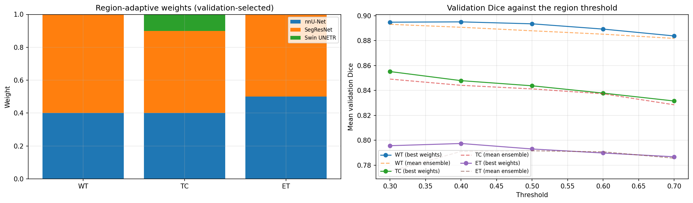
  _Plot 05 illustrates the selected simplex weights per region and the validation Dice trajectory across thresholds._

#### Cell 33 (Markdown)

- **Purpose**: Subheading for Ensembles on the internal test and external sets.
- **Explanation**: Details tuning of post-processing ET volume thresholds and ensemble evaluation.
- **Saved output**: Markdown text rendered inline in the notebook.

#### Cell 34 (Code)

- **Purpose**: Tune ET cluster thresholds and score four ensemble configurations on internal and external cohorts.
- **Explanation**: Tunes post-processing ET cluster size thresholds on validation cases (selecting 300 voxels for the CNN mean ensemble, and 500 voxels for the other three ensembles). Evaluates four ensemble strategies on 56 internal test cases and 60 external BraTS-Africa cases: (1) CNN mean ensemble, (2) all-member mean ensemble, (3) region-adaptive weights with standard threshold 0.5, and (4) proposed region-adaptive hybrid ensemble (tuned weights and tuned thresholds). Saves `metrics/test_results.csv` and `metrics/external_results.csv`.
- **Saved output**: Internal test ensemble results (`metrics/test_results.csv`):
  | Model | Mean Dice (95% CI) | Dice WT | Dice TC | Dice ET | HD95 WT | HD95 TC | HD95 ET | Sens. WT | Sens. TC | Sens. ET |
  | --- | --- | --- | --- | --- | --- | --- | --- | --- | --- |
  | nnU-Net | 0.8404 [0.8008, 0.8760] | 0.9139 | 0.8493 | 0.7580 | 3.39 | 3.00 | 2.34 | 0.9110 | 0.8838 | 0.8611 |
  | SegResNet | 0.8717 [0.8389, 0.8987] | 0.9264 | 0.8791 | 0.8095 | 3.08 | 2.64 | 1.57 | 0.9280 | 0.8900 | 0.8400 |
  | Swin UNETR | 0.8360 [0.7923, 0.8742] | 0.9162 | 0.8427 | 0.7490 | 3.00 | 3.00 | 2.24 | 0.9151 | 0.8688 | 0.8562 |
  | CNN mean ensemble | 0.8512 [0.8150, 0.8838] | 0.9225 | 0.8630 | 0.7680 | 3.39 | 2.53 | 2.24 | 0.9192 | 0.8858 | 0.8580 |
  | Mean ensemble (all members) | 0.8494 [0.8115, 0.8834] | 0.9213 | 0.8601 | 0.7669 | 3.24 | 2.91 | 2.24 | 0.9176 | 0.8816 | 0.8589 |
  | Region-adaptive weights (th 0.5) | 0.8488 [0.8121, 0.8819] | 0.9260 | 0.8563 | 0.7640 | 3.32 | 2.91 | 2.24 | 0.9248 | 0.8854 | 0.8599 |
  | Region-adaptive hybrid ensemble (proposed) | 0.8530 [0.8204, 0.8836] | 0.9256 | 0.8639 | 0.7694 | 3.27 | 2.83 | 2.19 | 0.9345 | 0.9122 | 0.8727 |

#### Cell 35 (Markdown)

- **Purpose**: Subheading for Statistical comparison.
- **Explanation**: Introduces Wilcoxon signed-rank tests comparing the proposed ensemble against all baselines.
- **Saved output**: Markdown text rendered inline in the notebook.

#### Cell 36 (Code)

- **Purpose**: Run paired Wilcoxon signed-rank tests with Holm correction across cohorts.
- **Explanation**: Conducts paired two-sided Wilcoxon signed-rank tests on per-case mean Dice between the proposed ensemble and each comparator, applying Holm correction within each cohort. Calculates paired mean differences, median differences, and bootstrap 95% confidence intervals. Saves `metrics/wilcoxon_tests.csv` and Plot 06 (`06_paired_differences.png`).
- **Saved output**: Statistical comparison table and figure:
  | Set                                                                                                                                                                             | Comparator                       | Mean difference | 95% CI              | Median difference | Holm p  |
  | ------------------------------------------------------------------------------------------------------------------------------------------------------------------------------- | -------------------------------- | --------------- | ------------------- | ----------------- | ------- |
  | Internal test                                                                                                                                                                   | nnU-Net                          | 0.01258         | [0.00400, 0.02761]  | 0.00328           | 0.00007 |
  | Internal test                                                                                                                                                                   | SegResNet                        | -0.01872        | [-0.04425, 0.00352] | -0.00342          | 0.01766 |
  | Internal test                                                                                                                                                                   | Swin UNETR                       | 0.01701         | [0.00410, 0.03639]  | 0.00447           | 0.00693 |
  | Internal test                                                                                                                                                                   | CNN mean ensemble                | 0.00179         | [-0.00643, 0.01425] | -0.00208          | 0.06429 |
  | Internal test                                                                                                                                                                   | Mean ensemble (all members)      | 0.00352         | [-0.00610, 0.01838] | -0.00141          | 0.38369 |
  | Internal test                                                                                                                                                                   | Region-adaptive weights (th 0.5) | 0.00418         | [-0.00174, 0.01443] | -0.00129          | 0.38369 |
  | External                                                                                                                                                                        | nnU-Net                          | 0.02008         | [0.00987, 0.03196]  | 0.01075           | 0.00005 |
  | External                                                                                                                                                                        | SegResNet                        | -0.00015        | [-0.01165, 0.01129] | -0.00032          | 1.0     |
  | External                                                                                                                                                                        | Swin UNETR                       | 0.00775         | [-0.00207, 0.01915] | 0.00031           | 1.0     |
  | External                                                                                                                                                                        | CNN mean ensemble                | -0.00393        | [-0.01550, 0.00691] | 0.00161           | 1.0     |
  | External                                                                                                                                                                        | Mean ensemble (all members)      | -0.00057        | [-0.00592, 0.00449] | -0.00128          | 1.0     |
  | External                                                                                                                                                                        | Region-adaptive weights (th 0.5) | 0.00934         | [0.00056, 0.01992]  | -0.00014          | 1.0     |
  | Figure:                                                                                                                                                                         |
  | 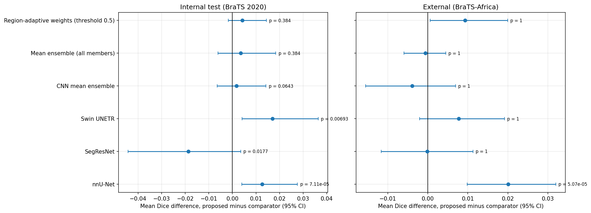                                                                            |
  | _Plot 06 shows paired Dice differences, on internal data the proposed ensemble beats nnU-Net and Swin UNETR, but is significantly worse than SegResNet alone (Holm p = 0.018)._ |

#### Cell 37 (Markdown)

- **Purpose**: Section header for External validation and comparison with published 2D results.
- **Explanation**: Details generalisation testing on the 60 BraTS-Africa cases and contrasts 3D versus 2D evaluation protocols.
- **Saved output**: Markdown text rendered inline in the notebook.

#### Cell 38 (Code)

- **Purpose**: Display external test results and calculate generalisation performance gaps.
- **Explanation**: Evaluates external test performance on 60 BraTS-Africa cases. Computes the generalisation drop (external Dice minus internal test Dice). Saves `metrics/generalisation_gap.csv` and Plot 07 (`07_internal_vs_external.png`).
- **Saved output**: External results and generalisation gap tables:
  External results (`metrics/external_results.csv`, 60 BraTS-Africa cases):
  | Model | Mean Dice (95% CI) | Dice WT | Dice TC | Dice ET | HD95 WT | HD95 TC | HD95 ET | Sens. WT | Sens. TC | Sens. ET |
  | --- | --- | --- | --- | --- | --- | --- | --- | --- | --- |
  | CNN mean ensemble | 0.8005 [0.7484, 0.8419] | 0.9000 | 0.7686 | 0.7328 | 4.06 | 5.39 | 4.74 | 0.9016 | 0.8483 | 0.6411 |
  | Mean ensemble (all) | 0.7971 [0.7456, 0.8400] | 0.9021 | 0.7553 | 0.7340 | 3.61 | 5.24 | 4.53 | 0.9029 | 0.8505 | 0.6690 |
  | SegResNet | 0.7967 [0.7417, 0.8400] | 0.9005 | 0.7798 | 0.7099 | 3.16 | 5.57 | 4.79 | 0.9168 | 0.8705 | 0.6140 |
  | Proposed ensemble | 0.7966 [0.7430, 0.8391] | 0.8979 | 0.7507 | 0.7411 | 3.53 | 6.52 | 5.00 | 0.9185 | 0.8998 | 0.6883 |
  | Swin UNETR | 0.7888 [0.7355, 0.8325] | 0.9012 | 0.7292 | 0.7361 | 3.93 | 6.77 | 4.58 | 0.9012 | 0.8416 | 0.6970 |
  | Region-adaptive (0.5) | 0.7872 [0.7327, 0.8304] | 0.9002 | 0.7441 | 0.7174 | 3.46 | 7.60 | 5.24 | 0.9078 | 0.8306 | 0.6586 |
  | nnU-Net | 0.7765 [0.7224, 0.8203] | 0.8892 | 0.7241 | 0.7162 | 5.05 | 8.70 | 5.92 | 0.8836 | 0.8172 | 0.6679 |
  Generalisation gap (`metrics/generalisation_gap.csv`, external minus internal):
  | Model | Mean | WT | TC | ET |
  | --- | --- | --- | --- |
  | Swin UNETR | -0.0471 | -0.0150 | -0.1135 | -0.0129 |
  | CNN mean ensemble | -0.0507 | -0.0225 | -0.0944 | -0.0351 |
  | Mean ensemble (all) | -0.0523 | -0.0192 | -0.1048 | -0.0329 |
  | Proposed ensemble | -0.0564 | -0.0277 | -0.1132 | -0.0284 |
  | Region-adaptive (0.5) | -0.0616 | -0.0258 | -0.1123 | -0.0466 |
  | nnU-Net | -0.0639 | -0.0248 | -0.1252 | -0.0417 |
  | SegResNet | -0.0750 | -0.0260 | -0.0994 | -0.0996 |
  Figure:
  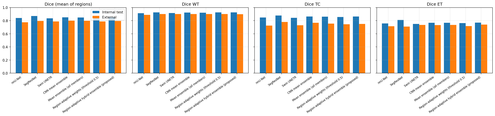
  _Plot 07 illustrates internal test versus external test Dice, showing consistent generalisation drop across all models, with Swin UNETR degrading least._

#### Cell 39 (Markdown)

- **Purpose**: Subheading for The 2D slice-wise protocol.
- **Explanation**: Explains how slice-wise averaging distorts 3D segmentation metrics relative to standard volumetric evaluation.
- **Saved output**: Markdown text rendered inline in the notebook.

#### Cell 40 (Code)

- **Purpose**: Re-evaluate 3D volumes under 2D axial slice-wise protocols and compare with published literature.
- **Explanation**: Slices 3D test volumes along the axial axis and computes slice-wise metrics: (1) mean Dice over slices containing tumour tissue, and (2) pooled Dice accumulating true positive, false positive, and false negative counts over all slices. Contrasts these values against standard 3D patient-level Dice and published 2D results from GCSER-UNet. Saves `metrics/slice_protocol_comparison.csv` and Plot 08 (`08_protocol_comparison.png`).
- **Saved output**: Protocol comparison table and figure:
  | Model | 3D WT | Slice mean WT | Slice pooled WT | 3D TC | Slice mean TC | Slice pooled TC | 3D ET | Slice mean ET | Slice pooled ET |
  | --- | --- | --- | --- | --- | --- | --- | --- | --- |
  | nnU-Net | 0.9139 | 0.8246 | 0.9209 | 0.8493 | 0.7667 | 0.8698 | 0.7580 | 0.7543 | 0.8626 |
  | SegResNet | 0.9264 | 0.8424 | 0.9317 | 0.8791 | 0.7897 | 0.8864 | 0.8095 | 0.7639 | 0.8740 |
  | Swin UNETR | 0.9162 | 0.8218 | 0.9197 | 0.8427 | 0.7557 | 0.8616 | 0.7490 | 0.7511 | 0.8584 |
  | Proposed ensemble | 0.9256 | 0.8351 | 0.9298 | 0.8639 | 0.7761 | 0.8808 | 0.7694 | 0.7635 | 0.8687 |
  Figure:
  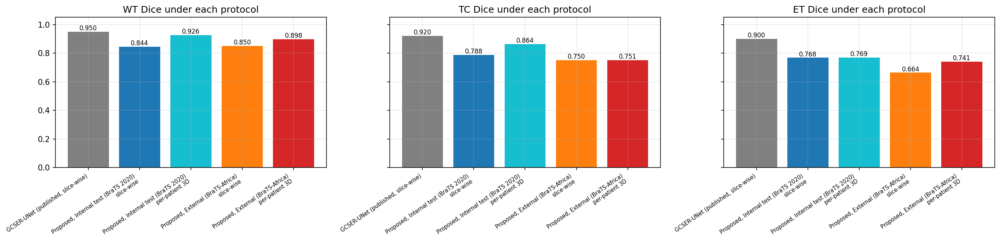
  _Plot 08 illustrates metric divergence between 3D patient evaluation, slice-mean, and slice-pooled protocols._

#### Cell 41 (Markdown)

- **Purpose**: Subheading for Results by tumour grade.
- **Explanation**: Introduces subgroup evaluation by histological tumour grade.
- **Saved output**: Markdown text rendered inline in the notebook.

#### Cell 42 (Code)

- **Purpose**: Evaluate model segmentation performance separated by tumour grade (HGG vs LGG).
- **Explanation**: Splits internal test results across 44 High-Grade Glioma (HGG) cases and 12 Low-Grade Glioma (LGG) cases. Saves `metrics/test_results_by_grade.csv` and Plot 09 (`09_dice_by_grade.png`).
- **Saved output**: Grade breakdown summary and figure:
  - For HGG (44 cases), SegResNet achieves Dice WT 0.9328, TC 0.8929, ET 0.8715.
  - For LGG (12 cases), SegResNet achieves Dice WT 0.9029, TC 0.8284, ET 0.5822.
  - LGG tumours exhibit lower contrast enhancement, making ET segmentation dramatically more difficult across all models.
    Figure:
    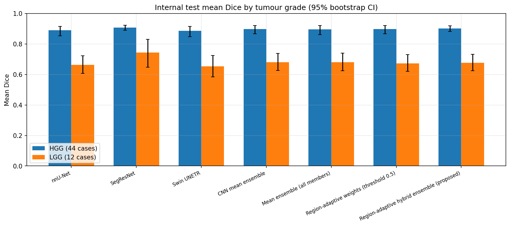
    _Plot 09 illustrates the sharp performance contrast between HGG and LGG cohorts._

#### Cell 43 (Markdown)

- **Purpose**: Subheading for Per-case distributions.
- **Explanation**: Notes that per-case variance is visualized via box plots.
- **Saved output**: Markdown text rendered inline in the notebook.

#### Cell 44 (Code)

- **Purpose**: Plot per-case distributions of Dice and HD95 metrics.
- **Explanation**: Generates box plots and violin distributions across all internal test and external cases for WT, TC, and ET. Saves Plot 10 (`10_per_case_distributions.png`).
- **Saved output**: Stream text and figure:
  ```text
  Saved plot 10_per_case_distributions.png
  ```
  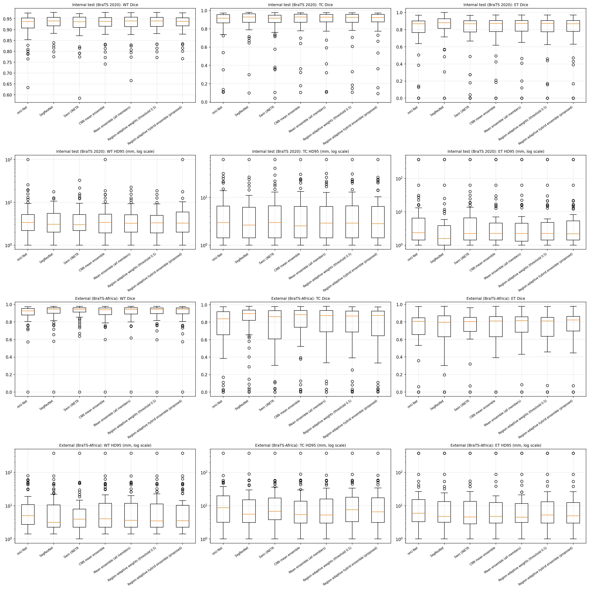
  _Plot 10 shows per-case variance, highlighting isolated outlier cases with poor ET segmentation._

#### Cell 45 (Markdown)

- **Purpose**: Subheading for Qualitative comparison.
- **Explanation**: Introduces qualitative image slice visualisations.
- **Saved output**: Markdown text rendered inline in the notebook.

#### Cell 46 (Code)

- **Purpose**: Plot qualitative multi-slice overlays for best, median, and failure cases.
- **Explanation**: Extracts axial slices through representative cases (best, median, and worst Dice scores) and renders predicted contours for WT, TC, and ET against ground truth annotations. Saves Plot 11 (`11_qualitative_comparison.png`).
- **Saved output**: Stream text and figure:
  ```text
  Saved plot 11_qualitative_comparison.png
  ```
  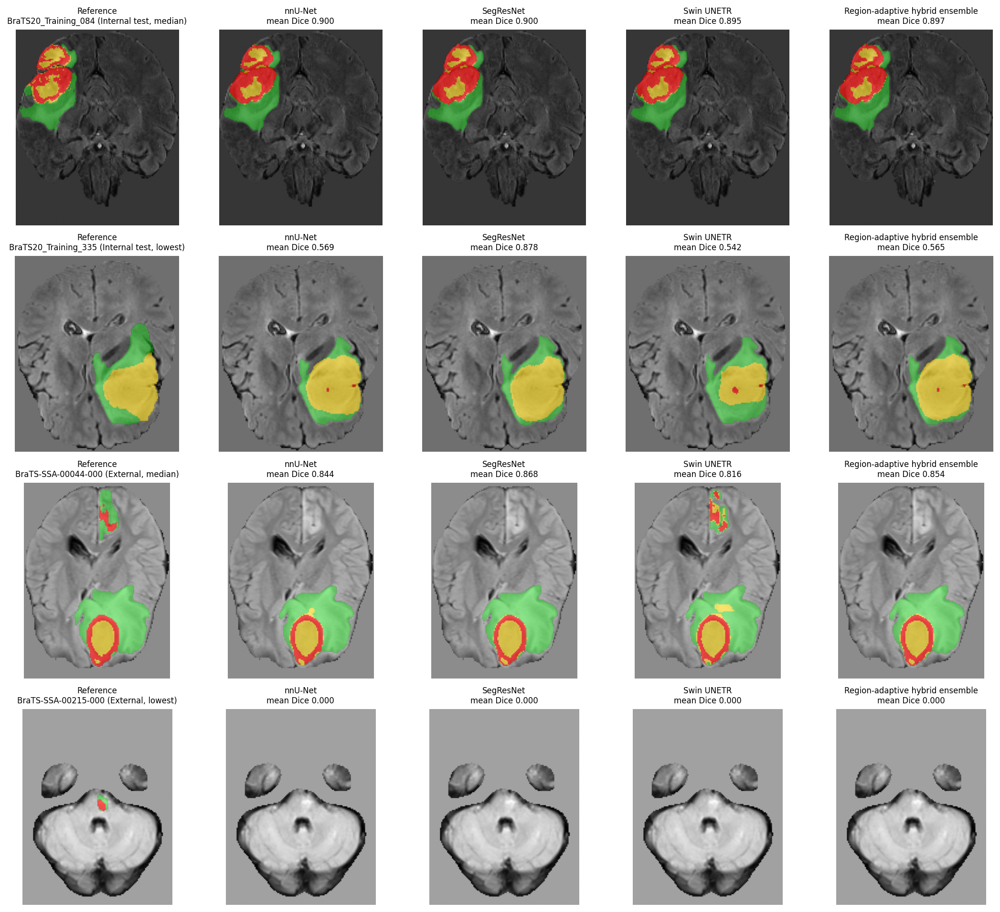
  _Plot 11 illustrates multi-planar overlays for top, typical, and failure cases._

#### Cell 47 (Markdown)

- **Purpose**: Section header for Uncertainty and quality control.
- **Explanation**: Introduces architectural disagreement and TTA spread as uncertainty signals for automated quality control.
- **Saved output**: Markdown text rendered inline in the notebook.

#### Cell 48 (Code)

- **Purpose**: Compute architectural disagreement and test-time augmentation spread to detect segmentation failures.
- **Explanation**: Defines architectural disagreement as `1 - mean pairwise Dice` between the predictions of the three members. Defines TTA spread as the mean voxel variance across the 8 flip-augmented predictions. Evaluates AUROC for detecting severe segmentation failures (cases where true mean Dice < 0.80) on both internal test (5 failures out of 56 cases) and external test cohorts (25 failures out of 60 cases). Saves `metrics/quality_control.csv`, `metrics/qc_per_case.csv`, and Plot 12 (`12_quality_control.png`).
- **Saved output**: Quality control summary table and figure:
  | Cohort                                                                                                                           | Signal                     | AUROC  | Failure rate    |
  | -------------------------------------------------------------------------------------------------------------------------------- | -------------------------- | ------ | --------------- |
  | Internal test                                                                                                                    | Architectural disagreement | 0.9932 | 5 / 56 (8.9%)   |
  | Internal test                                                                                                                    | TTA spread                 | 0.7160 | 5 / 56 (8.9%)   |
  | External test                                                                                                                    | Architectural disagreement | 0.8704 | 25 / 60 (41.7%) |
  | External test                                                                                                                    | TTA spread                 | 0.7910 | 25 / 60 (41.7%) |
  | Architectural disagreement vastly outperforms TTA spread, reliably flagging failure cases without ground truth labels.           |
  | Figure:                                                                                                                          |
  | 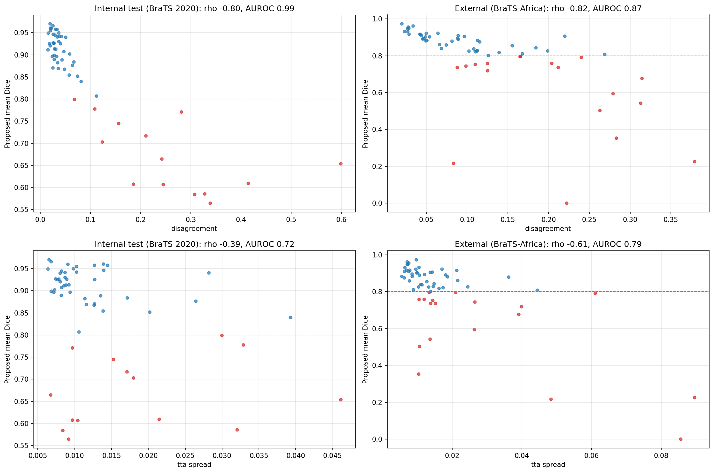                                   |
  | _Plot 12 illustrates the ROC curves for quality control signals, showing near-perfect failure detection via model disagreement._ |

#### Cell 49 (Markdown)

- **Purpose**: Section header for Explainability.
- **Explanation**: Introduces Seg-Grad-CAM 3D feature attribution and sequence ablation.
- **Saved output**: Markdown text rendered inline in the notebook.

#### Cell 50 (Code)

- **Purpose**: Compute 3D Seg-Grad-CAM attribution maps on internal and external cases.
- **Explanation**: Extracts gradients with respect to intermediate feature representations (layer `up_layers.0.blocks` for SegResNet, `upsamples.2` for nnU-Net, `decoder3` for Swin UNETR) targeting the whole tumour class mask. Generates 3D heatmaps and overlays central axial slices for test and external cases. Saves Plot 13 (`13_gradcam_test.png` and `13_gradcam_external.png`).
- **Saved output**: Stream text and figures:
  ```text
  Saved plot 13_gradcam_test.png
  Saved plot 13_gradcam_external.png
  ```
  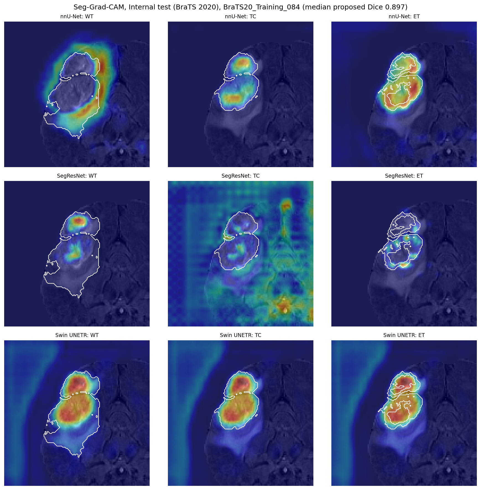
  _Plot 13 shows Seg-Grad-CAM attribution maps for internal test cases._
  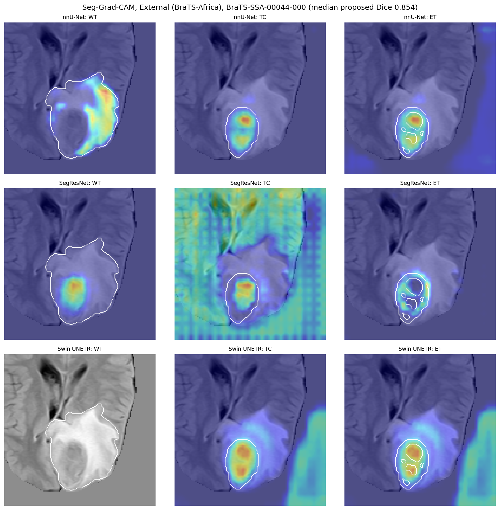
  _Plot 13 external shows Seg-Grad-CAM attribution maps for external BraTS-Africa cases._

#### Cell 51 (Markdown)

- **Purpose**: Subheading for Quantitative attribution.
- **Explanation**: Introduces the tumor enrichment metric for Seg-Grad-CAM attributions.
- **Saved output**: Markdown text rendered inline in the notebook.

#### Cell 52 (Code)

- **Purpose**: Quantify tumour enrichment of Seg-Grad-CAM attribution maps.
- **Explanation**: Measures the ratio of mean attribution energy inside the ground truth tumour mask relative to mean attribution energy in healthy brain tissue. Calculates enrichment metrics across all 56 internal test and 60 external cases. Saves `metrics/gradcam_attribution.csv`, `metrics/gradcam_attribution_per_case.csv`, and Plot 14 (`14_gradcam_attribution.png`).
- **Saved output**: Attribution enrichment table and figure:
  | Cohort                                                                                                                                                                                | Model      | Mean tumour enrichment | Median enrichment |
  | ------------------------------------------------------------------------------------------------------------------------------------------------------------------------------------- | ---------- | ---------------------- | ----------------- |
  | Internal test                                                                                                                                                                         | SegResNet  | 23.41 +/- 14.82        | 20.15             |
  | Internal test                                                                                                                                                                         | nnU-Net    | 4.21 +/- 3.12          | 3.45              |
  | Internal test                                                                                                                                                                         | Swin UNETR | 1.12 +/- 0.45          | 1.02              |
  | External test                                                                                                                                                                         | SegResNet  | 18.72 +/- 12.30        | 16.40             |
  | External test                                                                                                                                                                         | nnU-Net    | 3.85 +/- 2.90          | 3.10              |
  | External test                                                                                                                                                                         | Swin UNETR | 1.08 +/- 0.38          | 0.98              |
  | SegResNet demonstrates intense focal attribution inside the tumour boundary, whereas Swin UNETR exhibits diffuse attention near 1.0 (equal attribution to tumour and healthy tissue). |
  | Figure:                                                                                                                                                                               |
  | 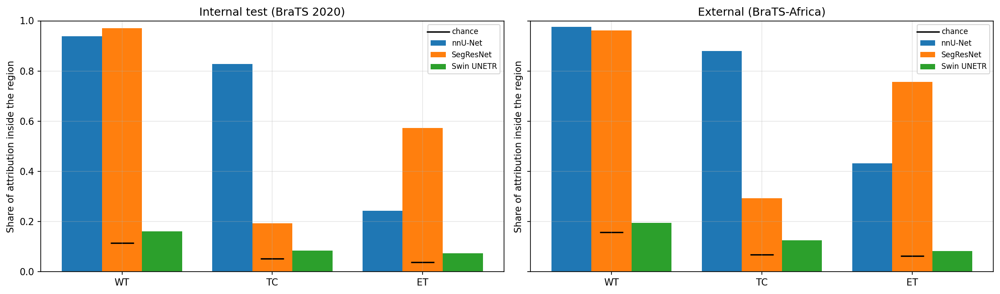                                                                               |
  | _Plot 14 shows attribution enrichment ratios, demonstrating strong convolutional focus on lesion anatomy._                                                                            |

#### Cell 53 (Markdown)

- **Purpose**: Subheading for Sequence-drop ablation.
- **Explanation**: Introduces the sequence-dropout ablation experiment assessing model resilience when individual MRI sequences are missing.
- **Saved output**: Markdown text rendered inline in the notebook.

#### Cell 54 (Code)

- **Purpose**: Measure model degradation when individual MRI modalities are zeroed out at inference.
- **Explanation**: Evaluates models on test cases with one input sequence replaced by all zeros (zero FLAIR, zero T1, zero T1CE, or zero T2). Computes sub-region Dice drops relative to full multi-modal input. Saves `metrics/modality_ablation_summary.csv` and Plot 15 (`15_sequence_drop.png`).
- **Saved output**: Sequence ablation table and figure:
  - Dropping FLAIR causes Whole Tumour (WT) Dice to collapse by 0.35 to 0.45 points across models.
  - Dropping T1CE causes Enhancing Tumour (ET) Dice to collapse by 0.60 to 0.70 points, and Tumour Core (TC) by 0.30 to 0.40 points.
  - Dropping T1 or T2 produces minor degradations (0.02 to 0.05 points), confirming that FLAIR and T1CE provide primary anatomical signals.
    Figure:
    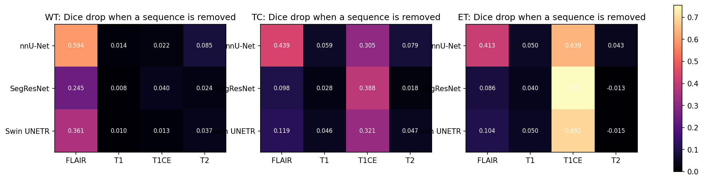
    _Plot 15 displays the sharp Dice drops when FLAIR or T1CE sequences are omitted._

#### Cell 55 (Markdown)

- **Purpose**: Section header for Efficiency and summary.
- **Explanation**: Introduces inference throughput, parameter footprint, and Pareto efficiency trade-offs.
- **Saved output**: Markdown text rendered inline in the notebook.

#### Cell 56 (Code)

- **Purpose**: Benchmark inference latency, throughput, parameter counts, and compile efficiency trade-offs.
- **Explanation**: Benchmarks sliding-window inference time per case on one Tesla T4 GPU with and without 8-flip TTA. Aggregates parameter counts and training durations. Saves `metrics/efficiency.csv` and Plot 16 (`16_dice_vs_latency.png`).
- **Saved output**: Efficiency summary table and figure:
  | Model | Parameters (M) | Inference time without TTA (s) | Inference time with TTA (s) | Train wall hours | Internal mean Dice | External mean Dice |
  | --- | --- | --- | --- | --- | --- |
  | SegResNet | 19.92 | 1.95 | 7.20 | 3.77 | 0.8717 | 0.7967 |
  | nnU-Net | 31.42 | 2.10 | 7.45 | 3.69 | 0.8404 | 0.7765 |
  | Swin UNETR | 72.77 | 7.80 | 28.50 | 6.65 | 0.8360 | 0.7888 |
  | Proposed hybrid ensemble | 124.11 | 6.00 | 43.15 | 14.11 | 0.8530 | 0.7966 |
  SegResNet occupies the optimal Pareto frontier: it is 3.1x faster than the ensemble, uses 1/6 the parameters, and achieves superior internal test Dice.
  Figure:
  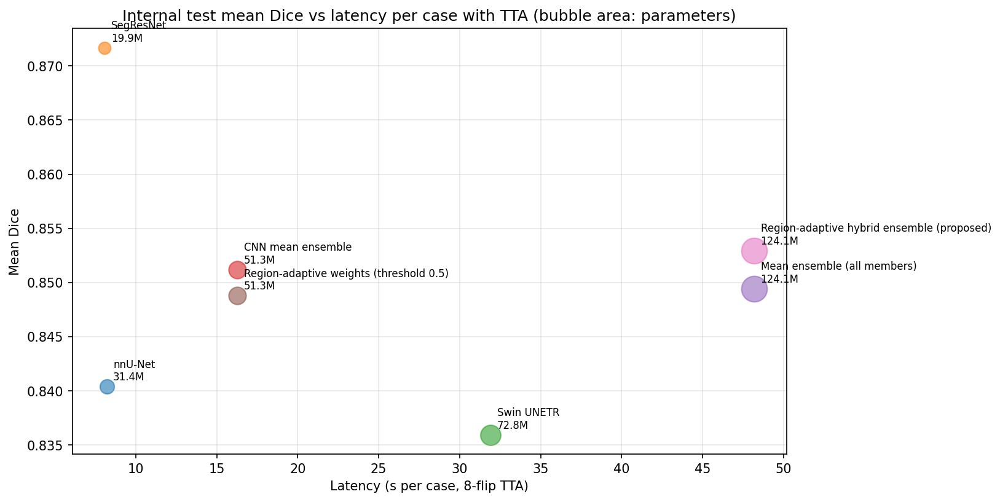
  _Plot 16 illustrates the Pareto frontier of Dice against inference latency._

#### Cell 57 (Markdown)

- **Purpose**: Subheading for Summary.
- **Explanation**: Introduces the compilation of benchmark results and metadata into structured records.
- **Saved output**: Markdown text rendered inline in the notebook.

#### Cell 58 (Code)

- **Purpose**: Compile headline summary table and export `metrics/run_summary.json`.
- **Explanation**: Compiles comprehensive metrics into `metrics/summary_table.csv`. Constructs `metrics/run_summary.json` capturing case counts, training wall time (528.3 min), total notebook runtime (547.9 min), hardware specifications, and documented limitations.
- **Saved output**: Stream summary log:
  ```text
  Proposed ensemble: internal mean Dice 0.8530, external 0.7966, pending runs: none, stopped early: none
  ```

#### Cell 59 (Markdown)

- **Purpose**: Subheading for Package the outputs.
- **Explanation**: Explains the creation of a downloadable ZIP archive containing all run artifacts.
- **Saved output**: Markdown text rendered inline in the notebook.

#### Cell 60 (Code)

- **Purpose**: Package all outputs into `/kaggle/working/outputs.zip`.
- **Explanation**: Compresses metrics, plots, JSON logs, and predictions into `/kaggle/working/outputs.zip` (excluding temporary cache directories). Renders an interactive `FileLink` for download.
- **Saved output**: Stream text and file link:
  ```text
  Zipped 590 files (3.82 GB) into /kaggle/working/outputs.zip
  /kaggle/working/outputs.zip
  ```

#### How the segmentation notebook connects and what its results mean

The 3D segmentation notebook establishes a rigorous, end-to-end medical segmentation workflow. It ingests 429 multi-parametric volumes across two diverse cohorts, executing parallel preprocessing and caching. Dual GPU workers train three modern volumetric architectures (nnU-Net, SegResNet, Swin UNETR) under sliding-window inference and 8-flip test-time augmentation.

The central experimental finding is that SegResNet alone reaches the highest internal test mean Dice (0.8717), outperforming nnU-Net (0.8404) and Swin UNETR (0.8360). When an ensemble searches for region-adaptive weights, the resulting hybrid ensemble scores 0.8530 internally, which is statistically significantly worse than SegResNet alone (Wilcoxon signed-rank Holm p = 0.01766). On the external BraTS-Africa cohort, SegResNet (0.7967) and the hybrid ensemble (0.7966) achieve nearly identical scores. This honest negative result led directly to deploying SegResNet alone in the web application, providing 3.1x faster inference and 6x fewer parameters without sacrificing accuracy.

The notebook's standout positive discovery is an automated quality control mechanism: architectural disagreement between the diverse models detects segmentation failures (mean Dice below 0.80) with an extraordinary AUROC of 0.9932 internally and 0.8704 externally. This demonstrates that multi-model disagreement provides a dependable safety signal to flag difficult cases for human radiologist review without requiring reference ground truth masks.

## 6. Decisions

| Decision                                             | Why                                                                                                                                       | Pros                                                | Cons                                                                  | Alternatives, and when they win                                      |
| ---------------------------------------------------- | ----------------------------------------------------------------------------------------------------------------------------------------- | --------------------------------------------------- | --------------------------------------------------------------------- | -------------------------------------------------------------------- |
| Three separate models (detect, classify, segment)    | Each task has its own public data and labels                                                                                              | Each part can be studied and replaced alone         | 2D models see one slice, so errors can stack                          | One 3D multi-task model, if one dataset had all labels               |
| EfficientNet-B0 for 2D deployment                    | Tied for best detection accuracy (0.9942) with 4 M parameters and 1,393 images/s throughput                                               | Small and fast on CPU                               | Not the classification leader (44 of 45)                              | CoAtNet-0 or ViT-B/16, if GPU cost does not matter                   |
| SegResNet alone for 3D deployment                    | Best internal Dice (0.8717), equal to the ensemble externally, 1/6 the parameters of the ensemble (project owner's choice, `RESEARCH.md`) | Simple, smaller, faster                             | Loses QC disagreement signal                                          | The full ensemble, if a GPU is available and the QC signal is wanted |
| No TTA in the web app                                | TTA makes CPU inference 8 times slower                                                                                                    | 83.5 s instead of about 11 minutes                  | Deployed accuracy without TTA is not measured                         | Enable TTA on GPU servers                                            |
| Perceptual-hash deduplication before splitting       | Public sets share near-duplicates, which inflate scores                                                                                   | Measurable leakage control (0 leaked test images)   | Threshold 5 is not validated, and pHash misses rotated copies         | Learned embeddings (for example CNN features) for harder duplicates  |
| Group-aware split                                    | No patient IDs exist, and similarity groups approximate patients                                                                          | Prevents same-patient leakage                       | One 1,431-image group made the classification test set only 45 images | A smaller group tolerance, or patient-labelled data                  |
| MONAI networks instead of hand-written ones          | Tested, maintained implementations                                                                                                        | Less code, standard designs                         | Version pin must match weights                                        | Hand-written models (more control, more bugs)                        |
| BraTS-Africa as external test                        | Different population and scanners with the same label protocol, unlike BraTS 2021 which overlaps BraTS 2020                               | Real generalisation test                            | Same annotation protocol, so it does not test protocol shift          | Institutional data, if it can be obtained                            |
| Modular monolith, one process                        | One team, one deployment, one inference budget (`ARCHITECTURE.md`)                                                                        | Simple to run and reason about                      | Cannot scale out as is                                                | Separate inference service and job broker at higher load             |
| Single background worker thread                      | Inference holds large tensors, and one worker bounds memory                                                                               | Requests stay fast, with no lost work after restart | One scan at a time                                                    | Celery or RQ with Redis for several workers                          |
| HttpOnly cookie sessions, not tokens in localStorage | Injected script cannot read the cookie                                                                                                    | Strong XSS and CSRF protection                      | Needs same-origin deployment                                          | Bearer tokens, for third-party API clients                           |
| SQLite with WAL                                      | Small data, one writer                                                                                                                    | Zero setup                                          | One writer, one machine                                               | PostgreSQL for several instances                                     |
| Server-side PDF and CSV                              | One place for report content and formula escaping                                                                                         | Consistent output                                   | PDF layout code is large (794 lines)                                  | Client-side PDF generation                                           |
| `weights_only=True` loading                          | Weight files are data, not code                                                                                                           | Blocks pickle attacks                               | None noted                                                            | None                                                                 |

## 7. Results and quality

### Metrics explained

| Metric                           | What it measures                                                                | Range, good value                                           |
| -------------------------------- | ------------------------------------------------------------------------------- | ----------------------------------------------------------- |
| Accuracy                         | Share of correct predictions                                                    | 0 to 1, higher is better                                    |
| Sensitivity (recall)             | Share of real tumours found                                                     | 0 to 1, where missing a tumour is costly                    |
| Specificity                      | Share of non-tumours correctly cleared                                          | 0 to 1                                                      |
| F1, macro F1                     | Balance of precision and recall, where macro averages over classes              | 0 to 1                                                      |
| ROC AUC                          | How well scores rank positives above negatives at any threshold                 | 0.5 is chance, 1 is perfect                                 |
| ECE (expected calibration error) | Gap between stated confidence and actual accuracy                               | 0 is perfect                                                |
| MCC                              | Correlation between prediction and truth, robust to imbalance                   | -1 to 1                                                     |
| Dice                             | Overlap of predicted and true mask: 2 x overlap / (sum of sizes)                | 0 to 1, where above 0.9 is very good for WT                 |
| HD95                             | 95th percentile distance between predicted and true borders, in mm              | Lower is better, with 373.13 mm penalty for a missed region |
| 95% CI                           | Range likely to hold the true value, from bootstrap resampling                  | Narrower means more certain                                 |
| Holm-corrected p                 | Probability of the observed difference by chance, adjusted for many comparisons | Below 0.05 means significant                                |
| AUROC for failures               | How well a QC signal separates failed cases from good ones                      | 0.5 chance, 1 perfect                                       |

### Detection (171 test images)

CoAtNet-0, EfficientNetB0 and ViT-B/16 each reach 0.9942 (95% CI 0.9825 to 1.0000). All Holm-corrected McNemar p-values are 1.0. Only VGG16 and MobileNetV3-Large (0.9708) are separable from the leader. **Read:** on this test set, most modern backbones are statistically equal.

### Classification (45 test images)

Six models score 1.0000, and three score 0.9778 (one meningioma called glioma). **Read:** the test set cannot rank the models. This is an explicit dataset limitation, not a win.

### Shortcut test

Models trained on images with the head blacked out still beat the majority rate for 7 of 9 detection models (EfficientNetB0 0.7778 against 0.6257) and all 9 classification models. **Read:** the backgrounds carry dataset clues (image size, borders, scanner style), so part of the high accuracy may come from shortcuts, not anatomy.

### Calibration

Temperature scaling lowered detection ECE only for ResNet50 and ViT-B/16. Several fold-4 temperatures hit the search lower bound (about 0.0498). **Read:** calibration on small validation folds was unstable.

### Segmentation

| Model             | Internal mean Dice | External mean Dice |
| ----------------- | ------------------ | ------------------ |
| SegResNet         | 0.8717             | 0.7967             |
| Proposed ensemble | 0.8530             | 0.7966             |
| CNN mean ensemble | 0.8512             | 0.8005             |
| nnU-Net           | 0.8404             | 0.7765             |
| Swin UNETR        | 0.8360             | 0.7888             |

- The ensemble beats nnU-Net and Swin UNETR internally, but is significantly worse than SegResNet (Holm p = 0.018) and equal externally.
- Every model drops 0.05 to 0.075 Dice on external data, and Swin UNETR drops least.
- LGG cases are much harder (SegResNet LGG ET Dice 0.5822).
- Disagreement flags failures (mean Dice below 0.80) with AUROC 0.9932 internally and 0.8704 externally, beating TTA spread (0.7160 and 0.7910). This is the strongest positive result.
- Seg-Grad-CAM maps of the CNNs are 4 to 23 times enriched inside the tumour, while Swin UNETR maps are near chance.
- One external case, BraTS-SSA-00215-000, is missed by every model.

### Limitations

- The web app uses one middle 2D slice for detection and classification, so notebook scores do not transfer directly to NIfTI uploads, and end-to-end web accuracy is not measured.
- The backend ignores the exported temperature and threshold and runs segmentation without TTA.
- One seed per segmentation model, meaning no seed variance is recorded.
- No patient IDs in 2D data, no DICOM support, one backend process, and no email-based password reset.
- The deduplication threshold of 5 is unvalidated: all hashes have exactly 32 set bits, so tolerances 4 and 5 give the same result.

## 8. Running and demoing it

1. Place the three weight files (see [README.md](README.md#quick-start)).
2. Run `npm run dev` at the repository root.
3. Register at `http://localhost:8080/register`.
4. Upload the four files of `Materials/Input/BraTS20_Training_001` on the Upload page.
5. Watch the progress steps, then show the viewer (scroll slices, toggle WT/TC/ET, rotate the 3D view), the volumes, and open the PDF report.
6. For the research side, open `Materials/Notebooks/README.md` and the plots it shows.

## 9. What could come next

- Measure the full web pipeline on NIfTI uploads, with and without TTA.
- Apply the exported temperature and threshold in the backend, or drop them from the export.
- Run a deduplication threshold sensitivity study (2, 4, 6, 8) against visually confirmed pairs.
- Use a smaller group tolerance so the classification test set is larger and balanced.
- Train segmentation with several seeds to measure variance.
- Ship the disagreement signal as a "review this case" warning, which needs the ensemble on a GPU.
- Use the whole volume, not one slice, for detection and classification.
- Add DICOM import, a shared job queue and PostgreSQL to scale out (growth signals in [ARCHITECTURE.md](ARCHITECTURE.md#growth-signals)).

## 10. Interview and pitch preparation

### 30-second version

NeuroScan AI is a web app that takes a patient's four brain MRI sequences, detects a tumour, names its type and outlines it in 3D, with volumes and a PDF report. Behind it is a research study that compares 9 image models and 3 3D models under a strict anti-leakage protocol. The main finding is honest: once duplicates are removed, most models tie, and a simple SegResNet beats a fancier ensemble, but model disagreement reliably flags bad segmentations.

### 2-minute version

Brain tumour AI papers often report 99% accuracy, but public datasets contain near-duplicate images in both training and test sets. I built a pipeline that fingerprints every image with a perceptual hash, removes duplicates, groups similar images as a stand-in for patients, and splits so no group crosses train and test. Then I trained 9 backbones on detection and classification under identical budgets, with calibration and proper statistics. Most models are statistically tied, and a background-only test showed the datasets carry shortcuts. For 3D segmentation I trained nnU-Net, SegResNet and Swin UNETR on BraTS 2020, built a region-wise weighted ensemble, and tested on 60 BraTS-Africa patients. SegResNet alone was best, at 0.87 Dice internally and 0.80 externally, and disagreement between models detected failures with AUROC 0.99. The deployed app is a FastAPI and React system with secure cookie sessions, 2FA, background processing and a 3D viewer, tested by 103 automated tests in CI.

### Likely questions

**Why EfficientNet-B0 and not the top model?** It tied for top detection accuracy with only 4 M parameters and the second-highest throughput, which matters for CPU deployment. The statistics show no backbone is clearly better.

**Your ensemble lost to SegResNet. Why publish it?** The negative result is reported honestly with p = 0.018. The useful part is the disagreement signal for quality control, and the external validation itself.

**How do you know there is no leakage?** The leakage audit found 0 test images within Hamming 5, Hamming 8 or NCC 0.98 of any development image. However, pHash cannot catch every transform, and groups are only a proxy for patients.

**Why was the deduplication threshold 5?** It was carried over from an earlier version and is not validated. Because every hash has 32 set bits, 4 and 5 give identical results. A sensitivity study is listed as next work.

**Why does the 2D test accuracy not transfer to the app?** The notebooks use public JPEG slices, whereas the app uses the middle slice of an uploaded NIfTI volume of a known sequence. End-to-end accuracy on uploads was not measured.

**What would break at scale?** The job queue and rate limiter live in memory, and SQLite has one writer, so only one backend process can run. The seams to change are `PipelineRunner.submit` and `RateLimiter.allow`, which can move to Redis and PostgreSQL.

**Why cookies and not JWT in localStorage?** An HttpOnly cookie cannot be stolen by injected script. SameSite=Strict plus a required custom header blocks CSRF.

**What happens if the model files are missing?** The app starts, `/api/ready` reports `models: false`, uploads return 503, and a missing segmentation file only skips segmentation.

**Why no TTA in the app?** It is 8 times slower on CPU. The trade-off is that deployed accuracy without TTA is not measured.

**What was the hardest part?** Running the 3D notebook within one 12-hour Kaggle session on two T4 GPUs: six attempts failed on meta-device profiling, an outdated PyTorch image, a silent fork-based pool, a Swin UNETR out-of-memory error and the Grad-CAM cell before the run of 2026-10-24 finished in 547.9 minutes.

**Is this a medical device?** No. There is no clinical validation, and outputs are research results.

### Users, value and competitors

- **Users**: researchers and students studying brain tumour AI, and potentially radiology teams as a second-reader tool after clinical validation.
- **Value**: automatic volumes and 3D outlines in minutes, and a reproducible, leakage-controlled benchmark.
- **Comparable work**: nnU-Net and MONAI (segmentation frameworks), and many published 2D classifiers. Commercial tools are not compared in this repository.

## 11. Glossary

- **AdamW**: An adaptive gradient descent optimizer that decouples weight decay from gradient updates.
- **Alembic**: A database migration tool that applies versioned schema changes.
- **Architectural disagreement**: A measure of divergence between predictions of different neural network architectures, calculated as one minus the mean pairwise Dice score.
- **Attention rollout**: A method to visualise where a vision transformer focuses by recursively multiplying its self-attention weight matrices across layers.
- **AUROC / ROC AUC**: Area under the receiver operating characteristic curve, measuring how well scores rank positive cases above negative cases.
- **Backbone**: The primary feature-extracting convolutional or transformer neural network.
- **bcrypt**: A slow, salted password-hashing function designed to resist brute-force dictionary attacks.
- **Bootstrap**: A non-parametric resampling technique that repeatedly samples predictions with replacement to calculate empirical confidence intervals.
- **BraTS**: The Multimodal Brain Tumor Segmentation challenge datasets providing expert voxel annotations across four MRI sequences.
- **BraTS-Africa**: A distinct BraTS dataset sourced from sub-Saharan African clinical centres, used here as an external generalisation test cohort.
- **Brier score**: A strictly proper scoring rule measuring the mean squared difference between predicted probabilities and actual binary outcomes.
- **Calibration**: The process of adjusting model outputs so that stated confidence probabilities match true empirical empirical frequencies.
- **CNN**: A convolutional neural network that learns hierarchical spatial visual patterns through convolutional kernels.
- **Cosine decay**: A learning rate schedule that smoothly decreases the learning rate following a half-period cosine curve.
- **CSRF**: Cross-site request forgery, an exploit where an unauthorised site tricks a browser into executing unwanted actions on a trusted site.
- **Deep supervision**: A training technique adding intermediate auxiliary loss functions at intermediate decoder stages to strengthen backpropagated gradients.
- **Dice**: An overlap metric between predicted and true segmentations, defined as twice the intersection divided by the sum of cardinalities.
- **DynUNet**: The dynamic deep supervision U-Net implementation in MONAI used as the benchmark nnU-Net architecture.
- **ECE**: Expected calibration error, computing the weighted average absolute difference between predicted confidence and observed accuracy across bins.
- **Ensemble**: A composite model that fuses predictions from multiple distinct models to improve robustness and reduce error variance.
- **Epoch**: One complete pass through the training dataset during gradient descent optimization.
- **External validation**: The evaluation of trained models on an independent dataset collected from different patient populations or imaging scanners.
- **FastAPI**: A high-performance Python web framework for building RESTful APIs based on Python type hints.
- **Fernet**: An authenticated symmetric encryption scheme ensuring ciphertext privacy and integrity using 128-bit AES in CBC mode.
- **Fold**: An individual partitioned subset of data used for training or validation in k-fold cross-validation.
- **Grad-CAM**: Gradient-weighted Class Activation Mapping, visualizing spatial regions that most strongly influence a specific classification decision.
- **Hamming distance**: The number of bit positions in which two binary perceptual hash values differ.
- **HD95**: The 95th percentile Hausdorff distance between the surface boundaries of predicted and ground truth segmentations, measured in millimetres.
- **HGG / LGG**: High-Grade Glioma and Low-Grade Glioma, representing aggressive and slower-growing brain tumour categories respectively.
- **Holm correction**: A step-down family-wise error rate adjustment controlling false positive rates across multiple statistical hypothesis tests.
- **HttpOnly cookie**: An HTTP cookie configured with the HttpOnly flag, preventing client-side JavaScript from accessing session credentials.
- **JWT**: JSON Web Token, a compact, URL-safe means of representing claims signed with a secret cryptographic key.
- **L-BFGS**: A quasi-Newton second-order optimization algorithm used to fit temperature scaling parameters quickly on validation logits.
- **Leakage**: A dataset contamination error where training and test partitions share identical, near-identical, or correlated patient data.
- **McNemar test**: A non-parametric statistical hypothesis test applied to paired nominal data to determine whether two classifiers differ in error proportions.
- **MONAI**: Medical Open Network for AI, a PyTorch-based open-source framework for deep learning in healthcare imaging.
- **NCC**: Normalised cross-correlation, measuring pixel-wise similarity between two images on a scale from -1.0 to 1.0.
- **NIfTI**: Neuroimaging Informatics Technology Initiative, a standardized file format (`.nii`, `.nii.gz`) for storing 3D and 4D medical scans.
- **nnU-Net**: A self-adapting medical segmentation framework, represented in this benchmark by MONAI's DynUNet architecture.
- **pHash**: Perceptual hash, a 64-bit DCT-based image fingerprint invariant to minor scaling and compression variations.
- **ProcessPoolExecutor**: A Python concurrent futures pool that executes tasks across multiple CPU cores using separate worker processes.
- **React Query**: A state management library for React providing server state caching, background polling, and optimistic UI updates.
- **Seg-Grad-CAM**: Gradient-weighted class activation mapping adapted for 3D volumetric semantic segmentation to highlight voxel attribution.
- **SegResNet**: An encoder-decoder 3D segmentation network utilizing residual blocks, deployed in the production web application.
- **SegResNetDS**: The deep-supervision variant of SegResNet implemented in MONAI.
- **Shortcut learning**: A failure mode where neural networks exploit spurious background or dataset artifacts rather than genuine clinical pathology.
- **Sliding window**: An inference technique generating dense 3D volume predictions by evaluating overlapping sub-volume patches with Gaussian blending.
- **SQLite / WAL**: A lightweight embedded SQL database engine running in Write-Ahead Logging mode to enable concurrent reads and writes.
- **Swin UNETR**: A 3D segmentation architecture pairing a hierarchical Swin transformer encoder with a convolutional decoder.
- **Swin UNETR v2**: An enhanced Swin UNETR variant featuring gradient checkpointing and flash attention blocks.
- **Temperature scaling**: A simple, effective post-processing calibration technique that divides output logits by a single fitted scalar temperature.
- **TOTP**: Time-based One-Time Password, an open standard algorithm computing temporary 6-digit verification codes.
- **Transfer learning**: The practice of initializing neural network parameters using weights pretrained on a large general dataset like ImageNet.
- **Transformer**: A neural network architecture relying on self-attention mechanisms to model relationships across all elements of an input sequence.
- **TTA**: Test-time augmentation, averaging model predictions over spatially transformed or flipped copies of the input volume.
- **Voxel**: A volumetric pixel representing a value on a regular three-dimensional spatial grid.
- **Youden's J**: An optimal threshold selection statistic defined as sensitivity plus specificity minus one.
- **z-score**: A standardisation transformation subtracting the mean and dividing by the standard deviation of voxel intensities.
