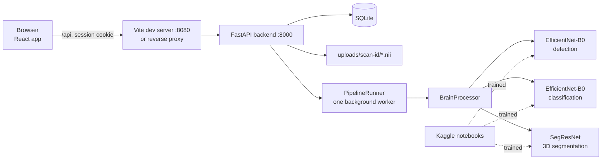

# NeuroScan AI Explained

This document explains the whole NeuroScan AI project from zero, for anyone preparing to present, demo or defend it in an interview or viva. Setup steps are in [README.md](README.md). Every number here comes from the repository's code, notebook outputs or docs.

## Contents

1. [The project in one minute](#1-the-project-in-one-minute)
2. [Background](#2-background)
3. [How it works, end to end](#3-how-it-works-end-to-end)
4. [Every part explained](#4-every-part-explained)
5. [Decisions](#5-decisions)
6. [Results and quality](#6-results-and-quality)
7. [Running and demoing it](#7-running-and-demoing-it)
8. [What could come next](#8-what-could-come-next)
9. [Interview and pitch preparation](#9-interview-and-pitch-preparation)
10. [Glossary](#10-glossary)

## 1. The project in one minute

**Problem.** Doctors use MRI (magnetic resonance imaging) scans to find brain tumours. Reading them takes time, and measuring the tumour by hand is slow. Many published AI papers report near-perfect accuracy, but their numbers are hard to trust because the same or near-identical images often appear in both the training and the test data.

**What the project does.** NeuroScan AI has two halves:

- **A web application.** A user uploads the four MRI sequences of one patient. The server answers three questions: is there a tumour, what type is it (glioma, meningioma or pituitary), and where exactly is it in 3D. The browser shows the scan in a multi-planar viewer with the tumour outlined, plus volumes and a PDF report.
- **A research study.** Three Kaggle notebooks compare 9 image models for detection, the same 9 for classification, and 3 3D models plus ensembles for segmentation, under a strict, leakage-controlled protocol. Two research papers are written from those results.

**Headline results.**

- Detection: three models tie at 0.9942 test accuracy (170 of 171 images); statistics show most models cannot be told apart.
- Classification: six models score 45 of 45, but the test set is too small and unbalanced to rank them.
- Segmentation: SegResNet alone reaches mean Dice 0.8717 on 56 internal BraTS 2020 patients and 0.7967 on 60 external BraTS-Africa patients. The proposed region-adaptive ensemble does not beat it (0.8530 and 0.7966), but disagreement between models flags bad segmentations with AUROC 0.99 internally and 0.87 externally.

The honest negative findings (ties, shortcut learning, no ensemble gain) are part of the contribution. No clinical validation exists; outputs are research results, not diagnoses.

## 2. Background

### MRI and its sequences

An MRI machine builds a 3D picture of the body using magnets and radio waves. The 3D picture is a **volume**: a stack of 2D **slices**, each made of pixels. A 3D pixel is a **voxel**. A BraTS volume is 240 x 240 x 155 voxels, each 1 mm on a side.

The same head can be imaged with different settings, called **sequences** or **modalities**. Each shows tissue differently:

| Sequence                | What stands out                                     | Used here for                         |
| ----------------------- | --------------------------------------------------- | ------------------------------------- |
| FLAIR                   | Swelling (oedema) around a tumour is bright         | Finding the whole tumour              |
| T1                      | Normal anatomy                                      | Context                               |
| T1CE (T1 with contrast) | Active tumour tissue that takes up the injected dye | Finding the core and enhancing tumour |
| T2                      | Fluid and swelling                                  | Context                               |

The project's sequence-drop test confirms this: removing FLAIR hurts whole-tumour Dice most, and removing T1CE hurts enhancing-tumour Dice most (Section 6).

### Brain tumour types

- **Glioma**: grows from glial (support) cells of the brain. BraTS splits gliomas into **HGG** (high grade, aggressive) and **LGG** (low grade, slower).
- **Meningioma**: grows from the membranes around the brain. Usually benign.
- **Pituitary tumour**: grows in the pituitary gland at the base of the brain.

### Tumour regions

BraTS labels three nested regions. Think of a fried egg on a plate of sauce: the sauce is swelling, the white is the core, the yolk is the active part.

- **WT (Whole Tumour)**: everything abnormal, including swelling.
- **TC (Tumour Core)**: the tumour without the swelling.
- **ET (Enhancing Tumour)**: the part that lights up with contrast.

They are nested: ET is inside TC, and TC is inside WT. The backend enforces this rule on its output.

### The three AI tasks

- **Detection** (binary classification): tumour or no tumour, from one 2D image.
- **Classification** (multiclass): which of three tumour types, from one 2D image.
- **Segmentation**: label every voxel of a 3D volume as WT, TC, ET or background.

### Deep learning basics

A **neural network** is a function with millions of adjustable numbers (**parameters** or **weights**). **Training** shows it many labelled examples and nudges the weights so its answers improve. A **CNN** (convolutional neural network) looks at small local patches and builds up to bigger patterns, like reading a page word by word. A **transformer** compares every part of the image with every other part through **attention**, like reading the whole page at once. A **hybrid** mixes both. **Transfer learning** starts from weights already trained on ImageNet (1.2 million everyday photos), so the model only needs to adapt, not learn vision from scratch.

### Data leakage

**Leakage** happens when the test set contains images that are the same as, or almost the same as, training images. The model then "remembers" instead of "understands", and test accuracy looks better than it really is. Public brain MRI datasets are often merged from each other, so duplicates are common. Fighting leakage is the central idea of the 2D study.

## 3. How it works, end to end

### System diagram

### One scan's journey

Take the sample case `BraTS20_Training_001` with four files: `..._flair.nii`, `..._t1.nii`, `..._t1ce.nii`, `..._t2.nii`.

1. **Upload.** On `/upload` the user drops the four files. The browser labels each file by name and sends them in one request to `POST /api/process-mri`, with the session cookie and the header `X-Requested-With: NeuroScan`.
2. **Checks.** The backend matches each file name to a modality (contains `FLAIR` -> flair; `T1CE` or `T1C` -> t1ce; `T2` -> t2; `T1` -> t1). It streams each file to `uploads/scan-<32 hex>/flair.nii` and so on, never using the client's file name as a path. It checks the NIfTI header: 3D or 4D, each side up to 1024, at most 32 Mi voxels, and size up to `MAX_UPLOAD_FILE_MB` (300 MB by default).
3. **Queue.** It creates a database row with status `queued` and answers `202 Accepted` at once. The job goes to a single background worker. If 8 jobs (`MAX_PENDING_JOBS`) are already waiting, it answers `503`.
4. **Detection.** The worker takes the middle axial slice of FLAIR, scales it to 0-255, makes it 3-channel, crops the brain (Gaussian blur 5 x 5, threshold 45, box around the largest contour), resizes to 224 x 224 and runs EfficientNet-B0. If `sigmoid(output) > 0.5`, a tumour is present.
5. **Classification.** A second EfficientNet-B0 runs on the same slice and picks the most likely of glioma, meningioma, pituitary (softmax argmax). If detection said "no tumour", the result is `No Tumour Detected`.
6. **Segmentation.** Because all four sequences are present, the worker crops the 3D volumes to the brain, normalises each sequence (z-score over non-zero voxels), and runs SegResNet over 128 x 128 x 128 windows with half overlap. It thresholds each channel at 0.5, removes an ET smaller than 800 voxels, enforces ET inside TC inside WT, and saves `segmentation.nii`.
7. **Volumes.** Voxel counts times voxel size give cubic centimetres. For this case the deployed model gives WT 197.4, TC 46.8, ET 29.0 cm^3 against reference values 212.0, 43.2 and 27.7 cm^3, in 83.5 s on an Intel Core i7-9750H CPU (`RESEARCH.md`).
8. **Display.** The scan page polls `GET /api/scans/{id}` and shows progress (`detection`, `classification`, `segmentation`, `complete`). When done, the viewer loads the volumes and the mask; the user can open a PDF report or download a CSV.

## 4. Every part explained

### 4.1 Repository layout

| Folder                       | Holds                                                                   |
| ---------------------------- | ----------------------------------------------------------------------- |
| `Backend/`                   | FastAPI application package `neuroscan/`, tests, pinned requirements    |
| `Frontend/`                  | React + TypeScript single-page app                                      |
| `Materials/Notebooks/`       | Three executed Kaggle notebooks and their downloaded outputs            |
| `Materials/Research Papers/` | Two LaTeX paper projects with submission variants                       |
| `Materials/` (root files)    | Review deck (24 slides), project report, templates, screenshots         |
| `scripts/`                   | `dev.mjs` (one-command launcher) and `build-papers.mjs` (paper builder) |
| `.github/`                   | CI workflow and Dependabot                                              |

### 4.2 Launcher (`scripts/dev.mjs`)

**What.** `npm run dev` sets up and starts everything. **How.** It creates `.venv` with Python 3.11, installs `Backend/requirements-dev.txt`, runs `npm ci`, writes a development `.env` with random `JWT_SECRET` and `DATA_ENCRYPTION_KEY`, starts Uvicorn on 127.0.0.1:8000 and Vite on 8080, and opens the browser. It skips reinstalling unless a requirements or lock file's SHA-256 changed. On Windows each service gets its own PowerShell window. **Why.** A new developer gets a running app with one command and no manual secret setup.

### 4.3 Backend (`Backend/neuroscan/`)

The backend is a **modular monolith**: one process, cleanly separated modules. Layers may only import downward: `app -> api -> scans -> inference`. This is enforced by `lint-imports`.

| Module                 | What it does                                                                                                             |
| ---------------------- | ------------------------------------------------------------------------------------------------------------------------ |
| `app.py`               | Builds the app: settings, database, storage, models, worker, middleware, routes. Re-queues unfinished scans at start-up. |
| `config.py`            | Reads settings from the environment and refuses to start with missing or example secrets.                                |
| `db.py`, `migrations/` | SQLite engine in WAL mode; Alembic migrations applied at start-up.                                                       |
| `models.py`            | Two tables: `user` and `scan`.                                                                                           |
| `schemas.py`           | Request and response shapes, password rules.                                                                             |
| `api/`                 | Routes for auth, scans and health; CSRF and security-header middleware. 23 routes in total.                              |
| `scans/`               | File storage, the background pipeline, CSV and PDF exports.                                                              |
| `inference/`           | Network definitions, NIfTI reading, `BrainProcessor`. No web or database code.                                           |
| `security/`            | bcrypt passwords, JWT tokens, TOTP, rate limiter. No web code.                                                           |
| `cli.py`               | Operator commands: `reset-password`, `unlock`, `disable-2fa`.                                                            |

**Authentication.** Passwords (12 to 72 bytes) are hashed with **bcrypt** at cost 12. A login sets an **HttpOnly**, **SameSite=Strict**, **Secure** cookie holding an HS256 **JWT** valid for 30 minutes. Each user has a token version; logout or password change increases it, which invalidates every older token. Five wrong attempts lock the account for 15 minutes, and auth routes allow 10 requests per minute per client. Optional **TOTP** two-factor authentication uses 30-second codes; the secret is encrypted at rest with **Fernet**.

**Ownership.** Scan routes return `404` both for missing scans and for other users' scans, so nobody can probe IDs.

**Reports.** `scans/exports.py` builds a paginated PDF (letterhead, patient details, impression, sequences, probabilities, volumes, key images with overlay, methodology, limitations, sign-off block) with reportlab, and CSV files whose cells starting with `=`, `+`, `-`, `@` are prefixed with `'` so spreadsheets do not run them as formulas.

**Observability.** Logs are JSON lines in production and coloured lines in development. Every error response carries a request ID that also appears in the log.

### 4.4 Inference (`Backend/neuroscan/inference/`)

- `networks.py` builds EfficientNet-B0 heads (1 output for detection, 3 for classification) with torchvision, and SegResNet with MONAI 1.6.1 `SegResNetDS`, the exact version used for training.
- `volumes.py` reads NIfTI files with nibabel.
- `processor.py` holds `BrainProcessor`, which runs the steps in [Section 3](#one-scans-journey).
- Weights are loaded with `torch.load(weights_only=True)`, so a weight file cannot run code.

The deployed SegResNet has 19,917,353 parameters; each EfficientNet-B0 about 4 million.

### 4.5 Frontend (`Frontend/src/`)

React 19 with TypeScript, Vite, Tailwind CSS 4 and Radix UI primitives. **React Query** handles fetching, caching and polling of scans. Pages: login and register, dashboard, upload, scan library, scan detail, reports, settings, and a 404 page. Layers: `pages -> components -> hooks -> lib`, enforced by ESLint; `lib/api.ts` is the only place that calls the server.

The **viewer** shows linked axial, coronal and sagittal slices with the WT/TC/ET overlay, and a 3D volume rendering with vtk.js. Users can change overlay colours, window the image, measure and capture. The design system (palette, type, components) is in [DESIGN.md](DESIGN.md).

### 4.6 Detection and classification notebooks

Both notebooks run the same code with different data.

**Data.**

| Notebook       | Sources                                 | Images | After deduplication | Test images                                |
| -------------- | --------------------------------------- | ------ | ------------------- | ------------------------------------------ |
| Detection      | Br35H (3,000), Chakrabarty (253)        | 3,253  | 1,185               | 171                                        |
| Classification | Bhuvaji (2,764), Cheng figshare (3,064) | 5,828  | 4,730               | 45 (1 glioma, 13 meningioma, 31 pituitary) |

**Pipeline.**

1. **Perceptual-hash deduplication.** Each image gets a 64-bit **pHash**, a fingerprint that stays similar when an image is resized or slightly changed. Two images of the same label whose hashes differ in at most 5 bits (**Hamming distance**) count as duplicates; one is dropped. Pairs with different labels within that distance are compared with **NCC** (normalised cross-correlation); near-identical ones (8 pairs in classification) are true label noise and both copies are removed. Detection lost 63.57% of its images; classification 18.84%.
2. **Group-aware split.** Images within Hamming 8 or NCC at least 0.98 are joined into groups, a stand-in for "same patient" because the datasets have no patient IDs. `StratifiedGroupKFold` makes a held-out test set and 5 folds so no group crosses a split. A leakage audit then finds 0 test images near any development image.
3. **Training.** 9 backbones: ResNet50, VGG16, DenseNet121, EfficientNetB0, MobileNetV3-Large, InceptionV3 (CNNs), ViT-B/16, Swin-Base (transformers), CoAtNet-0 (hybrid). Each runs 5 folds. Settings: AdamW, learning rate 3e-4, weight decay 0.01, 20 epochs, 1 warm-up epoch then cosine decay, effective batch 64, gradient clipping 1.0, mixed precision, light GPU augmentation (flip, 10 degree rotation, 20% brightness and contrast). The checkpoint with the lowest validation loss is kept. Every model gets the same number of optimiser steps, so the comparison is fair.
4. **Calibration.** **Temperature scaling** fits one number per run on validation data to make probabilities honest; the threshold is tuned by Youden's J.
5. **Evaluation.** The 5 folds are averaged into a **fold ensemble** and scored on the test set with bootstrap 95% confidence intervals, **McNemar** tests between every pair with **Holm** correction, and a gap-to-leader interval.
6. **Interpretability and shortcut tests.** Grad-CAM, attention rollout and occlusion maps; the share of map energy outside the head; masking tests; and a **shortcut test** that retrains models on images with the head blacked out.
7. **Efficiency.** Latency, throughput, training time and memory on one T4.
8. **Export.** The EfficientNetB0 fold with the lowest validation loss is exported to `weights/deploy/EfficientNetB0.pth` with a reload check.

### 4.7 Segmentation notebook

**Data.** 369 BraTS 2020 cases (293 HGG, 76 LGG) split 257 train / 56 validation / 56 test by grade, plus 60 BraTS-Africa cases as an **external test** never used for training or selection. BraTS-Africa tumours are larger on average (mean WT 161.36 cm^3 against 96.44 for HGG).

**Preprocessing.** Crop each case to its brain box, z-score each sequence over non-zero voxels, cache at native 1 mm resolution as float16 (429 cases, 12.45 GB, 337 s).

**Members.**

| Model                   | Family      | Parameters (M) | Optimiser, LR | Epochs x 250 steps |
| ----------------------- | ----------- | -------------- | ------------- | ------------------ |
| nnU-Net (MONAI DynUNet) | CNN         | 31.42          | SGD, 1e-2     | 60                 |
| SegResNet (SegResNetDS) | CNN         | 19.92          | AdamW, 2e-4   | 60                 |
| Swin UNETR v2           | Transformer | 72.77          | AdamW, 1e-4   | 30                 |

Training uses 128^3 patches (33% centred on tumour), Dice + BCE loss with deep supervision, strong 3D augmentation, and one seed (42). Inference uses a Gaussian-weighted sliding window with 8-flip **TTA** (test-time augmentation).

**Region-adaptive hybrid ensemble.** For each region separately, a search on the 56 validation cases picks weights for the three members (0.1 grid) and a threshold:

| Region | nnU-Net | SegResNet | Swin UNETR | Threshold |
| ------ | ------- | --------- | ---------- | --------- |
| WT     | 0.4     | 0.6       | 0.0        | 0.4       |
| TC     | 0.4     | 0.5       | 0.1        | 0.3       |
| ET     | 0.5     | 0.5       | 0.0        | 0.4       |

The idea came from an earlier run where transformers were more sensitive and CNNs more precise. In the final run the search gave the transformer weight only for TC.

**Quality control.** Two warning signals per case: **architectural disagreement** (1 minus the mean pairwise Dice between members) and **TTA spread**.

**Explainability.** Seg-Grad-CAM maps with an enrichment score, and a sequence-drop ablation.

**Deployment.** The run exports no deployment file, so `segresnet_seed42.pth` was copied unchanged to `weights/deploy/SegResNet.pth`. The project owner chose SegResNet alone over the full ensemble because the ensemble needs 124.1 M parameters and 6.0 s per case on a T4 without TTA and is not better.

### 4.8 Papers, deck and report

- **Classification paper**: nine-backbone benchmark for detection and subtype classification with perceptual-hash deduplication, with a separate supplementary document cross-linked through `xr-hyper`.
- **Segmentation paper**: region-adaptive CNN-transformer ensembles with external validation and disagreement-based quality control.

Both use the Elsevier CAS single-column template targeting _Engineering Applications of Artificial Intelligence_. `npm run papers` builds each with Tectonic, plus `main-anonymised` (double-blind copy), `main-title-page` (separate title page) and `main-no-references` (Turnitin copy). The review deck (`Materials/Presentation.pptx`, 24 slides) and the report (`Materials/Report.docx`) are built from the VIT templates.

### 4.9 Testing, CI and code quality

- 64 backend tests (pytest) with a fake inference engine, so no weights are needed; `test_inference.py` also checks the SegResNet layout against the checkpoint's parameter count.
- 39 frontend tests (Vitest).
- ruff, strict mypy, import-linter (3 contracts), bandit, pip-audit, ESLint, strict TypeScript, Prettier, jscpd (0 clones), npm audit.
- CI on GitHub Actions runs all of these plus a gitleaks secret scan of the whole history. Dependabot keeps dependencies current.

### 4.10 History

The repository started on 2026-02-17 as a basic web app. Later work, from `git log` (135 commits):

- February to September 2026: frontend and backend refactors, removal of older viewer libraries, auth hardening with migrations, a security review.
- October 2026: notebooks rebuilt around leakage control; Prettier and CI checks added; papers, report and deck written; on 2026-10-22 the segmentation notebook was rebuilt as a hybrid ensemble with external validation, after the old best Dice (0.8199, UNet) was weaker than a published comparison; on 2026-10-25 the web app switched from an older 128^3 VNet to the new SegResNet; on 2026-10-26 submission variants of both papers were added.

## 5. Decisions

| Decision                                             | Why                                                                                                                                       | Pros                                              | Cons                                                                  | Alternatives, and when they win                                      |
| ---------------------------------------------------- | ----------------------------------------------------------------------------------------------------------------------------------------- | ------------------------------------------------- | --------------------------------------------------------------------- | -------------------------------------------------------------------- |
| Three separate models (detect, classify, segment)    | Each task has its own public data and labels                                                                                              | Each part can be studied and replaced alone       | 2D models see one slice; errors can stack                             | One 3D multi-task model, if one dataset had all labels               |
| EfficientNet-B0 for 2D deployment                    | Tied for best detection accuracy (0.9942) with 4 M parameters and 1,393 images/s throughput                                               | Small, fast on CPU                                | Not the classification leader (44 of 45)                              | CoAtNet-0 or ViT-B/16, if GPU cost does not matter                   |
| SegResNet alone for 3D deployment                    | Best internal Dice (0.8717), equal to the ensemble externally, 1/6 the parameters of the ensemble (project owner's choice, `RESEARCH.md`) | Simple, smaller, faster                           | Loses QC disagreement signal                                          | The full ensemble, if a GPU is available and the QC signal is wanted |
| No TTA in the web app                                | TTA makes CPU inference 8 times slower                                                                                                    | 83.5 s instead of about 11 minutes                | Deployed accuracy without TTA is not measured                         | Enable TTA on GPU servers                                            |
| Perceptual-hash deduplication before splitting       | Public sets share near-duplicates, which inflate scores                                                                                   | Measurable leakage control (0 leaked test images) | Threshold 5 is not validated; pHash misses rotated copies             | Learned embeddings (for example CNN features) for harder duplicates  |
| Group-aware split                                    | No patient IDs exist; similarity groups approximate patients                                                                              | Prevents same-patient leakage                     | One 1,431-image group made the classification test set only 45 images | A smaller group tolerance, or patient-labelled data                  |
| MONAI networks instead of hand-written ones          | Tested, maintained implementations                                                                                                        | Less code, standard designs                       | Version pin must match weights                                        | Hand-written models (more control, more bugs)                        |
| BraTS-Africa as external test                        | Different population and scanners, same label protocol; BraTS 2021 overlaps BraTS 2020                                                    | Real generalisation test                          | Same annotation protocol, so it does not test protocol shift          | Institutional data, if it can be obtained                            |
| Modular monolith, one process                        | One team, one deployment, one inference budget (`ARCHITECTURE.md`)                                                                        | Simple to run and reason about                    | Cannot scale out as is                                                | Separate inference service and job broker at higher load             |
| Single background worker thread                      | Inference holds large tensors; one worker bounds memory                                                                                   | Requests stay fast; no lost work after restart    | One scan at a time                                                    | Celery or RQ with Redis for several workers                          |
| HttpOnly cookie sessions, not tokens in localStorage | Injected script cannot read the cookie                                                                                                    | Strong XSS and CSRF protection                    | Needs same-origin deployment                                          | Bearer tokens, for third-party API clients                           |
| SQLite with WAL                                      | Small data, one writer                                                                                                                    | Zero setup                                        | One writer, one machine                                               | PostgreSQL for several instances                                     |
| Server-side PDF and CSV                              | One place for report content and formula escaping                                                                                         | Consistent output                                 | PDF layout code is large (794 lines)                                  | Client-side PDF generation                                           |
| `weights_only=True` loading                          | Weight files are data, not code                                                                                                           | Blocks pickle attacks                             | None noted                                                            | None                                                                 |

## 6. Results and quality

### Metrics explained

| Metric                           | What it measures                                                                | Range, good value                                      |
| -------------------------------- | ------------------------------------------------------------------------------- | ------------------------------------------------------ |
| Accuracy                         | Share of correct predictions                                                    | 0 to 1, higher is better                               |
| Sensitivity (recall)             | Share of real tumours found                                                     | 0 to 1; missing a tumour is costly                     |
| Specificity                      | Share of non-tumours correctly cleared                                          | 0 to 1                                                 |
| F1, macro F1                     | Balance of precision and recall; macro averages over classes                    | 0 to 1                                                 |
| ROC AUC                          | How well scores rank positives above negatives at any threshold                 | 0.5 is chance, 1 is perfect                            |
| ECE (expected calibration error) | Gap between stated confidence and actual accuracy                               | 0 is perfect                                           |
| MCC                              | Correlation between prediction and truth, robust to imbalance                   | -1 to 1                                                |
| Dice                             | Overlap of predicted and true mask: 2 x overlap / (sum of sizes)                | 0 to 1; above 0.9 is very good for WT                  |
| HD95                             | 95th percentile distance between predicted and true borders, in mm              | Lower is better; 373.13 mm penalty for a missed region |
| 95% CI                           | Range likely to hold the true value, from bootstrap resampling                  | Narrower means more certain                            |
| Holm-corrected p                 | Probability of the observed difference by chance, adjusted for many comparisons | Below 0.05 means significant                           |
| AUROC for failures               | How well a QC signal separates failed cases from good ones                      | 0.5 chance, 1 perfect                                  |

### Detection (171 test images)

CoAtNet-0, EfficientNetB0 and ViT-B/16 each reach 0.9942 (95% CI 0.9825 to 1.0000). All Holm-corrected McNemar p-values are 1.0; only VGG16 and MobileNetV3-Large (0.9708) are separable from the leader. **Read:** on this test set, most modern backbones are statistically equal.

### Classification (45 test images)

Six models score 1.0000, three score 0.9778 (one meningioma called glioma). **Read:** the test set cannot rank the models; this is a limitation, not a win.

### Shortcut test

Models trained on images with the head blacked out still beat the majority rate for 7 of 9 detection models (EfficientNetB0 0.7778 against 0.6257) and all 9 classification models. **Read:** the backgrounds carry dataset clues (image size, borders, scanner style), so part of the high accuracy may come from shortcuts, not anatomy.

### Calibration

Temperature scaling lowered detection ECE only for ResNet50 and ViT-B/16. Several fold-4 temperatures hit the search's lower bound (about 0.0498). **Read:** calibration on small validation folds was unstable.

### Segmentation

| Model             | Internal mean Dice | External mean Dice |
| ----------------- | ------------------ | ------------------ |
| SegResNet         | 0.8717             | 0.7967             |
| Proposed ensemble | 0.8530             | 0.7966             |
| CNN mean ensemble | 0.8512             | 0.8005             |
| nnU-Net           | 0.8404             | 0.7765             |
| Swin UNETR        | 0.8360             | 0.7888             |

- The ensemble beats nnU-Net and Swin UNETR internally, but is significantly worse than SegResNet (Holm p = 0.018) and equal externally.
- Every model drops 0.05 to 0.075 Dice on external data; Swin UNETR drops least.
- LGG cases are much harder (SegResNet LGG ET Dice 0.5822).
- Disagreement flags failures (mean Dice below 0.80) with AUROC 0.9932 internally and 0.8704 externally, beating TTA spread (0.7160 and 0.7910). This is the strongest positive result.
- Seg-Grad-CAM maps of the CNNs are 4 to 23 times enriched inside the tumour; Swin UNETR maps are near chance.
- One external case, BraTS-SSA-00215-000, is missed by every model.

### Limitations

- The web app uses one middle 2D slice for detection and classification; notebook scores do not transfer directly to NIfTI uploads, and end-to-end web accuracy is not measured.
- The backend ignores the exported temperature and threshold and runs segmentation without TTA.
- One seed per segmentation model; no seed variance.
- No patient IDs in 2D data; no DICOM support; one backend process; no email-based password reset.
- The deduplication threshold of 5 is unvalidated: all hashes have exactly 32 set bits, so tolerances 4 and 5 give the same result.

## 7. Running and demoing it

1. Place the three weight files (see [README.md](README.md#quick-start)).
2. Run `npm run dev` at the repository root.
3. Register at `http://localhost:8080/register`.
4. Upload the four files of `Materials/Input/BraTS20_Training_001` on the Upload page.
5. Watch the progress steps, then show the viewer (scroll slices, toggle WT/TC/ET, rotate the 3D view), the volumes, and open the PDF report.
6. For the research side, open `Materials/Notebooks/README.md` and the plots it shows.

## 8. What could come next

- Measure the full web pipeline on NIfTI uploads, with and without TTA.
- Apply the exported temperature and threshold in the backend, or drop them from the export.
- Run a deduplication threshold sensitivity study (2, 4, 6, 8) against visually confirmed pairs.
- Use a smaller group tolerance so the classification test set is larger and balanced.
- Train segmentation with several seeds to measure variance.
- Ship the disagreement signal as a "review this case" warning, which needs the ensemble on a GPU.
- Use the whole volume, not one slice, for detection and classification.
- Add DICOM import, a shared job queue and PostgreSQL to scale out (growth signals in [ARCHITECTURE.md](ARCHITECTURE.md#growth-signals)).

## 9. Interview and pitch preparation

### 30-second version

NeuroScan AI is a web app that takes a patient's four brain MRI sequences, detects a tumour, names its type and outlines it in 3D, with volumes and a PDF report. Behind it is a research study that compares 9 image models and 3 3D models under a strict anti-leakage protocol. The main finding is honest: once duplicates are removed, most models tie, and a simple SegResNet beats a fancier ensemble, but model disagreement reliably flags bad segmentations.

### 2-minute version

Brain tumour AI papers often report 99% accuracy, but public datasets contain near-duplicate images in both training and test sets. I built a pipeline that fingerprints every image with a perceptual hash, removes duplicates, groups similar images as a stand-in for patients, and splits so no group crosses train and test. Then I trained 9 backbones on detection and classification under identical budgets, with calibration and proper statistics. Most models are statistically tied, and a background-only test showed the datasets carry shortcuts. For 3D segmentation I trained nnU-Net, SegResNet and Swin UNETR on BraTS 2020, built a region-wise weighted ensemble, and tested on 60 BraTS-Africa patients. SegResNet alone was best, at 0.87 Dice internally and 0.80 externally, and disagreement between models detected failures with AUROC 0.99. The deployed app is a FastAPI and React system with secure cookie sessions, 2FA, background processing and a 3D viewer, tested by 103 automated tests in CI.

### Likely questions

**Why EfficientNet-B0 and not the top model?** It tied for top detection accuracy with only 4 M parameters and the second-highest throughput, which matters for CPU deployment. The statistics show no backbone is clearly better.

**Your ensemble lost to SegResNet. Why publish it?** The negative result is reported honestly with p = 0.018. The useful part is the disagreement signal for quality control, and the external validation itself.

**How do you know there is no leakage?** The leakage audit found 0 test images within Hamming 5, Hamming 8 or NCC 0.98 of any development image. But pHash cannot catch every transform, and groups are only a proxy for patients.

**Why was the deduplication threshold 5?** It was carried over from an earlier version and is not validated. Because every hash has 32 set bits, 4 and 5 give identical results. A sensitivity study is listed as next work.

**Why does the 2D test accuracy not transfer to the app?** The notebooks use public JPEG slices; the app uses the middle slice of an uploaded NIfTI volume of a known sequence. End-to-end accuracy on uploads was not measured.

**What would break at scale?** The job queue and rate limiter live in memory, and SQLite has one writer, so only one backend process can run. The seams to change are `PipelineRunner.submit` and `RateLimiter.allow`; move to Redis and PostgreSQL.

**Why cookies and not JWT in localStorage?** An HttpOnly cookie cannot be stolen by injected script; SameSite=Strict plus a required custom header blocks CSRF.

**What happens if the model files are missing?** The app starts, `/api/ready` reports `models: false`, uploads return 503, and a missing segmentation file only skips segmentation.

**Why no TTA in the app?** It is 8 times slower on CPU. The trade-off is that deployed accuracy without TTA is not measured.

**What was the hardest part?** Running the 3D notebook within one 12-hour Kaggle session on two T4 GPUs: six attempts failed on meta-device profiling, an outdated PyTorch image, a silent fork-based pool, a Swin UNETR out-of-memory error and the Grad-CAM cell before the run of 2026-10-24 finished in 547.9 minutes.

**Is this a medical device?** No. There is no clinical validation; outputs are research results.

### Users, value and competitors

- **Users**: researchers and students studying brain tumour AI; potentially radiology teams as a second-reader tool after clinical validation.
- **Value**: automatic volumes and 3D outlines in minutes, and a reproducible, leakage-controlled benchmark.
- **Comparable work**: nnU-Net and MONAI (segmentation frameworks), and many published 2D classifiers. Commercial tools are not compared in this repository.

## 10. Glossary

- **Alembic**: a tool that applies versioned database schema changes.
- **Attention rollout**: a way to visualise where a transformer looks by combining its attention layers.
- **AUROC / ROC AUC**: area under the ROC curve; how well scores rank positives above negatives.
- **Backbone**: the main feature-extracting network of a model.
- **bcrypt**: a slow, salted password-hashing function that resists guessing.
- **Bootstrap**: resampling the test set many times to estimate a confidence interval.
- **BraTS**: the Brain Tumour Segmentation challenge datasets with expert labels for four MRI sequences.
- **BraTS-Africa**: a BraTS dataset from sub-Saharan African patients, used here as external test data.
- **Calibration**: making predicted probabilities match real-world frequencies.
- **CNN**: convolutional neural network; learns local image patterns.
- **CSRF**: cross-site request forgery; another site tricking a browser into making requests.
- **Deep supervision**: adding losses at intermediate decoder outputs to help training.
- **Dice**: overlap score between two masks, from 0 to 1.
- **ECE**: expected calibration error.
- **Ensemble**: combining several models' predictions.
- **Epoch**: one pass over the training data (here, 250 steps per epoch for 3D).
- **External validation**: testing on data from a different source than training.
- **FastAPI**: a Python web framework for building APIs.
- **Fernet**: a symmetric encryption scheme from the cryptography library.
- **Fold**: one of the k parts in cross-validation.
- **Grad-CAM**: a heat map of which image regions most influenced a CNN's output.
- **Hamming distance**: number of bits that differ between two fingerprints.
- **HD95**: 95th percentile Hausdorff distance between borders, in mm.
- **HGG / LGG**: high-grade and low-grade glioma.
- **Holm correction**: adjusts p-values when many tests are run.
- **HttpOnly cookie**: a cookie JavaScript cannot read.
- **JWT**: JSON Web Token; a signed token that proves a session.
- **Leakage**: test data that overlaps training data, inflating scores.
- **McNemar test**: compares two classifiers on the same test items.
- **MONAI**: a PyTorch library for medical imaging.
- **NCC**: normalised cross-correlation; pixel similarity from -1 to 1.
- **NIfTI**: a file format (`.nii`, `.nii.gz`) for 3D medical volumes.
- **nnU-Net**: a self-configuring U-Net method; here MONAI's DynUNet.
- **pHash**: perceptual hash; a 64-bit image fingerprint robust to small changes.
- **React Query**: a library that fetches, caches and refreshes server data in React.
- **SegResNet**: a residual encoder-decoder CNN for 3D segmentation.
- **Shortcut learning**: a model using irrelevant clues, like background, instead of the real signal.
- **Sliding window**: predicting a large volume by running the model over overlapping patches.
- **SQLite / WAL**: a single-file database; write-ahead logging lets reads and writes overlap.
- **Swin UNETR**: a 3D segmentation model with a Swin transformer encoder.
- **Temperature scaling**: dividing model outputs by one fitted number to calibrate probabilities.
- **TOTP**: time-based one-time password, the 6-digit codes of authenticator apps.
- **Transfer learning**: starting from weights trained on another task.
- **Transformer**: a network that relates all parts of the input through attention.
- **TTA**: test-time augmentation; averaging predictions over flipped copies of the input.
- **Voxel**: a 3D pixel.
- **Youden's J**: sensitivity plus specificity minus 1; used to choose a threshold.
- **z-score**: subtracting the mean and dividing by the standard deviation.
