# Research notebooks and results

This folder holds the three Kaggle notebooks behind NeuroScan AI and the outputs downloaded from their executed runs. Every number and figure below is copied from those outputs (`metrics/`, `logs/`, `plots/`, `weights/deploy/metadata.json`); nothing here was re-run locally.

| Notebook                                           | Task                                                                   | Models                                              | Outputs folder                           | Notebook time                |
| -------------------------------------------------- | ---------------------------------------------------------------------- | --------------------------------------------------- | ---------------------------------------- | ---------------------------- |
| [`binary-detection.ipynb`](binary-detection.ipynb) | Tumour-positive vs tumour-negative 2D MRI slices                       | 9                                                   | [`binary-detection/`](binary-detection/) | 71.8 min                     |
| [`classification.ipynb`](classification.ipynb)     | Glioma vs meningioma vs pituitary 2D MRI slices                        | 9                                                   | [`classification/`](classification/)     | 273.6 min                    |
| [`segmentation.ipynb`](segmentation.ipynb)         | Whole tumour (WT), tumour core (TC), enhancing tumour (ET), BraTS 2020 | 3 + ensemble (outputs: 6 from the previous version) | [`segmentation/`](segmentation/)         | 521.7 min (previous version) |

Notebook times are `notebook_minutes` in each `metrics/run_summary.json`. The segmentation notebook has since been rewritten and not yet run; its outputs folder still holds the previous version's run (see [Segmentation notebook](#segmentation-notebook)).

## Contents

- [How the folder is organised](#how-the-folder-is-organised)
- [Run environment](#run-environment)
- [Binary detection notebook](#binary-detection-notebook)
- [Classification notebook](#classification-notebook)
- [Segmentation notebook](#segmentation-notebook)
- [Checkpoints used by the web app](#checkpoints-used-by-the-web-app)
- [Limitations recorded by the notebooks](#limitations-recorded-by-the-notebooks)

## How the folder is organised

```text
Materials/Notebooks/
|-- binary-detection.ipynb       Executed notebook with all cell outputs (25 inline figures)
|-- classification.ipynb         Executed notebook with all cell outputs (26 inline figures)
|-- segmentation.ipynb           Revised notebook, not yet run (no outputs)
`-- <task>/                      Outputs downloaded from the executed Kaggle run
    |-- __notebook__.ipynb       Kaggle's copy of the same run (Git-ignored); same cells, without the last cell's output
    |-- metrics/                 CSV tables and JSON summaries; metrics/runs/<run>/ per-run history
    |-- plots/                   Every figure as PNG
    |-- logs/                    notebook.log, worker_gpu0/1.log, events_gpu0/1.jsonl, status_gpu0/1.json
    |-- predictions/             2D tasks: <run>.npz logits; segmentation: <run>.npy test probabilities (current notebook: <run>/<split>/<case>.npz)
    |-- weights/<model>/         Best-validation checkpoint of every run (*.pth, Git-ignored)
    |-- weights/deploy/          Checkpoint exported for the web app plus metadata.json
    `-- src/                     The library and worker modules each notebook writes and imports
```

The root `.gitignore` excludes `__notebook__.ipynb`, `*.pth`, `*.log` and `*.npy`, and `Materials/Notebooks/segmentation/predictions/`, so a fresh clone has the two executed 2D notebooks, the revised segmentation notebook, `deploy/metadata.json`, metrics, plots, JSON logs and `.npz` predictions, but not Kaggle's duplicate notebook copies, the weights, the text logs or the segmentation probability files.

Each notebook writes its shared code to `src/` in an early cell and runs training in one worker process per GPU: the 2D notebooks write `image_lib.py`, `image_worker.py` and `shared_lib.py`; the segmentation notebook writes `volume_lib.py`, `volume_worker.py` and `shared_lib.py`.

## Run environment

All three runs used Kaggle with two Tesla T4 GPUs (14.6 GB each as reported by the notebook), 4 CPU cores and 33.7 GB RAM (`logs/notebook.log`). From each `metrics/run_summary.json`:

| Item          | Binary detection | Classification | Segmentation |
| ------------- | ---------------- | -------------- | ------------ |
| Python        | 3.13.15          | 3.13.15        | 3.13.15      |
| PyTorch       | 2.11.0+cu128     | 2.11.0+cu128   | 2.11.0+cu128 |
| torchvision   | 0.26.0+cu128     | 0.26.0+cu128   | not recorded |
| timm          | 1.0.29           | 1.0.29         | not used     |
| CUDA          | 12.8             | 12.8           | 12.8         |
| Deterministic | False            | False          | False        |
| Training wall | 63.5 min         | 264.6 min      | 515.0 min    |
| Jobs finished | 54 of 54         | 54 of 54       | 6 of 6 runs  |

The 2D notebooks also print numpy 2.1.3 and pandas 2.3.3 in their first cell.

## Binary detection notebook

Source: [`binary-detection.ipynb`](binary-detection.ipynb). Outputs: [`binary-detection/`](binary-detection/).

### 1. Setup

- **Imports.** Installs `imagehash` and `timm` only if missing and prints the library versions listed above.
- **Configuration.** One cell holds every setting. Task `binary`, classes `Tumour-negative` and `Tumour`, nine models (ResNet50, VGG16, DenseNet121, EfficientNetB0, MobileNetV3-Large, InceptionV3, ViT-B/16, Swin-Base, CoAtNet-0), `SEED = 42`, `N_FOLDS = 5`, `TEST_FRACTION = 0.15`, `EPOCHS = 20`, `WARMUP_EPOCHS = 1`, `EFFECTIVE_BATCH = 64`, `LR = 3e-4`, `WEIGHT_DECAY = 0.01`, `GRAD_CLIP = 1.0`, `CACHE_SIZE = 320`, `DEDUP_TOLERANCE = 5`, `GROUP_TOLERANCE = 8`, `NCC_DUPLICATE = 0.98`, `SHORTCUT_TEST = True`, `BOOTSTRAP_SAMPLES = 2000`, `TRAINING_BUDGET_HOURS = 9.0`, `DEPLOY_MODEL = "EfficientNetB0"`. Output: `Task: binary | classes: ['Tumour-negative', 'Tumour'] | models: 9 | folds: 5`.
- **Hardware check.** Stops unless two GPUs are visible. Output: two Tesla T4 lines, 4 CPU cores, 33.7 GB RAM, 20.9 GB free disk.
- **Shared library, training worker, worker launcher.** Write `src/image_lib.py`, `src/image_worker.py` and `src/shared_lib.py`, then import them. Output: `Library loaded: 9 registered architectures`.

Model construction (`image_lib.build_model`): every model except CoAtNet-0 comes from torchvision with its `DEFAULT` ImageNet weights and a replaced final linear layer; CoAtNet-0 is timm `coatnet_0_rw_224`. InceptionV3's auxiliary classifier is removed. The worker trains with AdamW, a linear warm-up for one epoch then cosine decay per optimiser step, fp16 autocast with gradient scaling, gradient clipping at 1.0, binary cross-entropy with logits (cross-entropy for subtypes), and keeps the checkpoint with the lowest validation log-loss. Augmentation runs on the GPU: horizontal flip (p = 0.5), rotation up to 10 degrees, and brightness and contrast jitter of 20 percent. Every image is cropped with `crop_to_brain`, the same Gaussian blur (5 x 5), threshold 45 and largest-contour box the web app uses.

### 2. Data

- **Collect the image pool.** Output: `Pool: 3253 images | external: 0`.
- **Decode, hash, crop and cache.** Computes the native size, 64-bit perceptual hash and a 64 x 64 thumbnail of every original image and caches the brain crop. Output: `Cached 3253 images in 39s (1.33 GB); unreadable: 0`.
- **Dataset overview.** Provenance table (`metrics/provenance.csv`) and two figures.

| Source      | Tumour | Tumour-negative | Total | Distinct sizes | Modal size | Modal share | Median crop fraction |
| ----------- | ------ | --------------- | ----- | -------------- | ---------- | ----------- | -------------------- |
| Br35H       | 1,500  | 1,500           | 3,000 | 291            | 225x225    | 0.109       | 0.787                |
| Chakrabarty | 155    | 98              | 253   | 184            | 225x225    | 0.071       | 0.783                |
| Total       | 1,655  | 1,598           | 3,253 |                |            |             |                      |

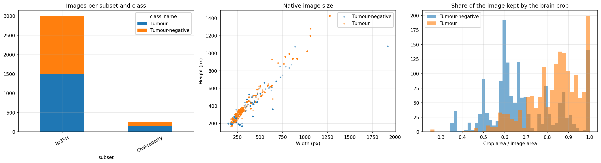

_Images per source and class and native image sizes of the binary pool._

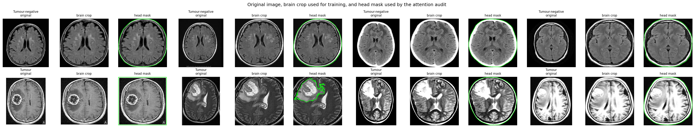

_Sample images, the brain crop the model sees, and the head masks used later by the attention audit._

### 3. Deduplication

- **Label-aware perceptual-hash deduplication.** 64-bit pHash, Hamming distance at most 5, applied per label before any split. Cross-label pairs within the tolerance are checked with thumbnail normalised cross-correlation (NCC). Output: `Cross-label pairs within Hamming 5: 0 (0 label noise, 0 hash false positives)`; `metrics/cross_label_pairs.csv` is empty.

| Class (`deduplication_summary.csv`) | Before | Duplicates removed | Label noise excluded | After | Removed |
| ----------------------------------- | ------ | ------------------ | -------------------- | ----- | ------- |
| Tumour-negative                     | 1,598  | 1,143              | 0                    | 455   | 71.53%  |
| Tumour                              | 1,655  | 925                | 0                    | 730   | 55.89%  |
| Total                               | 3,253  | 2,068              | 0                    | 1,185 | 63.57%  |

| Removed image source (`deduplication_by_source.csv`) | Kind          | Tumour | Tumour-negative | All   |
| ---------------------------------------------------- | ------------- | ------ | --------------- | ----- |
| Br35H                                                | cross-source  | 312    | 417             | 729   |
| Br35H                                                | within-source | 588    | 704             | 1,292 |
| Chakrabarty                                          | within-source | 25     | 22              | 47    |
| All                                                  |               | 925    | 1,143           | 2,068 |

- **Threshold sensitivity** (`deduplication_threshold_sweep.csv`). Images kept at each Hamming tolerance:

| Tolerance       | 0, 1  | 2, 3  | 4, 5  | 6, 7  | 8, 9 | 10, 11 | 12  |
| --------------- | ----- | ----- | ----- | ----- | ---- | ------ | --- |
| Kept            | 2,077 | 1,495 | 1,185 | 1,002 | 882  | 804    | 709 |
| Tumour-negative | 860   | 583   | 455   | 395   | 341  | 310    | 285 |
| Tumour          | 1,217 | 912   | 730   | 607   | 541  | 494    | 424 |

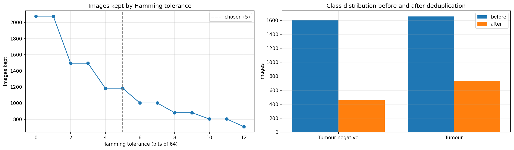

_Images kept at each tolerance, and the class distribution before and after the pass at tolerance 5._

- **Cross-label pairs.** Output: `No cross-label pairs within the tolerance.` (no gallery is saved for this task).

### 4. Group-aware split and leakage audit

Kept images linked by Hamming distance at most 8 or NCC at least 0.98 are joined into groups, a proxy for patient-level grouping. `StratifiedGroupKFold` draws a held-out test set and five development folds so no group crosses a partition. Output: `1185 images in 821 groups; largest group 7 images; 260 groups with more than one image`.

| Role (`split_roles.csv`) | Tumour | Tumour-negative | Total |
| ------------------------ | ------ | --------------- | ----- |
| Development (5 folds)    | 623    | 391             | 1,014 |
| Test                     | 107    | 64              | 171   |
| Removed duplicate        | 925    | 1,143           | 2,068 |
| Total                    | 1,655  | 1,598           | 3,253 |

| Fold (`fold_distribution.csv`) | 0   | 1   | 2   | 3   | 4   | All   |
| ------------------------------ | --- | --- | --- | --- | --- | ----- |
| Tumour                         | 110 | 123 | 133 | 133 | 124 | 623   |
| Tumour-negative                | 74  | 88  | 74  | 77  | 78  | 391   |
| All                            | 184 | 211 | 207 | 210 | 202 | 1,014 |

Leakage audit (`leakage_audit.csv`): 0 test images have a development image within Hamming 5, within Hamming 8, or at NCC 0.98 or more. `metrics/splits.csv` lists the role and fold of every image.

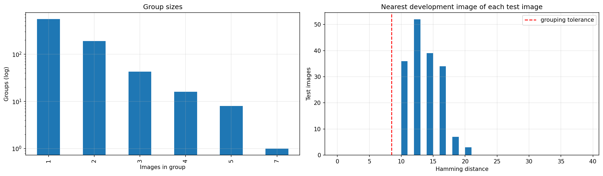

_Group sizes and the distance from each test image to its nearest development image._

- **Augmentation preview.**

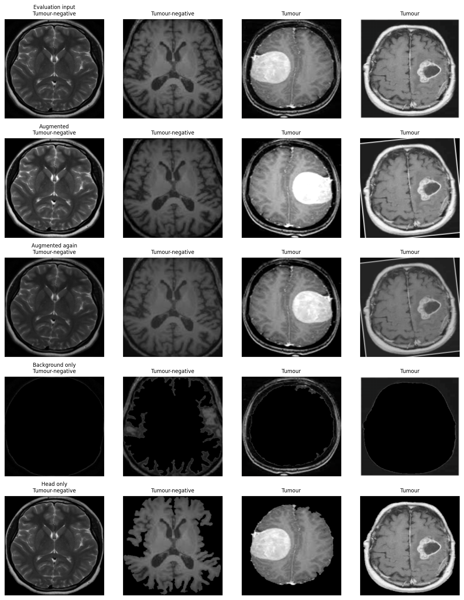

_GPU training augmentation on a few training images, with the background-only and head-only inputs of the shortcut tests._

### 5. Training

- **Model profiles** (`model_profiles.csv`). Parameter count and GFLOPs at the native input and at 224 px.

| Model             | Family        | Input | Parameters (M) | GFLOPs (native) | GFLOPs (224) |
| ----------------- | ------------- | ----- | -------------- | --------------- | ------------ |
| ResNet50          | Classical CNN | 224   | 23.510         | 8.174           | 8.174        |
| VGG16             | Classical CNN | 224   | 134.265        | 30.932          | 30.932       |
| DenseNet121       | Classical CNN | 224   | 6.955          | 5.666           | 5.666        |
| EfficientNetB0    | Efficient CNN | 224   | 4.009          | 0.769           | 0.769        |
| MobileNetV3-Large | Efficient CNN | 224   | 4.203          | 0.431           | 0.431        |
| InceptionV3       | Efficient CNN | 299   | 21.788         | 11.422          | 5.672        |
| ViT-B/16          | Transformer   | 224   | 85.799         | 22.541          | 22.541       |
| Swin-Base         | Transformer   | 224   | 86.744         | 30.860          | 30.860       |
| CoAtNet-0         | Hybrid        | 224   | 26.667         | 8.416           | 8.416        |

- **Launch the two GPU workers.** 45 full-image runs (9 models x 5 folds) plus 9 background-only runs (fold 0) for the shortcut test. Output: `54 jobs, 0 already finished; launching 2 workers` and `Training stage finished in 63.5 min; 54/54 jobs complete`. Every run took 260 optimiser steps (20 epochs x 13 steps of 64 images); Swin-Base used a micro-batch of 32 with 2 accumulation steps, every other model a micro-batch of 64. Per-run details are in `metrics/run_metrics.csv` and `metrics/runs/<run>/history.csv`; the worker settings are in `metrics/worker_config.json`.

### 6. Results

- **Per-run calibration and metrics.** For each run, a temperature is fitted on its validation fold, the decision threshold is chosen there by Youden's J, and the test set is scored. Fold summary (`fold_summary.csv`, mean +/- standard deviation over 5 folds, calibrated):

| Model             | Accuracy          | Balanced acc.     | Macro F1          | ROC AUC           | ECE               | Sensitivity       | Specificity       |
| ----------------- | ----------------- | ----------------- | ----------------- | ----------------- | ----------------- | ----------------- | ----------------- |
| InceptionV3       | 0.9789 +/- 0.0032 | 0.9775 +/- 0.0042 | 0.9775 +/- 0.0034 | 0.9966 +/- 0.0042 | 0.0195 +/- 0.0033 | 0.9832 +/- 0.0078 | 0.9719 +/- 0.0131 |
| Swin-Base         | 0.9778 +/- 0.0162 | 0.9785 +/- 0.0161 | 0.9764 +/- 0.0172 | 0.9974 +/- 0.0026 | 0.0182 +/- 0.0117 | 0.9757 +/- 0.0194 | 0.9812 +/- 0.0204 |
| EfficientNetB0    | 0.9778 +/- 0.0049 | 0.9747 +/- 0.0053 | 0.9762 +/- 0.0052 | 0.9968 +/- 0.0034 | 0.0197 +/- 0.0045 | 0.9869 +/- 0.0051 | 0.9625 +/- 0.0086 |
| CoAtNet-0         | 0.9754 +/- 0.0172 | 0.9760 +/- 0.0183 | 0.9739 +/- 0.0183 | 0.9966 +/- 0.0038 | 0.0216 +/- 0.0125 | 0.9738 +/- 0.0154 | 0.9781 +/- 0.0237 |
| ViT-B/16          | 0.9754 +/- 0.0096 | 0.9722 +/- 0.0128 | 0.9737 +/- 0.0104 | 0.9970 +/- 0.0013 | 0.0175 +/- 0.0044 | 0.9850 +/- 0.0156 | 0.9594 +/- 0.0324 |
| DenseNet121       | 0.9719 +/- 0.0076 | 0.9663 +/- 0.0077 | 0.9698 +/- 0.0082 | 0.9927 +/- 0.0048 | 0.0259 +/- 0.0048 | 0.9888 +/- 0.0078 | 0.9438 +/- 0.0086 |
| ResNet50          | 0.9684 +/- 0.0135 | 0.9635 +/- 0.0166 | 0.9660 +/- 0.0146 | 0.9876 +/- 0.0105 | 0.0226 +/- 0.0060 | 0.9832 +/- 0.0078 | 0.9438 +/- 0.0305 |
| MobileNetV3-Large | 0.9637 +/- 0.0220 | 0.9635 +/- 0.0188 | 0.9616 +/- 0.0230 | 0.9946 +/- 0.0033 | 0.0274 +/- 0.0084 | 0.9645 +/- 0.0320 | 0.9625 +/- 0.0086 |
| VGG16             | 0.9591 +/- 0.0083 | 0.9585 +/- 0.0102 | 0.9565 +/- 0.0088 | 0.9943 +/- 0.0023 | 0.0335 +/- 0.0075 | 0.9607 +/- 0.0167 | 0.9562 +/- 0.0280 |

The file also holds uncalibrated ECE, log-loss and threshold-tuned accuracy, sensitivity and specificity for every model.

- **Training curves.**

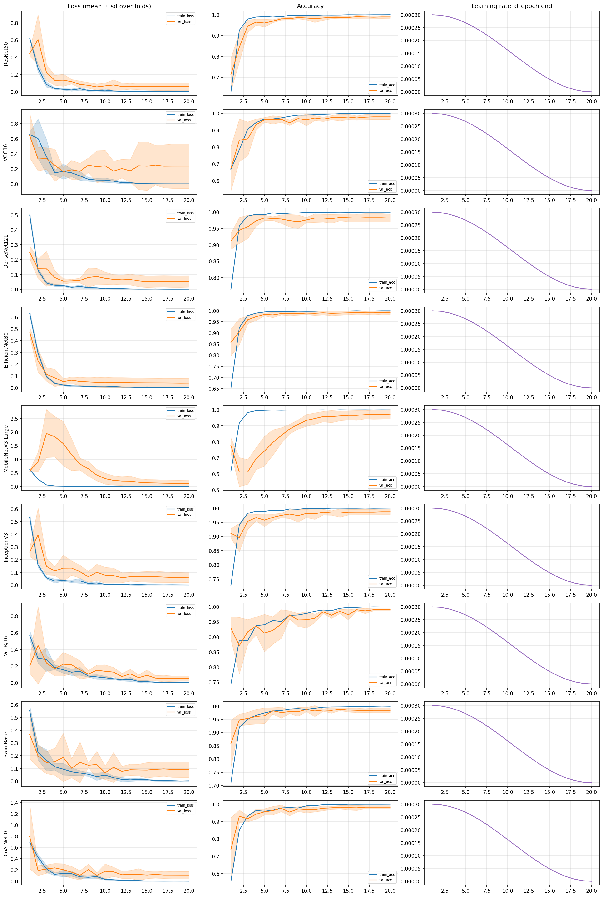

_Mean +/- one standard deviation across folds of training and validation loss, validation accuracy and learning rate, per model._

- **Fold-ensemble test results.** Calibrated test probabilities are averaged over each model's five folds and scored on the 171 test images, with bootstrap 95% confidence intervals (`test_leaderboard.csv`):

| Model             | Accuracy (95% CI)       | Balanced acc. | Macro F1 | MCC    | ROC AUC | PR AUC | Log-loss | Brier  | ECE    | Sens.  | Spec.  | FN  | FP  |
| ----------------- | ----------------------- | ------------- | -------- | ------ | ------- | ------ | -------- | ------ | ------ | ------ | ------ | --- | --- |
| CoAtNet-0         | 0.9942 [0.9825, 1.0000] | 0.9953        | 0.9938   | 0.9876 | 0.9994  | 0.9997 | 0.0412   | 0.0200 | 0.0275 | 0.9907 | 1.0000 | 1   | 0   |
| EfficientNetB0    | 0.9942 [0.9825, 1.0000] | 0.9922        | 0.9937   | 0.9876 | 0.9991  | 0.9995 | 0.0420   | 0.0241 | 0.0243 | 1.0000 | 0.9844 | 0   | 1   |
| ViT-B/16          | 0.9942 [0.9825, 1.0000] | 0.9922        | 0.9937   | 0.9876 | 0.9984  | 0.9990 | 0.0508   | 0.0215 | 0.0207 | 1.0000 | 0.9844 | 0   | 1   |
| Swin-Base         | 0.9883 [0.9708, 1.0000] | 0.9907        | 0.9876   | 0.9755 | 0.9997  | 0.9998 | 0.0348   | 0.0183 | 0.0152 | 0.9813 | 1.0000 | 2   | 0   |
| InceptionV3       | 0.9825 [0.9591, 1.0000] | 0.9797        | 0.9812   | 0.9625 | 0.9991  | 0.9995 | 0.0407   | 0.0245 | 0.0228 | 0.9907 | 0.9688 | 1   | 2   |
| ResNet50          | 0.9825 [0.9591, 1.0000] | 0.9828        | 0.9813   | 0.9627 | 0.9988  | 0.9993 | 0.0474   | 0.0276 | 0.0157 | 0.9813 | 0.9844 | 2   | 1   |
| DenseNet121       | 0.9708 [0.9415, 0.9942] | 0.9641        | 0.9685   | 0.9376 | 0.9984  | 0.9991 | 0.0534   | 0.0346 | 0.0252 | 0.9907 | 0.9375 | 1   | 4   |
| MobileNetV3-Large | 0.9708 [0.9415, 0.9942] | 0.9704        | 0.9689   | 0.9378 | 0.9978  | 0.9987 | 0.0714   | 0.0415 | 0.0326 | 0.9720 | 0.9688 | 3   | 2   |
| VGG16             | 0.9708 [0.9415, 0.9942] | 0.9704        | 0.9689   | 0.9378 | 0.9974  | 0.9985 | 0.0724   | 0.0433 | 0.0296 | 0.9720 | 0.9688 | 3   | 2   |

Sensitivity is the recall of the tumour class and specificity the recall of the tumour-negative class, at a threshold of 0.5. At the mean validation-tuned thresholds (0.4289 to 0.8384, column `threshold`) sensitivity and specificity are given in the `tuned_*` columns; for example EfficientNetB0 0.9626 and 0.9844. `test_per_class.csv` gives precision, sensitivity, specificity, F1, ROC AUC and average precision per class and model.

- **Statistical comparison.** Exact McNemar tests between every pair of fold ensembles, Holm-corrected: every adjusted p-value is 1.0 (`mcnemar_holm_p.csv`). Bootstrap 95% CI of each model's accuracy gap to CoAtNet-0 (`gap_to_leader.csv`): only VGG16 and MobileNetV3-Large (gap 0.0234, CI [0.0058, 0.0468]) are separable from the leader; the others' intervals include zero.

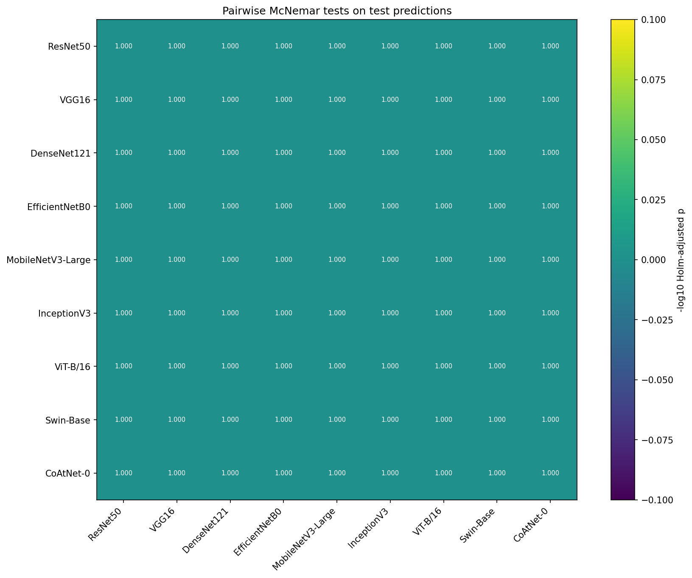

_Holm-corrected McNemar p-values between models._

- **Confusion matrices, ROC and PR curves.**

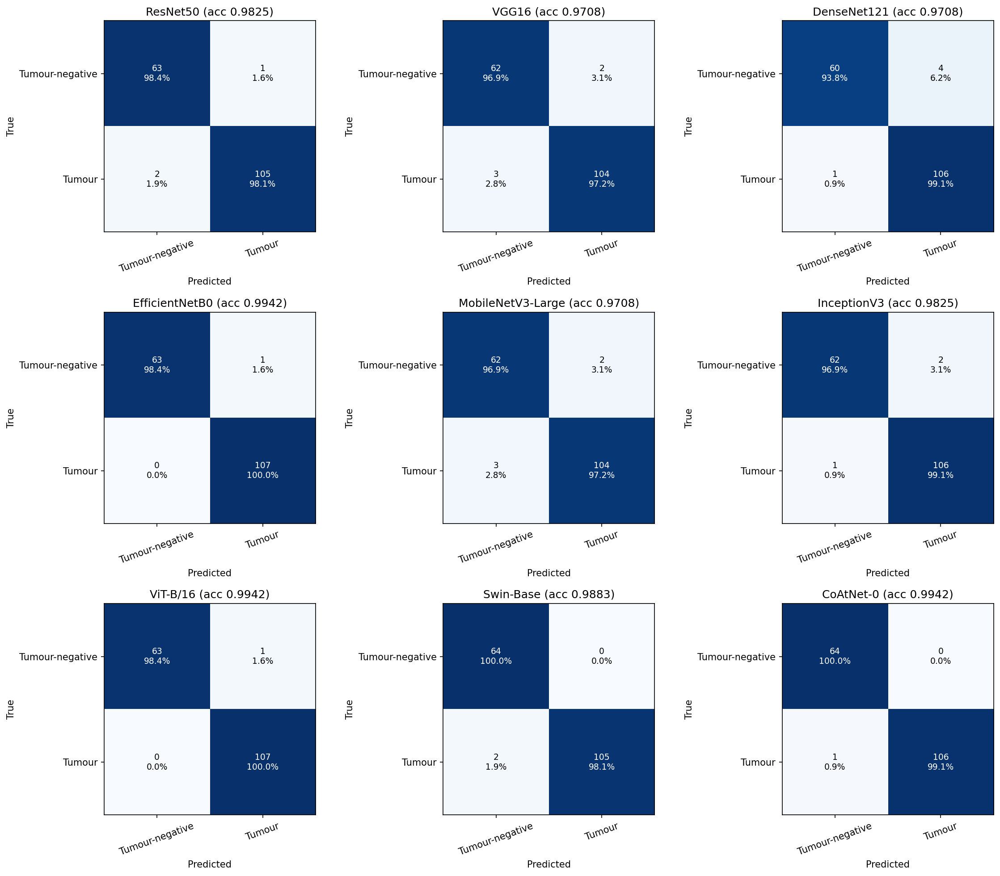

_Test confusion matrices of every fold ensemble, counts with row percentages._

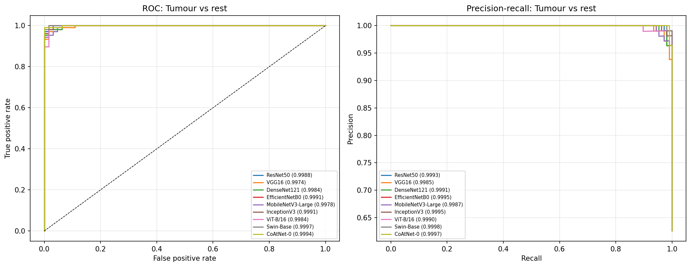

_ROC and precision-recall curves of every fold ensemble for the tumour class._

- **Calibration before and after temperature scaling** (`calibration_ece.csv`, test ECE of the fold ensembles):

| Model             | Temperature-scaled | Uncalibrated |
| ----------------- | ------------------ | ------------ |
| CoAtNet-0         | 0.0275             | 0.0207       |
| DenseNet121       | 0.0252             | 0.0233       |
| EfficientNetB0    | 0.0243             | 0.0231       |
| InceptionV3       | 0.0228             | 0.0151       |
| MobileNetV3-Large | 0.0326             | 0.0146       |
| ResNet50          | 0.0157             | 0.0173       |
| Swin-Base         | 0.0152             | 0.0148       |
| VGG16             | 0.0296             | 0.0179       |
| ViT-B/16          | 0.0207             | 0.0222       |

Temperature scaling lowered ECE only for ResNet50 and ViT-B/16. In fold 4, the fitted temperature of CoAtNet-0, EfficientNetB0, InceptionV3, MobileNetV3-Large, ResNet50 and Swin-Base is between 0.0498 and 0.0682 (`run_metrics.csv`), at or near the lower bound exp(-3), about 0.0498, of the temperature search. For the first five of these, fold 4 has the highest test log-loss of the model's five folds (for example EfficientNetB0 0.543 against 0.038 to 0.088 for its other folds).

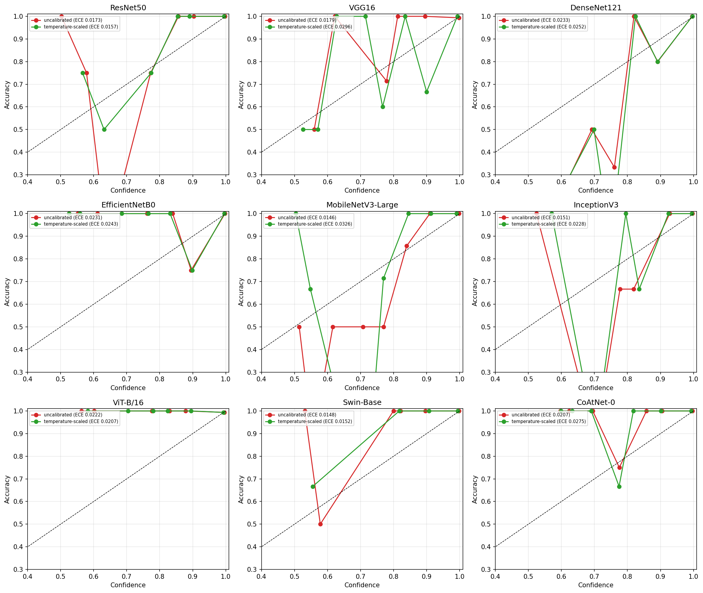

_Reliability diagrams of every fold ensemble, uncalibrated and temperature-scaled._

- **Accuracy against distance to the development pool** (`accuracy_by_nearest_dev_distance.csv`, by Hamming distance of each test image's nearest development image):

| Model             | 9-12   | 13-16  | 17-20  |
| ----------------- | ------ | ------ | ------ |
| CoAtNet-0         | 0.9886 | 1.0000 | 1.0000 |
| DenseNet121       | 0.9773 | 0.9589 | 1.0000 |
| EfficientNetB0    | 1.0000 | 0.9863 | 1.0000 |
| InceptionV3       | 1.0000 | 0.9589 | 1.0000 |
| MobileNetV3-Large | 0.9545 | 0.9863 | 1.0000 |
| ResNet50          | 0.9886 | 0.9726 | 1.0000 |
| Swin-Base         | 1.0000 | 0.9726 | 1.0000 |
| VGG16             | 0.9659 | 0.9726 | 1.0000 |
| ViT-B/16          | 1.0000 | 0.9863 | 1.0000 |

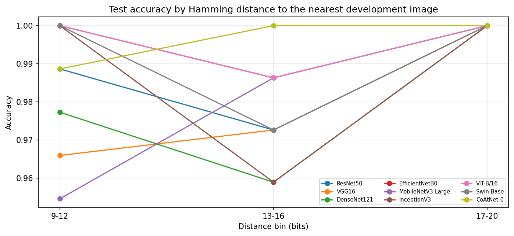

_Test accuracy by distance to the nearest development image._

### 7. Interpretability

- **Grad-CAM, attention rollout and outside-head energy.** For each model, the fold with the lowest validation loss is reloaded and Grad-CAM is computed for every test image; ViT-B/16 also gets attention rollout. The share of map energy outside the head mask (Otsu threshold, closing, largest component, hole filling), mean +/- sd (`outside_head_energy.csv`):

| Model             | Tumour-negative   | Tumour            |
| ----------------- | ----------------- | ----------------- |
| ResNet50          | 0.1215 +/- 0.2192 | 0.0787 +/- 0.2002 |
| VGG16             | 0.1526 +/- 0.2115 | 0.0737 +/- 0.1839 |
| DenseNet121       | 0.1897 +/- 0.2293 | 0.1764 +/- 0.1834 |
| EfficientNetB0    | 0.2868 +/- 0.2107 | 0.0720 +/- 0.1800 |
| MobileNetV3-Large | 0.1424 +/- 0.2305 | 0.0820 +/- 0.1630 |
| InceptionV3       | 0.1458 +/- 0.2342 | 0.1474 +/- 0.1873 |
| ViT-B/16 Grad-CAM | 0.4255 +/- 0.2375 | 0.2435 +/- 0.2643 |
| ViT-B/16 rollout  | 0.4211 +/- 0.1786 | 0.2850 +/- 0.1626 |
| Swin-Base         | 0.1586 +/- 0.2461 | 0.1845 +/- 0.1949 |
| CoAtNet-0         | 0.1391 +/- 0.2479 | 0.1882 +/- 0.2004 |
| Uniform map       | 0.3558            | 0.3278            |

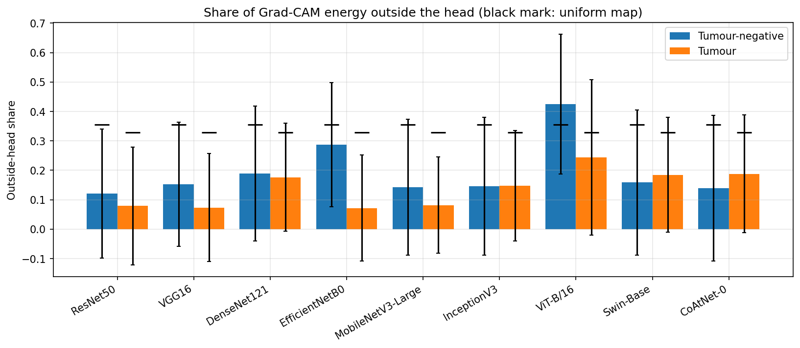

_Share of Grad-CAM energy outside the head per model and class; the black mark is a uniform map._

Grad-CAM galleries (most confident correct and most confident wrong test predictions per model):

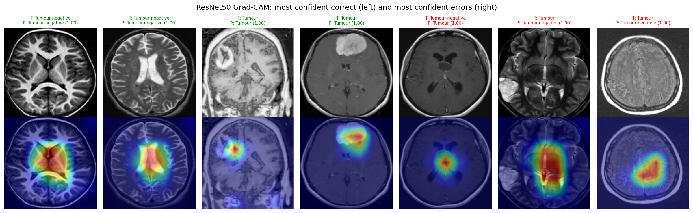
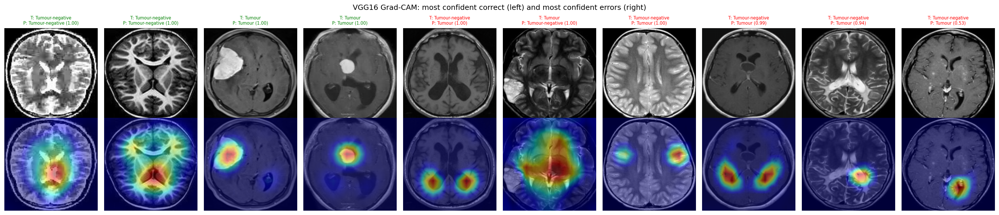
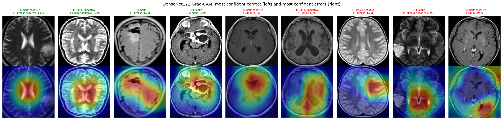
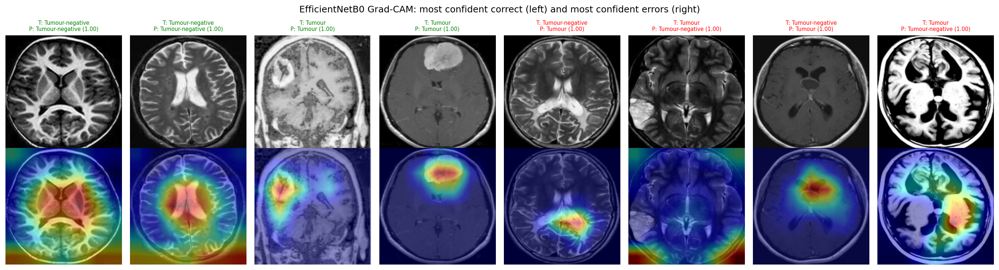
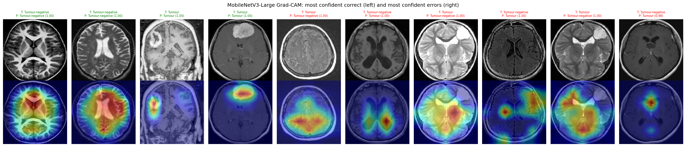
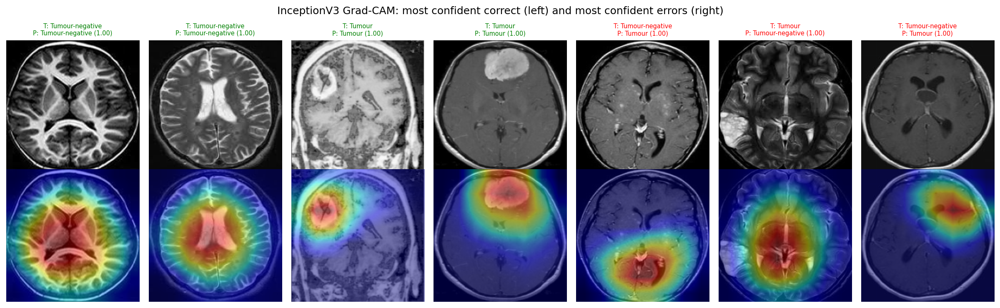
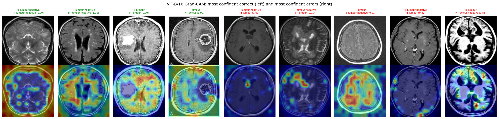
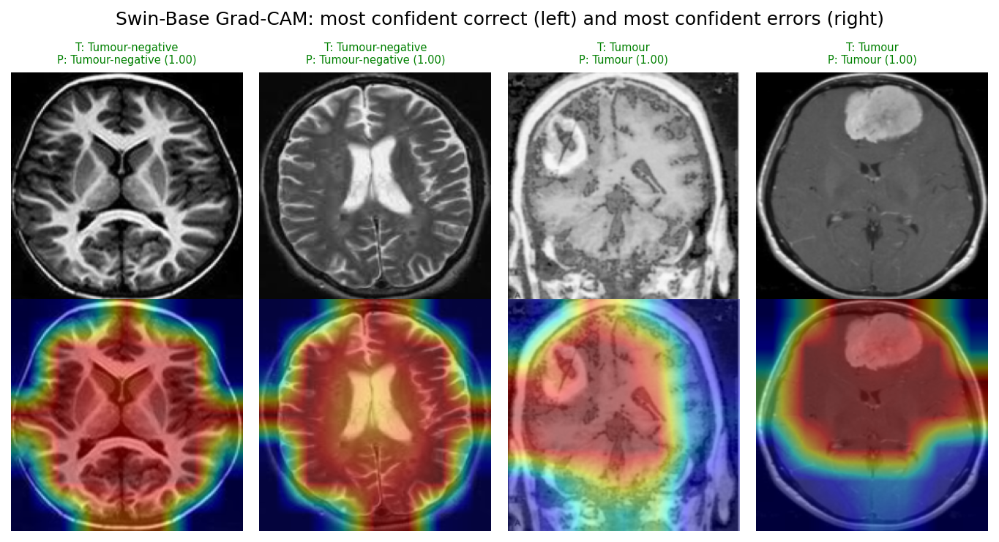
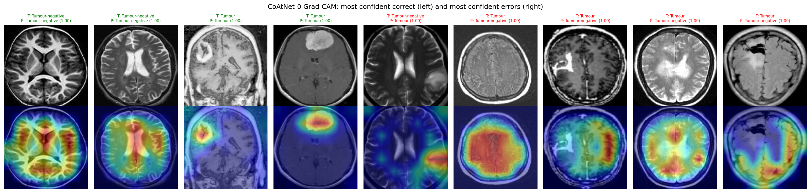

- **Occlusion maps.** Model-agnostic occlusion sensitivity (32 px patch, stride 16) on the same 16 test images for every model; share outside the head (`occlusion_outside_head.csv`):

| Model             | Outside-head share |
| ----------------- | ------------------ |
| ResNet50          | 0.1161 +/- 0.1324  |
| VGG16             | 0.0072 +/- 0.0162  |
| DenseNet121       | 0.1347 +/- 0.1601  |
| EfficientNetB0    | 0.1942 +/- 0.1974  |
| MobileNetV3-Large | 0.1109 +/- 0.1700  |
| InceptionV3       | 0.1674 +/- 0.2052  |
| ViT-B/16          | 0.1547 +/- 0.1597  |
| Swin-Base         | 0.1820 +/- 0.1539  |
| CoAtNet-0         | 0.0888 +/- 0.1451  |

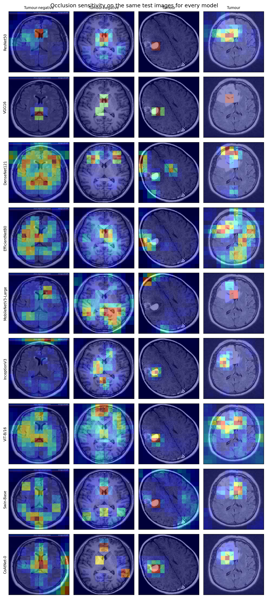

_Occlusion maps for every model on the same test images._

- **Masking test (inference only).** Each fold's checkpoint scored on test images with the head set to zero (background only) or the background set to zero (head only); mean over folds (`masking_test.csv`):

| Model             | Full image | Head only | Background only |
| ----------------- | ---------- | --------- | --------------- |
| CoAtNet-0         | 0.9754     | 0.9637    | 0.4444          |
| DenseNet121       | 0.9719     | 0.9439    | 0.5181          |
| EfficientNetB0    | 0.9778     | 0.9556    | 0.4982          |
| InceptionV3       | 0.9789     | 0.9450    | 0.6573          |
| MobileNetV3-Large | 0.9637     | 0.9368    | 0.5333          |
| ResNet50          | 0.9684     | 0.9602    | 0.4924          |
| Swin-Base         | 0.9778     | 0.9684    | 0.5170          |
| VGG16             | 0.9591     | 0.9474    | 0.4994          |
| ViT-B/16          | 0.9754     | 0.9567    | 0.4503          |

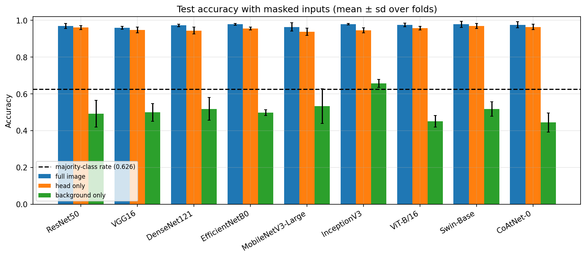

- **Shortcut test: retraining on background-only images.** Each model was trained (fold 0) and tested on images whose head region is zero. Majority-class rate 0.6257; one-sided exact binomial test, Holm-corrected (`shortcut_test.csv`):

| Model             | Background-only accuracy | Background-only AUC | Holm p | Shortcut detected |
| ----------------- | ------------------------ | ------------------- | ------ | ----------------- |
| ResNet50          | 0.8129                   | 0.8657              | 0.0000 | Yes               |
| VGG16             | 0.7485                   | 0.8359              | 0.0013 | Yes               |
| DenseNet121       | 0.7953                   | 0.8578              | 0.0000 | Yes               |
| EfficientNetB0    | 0.7778                   | 0.8584              | 0.0001 | Yes               |
| MobileNetV3-Large | 0.6784                   | 0.7821              | 0.1772 | No                |
| InceptionV3       | 0.7953                   | 0.8606              | 0.0000 | Yes               |
| ViT-B/16          | 0.6550                   | 0.7411              | 0.2396 | No                |
| Swin-Base         | 0.8304                   | 0.8893              | 0.0000 | Yes               |
| CoAtNet-0         | 0.7953                   | 0.8756              | 0.0000 | Yes               |

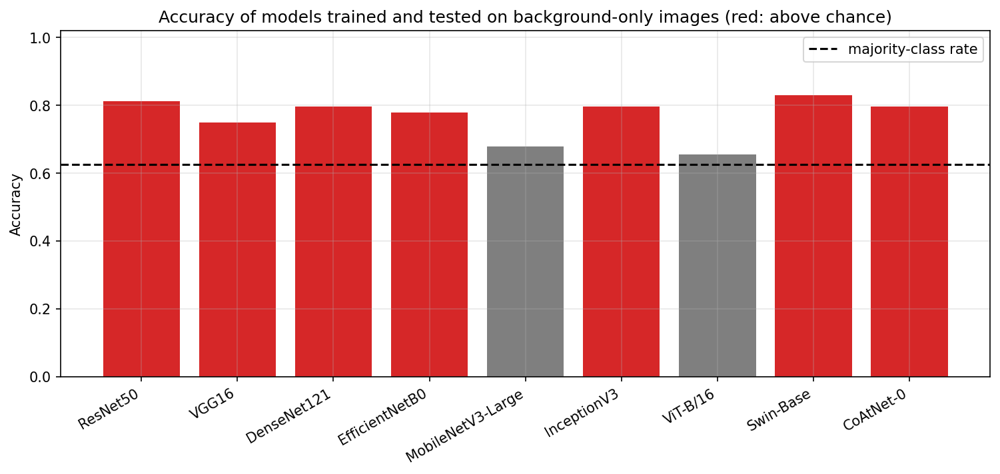

_Accuracy of models trained and tested on background-only images; red bars are above chance._

### 8. Efficiency

Measured on one T4 under fp16 autocast: latency is 100 timed single-image passes after 10 warm-up passes, throughput is batch 32 over 20 passes after 3 warm-up, both repeated three times. Training cost is the mean over folds (`efficiency.csv`):

| Model             | Latency (ms)     | Throughput (img/s) | Train min/run | Train img/s | Peak train memory (GB) | Accuracy | Acc. per M params |
| ----------------- | ---------------- | ------------------ | ------------- | ----------- | ---------------------- | -------- | ----------------- |
| ResNet50          | 9.573 +/- 0.376  | 777.2 +/- 6.1      | 1.150         | 235.2       | 5.616                  | 0.982    | 4.179             |
| VGG16             | 7.722 +/- 0.422  | 386.5 +/- 4.8      | 2.173         | 124.4       | 9.876                  | 0.971    | 0.723             |
| DenseNet121       | 23.584 +/- 1.534 | 656.6 +/- 22.9     | 1.458         | 185.4       | 4.478                  | 0.971    | 13.958            |
| EfficientNetB0    | 13.129 +/- 0.550 | 1393.3 +/- 115.8   | 1.994         | 136.4       | 3.093                  | 0.994    | 24.799            |
| MobileNetV3-Large | 10.552 +/- 1.090 | 2301.1 +/- 292.9   | 1.488         | 182.3       | 2.088                  | 0.971    | 23.095            |
| InceptionV3       | 17.632 +/- 0.788 | 511.6 +/- 5.8      | 1.735         | 155.8       | 5.849                  | 0.982    | 4.509             |
| ViT-B/16          | 10.952 +/- 1.039 | 272.2 +/- 2.8      | 2.908         | 93.0        | 5.960                  | 0.994    | 1.159             |
| Swin-Base         | 36.294 +/- 1.234 | 197.6 +/- 2.9      | 4.296         | 62.9        | 6.448                  | 0.988    | 1.139             |
| CoAtNet-0         | 16.533 +/- 1.065 | 513.1 +/- 6.9      | 2.281         | 118.7       | 11.386                 | 0.994    | 3.728             |

The two workers shared four CPU cores, so training throughput is a lower bound (notebook text).

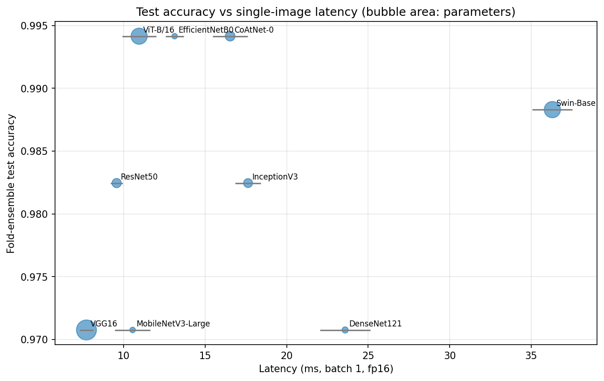

- **External validation.** Output: `No external evaluation: EXTERNAL_FOLDERS is empty or every external image duplicated the pool.`

### 9. Export and summary

- **Web-app checkpoint.** Exports the EfficientNetB0 fold with the lowest validation loss and checks that it reloads into the web app's architecture and reproduces the stored logits. Output: `Exported /kaggle/working/weights/deploy/EfficientNetB0.pth (16.3 MB); reload check passed`. See [Checkpoints used by the web app](#checkpoints-used-by-the-web-app).
- **Summary.** `summary_table.csv` (the headline columns of the tables above) and `run_summary.json`: 3,253 images in the pool, 1,185 after deduplication, 0 label-noise exclusions, 171 test images, leader CoAtNet-0, 54 of 54 jobs. Log: `Leader: CoAtNet-0; 54/54 jobs; notebook time 72 min`.
- **Package the outputs.** Zips `/kaggle/working/` (except the image cache) for download.

## Classification notebook

Source: [`classification.ipynb`](classification.ipynb). Outputs: [`classification/`](classification/).

The notebook runs the same code as the binary notebook with task `multiclass`, classes `Glioma`, `Meningioma`, `Pituitary`, and the same nine models and settings. Only the data, the outputs and the differences below are described.

### 1. Setup

Same cells and settings as the binary notebook. Output: `Task: multiclass | classes: ['Glioma', 'Meningioma', 'Pituitary'] | models: 9 | folds: 5`.

### 2. Data

Sources: Bhuvaji et al. `sartajbhuvaji/brain-tumor-classification-mri` (training and testing folders merged, tumour-negative folder excluded) and the Cheng et al. figshare collection in the JPEG conversion `moundir8/jun-cheng-brain-tumor-mri-dataset-jpg`. Output: `Pool: 5828 images | external: 0`, `Cached 5828 images in 68s (2.39 GB); unreadable: 0`.

| Source (`provenance.csv`) | Glioma | Meningioma | Pituitary | Total | Distinct sizes | Modal size | Modal share | Median crop fraction |
| ------------------------- | ------ | ---------- | --------- | ----- | -------------- | ---------- | ----------- | -------------------- |
| Bhuvaji testing           | 100    | 115        | 74        | 289   | 184            | 512x512    | 0.111       | 0.846                |
| Bhuvaji training          | 826    | 822        | 827       | 2,475 | 137            | 512x512    | 0.931       | 0.671                |
| Cheng                     | 1,426  | 708        | 930       | 3,064 | 2              | 512x512    | 0.995       | 0.635                |
| Total                     | 2,352  | 1,645      | 1,831     | 5,828 |                |            |             |                      |

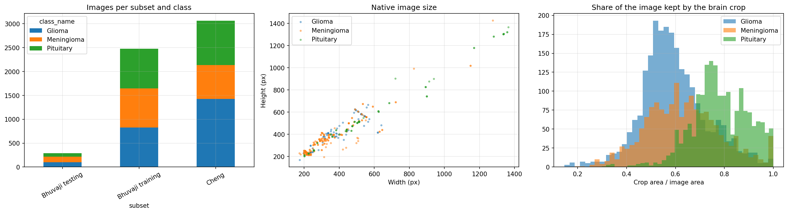

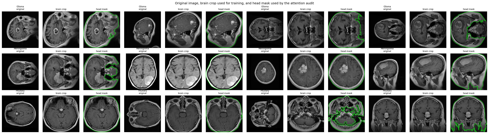

### 3. Deduplication

Output: `Cross-label pairs within Hamming 5: 31 (8 label noise, 23 hash false positives)`. All 31 pairs are glioma against meningioma; the 8 label-noise pairs (NCC at least 0.9997) are all inside the Bhuvaji collection and both copies are excluded; the 23 hash false positives (NCC 0.67 to 0.86) are kept (`cross_label_pairs.csv`).

| Class (`deduplication_summary.csv`) | Before | Duplicates removed | Label noise excluded | After | Removed |
| ----------------------------------- | ------ | ------------------ | -------------------- | ----- | ------- |
| Glioma                              | 2,352  | 342                | 2                    | 2,008 | 14.63%  |
| Meningioma                          | 1,645  | 329                | 2                    | 1,314 | 20.12%  |
| Pituitary                           | 1,831  | 423                | 0                    | 1,408 | 23.10%  |
| Total                               | 5,828  | 1,094              | 4                    | 4,730 | 18.84%  |

`split_roles.csv` and `run_summary.json` count the same outcome per image instead: 1,088 images removed as duplicates and 10 excluded as label noise (2 glioma, 8 meningioma); both tables total 4,730 kept images.

| Removed image source (`deduplication_by_source.csv`) | Kind          | Glioma | Meningioma | Pituitary | All   |
| ---------------------------------------------------- | ------------- | ------ | ---------- | --------- | ----- |
| Bhuvaji                                              | within-source | 143    | 229        | 236       | 608   |
| Cheng                                                | cross-source  | 0      | 3          | 0         | 3     |
| Cheng                                                | within-source | 199    | 97         | 187       | 483   |
| All                                                  |               | 342    | 329        | 423       | 1,094 |

| Tolerance (`deduplication_threshold_sweep.csv`) | 0, 1  | 2, 3  | 4, 5  | 6, 7  | 8, 9  | 10, 11 | 12    |
| ----------------------------------------------- | ----- | ----- | ----- | ----- | ----- | ------ | ----- |
| Kept                                            | 5,572 | 5,337 | 4,734 | 3,928 | 3,098 | 2,286  | 1,611 |
| Glioma                                          | 2,303 | 2,221 | 2,010 | 1,653 | 1,277 | 919    | 627   |
| Meningioma                                      | 1,518 | 1,453 | 1,316 | 1,130 | 935   | 704    | 506   |
| Pituitary                                       | 1,751 | 1,663 | 1,408 | 1,145 | 886   | 663    | 478   |

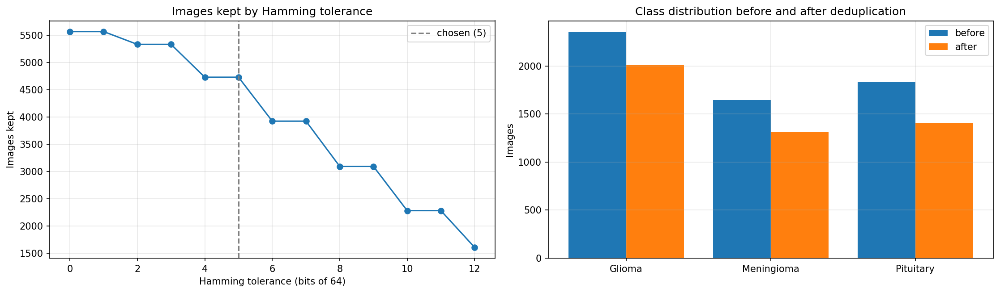

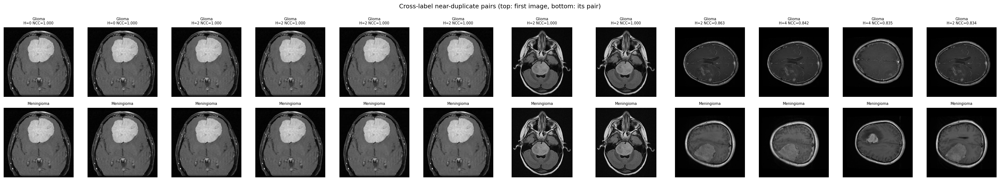

_Cross-label pairs within the tolerance, label-noise pairs first._

### 4. Group-aware split and leakage audit

Output: `4730 images in 1867 groups; largest group 1431 images; 596 groups with more than one image` followed by `Warning: one group holds more than 5% of the pool; consider a smaller GROUP_TOLERANCE.` The run kept `GROUP_TOLERANCE = 8`. The large group makes the split very uneven:

| Role (`split_roles.csv`) | Glioma | Meningioma | Pituitary | Total |
| ------------------------ | ------ | ---------- | --------- | ----- |
| Development (5 folds)    | 2,007  | 1,301      | 1,377     | 4,685 |
| Test                     | 1      | 13         | 31        | 45    |
| Removed duplicate        | 342    | 323        | 423       | 1,088 |
| Label noise              | 2      | 8          | 0         | 10    |
| Total                    | 2,352  | 1,645      | 1,831     | 5,828 |

| Fold (`fold_distribution.csv`) | 0   | 1   | 2   | 3   | 4     | All   |
| ------------------------------ | --- | --- | --- | --- | ----- | ----- |
| Glioma                         | 61  | 275 | 246 | 285 | 1,140 | 2,007 |
| Meningioma                     | 40  | 220 | 204 | 225 | 612   | 1,301 |
| Pituitary                      | 53  | 247 | 247 | 366 | 464   | 1,377 |
| All                            | 154 | 742 | 697 | 876 | 2,216 | 4,685 |

The test set has 45 images, one of them glioma. Because the fold sizes differ, the number of optimiser steps per run differs by fold: 1,420 (fold 0), 1,240, 1,260, 1,200 and 780 (fold 4), the same for every model within a fold (`run_metrics.csv`). Leakage audit: 0 test images near a development image by any criterion.

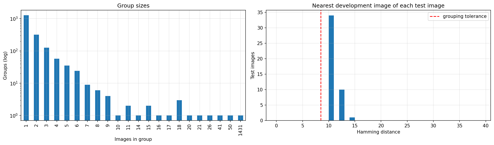

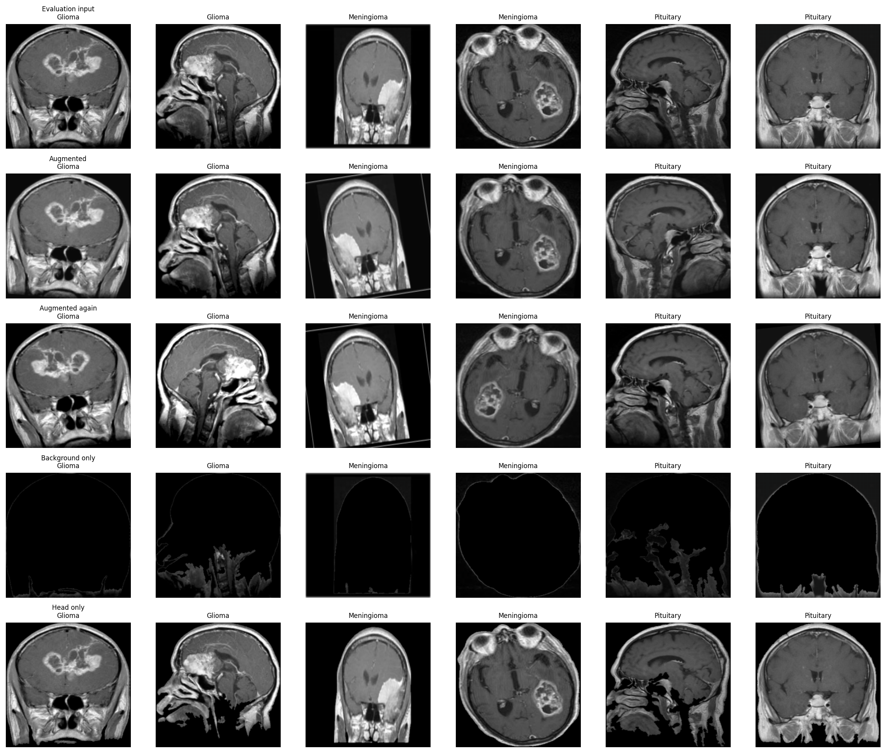

### 5. Training

Model profiles match the binary table except for the three-output heads (for example EfficientNetB0 4.011 M, ResNet50 23.514 M, VGG16 134.273 M parameters; `model_profiles.csv`). Output: `54 jobs, 0 already finished; launching 2 workers`, `Training stage finished in 264.6 min; 54/54 jobs complete`.

### 6. Results

Fold summary (`fold_summary.csv`, calibrated, mean +/- sd over 5 folds):

| Model             | Accuracy          | Balanced acc.     | Macro F1          | ROC AUC           | ECE               | Log-loss          |
| ----------------- | ----------------- | ----------------- | ----------------- | ----------------- | ----------------- | ----------------- |
| InceptionV3       | 0.9956 +/- 0.0099 | 0.9949 +/- 0.0115 | 0.9751 +/- 0.0557 | 1.0000 +/- 0.0000 | 0.0088 +/- 0.0097 | 0.0139 +/- 0.0207 |
| Swin-Base         | 0.9956 +/- 0.0099 | 0.9949 +/- 0.0115 | 0.9751 +/- 0.0557 | 1.0000 +/- 0.0000 | 0.0109 +/- 0.0123 | 0.0127 +/- 0.0157 |
| ViT-B/16          | 0.9911 +/- 0.0122 | 0.9897 +/- 0.0140 | 0.9502 +/- 0.0682 | 0.9995 +/- 0.0011 | 0.0147 +/- 0.0081 | 0.0397 +/- 0.0460 |
| DenseNet121       | 0.9911 +/- 0.0122 | 0.9927 +/- 0.0113 | 0.9715 +/- 0.0542 | 0.9998 +/- 0.0004 | 0.0207 +/- 0.0214 | 0.0342 +/- 0.0424 |
| CoAtNet-0         | 0.9867 +/- 0.0122 | 0.9876 +/- 0.0129 | 0.9467 +/- 0.0653 | 1.0000 +/- 0.0000 | 0.0211 +/- 0.0124 | 0.0319 +/- 0.0258 |
| ResNet50          | 0.9867 +/- 0.0122 | 0.9876 +/- 0.0129 | 0.9269 +/- 0.0668 | 0.9998 +/- 0.0004 | 0.0175 +/- 0.0108 | 0.0445 +/- 0.0376 |
| MobileNetV3-Large | 0.9778 +/- 0.0000 | 0.9744 +/- 0.0000 | 0.8756 +/- 0.0000 | 0.9998 +/- 0.0004 | 0.0236 +/- 0.0033 | 0.0756 +/- 0.0378 |
| VGG16             | 0.9733 +/- 0.0243 | 0.9752 +/- 0.0167 | 0.8846 +/- 0.0730 | 0.9989 +/- 0.0021 | 0.0415 +/- 0.0351 | 0.1106 +/- 0.0899 |
| EfficientNetB0    | 0.9733 +/- 0.0365 | 0.9782 +/- 0.0239 | 0.9061 +/- 0.0943 | 0.9989 +/- 0.0017 | 0.0245 +/- 0.0235 | 0.1652 +/- 0.2584 |

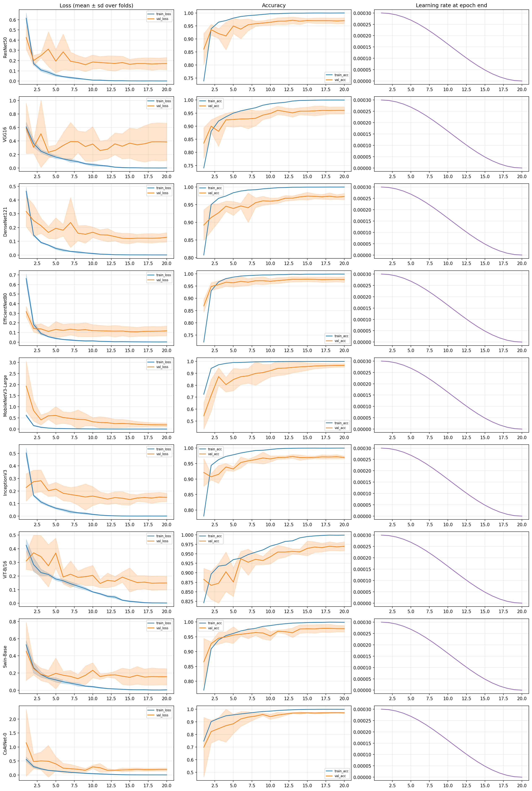

Fold-ensemble test results on the 45 test images (`test_leaderboard.csv`):

| Model             | Accuracy (95% CI)       | Balanced acc. | Macro precision | Macro F1 (95% CI)       | MCC    | ROC AUC | Log-loss | ECE    |
| ----------------- | ----------------------- | ------------- | --------------- | ----------------------- | ------ | ------- | -------- | ------ |
| ResNet50          | 1.0000 [1.0000, 1.0000] | 1.0000        | 1.0000          | 1.0000 [1.0000, 1.0000] | 1.0000 | 1.0000  | 0.0257   | 0.0222 |
| DenseNet121       | 1.0000 [1.0000, 1.0000] | 1.0000        | 1.0000          | 1.0000 [1.0000, 1.0000] | 1.0000 | 1.0000  | 0.0237   | 0.0215 |
| InceptionV3       | 1.0000 [1.0000, 1.0000] | 1.0000        | 1.0000          | 1.0000 [1.0000, 1.0000] | 1.0000 | 1.0000  | 0.0093   | 0.0088 |
| ViT-B/16          | 1.0000 [1.0000, 1.0000] | 1.0000        | 1.0000          | 1.0000 [1.0000, 1.0000] | 1.0000 | 1.0000  | 0.0220   | 0.0182 |
| Swin-Base         | 1.0000 [1.0000, 1.0000] | 1.0000        | 1.0000          | 1.0000 [1.0000, 1.0000] | 1.0000 | 1.0000  | 0.0114   | 0.0109 |
| CoAtNet-0         | 1.0000 [1.0000, 1.0000] | 1.0000        | 1.0000          | 1.0000 [1.0000, 1.0000] | 1.0000 | 1.0000  | 0.0272   | 0.0253 |
| VGG16             | 0.9778 [0.9333, 1.0000] | 0.9744        | 0.8333          | 0.8756 [0.7565, 1.0000] | 0.9515 | 1.0000  | 0.0664   | 0.0371 |
| EfficientNetB0    | 0.9778 [0.9333, 1.0000] | 0.9744        | 0.8333          | 0.8756 [0.7565, 1.0000] | 0.9515 | 1.0000  | 0.0365   | 0.0277 |
| MobileNetV3-Large | 0.9778 [0.9333, 1.0000] | 0.9744        | 0.8333          | 0.8756 [0.7565, 1.0000] | 0.9515 | 1.0000  | 0.0583   | 0.0285 |

The single error of VGG16, EfficientNetB0 and MobileNetV3-Large is one of the 13 meningioma images predicted as glioma (`test_per_class.csv`: glioma precision 0.5, meningioma sensitivity 0.9231). Every Holm-corrected McNemar p-value is 1.0 and no model is separable from the leader, ResNet50 (`mcnemar_holm_p.csv`, `gap_to_leader.csv`).


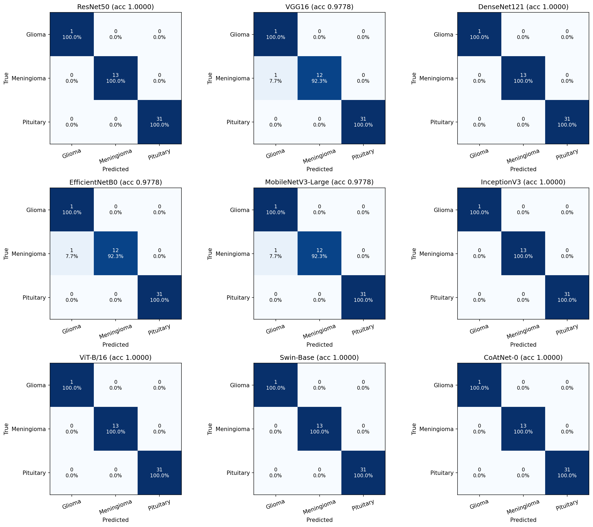

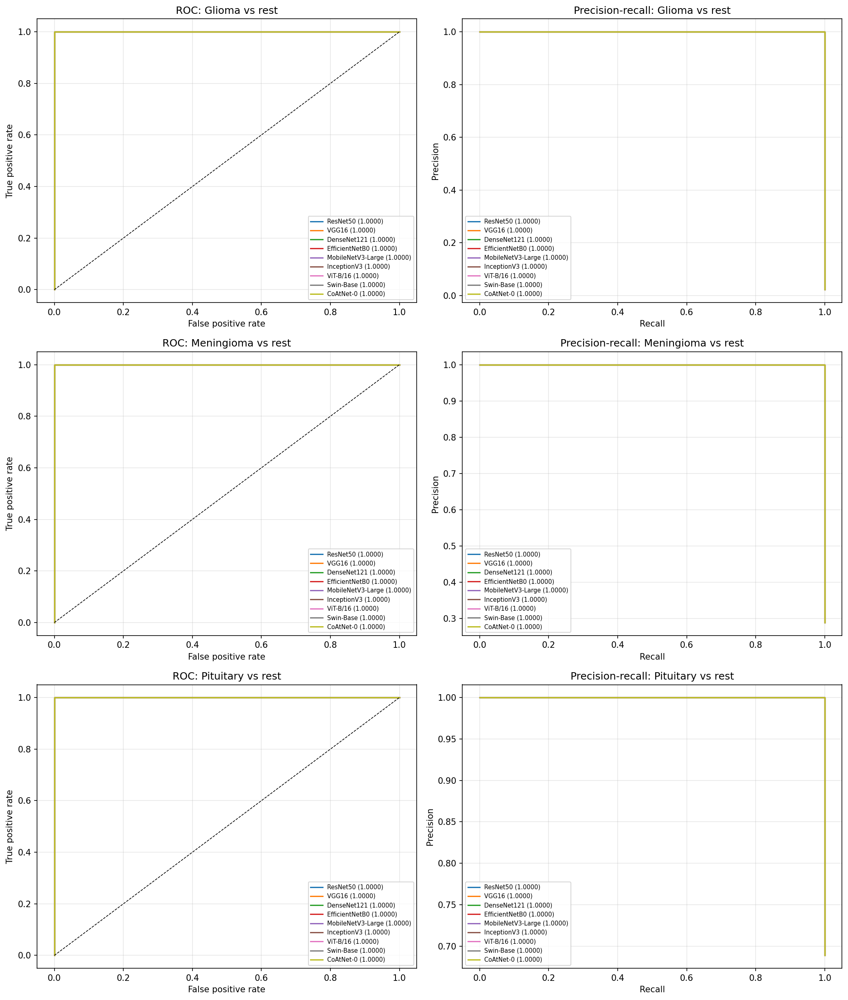

| Model (`calibration_ece.csv`) | Temperature-scaled ECE | Uncalibrated ECE |
| ----------------------------- | ---------------------- | ---------------- |
| CoAtNet-0                     | 0.0253                 | 0.0259           |
| DenseNet121                   | 0.0215                 | 0.0165           |
| EfficientNetB0                | 0.0277                 | 0.0263           |
| InceptionV3                   | 0.0088                 | 0.0045           |
| MobileNetV3-Large             | 0.0285                 | 0.0204           |
| ResNet50                      | 0.0222                 | 0.0125           |
| Swin-Base                     | 0.0109                 | 0.0044           |
| VGG16                         | 0.0371                 | 0.0355           |
| ViT-B/16                      | 0.0182                 | 0.0114           |

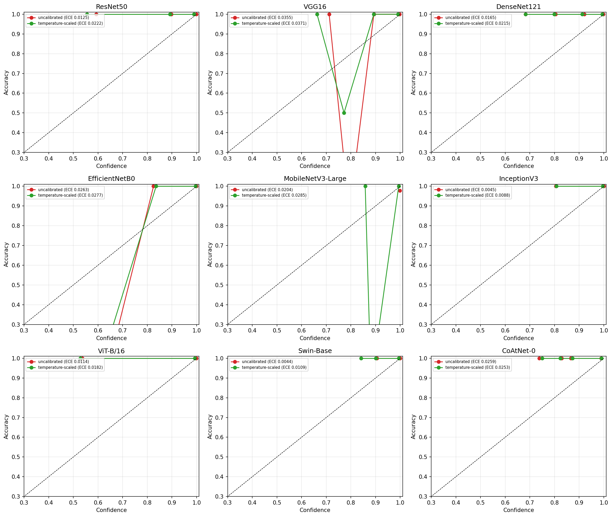

Accuracy by distance to the development pool (`accuracy_by_nearest_dev_distance.csv`): 1.0000 for every model in the 13-16 bin; in the 9-12 bin 0.9773 for EfficientNetB0, MobileNetV3-Large and VGG16 and 1.0000 for the others.

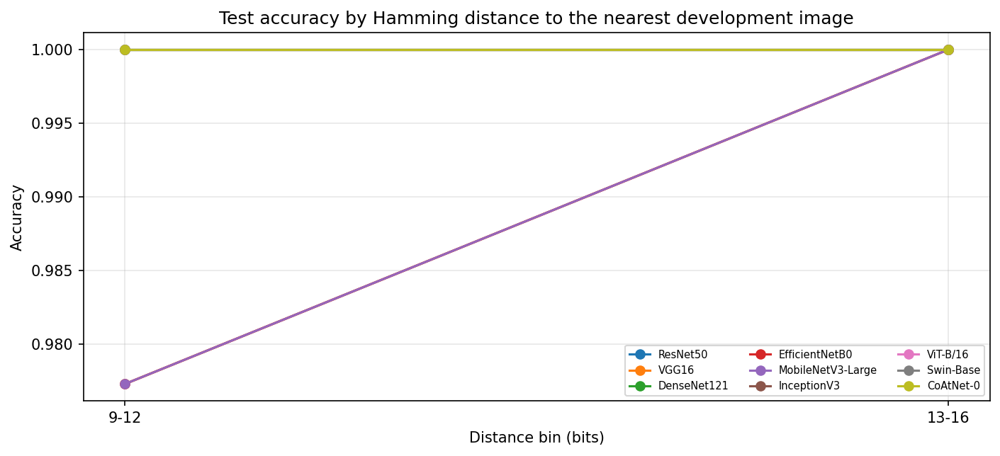

### 7. Interpretability

Outside-head Grad-CAM energy, mean +/- sd (`outside_head_energy.csv`; the glioma column has one test image, so its sd is 0):

| Model             | Glioma | Meningioma        | Pituitary         |
| ----------------- | ------ | ----------------- | ----------------- |
| ResNet50          | 0.0979 | 0.0561 +/- 0.0738 | 0.1058 +/- 0.2021 |
| VGG16             | 0.0258 | 0.1212 +/- 0.0655 | 0.1148 +/- 0.1630 |
| DenseNet121       | 0.1081 | 0.1481 +/- 0.0416 | 0.1495 +/- 0.1525 |
| EfficientNetB0    | 0.0330 | 0.0673 +/- 0.0417 | 0.0905 +/- 0.1564 |
| MobileNetV3-Large | 0.0381 | 0.0576 +/- 0.0556 | 0.1343 +/- 0.1356 |
| InceptionV3       | 0.1018 | 0.1356 +/- 0.0615 | 0.1292 +/- 0.1776 |
| ViT-B/16 Grad-CAM | 0.3262 | 0.0773 +/- 0.0454 | 0.2184 +/- 0.2285 |
| ViT-B/16 rollout  | 0.2624 | 0.3501 +/- 0.0469 | 0.3579 +/- 0.1205 |
| Swin-Base         | 0.0793 | 0.1234 +/- 0.0456 | 0.1030 +/- 0.1583 |
| CoAtNet-0         | 0.4172 | 0.1520 +/- 0.0636 | 0.1223 +/- 0.1837 |
| Uniform map       | 0.2129 | 0.2679            | 0.2671            |

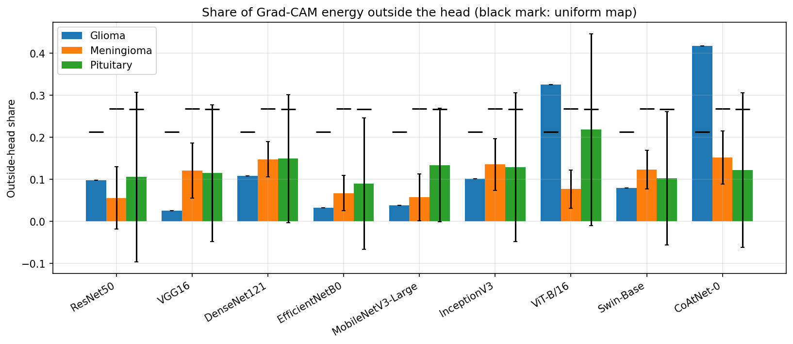

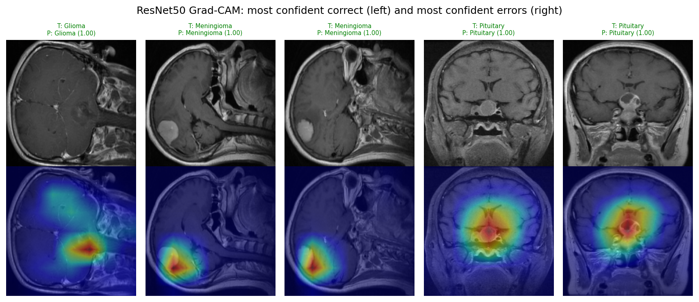
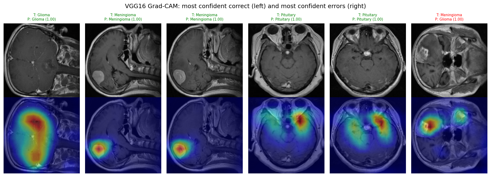
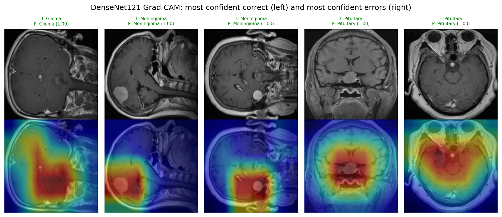
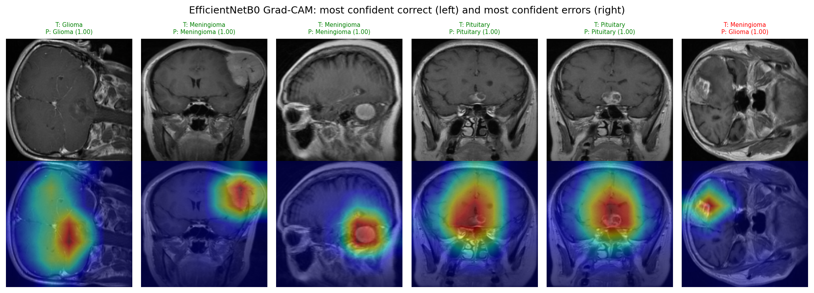
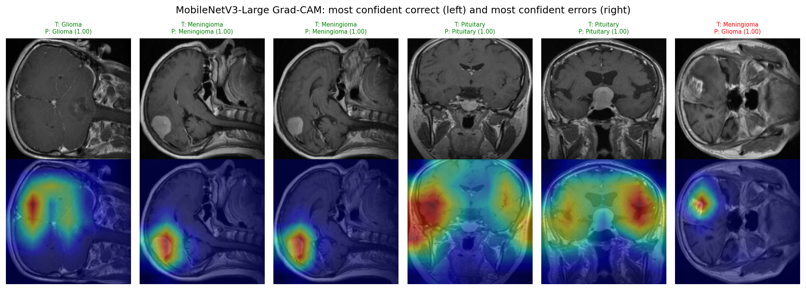
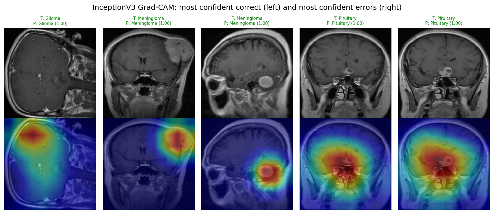
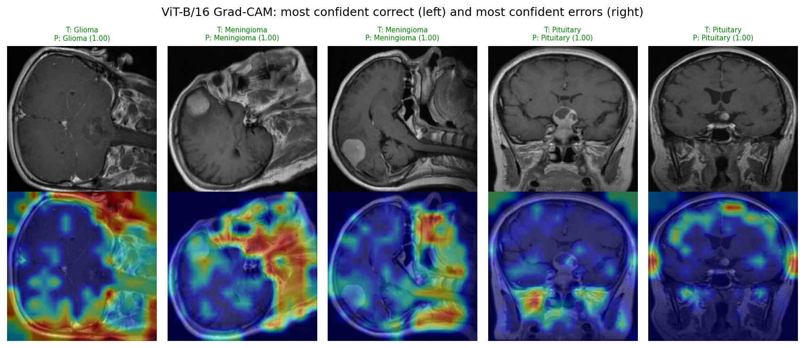
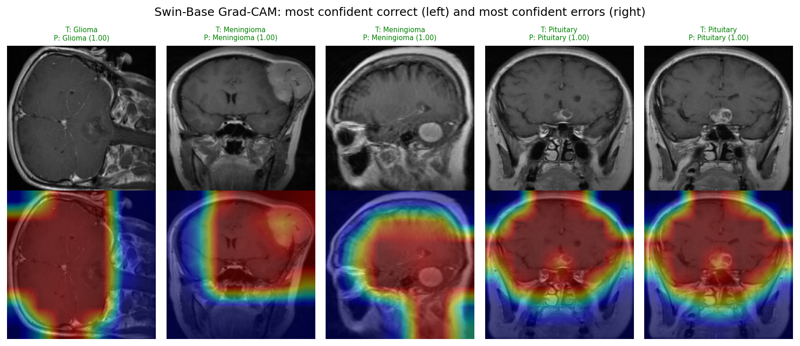
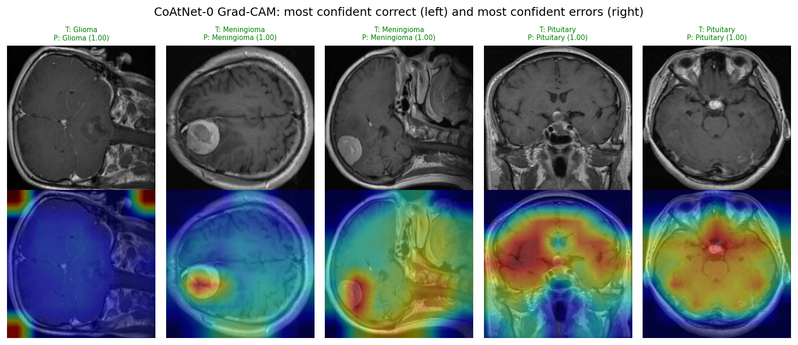

Occlusion outside-head share on 17 test images (`occlusion_outside_head.csv`): ResNet50 0.0791, VGG16 0.0788, DenseNet121 0.1103, EfficientNetB0 0.0655, MobileNetV3-Large 0.0709, InceptionV3 0.0993, ViT-B/16 0.1066, Swin-Base 0.1219, CoAtNet-0 0.1241.

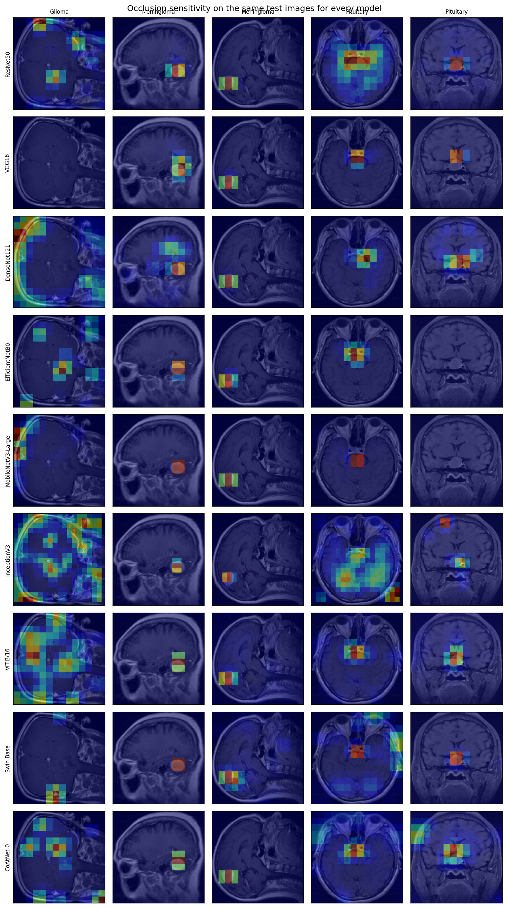

| Model (`masking_test.csv`) | Full image | Head only | Background only |
| -------------------------- | ---------- | --------- | --------------- |
| CoAtNet-0                  | 0.9867     | 0.9822    | 0.1556          |
| DenseNet121                | 0.9911     | 0.9600    | 0.2756          |
| EfficientNetB0             | 0.9733     | 0.9556    | 0.1333          |
| InceptionV3                | 0.9956     | 0.9467    | 0.2178          |
| MobileNetV3-Large          | 0.9778     | 0.9511    | 0.3378          |
| ResNet50                   | 0.9867     | 0.9467    | 0.2844          |
| Swin-Base                  | 0.9956     | 0.9956    | 0.1689          |
| VGG16                      | 0.9733     | 0.9422    | 0.2400          |
| ViT-B/16                   | 0.9911     | 0.9867    | 0.1156          |

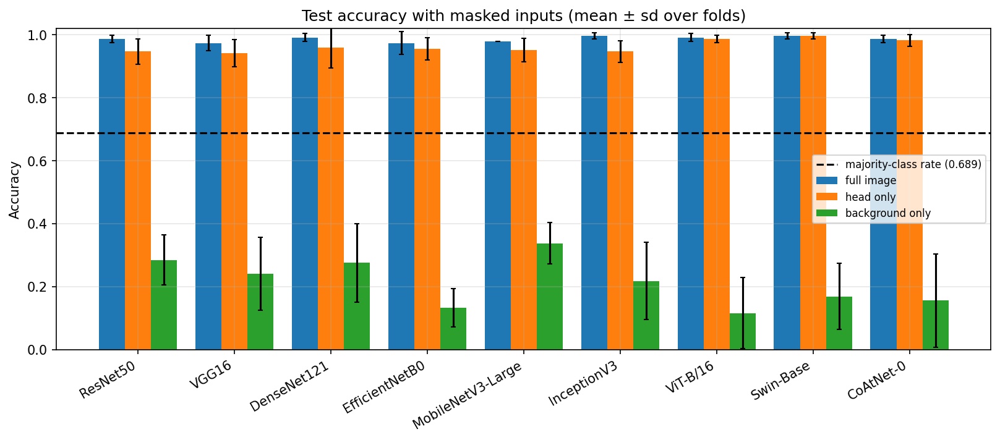

Shortcut test (`shortcut_test.csv`, majority-class rate 0.6889): every model trained on background-only images scores above chance after Holm correction.

| Model             | Background-only accuracy | Background-only AUC | Holm p |
| ----------------- | ------------------------ | ------------------- | ------ |
| ResNet50          | 0.9333                   | 0.9968              | 0.0006 |
| VGG16             | 0.9778                   | 1.0000              | 0.0000 |
| DenseNet121       | 0.8667                   | 0.9904              | 0.0104 |
| EfficientNetB0    | 0.8889                   | 1.0000              | 0.0048 |
| MobileNetV3-Large | 0.9333                   | 1.0000              | 0.0006 |
| InceptionV3       | 0.9778                   | 0.9984              | 0.0000 |
| ViT-B/16          | 0.9111                   | 0.9717              | 0.0020 |
| Swin-Base         | 0.9111                   | 0.9976              | 0.0020 |
| CoAtNet-0         | 0.8222                   | 0.9752              | 0.0337 |

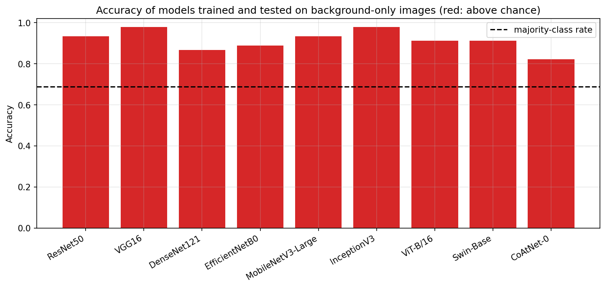

### 8. Efficiency

| Model (`efficiency.csv`) | Latency (ms)     | Throughput (img/s) | Train min/run | Peak train memory (GB) | Accuracy |
| ------------------------ | ---------------- | ------------------ | ------------- | ---------------------- | -------- |
| ResNet50                 | 9.074 +/- 0.363  | 716.8 +/- 6.9      | 5.319         | 4.076                  | 1.000    |
| VGG16                    | 8.015 +/- 0.395  | 332.1 +/- 6.2      | 9.496         | 9.869                  | 0.978    |
| DenseNet121              | 22.805 +/- 1.221 | 607.7 +/- 17.7     | 6.865         | 4.478                  | 1.000    |
| EfficientNetB0           | 12.805 +/- 0.796 | 1265.7 +/- 50.3    | 5.078         | 3.039                  | 0.978    |
| MobileNetV3-Large        | 9.985 +/- 0.923  | 2183.1 +/- 234.4   | 3.490         | 2.081                  | 0.978    |
| InceptionV3              | 16.690 +/- 1.251 | 438.2 +/- 6.6      | 7.974         | 5.263                  | 1.000    |
| ViT-B/16                 | 10.255 +/- 1.097 | 241.0 +/- 3.0      | 15.020        | 5.968                  | 1.000    |
| Swin-Base                | 34.649 +/- 1.513 | 173.1 +/- 2.8      | 21.427        | 6.446                  | 1.000    |
| CoAtNet-0                | 15.875 +/- 0.726 | 448.4 +/- 6.3      | 9.457         | 10.423                 | 1.000    |

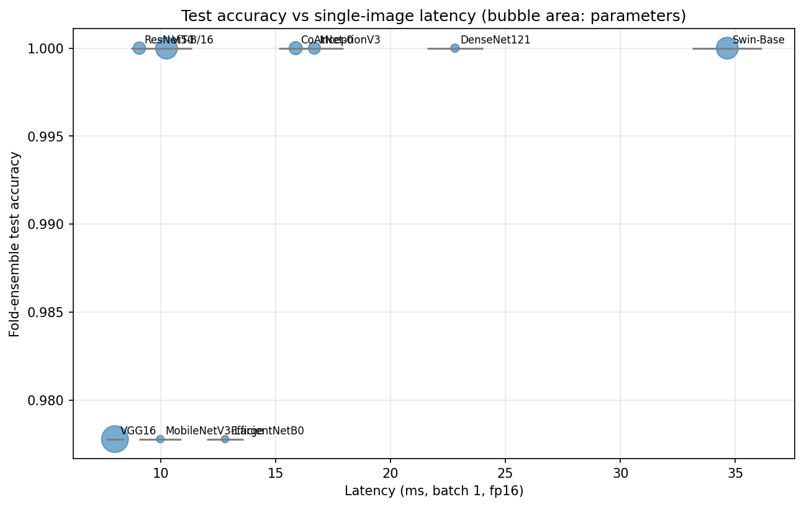

External validation: none configured.

### 9. Export and summary

Output: `Exported /kaggle/working/weights/deploy/EfficientNetB0.pth (16.3 MB); reload check passed` and `Leader: ResNet50; 54/54 jobs; notebook time 274 min`. `run_summary.json`: 5,828 images in the pool, 4,730 after deduplication, 10 label-noise exclusions, 45 test images.

## Segmentation notebook

Source: [`segmentation.ipynb`](segmentation.ipynb). Outputs: [`segmentation/`](segmentation/).

### Current notebook: region-adaptive hybrid ensemble (not yet run)

The notebook was rewritten after the six-network benchmark below. It has no saved outputs yet, and none of its results exist until it is run on Kaggle; the `segmentation/` folder still holds the outputs of the previous version, documented in the next subsections. A new run writes the same folder layout, with these changes:

| Aspect         | Previous version (results below)                                     | Current notebook                                                                                                                                                                                                                                                                                                        |
| -------------- | -------------------------------------------------------------------- | ----------------------------------------------------------------------------------------------------------------------------------------------------------------------------------------------------------------------------------------------------------------------------------------------------------------------- |
| Networks       | UNet, nnU-Net, VNet, UNETR, Swin UNETR, TransBTS, written in PyTorch | nnU-Net (residual DynUNet, 31.4 M parameters), SegResNet (SegResNetDS, 19.9 M) and Swin UNETR-v2 (feature size 48, 72.8 M), from MONAI 1.6.1                                                                                                                                                                            |
| Input          | Whole volume resampled to 128^3                                      | Native 1 mm volume cropped to the brain; 128^3 training patches, one third centred on tumour                                                                                                                                                                                                                            |
| Augmentation   | Flips, intensity scale and shift                                     | Rotation up to 30 degrees and zoom 0.7 to 1.4 (p = 0.2 each), flips, noise, brightness, contrast, gamma, on the GPU                                                                                                                                                                                                     |
| Training       | 50 epochs of the 257 training cases                                  | `EPOCHS = {"nnU-Net": 60, "SegResNet": 60, "Swin UNETR": 30}` of 250 steps x 2 patches; validation every 5 epochs                                                                                                                                                                                                       |
| Inference      | Whole 128^3 volume, 8-flip TTA                                       | Gaussian sliding windows (128^3, overlap 0.5), 8-flip TTA                                                                                                                                                                                                                                                               |
| Ensemble       | Plain mean of all models and of the CNNs                             | Region-adaptive hybrid ensemble: one convex weight vector and one threshold per region (WT, TC, ET), chosen on the 56 validation cases; ablations: each member, plain mean, CNN mean, weights without threshold tuning                                                                                                  |
| Validation     | 56 internal test cases                                               | The same 56 internal test cases (fixed by ID, so paired with the results below) and 60 external BraTS-Africa cases (`aiocta/brats2023-ssa-training-dataset`)                                                                                                                                                            |
| Added analyses |                                                                      | Paired Wilcoxon tests of the proposed ensemble with bootstrap CIs; generalisation gap; slice-wise protocol of 2D studies next to the published GCSER-UNet results; CNN-transformer disagreement as a failure detector (Spearman, AUROC); 3D Seg-Grad-CAM maps with attribution-in-region scores; sequence-drop ablation |
| Web-app export | `weights/deploy/VNet.pth`                                            | None: keep the existing `weights/deploy/` folder when copying new outputs                                                                                                                                                                                                                                               |

Kaggle settings: GPU T4 x2, Internet on, both datasets attached, and the Environment preference set to "Always use latest environment". MONAI 1.6.1 needs PyTorch 2.8 or newer: a second attempt on 2026-10-22 ran on an older pinned image (Python 3.10) and failed at `import monai`, so the setup cell now stops at once with this instruction when PyTorch is older than 2.8. `RESUME_DIR` continues an interrupted run. The first Kaggle attempt (2026-10-22) stopped in the model-profile cell, because MONAI's Swin UNETR calls `.item()` while it is built and the cell built the models on the meta device. The cell now builds each model on the CPU to count its parameters and measures GFLOPs with one forward pass on GPU 0. Case discovery also accepts a sequence stored inside a folder named like the NIfTI file, a layout Kaggle can produce when it unpacks an upload. A third attempt (2026-10-23, PyTorch 2.11, MONAI 1.6.1) logged nothing for 45 minutes after writing `src/shared_lib.py`; the previous version had cached all cases within 6 minutes. The likely cause is the preprocessing pool, which forked the kernel after the models had been built on the CPU and run on GPU 0 (CUDA, OpenMP and debugger threads alive); forking a multithreaded process can deadlock the children. Both CPU process pools now use `spawn` (`POOL_CONTEXT`), and the preprocessing worker no longer calls PyTorch. Training workers create their DataLoader once per run instead of once per epoch. tqdm bars are widgets, which the log of a saved Kaggle run does not show, so every long stage now also logs every tenth of its items (`progress`), and the training monitor logs each GPU's step every 5 minutes. A fourth attempt (2026-10-23, PyTorch 2.11, MONAI 1.6.1, Python 3.13) preprocessed the 429 cases in 3031 s with the `spawn` pool, logging steadily; case discovery alone took 87 s against 9 s in the earlier run, so the slowdown points at slow reads from `/kaggle/input` in that session, and the third attempt was probably still preprocessing rather than deadlocked. Training then failed: the Swin UNETR worker on GPU 0 ran out of GPU memory in its first epoch at micro-batch 2 (a 2.63 GiB allocation in the window-attention mask sum, with 6.4 GiB reserved but unallocated), while GPU 1 trained nnU-Net (internal test mean Dice 0.8364, external 0.7706) and SegResNet (0.8603, 0.7956). The monitor only raised when GPU 1 finished, 8 hours later, and the outputs of that run were not kept. Fixes: Swin UNETR now uses micro-batch 1 with 2 accumulation steps (the effective batch is still 2); the micro-batch probe keeps 10% of GPU memory free; workers run with `PYTORCH_CUDA_ALLOC_CONF=expandable_segments:True`, release GPU memory between jobs and retry a job that runs out of memory from its last checkpoint with half the micro-batch; the monitor stops the other worker and raises as soon as one worker fails, and warns with the end of a worker's log after 30 minutes without progress; workers enable `faulthandler`; `progress` also logs at least every 2 minutes with an ETA; preprocessing uses twice the CPU cores as processes (`PREPROCESS_WORKERS`) and logs the mean read and processing time per case; and the ensemble's ET-threshold search logs its progress. The new outputs add `metrics/fusion_weights.csv`, `test_results.csv`, `external_results.csv`, `generalisation_gap.csv`, `slice_protocol_comparison.csv`, `quality_control.csv`, `gradcam_attribution.csv`, `modality_ablation_summary.csv` and `predictions/<run>/<split>/<case>.npz` (compressed uint8 probabilities on the brain crop, Git-ignored).

The subsections below describe the previous version of the notebook (commit `4a3ffae`) and the outputs it produced.

### 1. Setup

- **Configuration.** Models UNet, nnU-Net, VNet, UNETR, Swin UNETR and TransBTS; `SEEDS = [42]`, `IMG_SIZE = 128`, `EPOCHS = 50`, `EFFECTIVE_BATCH = 4`, `GRAD_CLIP = 1.0`, 70/15/15 split with `SPLIT_SEED = 42`, `TTA = True`, `EARLY_STOP_PATIENCE = None`, `ET_CANDIDATES = [0, 50, 100, 200, 300, 500, 800]`, `TRAINING_BUDGET_HOURS = 9.5`, `DEPLOY_MODEL = "VNet"`. Output: `Models: [...] | seeds: [42] | epochs: 50 | input 128^3`.
- **Hardware check.** Two Tesla T4 GPUs, 4 CPU cores, 33.7 GB RAM.
- **Shared library and workers.** `src/volume_lib.py` holds case discovery, foreground z-score normalisation and resampling, GPU augmentation (random flips on each axis, per-channel intensity scale 0.9 to 1.1 and shift -0.1 to 0.1), the six architectures written from scratch in PyTorch (VNet with the web app's exact module names), the soft Dice plus binary cross-entropy loss per region with deep supervision, 8-flip test-time augmentation, the BraTS region hierarchy with ET size post-processing, and per-case Dice, HD95, sensitivity and specificity.

Training recipes (`model_profiles.csv`):

| Model      | Family      | Parameters (M) | GFLOPs per volume | Optimiser                   | LR   | Weight decay | Warm-up epochs | Micro-batch | Grad. checkpointing | Deep supervision weights |
| ---------- | ----------- | -------------- | ----------------- | --------------------------- | ---- | ------------ | -------------- | ----------- | ------------------- | ------------------------ |
| UNet       | CNN         | 5.604          | 907.0             | SGD, Nesterov momentum 0.99 | 0.01 | 3e-5         | 0              | 2           | No                  | 1.0, 0.5, 0.25           |
| nnU-Net    | CNN         | 16.548         | 956.3             | SGD, Nesterov momentum 0.99 | 0.01 | 3e-5         | 0              | 2           | No                  | 1.0, 0.5, 0.25, 0.125    |
| VNet       | CNN         | 1.399          | 149.9             | SGD, Nesterov momentum 0.99 | 0.01 | 3e-5         | 0              | 2           | No                  | 1.0, 0.5, 0.25           |
| UNETR      | Transformer | 137.597        | 1761.7            | AdamW                       | 1e-4 | 1e-5         | 3              | 2           | Yes                 | 1.0                      |
| Swin UNETR | Transformer | 10.521         | 797.1             | AdamW                       | 1e-4 | 1e-5         | 3              | 1           | Yes                 | 1.0                      |
| TransBTS   | Hybrid      | 35.805         | 996.2             | AdamW                       | 1e-4 | 1e-5         | 3              | 2           | No                  | 1.0, 0.5, 0.25           |

SGD runs use polynomial decay (power 0.9) per step; AdamW runs use linear warm-up then cosine decay to 1% of the initial rate.

### 2. Data

- **Find the cases and their grades.** Dataset `awsaf49/brats20-dataset-training-validation`. Masks are found by name pattern, which also picks up the misnamed mask of case 355. Output: `369 complete cases | grades: {'HGG': 293, 'LGG': 76}`.
- **Preprocess and cache.** Foreground z-score per sequence, trilinear resampling of images and nearest-neighbour resampling of masks to 128^3. Output: `Cached 369 cases in 316s (6.96 GB)`.
- **Dataset overview.** 27 of 76 LGG cases (35.5%) and 0 of 293 HGG cases have no ET (`cases_without_et.csv`). Region volumes in cm^3 (`region_volumes_by_grade.csv`):

| Region | Grade | Mean   | SD    | Min   | Median | Max    |
| ------ | ----- | ------ | ----- | ----- | ------ | ------ |
| WT     | HGG   | 96.44  | 53.78 | 7.28  | 91.13  | 256.88 |
| WT     | LGG   | 111.54 | 76.72 | 17.08 | 86.32  | 361.78 |
| TC     | HGG   | 37.66  | 29.26 | 0.56  | 32.54  | 126.72 |
| TC     | LGG   | 57.85  | 49.66 | 0.83  | 44.59  | 190.19 |
| ET     | HGG   | 23.39  | 18.50 | 0.11  | 19.46  | 111.25 |
| ET     | LGG   | 5.46   | 13.53 | 0.00  | 0.82   | 89.55  |


_One case with its four sequences and three region masks._

- **Grade-stratified split** (`split.csv`; per-case roles in `cases.csv`):

| Split      | HGG | LGG | Total |
| ---------- | --- | --- | ----- |
| Train      | 204 | 53  | 257   |
| Validation | 45  | 11  | 56    |
| Test       | 44  | 12  | 56    |
| Total      | 293 | 76  | 369   |

- **Augmentation preview.**


### 3. Training

Output: `6 jobs, 0 already finished; launching 2 workers` and `Training stage finished in 515.0 min; pending runs: none`. Every run trained 50 epochs, 3,250 optimiser steps. The best checkpoint is chosen on validation mean Dice, and the ET size threshold is tuned on the validation cases (`et_threshold_and_selection.csv`):

| Run               | Best epoch | Best validation Dice | ET minimum voxels |
| ----------------- | ---------- | -------------------- | ----------------- |
| unet_seed42       | 45         | 0.7845               | 100               |
| nnu-net_seed42    | 50         | 0.7824               | 200               |
| vnet_seed42       | 44         | 0.7598               | 200               |
| swin-unetr_seed42 | 33         | 0.7235               | 0                 |
| transbts_seed42   | 45         | 0.7102               | 0                 |
| unetr_seed42      | 39         | 0.6960               | 800               |

### 4. Results


_Training and validation loss and validation Dice per region for every run._

**Test results at native resolution** on 56 cases with 8-flip TTA (`test_results.csv`). Dice is the mean over cases; HD95 (mm) is summarised by its median because empty-region cases contribute the fixed BraTS value of 373.13 mm (`notebook.log`):

| Model      | Mean Dice (95% CI)      | Dice WT | Dice TC | Dice ET | HD95 WT | HD95 TC | HD95 ET | Sens. WT | Sens. TC | Sens. ET |
| ---------- | ----------------------- | ------- | ------- | ------- | ------- | ------- | ------- | -------- | -------- | -------- |
| UNet       | 0.8199 [0.7826, 0.8533] | 0.9012  | 0.8300  | 0.7286  | 4.24    | 3.24    | 3.67    | 0.9059   | 0.8797   | 0.8486   |
| nnU-Net    | 0.8192 [0.7837, 0.8511] | 0.9002  | 0.8309  | 0.7264  | 4.24    | 3.46    | 3.80    | 0.9070   | 0.8831   | 0.8538   |
| VNet       | 0.7965 [0.7497, 0.8340] | 0.8865  | 0.7972  | 0.7058  | 4.06    | 4.18    | 3.46    | 0.8899   | 0.8697   | 0.8278   |
| Swin UNETR | 0.7462 [0.7134, 0.7772] | 0.8714  | 0.7495  | 0.6176  | 5.10    | 6.70    | 6.28    | 0.9619   | 0.9316   | 0.9407   |
| TransBTS   | 0.7291 [0.6876, 0.7661] | 0.8743  | 0.7488  | 0.5642  | 4.42    | 6.58    | 5.96    | 0.9468   | 0.9384   | 0.9475   |
| UNETR      | 0.7056 [0.6700, 0.7384] | 0.8758  | 0.6692  | 0.5720  | 5.05    | 11.29   | 9.15    | 0.9492   | 0.9481   | 0.9520   |

Per-case standard deviations of Dice (WT, TC, ET): UNet 0.0575, 0.2146, 0.2500; nnU-Net 0.0533, 0.2063, 0.2462; VNet 0.0848, 0.2210, 0.2678; Swin UNETR 0.0596, 0.2022, 0.2584; TransBTS 0.0683, 0.2115, 0.2709; UNETR 0.0601, 0.2204, 0.2577. Specificity is between 0.9973 and 0.9996 for every model and region. Per-case values are in `test_per_case.csv` and `metrics/runs/<run>/test_cases.csv`.

**Ensembles** (`ensemble_results.csv`; each uses the median of its members' ET thresholds):

| Ensemble   | Mean Dice (95% CI)      | Dice WT | Dice TC | Dice ET | HD95 WT | HD95 TC | HD95 ET |
| ---------- | ----------------------- | ------- | ------- | ------- | ------- | ------- | ------- |
| All models | 0.7991 [0.7631, 0.8309] | 0.8993  | 0.8027  | 0.6953  | 4.12    | 4.12    | 4.47    |
| CNN models | 0.8178 [0.7782, 0.8522] | 0.9010  | 0.8262  | 0.7262  | 4.06    | 3.61    | 3.87    |

**Statistical comparison.** Pairwise Wilcoxon signed-rank tests on per-case mean Dice, Holm-corrected (`wilcoxon_tests.csv`):

| Model A    | Model B    | Median Dice difference | Holm p  |
| ---------- | ---------- | ---------------------- | ------- |
| UNet       | nnU-Net    | 0.00231                | 0.04195 |
| UNet       | VNet       | 0.01186                | < 1e-5  |
| UNet       | UNETR      | 0.11386                | < 1e-5  |
| UNet       | Swin UNETR | 0.07378                | < 1e-5  |
| UNet       | TransBTS   | 0.07886                | < 1e-5  |
| nnU-Net    | VNet       | 0.01003                | 1e-5    |
| nnU-Net    | UNETR      | 0.10660                | < 1e-5  |
| nnU-Net    | Swin UNETR | 0.06871                | < 1e-5  |
| nnU-Net    | TransBTS   | 0.07945                | < 1e-5  |
| VNet       | UNETR      | 0.08583                | < 1e-5  |
| VNet       | Swin UNETR | 0.06041                | < 1e-5  |
| VNet       | TransBTS   | 0.06660                | < 1e-5  |
| UNETR      | Swin UNETR | -0.03594               | < 1e-5  |
| UNETR      | TransBTS   | -0.01936               | 0.00018 |
| Swin UNETR | TransBTS   | 0.00638                | 0.04195 |

"< 1e-5" marks p-values stored as 0.0 at five decimals.


**Results by tumour grade** (`test_results_by_grade.csv`, 44 HGG and 12 LGG test cases):

| Model      | Grade | Dice WT | Dice TC | Dice ET | Mean Dice | 95% CI           |
| ---------- | ----- | ------- | ------- | ------- | --------- | ---------------- |
| UNet       | HGG   | 0.8984  | 0.8786  | 0.8117  | 0.8629    | [0.8300, 0.8889] |
| UNet       | LGG   | 0.9115  | 0.6520  | 0.4237  | 0.6624    | [0.6055, 0.7253] |
| nnU-Net    | HGG   | 0.8985  | 0.8785  | 0.8124  | 0.8632    | [0.8357, 0.8865] |
| nnU-Net    | LGG   | 0.9065  | 0.6561  | 0.4112  | 0.6579    | [0.6032, 0.7175] |
| VNet       | HGG   | 0.8819  | 0.8412  | 0.7923  | 0.8385    | [0.7965, 0.8716] |
| VNet       | LGG   | 0.9032  | 0.6359  | 0.3885  | 0.6425    | [0.5750, 0.7131] |
| Swin UNETR | HGG   | 0.8620  | 0.7859  | 0.7262  | 0.7913    | [0.7666, 0.8147] |
| Swin UNETR | LGG   | 0.9061  | 0.6161  | 0.2193  | 0.5805    | [0.5249, 0.6299] |
| TransBTS   | HGG   | 0.8665  | 0.7837  | 0.6740  | 0.7748    | [0.7389, 0.8073] |
| TransBTS   | LGG   | 0.9029  | 0.6206  | 0.1613  | 0.5616    | [0.5043, 0.6120] |
| UNETR      | HGG   | 0.8686  | 0.6843  | 0.6773  | 0.7434    | [0.7100, 0.7736] |
| UNETR      | LGG   | 0.9021  | 0.6137  | 0.1857  | 0.5672    | [0.5037, 0.6325] |


_Box plots of per-case Dice and HD95 per region and model, including the ensembles._


_The test cases with the median and the lowest all-model-ensemble Dice: reference and every model's prediction on FLAIR (oedema-only WT green, TC yellow, ET red)._

**Uncertainty and error.** Spearman correlation between the mean TTA standard deviation inside the predicted WT and per-case mean Dice (`uncertainty_correlation.csv`):

| Model      | Spearman rho | p      |
| ---------- | ------------ | ------ |
| UNet       | -0.3034      | 0.0230 |
| nnU-Net    | -0.3040      | 0.0228 |
| VNet       | -0.4018      | 0.0021 |
| UNETR      | -0.0936      | 0.4924 |
| Swin UNETR | -0.0796      | 0.5596 |
| TransBTS   | -0.1401      | 0.3030 |


**Efficiency** (`efficiency.csv`; latency per volume at batch 1, fp16, mean +/- sd):

| Model      | Train hours | Peak train memory (GB) | Peak inference memory (GB) | Latency (s)       | Latency with TTA (s) | Dice per M params | Dice per train hour |
| ---------- | ----------- | ---------------------- | -------------------------- | ----------------- | -------------------- | ----------------- | ------------------- |
| UNet       | 1.281       | 5.250                  | 1.536                      | 0.1076 +/- 0.0013 | 0.8611 +/- 0.0019    | 0.1463            | 0.6402              |
| nnU-Net    | 1.350       | 5.218                  | 1.648                      | 0.1112 +/- 0.0017 | 0.8963 +/- 0.0021    | 0.0495            | 0.6066              |
| VNet       | 0.533       | 3.442                  | 0.978                      | 0.0375 +/- 0.0003 | 0.2973 +/- 0.0007    | 0.5694            | 1.4939              |
| UNETR      | 2.487       | 9.303                  | 3.798                      | 0.2094 +/- 0.0029 | 1.6966 +/- 0.0048    | 0.0051            | 0.2837              |
| Swin UNETR | 5.291       | 7.070                  | 6.971                      | 0.4893 +/- 0.0034 | 3.9512 +/- 0.0044    | 0.0709            | 0.1410              |
| TransBTS   | 1.562       | 7.459                  | 1.990                      | 0.1291 +/- 0.0010 | 1.0336 +/- 0.0022    | 0.0204            | 0.4669              |


### 5. Export and summary

Output: `Exported /kaggle/working/weights/deploy/VNet.pth (5.6 MB); reload check passed (max diff 0.0026)` and `Best model: UNet; finished 6 runs, pending 0`. `run_summary.json` also records the ensembles (all models 0.7991, CNN models 0.8178).

## Checkpoints used by the web app

Each notebook exports one checkpoint to `weights/deploy/` with a `metadata.json`. The backend loads these three files by default (see the root [README](../../README.md#configuration)).

| File                                                 | Run                    | Selection                         | Recorded result                                    | Other metadata                                       |
| ---------------------------------------------------- | ---------------------- | --------------------------------- | -------------------------------------------------- | ---------------------------------------------------- |
| `binary-detection/weights/deploy/EfficientNetB0.pth` | `efficientnetb0_fold4` | Lowest validation loss of 5 folds | Fold test accuracy 0.9766 (171 images)             | Temperature 0.0498, decision threshold 1.0, 1 output |
| `classification/weights/deploy/EfficientNetB0.pth`   | `efficientnetb0_fold0` | Lowest validation loss of 5 folds | Fold test accuracy 0.9778 (45 images)              | Temperature 0.0498, no threshold, 3 outputs          |
| `segmentation/weights/deploy/VNet.pth`               | `vnet_seed42`          | Only VNet run                     | Best validation Dice 0.7598, test mean Dice 0.7965 | ET minimum 200 voxels at native resolution           |

The 2D metadata records the preprocessing `crop_to_brain (blur 5x5, threshold 45, largest contour box), resize, ImageNet normalisation`, which is the same crop as `Backend/neuroscan/inference/processor.py`. The backend does not read `metadata.json`: it applies no temperature, uses a fixed 0.5 detection threshold, and segments without TTA, region hierarchy or ET size filtering.

## Limitations recorded by the notebooks

From `run_summary.json`:

- 2D tasks: the MRI sequence of the images is not recorded by the sources; binary negatives are tumour-negative, not certified normal; there are no patient identifiers, so grouping by image similarity is a proxy for a patient-level split; only two-dimensional public slices are used, with no institutional or three-dimensional external data.
- Segmentation (previous version): a single dataset (BraTS 2020 training cases) with no external multi-centre test set with public labels; no large-scale pretraining of the transformer encoders; one input resolution per run (128^3, whole volume resampled). The current notebook addresses the first and last of these (BraTS-Africa external set, native-resolution patches) and records its own limitations in `run_summary.json` when run.

Found in the outputs and worth knowing before citing the results:

- The classification split is dominated by one group of 1,431 images, and its test set has 45 images (1 glioma, 13 meningioma, 31 pituitary). Six models score 45 of 45 and the other three 44 of 45, so the test set cannot rank the models.
- The background-only shortcut test is positive for 7 of 9 binary models and all 9 classification models.
- Every segmentation run used one seed, so seed-to-seed spread is not available (`dice_mean_seed_sd` is empty).
- The markdown overview of each notebook still says "Runtime. Not measured yet", and the export cells tell the reader to copy the checkpoint to `Backend/Binary Detection/`, `Backend/Classification/` or `Backend/Segmentation/`. Those folders no longer exist; the backend now reads the checkpoints from `weights/deploy/` directly.
