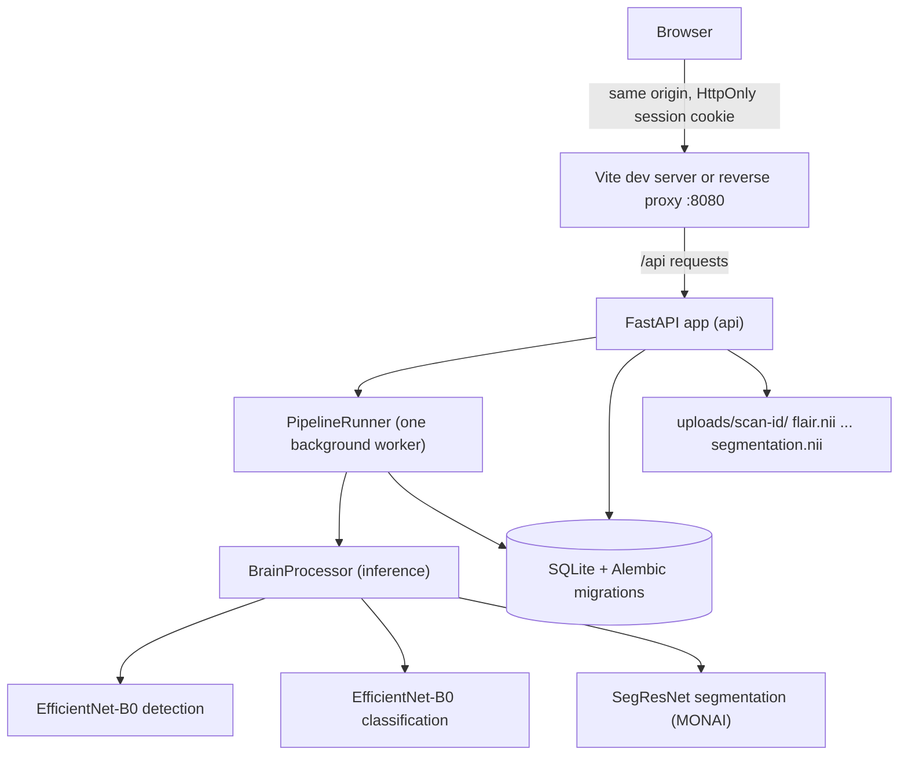
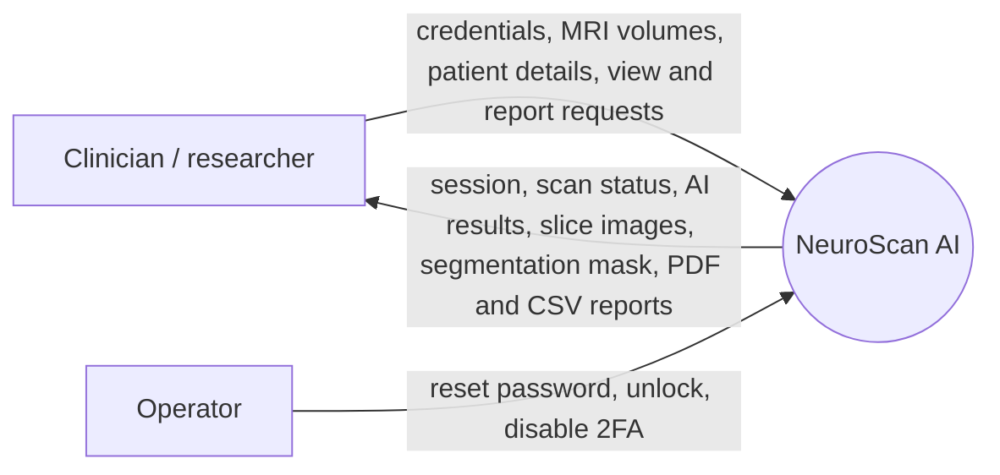
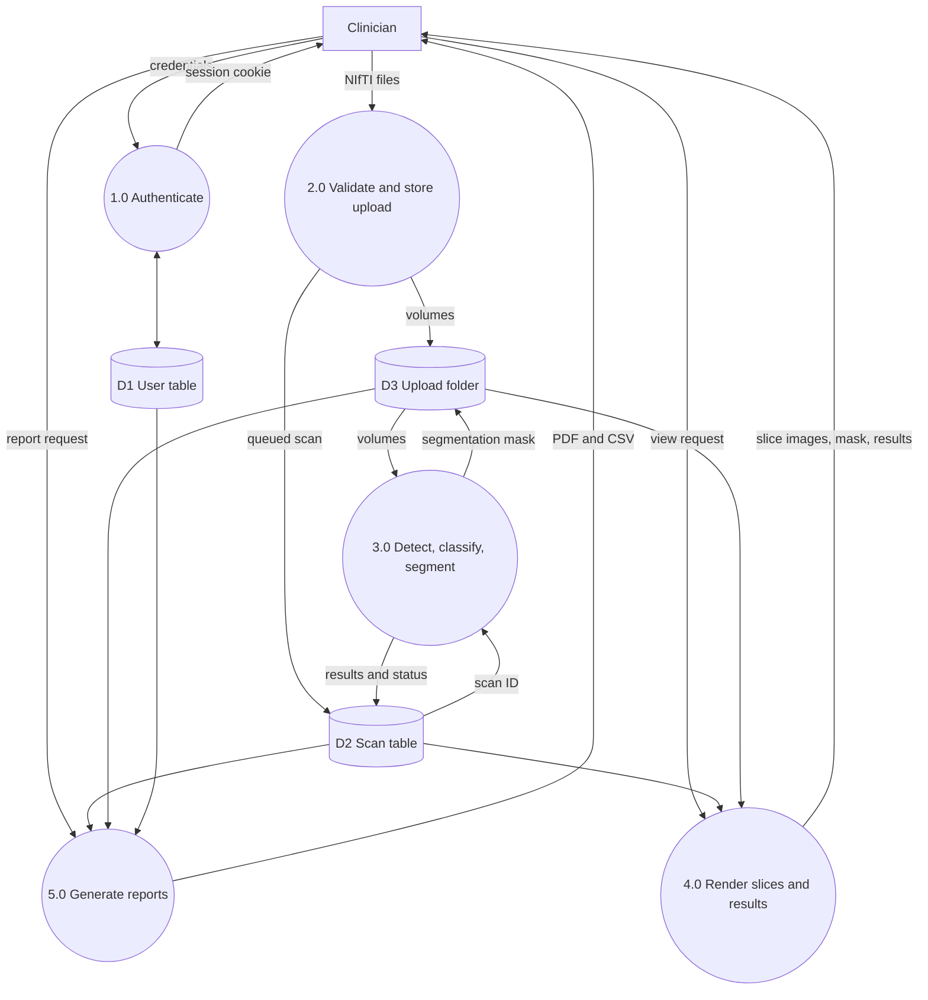
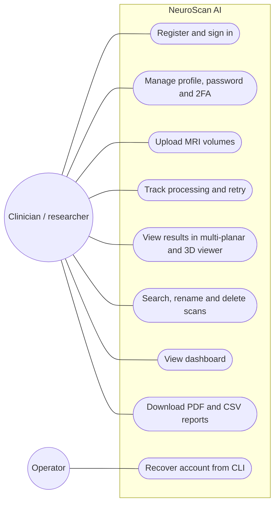
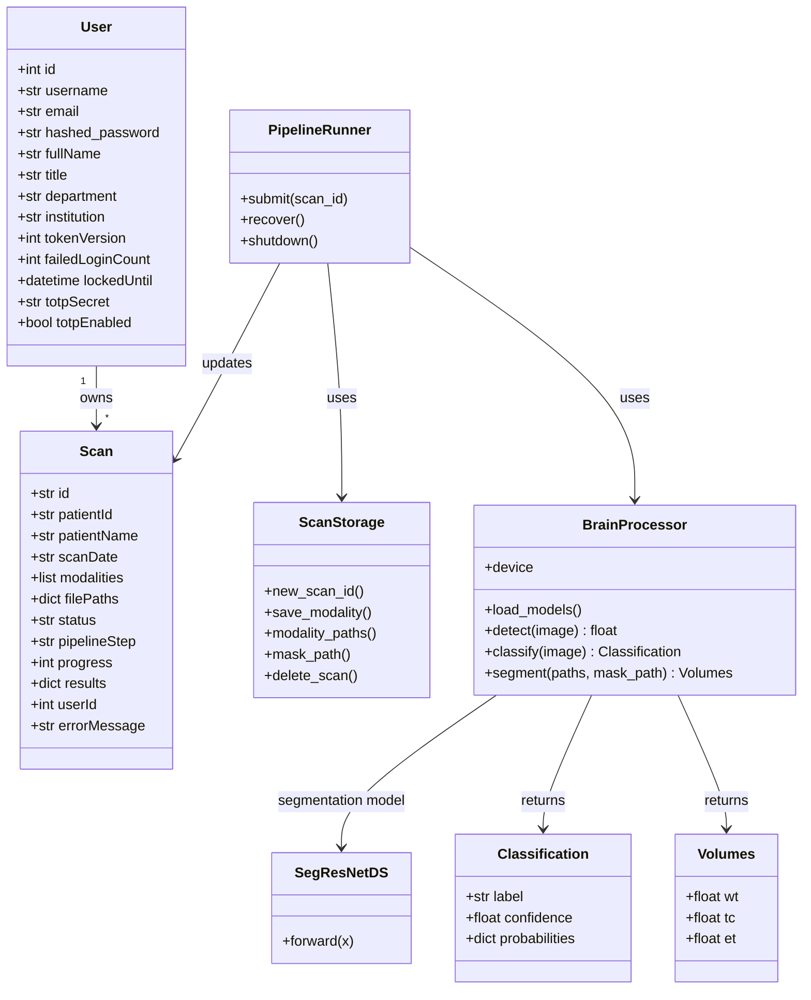
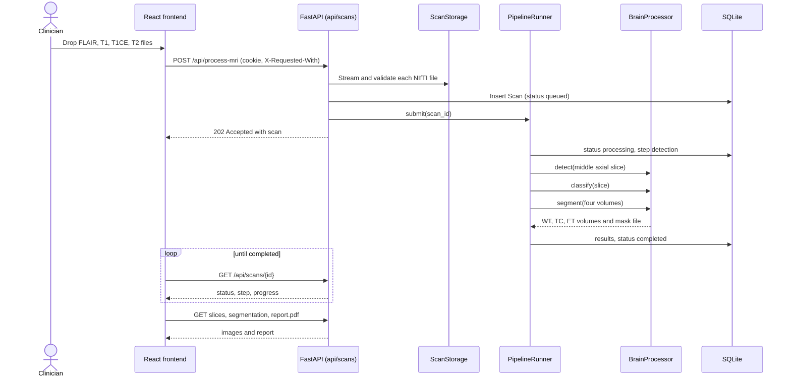

# Report Content

Content of `Report.docx`, the project report built from a duplicate of `Report Template.docx`, section by section in template order. This file is the report's content source: the build fills the template's placeholders and chapters from it, so edit the content here and rebuild. Lines starting with `>` are notes (formatting, figure files, diagrams); they are not report text.

> Formatting from the template: project title Times New Roman 18, bold, upper case, line spacing 1.5; chapter headings (ABSTRACT, CHAPTER n) Times New Roman 16, bold, upper case, line spacing 1.5; body text Times New Roman 12, line spacing 1.15 (table of contents 1.5); figure and table captions font size 10, figure captions below the figure, table captions above the table.
>
> Page numbers: the page-number columns of the contents and both lists are PAGEREF fields to bookmarks on the headings and captions, filled from a render of the finished document. After editing `Report.docx` in Word, select all and press F9 to update them.
>
> Diagrams in Chapter 4 are given as Mermaid code; the build renders each to PNG and inserts it above its caption.

## Title Page

**B.Tech. BCSE497J - Project-I**

**NEUROSCAN AI: AI-POWERED BRAIN TUMOUR DETECTION, CLASSIFICATION AND SEGMENTATION PLATFORM**

Submitted in partial fulfillment of the requirements for the degree of

**Bachelor of Technology**

in

**Computer Science and Engineering**

by

| **23BCE0842** | **PARTH MITAL** |
| ------------- | --------------- |
| **23BDS0141** | **VED LAWAND**  |

**Under the Supervision of**

| **Dr. Biji C. L.**                                 |
| -------------------------------------------------- |
| Associate Professor Grade 2                        |
| School of Computer Science and Engineering (SCOPE) |

> Image: VIT logo (keep the template's logo).

October 2026

## Declaration

**DECLARATION**

We hereby declare that the project entitled **NeuroScan AI: AI-Powered Brain Tumour Detection, Classification and Segmentation Platform** submitted by us, for the award of the degree of Bachelor of Technology in Computer Science and Engineering to VIT is a record of bonafide work carried out by us under the supervision of Dr. Biji C. L.

We further declare that the work reported in this project has not been submitted and will not be submitted, either in part or in full, for the award of any other degree or diploma in this institute or any other institute or university.

Place : Vellore
Date :

| **Parth Mital (23BCE0842)** | **Ved Lawand (23BDS0141)** |
| --------------------------- | -------------------------- |
| Signature of the Candidate  | Signature of the Candidate |

## Certificate

**CERTIFICATE**

This is to certify that the project entitled **NeuroScan AI: AI-Powered Brain Tumour Detection, Classification and Segmentation Platform** submitted by **Parth Mital (23BCE0842)** and **Ved Lawand (23BDS0141)**, **School of Computer Science and Engineering**, VIT, for the award of the degree of Bachelor of Technology in Computer Science and Engineering, is a record of bonafide work carried out by them under my supervision during Fall Semester 2026-2027, as per the VIT code of academic and research ethics.

The contents of this report have not been submitted and will not be submitted either in part or in full, for the award of any other degree or diploma in this institute or any other institute or university. The project fulfills the requirements and regulations of the University and in my opinion meets the necessary standards for submission.

Place : Vellore

Date :

**Signature of the Guide**

**Dr. Biji C. L.**

**Examiner(s)**

**Head of the Department**

**B.Tech. Computer Science and Engineering**

## Acknowledgements

**ACKNOWLEDGEMENTS**

We are deeply grateful to the management of Vellore Institute of Technology (VIT) for providing us with the opportunity and resources to undertake this project. Their commitment to fostering a conducive learning environment has been instrumental in our academic journey. The support and infrastructure provided by VIT have enabled us to explore and develop our ideas to their fullest potential.

Our sincere thanks to Dr. Jaisankar N, the Dean of the School of Computer Science and Engineering (SCOPE), for his unwavering support and encouragement. His leadership and vision have greatly inspired us to strive for excellence. The Dean's dedication to academic excellence and innovation has been a constant source of motivation for us. We appreciate his efforts in creating an environment that nurtures creativity and critical thinking.

We express our profound appreciation to the Head of the Department, B.Tech. Computer Science and Engineering, for the insightful guidance and continuous support extended to us. The department's commitment to fostering a collaborative and supportive atmosphere has greatly enhanced our learning experience, and the constructive feedback received during the project reviews has been invaluable in overcoming challenges and achieving our project goals.

We are immensely thankful to our project guide, Dr. Biji C. L., Associate Professor Grade 2, SCOPE, for dedicated mentorship and invaluable feedback throughout this project. Dr. Biji C. L.'s patience, knowledge and encouragement have been pivotal in the successful completion of this work, and the thoughtful guidance on experimental design, evaluation and the preparation of our research manuscripts has been instrumental in refining our ideas and methodologies. This support has not only contributed to the success of this project but has also enriched our overall academic experience.

We also thank Kaggle for the free GPU resources on which all our models were trained, and the creators of the public Br35H, Brain MRI Images for Brain Tumor Detection, Brain Tumor Classification (MRI), Cheng brain tumour and BraTS 2020 datasets used in this work.

Thank you all for your contributions and support.

**Parth Mital (23BCE0842)**

**Ved Lawand (23BDS0141)**

## Table of Contents

**TABLE OF CONTENTS**

| **Sl.No** | **Contents**                              | **Page No.** |
| --------- | ----------------------------------------- | ------------ |
|           | **Abstract**                              |              |
| **1.**    | **INTRODUCTION**                          |              |
|           | 1.1 Background                            |              |
|           | 1.2 Motivations                           |              |
|           | 1.3 Scope of the Project                  |              |
| **2.**    | **PROJECT DESCRIPTION AND GOALS**         |              |
|           | 2.1 Literature Review                     |              |
|           | 2.2 Research Gap                          |              |
|           | 2.3 Objectives                            |              |
|           | 2.4 Problem Statement                     |              |
|           | 2.5 Project Plan                          |              |
| **3.**    | **TECHNICAL SPECIFICATION**               |              |
|           | 3.1 Requirements                          |              |
|           | 3.1.1 Functional                          |              |
|           | 3.1.2 Non-Functional                      |              |
|           | 3.2 Feasibility Study                     |              |
|           | 3.2.1 Technical Feasibility               |              |
|           | 3.2.2 Economic Feasibility                |              |
|           | 3.2.3 Social Feasibility                  |              |
|           | 3.3 System Specification                  |              |
|           | 3.3.1 Hardware Specification              |              |
|           | 3.3.2 Software Specification              |              |
| **4.**    | **DESIGN APPROACH AND DETAILS**           |              |
|           | 4.1 System Architecture                   |              |
|           | 4.2 Design                                |              |
|           | 4.2.1 Data Flow Diagram                   |              |
|           | 4.2.2 Use Case Diagram                    |              |
|           | 4.2.3 Class Diagram                       |              |
|           | 4.2.4 Sequence Diagram                    |              |
| **5.**    | **METHODOLOGY AND TESTING**               |              |
|           | 5.1 Module Description                    |              |
|           | 5.2 Testing                               |              |
| **6.**    | **PROJECT DEMONSTRATION**                 |              |
| **7.**    | **RESULT AND DISCUSSION (COST ANALYSIS)** |              |
| **8.**    | **CONCLUSION**                            |              |
| **9.**    | **REFERENCES**                            |              |
|           | **APPENDIX A – SAMPLE CODE**              |              |

> The Page No. column is filled by the build (see the note on page numbers above).

## List of Figures

**List of Figures**

| **Figure No.** | **Title**                                                        | **Page No.** |
| -------------- | ---------------------------------------------------------------- | ------------ |
| 4.1            | System architecture of NeuroScan AI                              |              |
| 4.2            | Level 0 data flow diagram                                        |              |
| 4.3            | Level 1 data flow diagram                                        |              |
| 4.4            | Use case diagram                                                 |              |
| 4.5            | Class diagram of the backend                                     |              |
| 4.6            | Sequence diagram of scan upload and processing                   |              |
| 5.1            | Sample images with brain crop and head mask (binary detection)   |              |
| 5.2            | Images kept at each Hamming tolerance (binary detection)         |              |
| 5.3            | One BraTS 2020 case: four MRI sequences and three tumour regions |              |
| 6.1            | Dashboard                                                        |              |
| 6.2            | Upload Scan page                                                 |              |
| 6.3            | Scan viewer with segmentation overlay and 3D rendering           |              |
| 6.4            | Scan Library                                                     |              |
| 6.5            | Reports page                                                     |              |
| 7.1            | Confusion matrices of the binary detection fold ensembles        |              |
| 7.2            | Grad-CAM maps of EfficientNetB0 (binary detection)               |              |
| 7.3            | Background-only shortcut test (binary detection)                 |              |
| 7.4            | Qualitative segmentation comparison, internal and external cases |              |
| 7.5            | Test Dice per region by tumour grade                             |              |
| 7.6            | Mean Dice against latency per case                               |              |
| 7.7            | Member disagreement and TTA spread against per-case Dice         |              |

> Template rule: in the chapters, figure captions come below the figure and table captions above the table, in font size 10.

## List of Tables

**List of Tables**

| **Table No.** | **Title**                                                                    | **Page No.** |
| ------------- | ---------------------------------------------------------------------------- | ------------ |
| 2.1           | Comparison of existing studies for brain tumour detection and classification |              |
| 2.2           | 3D brain tumour segmentation architectures reviewed                          |              |
| 2.3           | Project plan and timeline                                                    |              |
| 3.1           | Hardware specification                                                       |              |
| 3.2           | Software specification                                                       |              |
| 5.1           | Image sources of the two 2D tasks                                            |              |
| 5.2           | Deduplication outcome per class                                              |              |
| 5.3           | Training settings of the 2D benchmark                                        |              |
| 5.4           | Training settings of the 3D segmentation models                              |              |
| 5.5           | Automated test suites and quality checks                                     |              |
| 5.6           | Representative test cases                                                    |              |
| 7.1           | Binary detection fold-ensemble results and efficiency                        |              |
| 7.2           | Subtype classification fold-ensemble results                                 |              |
| 7.3           | 3D segmentation results, internal and external test sets                     |              |
| 7.4           | Internal test Dice by tumour grade                                           |              |
| 7.5           | Computational cost of the 3D models                                          |              |
| 7.6           | Deployed models                                                              |              |
| 7.7           | Cost analysis                                                                |              |

## List of Abbreviations

**List of Abbreviations**

| Abbreviation | Expansion                                                    |
| ------------ | ------------------------------------------------------------ |
| 2D           | Two-Dimensional                                              |
| 3D           | Three-Dimensional                                            |
| API          | Application Programming Interface                            |
| AUC          | Area Under the Receiver Operating Characteristic Curve       |
| BraTS        | Brain Tumour Segmentation Challenge                          |
| CI           | Continuous Integration                                       |
| CNN          | Convolutional Neural Network                                 |
| CPU          | Central Processing Unit                                      |
| CSRF         | Cross-Site Request Forgery                                   |
| CSV          | Comma-Separated Values                                       |
| DFD          | Data Flow Diagram                                            |
| ECE          | Expected Calibration Error                                   |
| ET           | Enhancing Tumour                                             |
| FLAIR        | Fluid-Attenuated Inversion Recovery                          |
| GFLOPs       | Giga Floating-Point Operations                               |
| GPU          | Graphics Processing Unit                                     |
| Grad-CAM     | Gradient-weighted Class Activation Mapping                   |
| HD95         | 95th-percentile Hausdorff Distance                           |
| HGG          | High-Grade Glioma                                            |
| JWT          | JSON Web Token                                               |
| LGG          | Low-Grade Glioma                                             |
| MCC          | Matthews Correlation Coefficient                             |
| MRI          | Magnetic Resonance Imaging                                   |
| NCC          | Normalised Cross-Correlation                                 |
| NIfTI        | Neuroimaging Informatics Technology Initiative (file format) |
| PDF          | Portable Document Format                                     |
| pHash        | Perceptual Hash                                              |
| REST         | Representational State Transfer                              |
| SDG          | Sustainable Development Goal                                 |
| SGD          | Stochastic Gradient Descent                                  |
| SQL          | Structured Query Language                                    |
| T1           | T1-weighted MRI                                              |
| T1CE         | Contrast-Enhanced T1-weighted MRI                            |
| T2           | T2-weighted MRI                                              |
| TC           | Tumour Core                                                  |
| TOTP         | Time-based One-Time Password                                 |
| TRL          | Technology Readiness Level                                   |
| TTA          | Test-Time Augmentation                                       |
| ViT          | Vision Transformer                                           |
| WAL          | Write-Ahead Logging                                          |
| WT           | Whole Tumour                                                 |

> Template rule: abbreviations are listed in alphabetical order.

## Symbols and Notations

**Symbols and Notations**

| Symbol   | Meaning                                                                     |
| -------- | --------------------------------------------------------------------------- |
| D        | Dice similarity coefficient, D = 2\|P ∩ G\| / (\|P\| + \|G\|)               |
| P, G     | Set of predicted voxels and set of reference (ground-truth) voxels          |
| H        | Hamming distance between two 64-bit perceptual hashes                       |
| HD95     | 95th-percentile symmetric Hausdorff distance, in millimetres                |
| J        | Youden's J statistic, sensitivity + specificity − 1                         |
| p        | p-value of a statistical test                                               |
| ρ        | Spearman's rank correlation coefficient                                     |
| σ(x)     | Sigmoid function, 1 / (1 + e^(−x))                                          |
| T        | Temperature used to scale model logits in calibration                       |
| μ_f, σ_f | Mean and standard deviation of the non-zero (foreground) voxels of a volume |
| z        | Normalised intensity, z = (x − μ_f) / σ_f                                   |

## Abstract

**ABSTRACT**

Brain tumours are diagnosed and planned for treatment from magnetic resonance imaging (MRI), but reading multi-sequence MRI studies by hand is slow and varies between readers. Published deep learning results for this task are hard to compare, because each study uses its own data, splits and evaluation, and because near-duplicate images in public collections leak between training and test sets. This project, NeuroScan AI, addresses both problems: it benchmarks deep learning architectures under one controlled protocol and deploys the most efficient models in a secure, full-stack web application.

For two-dimensional analysis, nine ImageNet-pretrained backbones (ResNet50, VGG16, DenseNet121, EfficientNetB0, MobileNetV3-Large, InceptionV3, ViT-B/16, Swin-Base and CoAtNet-0) were trained with identical settings for binary tumour detection and three-way subtype classification (glioma, meningioma, pituitary). Label-aware perceptual-hash deduplication before splitting reduced the detection pool from 3,253 to 1,185 images and the classification pool from 5,828 to 4,730, and a group-aware split with five-fold cross-validation, fold ensembles, bootstrap confidence intervals and Holm-corrected McNemar tests was used for evaluation. On 171 held-out detection images, CoAtNet-0, EfficientNetB0 and ViT-B/16 reached 99.42% accuracy (95% confidence interval 98.25% to 100%), with no significant difference between any pair of models. A background-only shortcut test showed that these public collections carry label information outside the brain, a limitation that is reported rather than hidden.

For three-dimensional segmentation of the whole tumour, tumour core and enhancing tumour, two convolutional networks (nnU-Net and SegResNet) and one transformer (Swin UNETR-v2) were trained at native resolution on BraTS 2020 and combined in a region-adaptive hybrid ensemble, then tested on 56 internal cases and on 60 external BraTS-Africa cases. SegResNet alone achieved the best internal mean Dice of 0.8717 and matched the ensemble externally (0.7967 against 0.7966), while the disagreement between the three networks flagged poorly segmented cases with an area under the ROC curve of 0.993 internally and 0.870 externally.

EfficientNetB0, with 4.01 million parameters, and SegResNet were deployed in a web application built with FastAPI, PyTorch, SQLite and React. A user uploads FLAIR, T1, T1CE and T2 NIfTI volumes; a background worker runs detection, classification and segmentation, and the results are shown in a linked axial, coronal, sagittal and 3D viewer with a tumour overlay and exported as PDF and CSV reports. The application uses cookie-based sessions, optional two-factor authentication, per-user data isolation and validated uploads, and is covered by 64 backend and 39 frontend automated tests. The work produced two research manuscripts. NeuroScan AI is a research prototype, not a diagnostic device.

**Keywords:** brain tumour, MRI, deep learning, convolutional neural networks, vision transformers, 3D segmentation, ensemble learning, external validation, BraTS, data leakage, web application.

## Chapter 1: Introduction

**CHAPTER 1**

**1. INTRODUCTION**

**1.1 Background**

Brain tumours are abnormal growths of cells in the brain or central nervous system, classified by their cell of origin and molecular features [1]. The Central Brain Tumor Registry of the United States recorded 453,623 primary brain and other central nervous system tumours diagnosed between 2016 and 2020, about 90,700 cases per year; glioma alone accounted for 26.3% of them [2]. Three common types are studied in this project: glioma, which arises from glial cells; meningioma, which grows in the meninges that cover the brain and is usually benign; and pituitary tumours, which grow in the pituitary gland [2], [3].

Magnetic resonance imaging (MRI) is the main non-invasive technique for detecting and characterising brain tumours [4]. Compared with computed tomography, it gives better soft-tissue contrast without ionising radiation, and it acquires several sequences, such as T1-weighted (T1), contrast-enhanced T1-weighted (T1CE), T2-weighted (T2) and fluid-attenuated inversion recovery (FLAIR), which together show the location, extent and margins of a tumour and the surrounding oedema [4]. An MRI study is a stack of two-dimensional slices, and reading it by hand is time-consuming and subject to variability between and within readers [3]. Outlining a tumour in three dimensions for treatment planning is slower still. The Brain Tumour Segmentation (BraTS) benchmark provides multi-sequence MRI volumes with expert labels for three nested tumour sub-regions, the whole tumour (WT), tumour core (TC) and enhancing tumour (ET), and is the standard dataset for evaluating automated segmentation [5], [6].

Deep learning learns layered representations directly from raw data [7] and has transformed medical image analysis [8]. Convolutional neural networks (CNNs) and, more recently, vision transformers are the main architectures for classifying and segmenting medical images.

**1.2 Motivations**

Three observations motivated this project. First, published accuracies for brain tumour classification are high, often above 98%, but they are rarely comparable: studies use different data, preprocessing, splits and metrics, and many evaluate a single model from a single run. Second, public brain MRI collections are often assembled from shared sources without patient identifiers, so the same image or a near-identical copy can appear in both the training and test sets. Such data leakage is a recurring cause of over-optimistic results across machine-learning-based science [9], and models are known to exploit shortcuts such as image borders instead of pathology [10]. A trustworthy comparison therefore has to remove duplicates before splitting and test what the models actually rely on. Third, research models are rarely turned into tools that a clinician could use: a model that reports accuracy in a notebook does not accept a patient's NIfTI volumes, show the result on the images, or produce a report.

Automated analysis can support faster preliminary assessment and more consistent interpretation [11]. NeuroScan AI was built to provide both a fair, leakage-controlled benchmark that identifies efficient architectures, and a secure application that applies the chosen models to uploaded MRI volumes.

**1.3 Scope of the Project**

The project has a research part and an engineering part.

The research part covers:

- Binary tumour detection and three-way subtype classification (glioma, meningioma, pituitary) on two-dimensional MRI slices from four public collections, with nine CNN, transformer and hybrid backbones trained under identical settings.
- Three-dimensional segmentation of WT, TC and ET on the 369 BraTS 2020 training cases with three networks and a region-adaptive ensemble, validated externally on 60 BraTS-Africa cases.
- Leakage control (perceptual-hash deduplication and group-aware splitting), statistical comparison, calibration, efficiency measurement and interpretability and shortcut audits.

The engineering part covers a web application that:

- Accepts FLAIR, T1, T1CE and T2 volumes in NIfTI format.
- Runs EfficientNetB0 detection and classification on a representative slice and SegResNet segmentation on the four-sequence volume.
- Shows the results in a multi-planar and 3D viewer and exports PDF and CSV reports.
- Protects accounts and patient data with secure sessions, optional two-factor authentication and per-user isolation.

Out of scope: clinical validation, regulatory approval, DICOM input, multi-institution deployment and autonomous diagnosis. Every output of the system is a research result that requires review by a radiologist.

## Chapter 2: Project Description and Goals

**CHAPTER 2**

**2. PROJECT DESCRIPTION AND GOALS**

**2.1 Literature Review**

_Hand-engineered features._ Early work combined hand-crafted texture, shape and intensity descriptors with classifiers such as the support vector machine (SVM). Zacharaki et al. [12] separated metastases from gliomas with 85% accuracy and high-grade from low-grade tumours with 88% using texture and shape features and an SVM, and Cheng et al. [13] reached 91.28% subtype accuracy on 3,064 contrast-enhanced T1 slices with region augmentation and partition. Such features must be redesigned for each problem and generalise poorly across datasets [8].

_Convolutional neural networks._ The success of AlexNet [14] brought deep learning to medical imaging [8]. He et al. [15] introduced residual connections in ResNet; fine-tuning a pretrained ResNet34, Talo et al. [16] separated normal from abnormal brain MR images with 100% five-fold accuracy on 613 images, and Seetha and Raja [17] reported 97.5% training accuracy for tumour versus non-tumour images with an ImageNet-pretrained CNN. Simonyan and Zisserman [18] built deep networks from small 3 x 3 filters (VGG16), and Khan et al. [19] reached 97.8% on BraTS 2015 with VGG16 and VGG19 features and an extreme learning machine. Huang et al. [20] connected every layer of a dense block to all preceding layers (DenseNet), and Noreen et al. [21] reached 99.51% subtype accuracy on the 3,064 Cheng slices with concatenated DenseNet201 features. Szegedy et al. [22] used parallel convolutions of different sizes (Inception): GoogLeNet features gave 98% mean accuracy under patient-level cross-validation in Deepak and Ameer [23], concatenated Inception-v3 features reached 99.34% [21], and Rehman et al. [24] reached 98.69% by fine-tuning VGG16 on the same slices. Tan and Le [25] scaled depth, width and resolution together from the EfficientNetB0 baseline to obtain high accuracy with few parameters, Howard et al. [26] designed MobileNetV3 for mobile devices, and Ghassemi et al. [27] pretrained a six-layer CNN as the discriminator of a generative adversarial network on the Cheng collection.

_Transformers and hybrids._ Dosovitskiy et al. [28] applied the transformer to images by treating a 16 x 16 pixel patch as a token (ViT); it matches CNNs when pretrained on very large datasets but lacks the locality bias of convolution. Liu et al. [29] restricted attention to shifted local windows in a hierarchy (Swin Transformer), and Dai et al. [30] combined convolution stages with attention stages in the hybrid CoAtNet. For brain tumour MRI, Tummala et al. [31] reported 98.7% subtype accuracy with an ensemble of ViTs, and Asiri et al. [32] reported 97% with a Swin Transformer on four classes, including no tumour.

_Three-dimensional segmentation._ Ronneberger et al. [33] introduced the UNet encoder-decoder with skip connections, and Çiçek et al. [34] extended it to 3D volumes. Milletari et al. [35] added residual blocks and PReLU activations in VNet. Isensee et al. [36] automated the design of UNet-style pipelines in nnU-Net from dataset properties. On the transformer side, UNETR [37] attaches a ViT encoder to a convolutional decoder, Swin UNETR [38] uses a Swin Transformer encoder for brain tumour segmentation, and TransBTS [39] places transformer layers only at the bottleneck of a CNN. Transformers are known to need large datasets or distillation to train well [40].

_Reliability of benchmarks._ Kapoor and Narayanan [9] documented data leakage as a recurring cause of over-optimistic results in 17 fields. Fateh et al. [41], curating a widely used aggregate of the Cheng, Bhuvaji and Br35H collections, removed exact and near-duplicates before splitting and noted that the original release records no patient, sequence or slice information. In chest radiography, models have been shown to exploit hospital-specific markers and image borders instead of pathology [42], [43].

**Table 2.1:** Accuracies reported by existing brain tumour MRI studies; the 3,064 images are the Cheng collection.

| Study                 | Model            | Dataset size | Task                          | Accuracy |
| --------------------- | ---------------- | ------------ | ----------------------------- | -------- |
| Talo et al. [16]      | ResNet34         | 613          | Normal vs abnormal            | 100.00%  |
| Cheng et al. [13]     | SVM + features   | 3,064        | Subtype classification        | 91.28%   |
| Noreen et al. [21]    | DenseNet201      | 3,064        | Subtype classification        | 99.51%   |
| Noreen et al. [21]    | Inception-v3     | 3,064        | Subtype classification        | 99.34%   |
| Deepak and Ameer [23] | GoogLeNet        | 3,064        | Subtype classification        | 98.00%   |
| Rehman et al. [24]    | VGG16            | 3,064        | Subtype classification        | 98.69%   |
| Tummala et al. [31]   | ViT ensemble     | 3,064        | Subtype classification        | 98.70%   |
| Asiri et al. [32]     | Swin Transformer | 2,870        | Four classes, incl. no tumour | 97.00%   |

**Table 2.2:** 3D brain tumour segmentation architectures reviewed.

| Architecture    | Family      | Key idea                                                      |
| --------------- | ----------- | ------------------------------------------------------------- |
| 3D UNet [34]    | CNN         | Symmetric encoder-decoder with skip connections on volumes    |
| VNet [35]       | CNN         | Residual blocks, PReLU, strided convolutions                  |
| nnU-Net [36]    | CNN         | Self-configuring UNet pipeline from dataset fingerprint       |
| UNETR [37]      | Transformer | ViT encoder on 3D patches with a convolutional decoder        |
| Swin UNETR [38] | Transformer | Shifted-window transformer encoder, convolutional decoder     |
| TransBTS [39]   | Hybrid      | CNN encoder-decoder with transformer layers at the bottleneck |

**2.2 Research Gap**

The literature leaves five gaps that this project addresses:

1. **No controlled cross-architecture comparison.** Most studies compare two or three models, transformers are under-represented, and data, preprocessing, splits and training budgets differ, so reported accuracies cannot be ranked.
2. **Leakage from duplicate images.** Combined public collections contain exact and near-duplicate images, which are rarely removed before splitting, and adjacent slices of one patient are rarely kept in the same partition.
3. **Single-run results without statistics.** Results are usually quoted from one run without confidence intervals, significance tests, per-class metrics or calibration.
4. **Cost and shortcuts ignored.** Parameter count, latency and memory are seldom measured, and whether a model relies on the anatomy or on the framing of the image is rarely tested.
5. **No path to use.** Benchmark models are seldom integrated into an application that accepts real MRI volumes, displays the results and protects patient data.

**2.3 Objectives**

1. To benchmark nine ImageNet-pretrained 2D backbones for binary tumour detection and three-way subtype classification with one code path, identical splits and an equal number of optimiser steps.
2. To control leakage with label-aware perceptual-hash deduplication and a group-aware split before any training, and to audit the split for leakage.
3. To evaluate every model with five-fold cross-validation, fold ensembles, bootstrap confidence intervals, Holm-corrected McNemar tests, calibration, measured efficiency, and attention and background-only shortcut audits.
4. To train two 3D CNNs and one 3D transformer at native resolution on BraTS 2020, fuse them with weights and thresholds chosen per tumour region, and compare every model internally and on an external cohort with Dice, HD95, results by grade, significance tests, quality-control signals, explainability and measured cost.
5. To deploy the most efficient models (EfficientNetB0 for detection and classification, SegResNet for segmentation) in a secure web application with multi-planar and 3D visualisation and PDF and CSV reports.
6. To release the notebooks, splits, per-run outputs and application code for reproduction, and to write up the two benchmarks as research manuscripts.

**2.4 Problem Statement**

Given a patient's brain MRI study as FLAIR, T1, T1CE and T2 NIfTI volumes, the system must decide whether a tumour is present, assign it to glioma, meningioma or pituitary tumour, and outline the whole tumour, tumour core and enhancing tumour in three dimensions, presenting the result on the images and in a report within seconds. The models used must be chosen by a comparison that is fair across architectures and free of train-test leakage, and the application must protect patient data and accounts. The system must state clearly that its output is a research result to be reviewed by a radiologist.

**2.5 Project Plan**

The project ran from February to October 2026. The timeline below is taken from the repository's commit history.

**Table 2.3:** Project plan and timeline.

| Phase                              | Period                 | Work                                                                                                                                           |
| ---------------------------------- | ---------------------- | ---------------------------------------------------------------------------------------------------------------------------------------------- |
| 1. Literature survey and setup     | February 2026          | Review of 2D classification, 3D segmentation and transformer literature; first application skeleton (React frontend, FastAPI backend)          |
| 2. Initial model training          | February to March 2026 | First binary detection, classification and 3D segmentation notebooks; 3D segmentation completed on 25 March 2026                               |
| 3. Visualisation and review 2      | May to September 2026  | Visualisation notebooks; first project report and review 2 deck (September 2026)                                                               |
| 4. Standardised benchmark          | September 2026         | Unified notebooks with deduplication, group-aware split, five-fold cross-validation and statistical tests; first research manuscripts          |
| 5. Application hardening           | Late September 2026    | Security hardening, modular backend with tests, Alembic migrations, new multi-planar and 3D viewer, PDF reports                                |
| 6. Final benchmark runs and papers | October 2026           | One unified notebook per task executed on Kaggle; segmentation rebuilt as a hybrid ensemble with external validation; both manuscripts revised |
| 7. Documentation and review 3      | October 2026           | Architecture, design and security documentation; final report and review 3 presentation                                                        |

## Chapter 3: Technical Specification

**CHAPTER 3**

**3. TECHNICAL SPECIFICATION**

**3.1 Requirements**

**3.1.1 Functional**

1. **User accounts.** A user can register, sign in and sign out, change the password, edit the profile (name, email, title, department, institution) and enable or disable two-factor authentication with an authenticator app.
2. **Scan upload.** A signed-in user can upload one to four NIfTI volumes (`.nii` or `.nii.gz`) of one case, optionally with a patient name and ID. The modality of each file is detected from its file name (FLAIR, T1CE or T1C, T2, T1).
3. **Background processing.** The upload is queued and processed in the background; the scan shows its status (queued, processing, completed, failed), current step and progress, and a failed scan can be retried.
4. **Tumour detection.** The system estimates the probability that the case contains a tumour.
5. **Subtype classification.** When a tumour is detected, the system reports glioma, meningioma or pituitary tumour with its confidence and the probability of every class.
6. **3D segmentation.** When all four sequences are present, the system segments WT, TC and ET, stores a label mask aligned with the FLAIR volume and reports the volume of each region.
7. **Viewer.** The user can view the case in linked axial, coronal and sagittal panes and a 3D rendering, switch sequences, toggle the overlay, adjust contrast and zoom, and measure distances.
8. **Scan library and dashboard.** The user can list, search, rename and delete their scans, and see scan counts, recent scans and a tumour volume chart.
9. **Reports.** The user can open a PDF report and download a CSV report for each completed scan, and export all completed scans as one CSV file.
10. **Account recovery.** An operator can reset a password, clear a lockout or disable two-factor authentication from the server command line.

**3.1.2 Non-Functional**

1. **Performance.** Uploads return immediately and processing runs on one background worker. Segmentation of one four-sequence BraTS case took 83.5 seconds on the CPU-only development machine (Intel Core i7-9750H, measured once); on a Tesla T4 it takes about 1 second.
2. **Security.** Passwords are hashed with bcrypt; sessions use an HttpOnly, Secure, SameSite=Strict cookie carrying a signed token that can be revoked; unsafe requests need a custom CSRF header; five wrong passwords lock an account for 15 minutes and authentication routes are rate limited; every scan route checks ownership.
3. **Reliability.** Unfinished scans are re-queued at start-up, a bounded queue rejects work with HTTP 503 when full, the database schema is migrated automatically, and the server refuses to start with missing or example secrets.
4. **Input safety.** Each file is size-capped (300 MB by default) and its NIfTI header must describe a 3D or 4D volume of at most 32 Mi voxels before any data is read; client file names never become paths.
5. **Usability and accessibility.** Light and dark themes, keyboard control of the viewer, responsive layout, and MRI shown on a fixed dark background without colour cast.
6. **Maintainability.** A modular monolith with enforced import boundaries, strict typing (mypy, TypeScript strict mode), linting, duplicate-code detection and automated tests in continuous integration.
7. **Reproducibility.** Fixed seeds, saved splits, per-run histories and exported checkpoints with metadata for every notebook.
8. **Portability.** Runs on Windows, macOS and Linux with Python 3.11 and Node.js 22 or newer, with or without a GPU.

**3.2 Feasibility Study**

**3.2.1 Technical Feasibility**

All components use mature open-source software: PyTorch and torchvision for the models, nibabel for NIfTI files, OpenCV for image processing, FastAPI and SQLModel for the backend, and React with vtk.js for the frontend. The benchmark showed that small models are sufficient: EfficientNetB0 (4.01 million parameters) matched the best detection accuracy, and SegResNet (19.9 million parameters) had the best internal segmentation Dice of the three 3D models. Both run on a CPU, so the application does not require a GPU at inference time, although segmentation then takes over a minute per case. Training needed GPUs, which Kaggle provided (two NVIDIA Tesla T4). The complete pipeline was implemented and runs end to end, which confirms technical feasibility.

**3.2.2 Economic Feasibility**

The project used only free resources: open-source libraries, public datasets and Kaggle's free GPU sessions. The three benchmark notebooks ran for about 14.5 hours in total on Kaggle. The application runs on an ordinary computer with SQLite, so it needs no paid database or GPU server. Chapter 7 gives the cost analysis.

**3.2.3 Social Feasibility**

The system is designed as an assistant to radiologists, not a replacement: every report is marked preliminary until a radiologist signs it, and the documentation states that no clinical validation has been done. The benchmark reports the limitations of the public data openly, including the shortcut test, so that users are not misled by high accuracies. Patient data stay on the operator's server, are visible only to the user who uploaded them, and are protected by the controls listed in Section 3.1.2. Faster preliminary assessment and consistent tumour volumes can reduce radiologist workload, which supports the Sustainable Development Goal of good health and well-being (SDG 3).

**3.3 System Specification**

**3.3.1 Hardware Specification**

**Table 3.1:** Hardware specification.

| Item      | Training (Kaggle)                                    | Application (development and deployment)                                                                  |
| --------- | ---------------------------------------------------- | --------------------------------------------------------------------------------------------------------- |
| Processor | 4 CPU cores                                          | Any 64-bit x86 or ARM processor                                                                           |
| GPU       | 2 x NVIDIA Tesla T4                                  | Optional; CUDA is used when available, otherwise CPU                                                      |
| Memory    | 33.7 GB system memory                                | Enough to hold four MRI volumes and the models; the measured run used a CPU-only development machine      |
| Storage   | Kaggle working directory for outputs and checkpoints | Space for the uploads folder (four volumes per case) and three weight files (16.3 MB, 16.3 MB and 5.6 MB) |

**3.3.2 Software Specification**

**Table 3.2:** Software specification.

| Layer                | Software and version                                                                                                                                                                                                                                                  |
| -------------------- | --------------------------------------------------------------------------------------------------------------------------------------------------------------------------------------------------------------------------------------------------------------------- |
| Operating system     | Windows, macOS or Linux                                                                                                                                                                                                                                               |
| Training environment | Python 3.13.15, PyTorch 2.11.0, CUDA 12.8, torchvision 0.26.0, timm 1.0.29, imagehash, OpenCV, scikit-image, SciPy, scikit-learn, nibabel                                                                                                                             |
| Backend runtime      | Python 3.11, FastAPI 0.141.1, Uvicorn 0.53.0, SQLModel 0.0.42, SQLAlchemy 2.0.54, Alembic 1.20.0, Pydantic 2.13.5, PyJWT 2.15.0, bcrypt 5.0.0, PyOTP 2.10.0, cryptography 50.0.1, reportlab 5.0.1, PyTorch 2.14.0, torchvision 0.29.0, nibabel, NumPy, OpenCV, Pillow |
| Database             | SQLite in write-ahead logging (WAL) mode                                                                                                                                                                                                                              |
| Frontend             | Node.js 22 or newer, React 19, TypeScript 6 (strict), Vite 8, React Router 7, TanStack React Query 5, Tailwind CSS 4, Radix UI, vtk.js 37, nifti-reader-js, Recharts                                                                                                  |
| Quality tools        | pytest, ruff, mypy (strict), import-linter, bandit, pip-audit, Vitest, Testing Library, ESLint, Prettier, jscpd, gitleaks, GitHub Actions                                                                                                                             |
| Papers               | LaTeX with the Elsevier CAS template, compiled with Tectonic                                                                                                                                                                                                          |

## Chapter 4: Design Approach and Details

**CHAPTER 4**

**4. DESIGN APPROACH AND DETAILS**

**4.1 System Architecture**

NeuroScan AI is a modular monolith: one FastAPI backend process and one React single-page application, served from the same origin so that the session cookie stays first-party. In development the Vite server proxies `/api` requests to the backend; in production a reverse proxy does the same.

The backend is divided into packages with enforced dependency rules (`app -> api -> scans -> inference`):

- `api/` handles HTTP only: routers for authentication, scans and health, request dependencies and middleware (security headers, request IDs, CSRF check and body-size limits).
- `scans/` owns the scan lifecycle: file storage, the background pipeline and CSV and PDF exports.
- `inference/` holds the network definitions, NIfTI handling and the `BrainProcessor` that runs the three models; it has no web or database dependencies.
- `security/` provides password hashing, tokens, TOTP and rate limiting without any HTTP knowledge.
- `models.py`, `schemas.py`, `db.py` and `migrations/` define the two tables (`user`, `scan`), the request and response shapes and the Alembic migrations.

A single background worker thread processes scans one at a time, which bounds memory use; unfinished scans are re-queued when the server restarts.

The frontend follows `pages -> components -> hooks -> lib`, with `lib/api.ts` as the only HTTP client and React Query hooks for server state. The research notebooks are separate: the application only reads the three checkpoints they export.

> Figure 4.1: render the Mermaid code below.



**Figure 4.1:** System architecture of NeuroScan AI.

**4.2 Design**

**4.2.1 Data Flow Diagram**

At level 0 the system exchanges data with two external entities: the clinician or researcher, who sends credentials, MRI volumes and requests and receives results, images and reports; and the operator, who performs account recovery from the server.

> Figure 4.2: render the Mermaid code below.



**Figure 4.2:** Level 0 data flow diagram.

At level 1 the system has five processes: authentication, upload and validation, AI processing, result rendering, and report generation, over three data stores: users, scans and the upload folder.

> Figure 4.3: render the Mermaid code below.



**Figure 4.3:** Level 1 data flow diagram.

**4.2.2 Use Case Diagram**

The primary actor is the clinician or researcher; the operator is a secondary actor with shell access to the server.

> Figure 4.4: render the Mermaid code below.



**Figure 4.4:** Use case diagram.

**4.2.3 Class Diagram**

The class diagram shows the two database tables and the main backend classes of the processing pipeline.

> Figure 4.5: render the Mermaid code below.



**Figure 4.5:** Class diagram of the backend.

**4.2.4 Sequence Diagram**

The sequence diagram shows an upload from the browser to the completed result.

> Figure 4.6: render the Mermaid code below.



**Figure 4.6:** Sequence diagram of scan upload and processing.

## Chapter 5: Methodology and Testing

**CHAPTER 5**

**5. METHODOLOGY AND TESTING**

**5.1 Module Description**

**Module 1: Data curation and leakage control.** The 2D tasks use four public collections (Table 5.1). Binary detection combines the Brain MRI Images for Brain Tumor Detection collection [44] and Br35H [45] (3,253 images). Subtype classification combines the Brain Tumor Classification (MRI) collection [46] (training and testing folders merged, tumour-negative folder excluded) with the 3,064-slice collection of Cheng [47], [13] (5,828 images). None of the sources records patient identifiers.

Every image is converted to greyscale, smoothed with a 5 x 5 Gaussian filter, thresholded at intensity 45, and cropped to the bounding box of the largest outer contour (Figure 5.1). The web application applies exactly the same crop.

A 64-bit perceptual hash [48] and a 64 x 64 thumbnail are computed for every image. Images within Hamming distance 5 are duplicates, and within each label only one image per duplicate set is kept. Cross-label pairs whose thumbnails have a normalised cross-correlation of 0.98 or more are the same image filed under two labels, and both copies are excluded as label noise. Deduplication removed 63.57% of the detection pool and 18.84% of the classification pool (Table 5.2, Figure 5.2).

Kept images within Hamming distance 8 of each other, or with NCC of 0.98 or more, are joined into groups as a proxy for patients. Stratified group k-fold sampling [49] then draws a held-out test set of about 15% and five development folds, keeping every group in one partition. The leakage audit found no test image within Hamming distance 5 or 8, or at NCC of 0.98 or more, of any development image. The detection split is 1,014 development and 171 test images. In classification, one group held 1,431 images, so the test set has only 45 images (1 glioma, 13 meningioma, 31 pituitary).

**Table 5.1:** Image sources of the two 2D tasks.

| Task                   | Source                                          | Images | Classes                                     |
| ---------------------- | ----------------------------------------------- | ------ | ------------------------------------------- |
| Binary detection       | Brain MRI Images for Brain Tumor Detection [44] | 253    | 155 tumour, 98 tumour-negative              |
| Binary detection       | Br35H [45]                                      | 3,000  | 1,500 tumour, 1,500 tumour-negative         |
| Subtype classification | Brain Tumor Classification (MRI) [46]           | 2,764  | 926 glioma, 937 meningioma, 901 pituitary   |
| Subtype classification | Cheng [47]                                      | 3,064  | 1,426 glioma, 708 meningioma, 930 pituitary |

**Table 5.2:** Deduplication outcome per class at Hamming tolerance 5.

| Class                            | Before    | Duplicates | Label noise | After     | Removed (%) |
| -------------------------------- | --------- | ---------- | ----------- | --------- | ----------- |
| Tumour-negative                  | 1,598     | 1,143      | 0           | 455       | 71.53       |
| Tumour                           | 1,655     | 925        | 0           | 730       | 55.89       |
| **Binary detection total**       | **3,253** | **2,068**  | **0**       | **1,185** | **63.57**   |
| Glioma                           | 2,352     | 342        | 2           | 2,008     | 14.63       |
| Meningioma                       | 1,645     | 329        | 2           | 1,314     | 20.12       |
| Pituitary                        | 1,831     | 423        | 0           | 1,408     | 23.10       |
| **Subtype classification total** | **5,828** | **1,094**  | **4**       | **4,730** | **18.84**   |

> Figure 5.1: insert `Materials/Notebooks/binary-detection/plots/02_samples_crop_mask.png`.

**Figure 5.1:** Sample images with brain crop and head mask (binary detection).

> Figure 5.2: insert `Materials/Notebooks/binary-detection/plots/03_deduplication.png`.

**Figure 5.2:** Images kept at each Hamming tolerance, and the class distribution before and after deduplication at tolerance 5 (binary detection).

**Module 2: 2D detection and classification benchmark.** Nine backbones from one model registry are trained for each task. Eight come from torchvision with ImageNet weights: ResNet50, VGG16, DenseNet121, EfficientNetB0, MobileNetV3-Large, InceptionV3, ViT-B/16 and Swin-Base. CoAtNet-0 comes from timm. The final layer is replaced by one with one output (detection) or three outputs (classification).

All models share the settings in Table 5.3, so every model takes the same number of optimiser steps on a fold. Each backbone is trained on five folds, plus once on fold 0 with the head masked out for the shortcut test, giving 54 runs per task. Implementation uses PyTorch [50] with the AdamW optimiser [51].

After training:

- A temperature is fitted on each run's validation fold [52], and for detection a decision threshold is chosen by Youden's J statistic.
- The five fold models of each backbone are averaged into a fold ensemble.
- Ensembles are compared with exact McNemar tests [53] with Holm correction [54], and accuracy gets a bootstrap 95% confidence interval from 2,000 resamples [55].
- Grad-CAM [56], occlusion sensitivity, head and background masking, and retraining on background-only images measure how much each model relies on the head [10].

**Table 5.3:** Training settings of the 2D benchmark.

| Setting                | Value                                                                                                                                  |
| ---------------------- | -------------------------------------------------------------------------------------------------------------------------------------- |
| Input                  | Brain crop cached at 320 x 320, resized to the backbone input (299 x 299 for InceptionV3, 224 x 224 otherwise), ImageNet normalisation |
| Augmentation           | Horizontal flip, rotation up to ±10°, brightness and contrast jitter up to 20%                                                         |
| Epochs and batch       | 20 epochs, effective batch of 64 images (gradient accumulation where needed)                                                           |
| Optimiser              | AdamW, learning rate 3 x 10^-4, weight decay 0.01                                                                                      |
| Schedule               | One-epoch linear warm-up, then cosine decay                                                                                            |
| Precision and clipping | Half precision, gradient clipping at norm 1.0                                                                                          |
| Loss                   | Binary cross-entropy (detection), cross-entropy (classification)                                                                       |
| Checkpoint             | Lowest validation log-loss                                                                                                             |
| Hardware               | 2 x NVIDIA Tesla T4 on Kaggle; 63.5 min (detection) and 264.6 min (classification) of training                                         |

**Module 3: 3D segmentation with a region-adaptive hybrid ensemble.** The 369 BraTS 2020 training cases [5], [6], [57] (293 HGG and 76 LGG) are split by grade into 257 training, 56 validation and 56 internal test cases. The 60 labelled BraTS-Africa cases from Sub-Saharan Africa [58] form an external test set that is never used for training or selection. The labels are converted into three nested binary regions:

- WT: all tumour labels.
- TC: necrotic or non-enhancing core plus enhancing tumour.
- ET: enhancing tumour only.

Each case is cropped to its brain and each sequence is z-score normalised over its non-zero voxels at the native 1 mm resolution, without resampling. The four sequences are stacked in the order FLAIR, T1, T1CE, T2 (Figure 5.3). Training uses 128 x 128 x 128 patches, one third centred on tumour, with rotation, scaling, mirroring, noise, brightness, contrast and gamma augmentation.

Three networks from MONAI 1.6.1 are trained: an nnU-Net-style residual DynUNet [36] (31.4 M parameters), SegResNet [59] (19.9 M) and Swin UNETR-v2 [38], [60] (72.8 M). The loss is soft Dice plus binary cross-entropy with deep supervision (Table 5.4).

At test time:

- Each case is segmented with Gaussian-weighted 128^3 sliding windows, averaged over eight flip combinations (test-time augmentation).
- The region-adaptive hybrid ensemble combines the members' probabilities with one convex weight vector and one threshold per region (WT, TC, ET), chosen on the validation cases only. The search selected nnU-Net 0.4 and SegResNet 0.6 for WT (threshold 0.4), 0.4, 0.5 and 0.1 (Swin UNETR) for TC (threshold 0.3), and 0.5 and 0.5 for ET (threshold 0.4).
- The region hierarchy is enforced, and small ET predictions are removed with a size threshold tuned on validation.
- Dice, HD95, sensitivity and specificity are computed per case, with bootstrap confidence intervals and Holm-corrected Wilcoxon signed-rank tests.
- The disagreement between the members and the spread across TTA flips are tested as per-case warning signals; Seg-Grad-CAM [56], [61] maps are scored by how much of their mass lies inside the tumour, and each sequence is removed in turn to measure its contribution.

**Table 5.4:** Training settings of the 3D segmentation models.

| Model         | Optimiser | Learning rate | Weight decay | Schedule                | Epochs (steps) | Micro-batch |
| ------------- | --------- | ------------- | ------------ | ----------------------- | -------------- | ----------- |
| nnU-Net       | SGD       | 0.01          | 3 x 10^-5    | Polynomial              | 60 (15,000)    | 2           |
| SegResNet     | AdamW     | 2 x 10^-4     | 10^-5        | 2-epoch warm-up, cosine | 60 (15,000)    | 2           |
| Swin UNETR-v2 | AdamW     | 10^-4         | 10^-5        | 2-epoch warm-up, cosine | 30 (7,500)     | 1           |

All models: 2 patches per optimiser step, half-precision autocasting, validation every 5 epochs and the checkpoint with the best validation mean Dice, one seed. Total training time on 2 x Tesla T4: 528.3 minutes.

> Figure 5.3: insert `Materials/Notebooks/segmentation/plots/02_modalities_and_masks.png`.

**Figure 5.3:** One BraTS 2020 case and one BraTS-Africa case: the four MRI sequences and the three nested tumour regions.

**Module 4: Inference engine.** `BrainProcessor` loads the three exported checkpoints with `torch.load(weights_only=True)`, so a weights file cannot execute code, and uses CUDA when available.

For detection and classification, it takes the middle axial slice of one representative sequence (FLAIR first, then T1CE, T2, T1), rescales it to 0 to 255, applies the same brain crop as the notebooks, resizes it to 224 x 224 and normalises it with ImageNet statistics.

- Detection reports a tumour when sigmoid(output) > 0.5.
- Classification takes the softmax argmax over glioma, meningioma and pituitary.

For segmentation, it crops the four volumes to the brain, z-scores each at native resolution and runs SegResNet with 128^3 Gaussian sliding windows, as in the notebook but without test-time augmentation. Each output channel is thresholded at 0.5, ET predictions under 800 voxels are removed, ET is kept inside TC and TC inside WT, and the label mask (1 = WT, 2 = TC, 3 = ET) is saved on the FLAIR grid. Volumes are voxel counts times the FLAIR voxel volume, in cm^3.

**Module 5: Backend API and pipeline.** FastAPI exposes 23 routes under `/api` for authentication, scans, slices, downloads, reports and health checks.

An upload is streamed to `uploads/scan-<id>/<modality>.nii` and validated, the scan row is created with status `queued`, and the request returns HTTP 202. The `PipelineRunner` worker then updates the step and progress (detection 10%, classification 35%, segmentation 60%, complete 100%) and stores the results. A failure marks the scan `failed` with a generic message, and the scan can be retried.

SQLite runs in WAL mode so the worker and requests do not block each other, and Alembic applies schema migrations at start-up.

**Module 6: Security.** The security controls are:

- Passwords: bcrypt with cost 12, 12 to 72 bytes, and a dummy hash for unknown users so timing does not reveal usernames.
- Sessions: HS256 JWT with issuer, audience, expiry and a per-user version, in an HttpOnly, Secure, SameSite=Strict cookie. Logout, password change and 2FA changes revoke every earlier token.
- CSRF: an `X-Requested-With: NeuroScan` header is required on every unsafe method.
- Brute force: lockout for 15 minutes after five failures, and per-client rate limits on authentication routes.
- Two-factor authentication: TOTP with replay protection, and secrets encrypted with Fernet.
- Data isolation: every scan route checks ownership and returns 404 for other users' scans.
- Inputs: strict request schemas that reject unknown fields.
- Exports: CSV cells are escaped against formula injection.
- Hardening: security headers, generic error messages with request IDs, and HSTS in production.

**Module 7: Frontend and viewer.** The React application has nine routes: Login, Register, Dashboard, Upload, Scan Library, Scan Detail, Reports, Settings and a 404 page.

The scan viewer shows linked axial, coronal and sagittal panes and a vtk.js 3D view in a 2 x 2 grid. It offers:

- Tools: crosshair, pan, zoom (0.5x to 16x), contrast and ruler.
- Slab modes: thin, MIP, mean and MinIP.
- 3D presets: tissue, tumour and MIP, with a cut plane.
- Overlay colours: WT, TC and ET colours chosen in Settings.
- Keyboard navigation of slices and the 3D view.

**Module 8: Reports.** The backend generates a paginated PDF MRI brain report with:

- A letterhead from the user's department and institution.
- Patient and study details, an impression, and the sequences received with matrix size and voxel spacing.
- Detection probability, per-class probabilities, and WT, TC and ET volumes with their axial extent.
- Key images with the overlay.
- Methodology, limitations and a radiologist sign-off block; the report is marked preliminary until signed.

CSV reports are generated per scan and for all completed scans.

**5.2 Testing**

Testing combined automated unit and integration tests, static analysis and an end-to-end run with a real BraTS case. The backend tests use a fake inference engine, so they run without the model weights; separate tests check the SegResNet layout against the trained checkpoint and the segmentation post-processing with a stand-in network. Both suites were run on 25 October 2026: all 64 backend tests and all 39 frontend tests passed.

**Table 5.5:** Automated test suites and quality checks.

| Check           | Tool                                   | Scope                                                      | Result    |
| --------------- | -------------------------------------- | ---------------------------------------------------------- | --------- |
| Backend tests   | pytest                                 | Authentication, CLI, inference, platform, scans (64 tests) | 64 passed |
| Frontend tests  | Vitest, Testing Library                | API client, helpers, login, viewer geometry (39 tests)     | 39 passed |
| Lint and format | ruff, ESLint, Prettier, black          | Backend, frontend, notebooks                               | Run in CI |
| Types           | mypy (strict), TypeScript (strict)     | Backend and frontend                                       | Run in CI |
| Architecture    | import-linter, ESLint import rules     | Layer boundaries (3 backend contracts)                     | Run in CI |
| Duplication     | jscpd                                  | Backend and frontend, clones of 60+ tokens                 | Run in CI |
| Security        | bandit, pip-audit, npm audit, gitleaks | Code, dependencies, Git history                            | Run in CI |

**Table 5.6:** Representative test cases.

| ID   | Test case                                                         | Expected result                                                    | Status |
| ---- | ----------------------------------------------------------------- | ------------------------------------------------------------------ | ------ |
| TC1  | Upload four valid NIfTI files                                     | Scan queued (HTTP 202), then processed to `completed` with results | Pass   |
| TC2  | Upload a non-NIfTI file                                           | HTTP 400, file deleted                                             | Pass   |
| TC3  | Upload two files for the same modality or an unknown name         | HTTP 400                                                           | Pass   |
| TC4  | Upload larger than the size limit, with or without Content-Length | HTTP 413                                                           | Pass   |
| TC5  | Volume header with too many voxels                                | Rejected before data is read                                       | Pass   |
| TC6  | Client file name containing a path                                | Stored as `<modality>.nii`; the name never becomes a path          | Pass   |
| TC7  | Fewer than four modalities                                        | Detection and classification run; segmentation skipped             | Pass   |
| TC8  | User B requests user A's scan                                     | HTTP 404                                                           | Pass   |
| TC9  | Unsafe request without the CSRF header                            | HTTP 403                                                           | Pass   |
| TC10 | Five wrong passwords                                              | Account locked for 15 minutes                                      | Pass   |
| TC11 | Forged, expired or logged-out token                               | HTTP 401                                                           | Pass   |
| TC12 | Reuse of a TOTP code                                              | Rejected                                                           | Pass   |
| TC13 | Weak password or password over 72 bytes                           | HTTP 422 without echoing the password                              | Pass   |
| TC14 | Pipeline error during processing                                  | Status `failed` with generic message; retry re-queues              | Pass   |
| TC15 | CSV export of a cell starting with `=`                            | Cell prefixed with `'`                                             | Pass   |
| TC16 | PDF report of a completed scan                                    | Valid PDF returned                                                 | Pass   |
| TC17 | Models not loaded                                                 | Upload returns HTTP 503; `/api/ready` reports models false         | Pass   |
| TC18 | Insecure configuration (example secret)                           | Server refuses to start                                            | Pass   |

The end-to-end test uploaded the four sequences of BraTS 2020 training case 001 through the web interface. With the earlier VNet segmentation model the scan was processed in about 4 seconds on the CPU-only development machine, and the result, viewer overlay and PDF and CSV reports were produced. With SegResNet, the segmentation step alone took 83.5 seconds on the same machine and gave WT, TC and ET volumes of 197.4, 46.8 and 29.0 cm^3 against reference volumes of 212.0, 43.2 and 27.7 cm^3; the full web pipeline was not re-run end to end. The notebooks were verified on their target runtime: all three executed fully on Kaggle, and all 54 detection runs, 54 classification runs and 3 segmentation runs finished.

## Chapter 6: Project Demonstration

**CHAPTER 6**

**6. PROJECT DEMONSTRATION**

The application is started with one command, `npm run dev`, from the repository root. On the first run it creates the Python environment, installs the dependencies and writes a development configuration with freshly generated secrets. It then starts the backend on port 8000 and the frontend on port 8080, and opens the browser. The demonstration uses the four sequences of BraTS 2020 training case 001 (`BraTS20_Training_001_flair.nii`, `_t1.nii`, `_t1ce.nii` and `_t2.nii`).

1. **Registration and sign-in.** The user registers and signs in. When two-factor authentication is enabled in Settings, sign-in asks for the six-digit code from an authenticator app.
2. **Dashboard (Figure 6.1).** After sign-in, the dashboard shows scan counts, the most recent scans and a chart of tumour volumes.
3. **Upload (Figure 6.2).** The user drags the four files onto the Upload page. Each file is labelled with its detected sequence before upload, and a patient name and ID can be entered. After upload, the browser opens the scan page, which shows the processing pipeline (queued, detection, classification, segmentation, complete) and updates itself until the result is ready.
4. **Scan viewer (Figure 6.3).** The completed scan shows the result (tumour detected, predicted type with confidence, and WT, TC and ET volumes) next to the multi-planar viewer. The axial, coronal and sagittal panes are linked by a crosshair, show the segmentation overlay, and can be zoomed, panned, windowed and measured. The 3D pane renders the volume with the tumour, and any pane can be maximised.
5. **Scan library (Figure 6.4).** All scans of the user can be searched, renamed and deleted.
6. **Reports (Figure 6.5).** For every completed scan, the PDF report opens in a new tab and the CSV report downloads; "Export All" downloads every completed scan as one CSV file.

> Figure 6.1: insert `Materials/Screenshots/dashboard.png`.

**Figure 6.1:** Dashboard with scan counts, recent scans and tumour volume chart.

> Figure 6.2: insert `Materials/Screenshots/upload-scan.png`.

**Figure 6.2:** Upload Scan page with drag-and-drop upload of FLAIR, T1, T1CE and T2 volumes.

> Figure 6.3: insert `Materials/Screenshots/scan-viewer.png`.

**Figure 6.3:** Scan viewer: linked axial, coronal and sagittal views with the WT, TC and ET overlay, 3D rendering, display controls and measurements.

> Figure 6.4: insert `Materials/Screenshots/scan-library.png`.

**Figure 6.4:** Scan Library with search, edit and delete.

> Figure 6.5: insert `Materials/Screenshots/reports.png`.

**Figure 6.5:** Reports page with PDF and CSV reports and Export All.

## Chapter 7: Result and Discussion (Cost Analysis)

**CHAPTER 7**

**7. RESULT AND DISCUSSION (COST ANALYSIS)**

**7.1 Binary Detection**

On the 171 held-out detection images (107 tumour, 64 tumour-negative), CoAtNet-0, EfficientNetB0 and ViT-B/16 each misclassified one image, an accuracy of 99.42% with a bootstrap 95% confidence interval of 98.25% to 100% (Table 7.1). Their errors differ in kind: CoAtNet-0 missed one tumour, whereas EfficientNetB0 and ViT-B/16 detected every tumour and raised one false alarm (Figure 7.1). Every AUC lies between 0.9974 and 0.9997.

No pair of models differs significantly by the McNemar test after Holm correction; every adjusted p-value is 1.0. The confidence interval of the accuracy gap to the leader excludes zero only for VGG16 and MobileNetV3-Large. Across folds, the standard deviation of a model's accuracy (0.32 to 2.20 points) is as large as most gaps between models, so single-run leaderboards on data of this size cannot rank architectures.

**Table 7.1:** Binary detection fold-ensemble results on 171 test images, and efficiency on one Tesla T4.

| Model             | Accuracy (%) | Parameters (M) | Latency (ms) | Throughput (images/s) |
| ----------------- | ------------ | -------------- | ------------ | --------------------- |
| CoAtNet-0         | 99.42        | 26.67          | 16.53        | 513.1                 |
| EfficientNetB0    | 99.42        | 4.01           | 13.13        | 1,393.3               |
| ViT-B/16          | 99.42        | 85.80          | 10.95        | 272.2                 |
| Swin-Base         | 98.83        | 86.74          | 36.29        | 197.6                 |
| InceptionV3       | 98.25        | 21.79          | 17.63        | 511.6                 |
| ResNet50          | 98.25        | 23.51          | 9.57         | 777.2                 |
| DenseNet121       | 97.08        | 6.95           | 23.58        | 656.6                 |
| MobileNetV3-Large | 97.08        | 4.20           | 10.55        | 2,301.1               |
| VGG16             | 97.08        | 134.26         | 7.72         | 386.5                 |

Cost varies by a factor of about 72, from 0.43 GFLOPs for MobileNetV3-Large to 30.9 GFLOPs for Swin-Base and VGG16, while accuracy varies by only 2.34 points. EfficientNetB0 matches the leaders with 4.01 million parameters and 0.77 GFLOPs, and has the second-highest throughput (1,393 images per second). It was therefore chosen for deployment.

> Figure 7.1: insert `Materials/Notebooks/binary-detection/plots/09_confusion_matrices.png`.

**Figure 7.1:** Confusion matrices of the binary detection fold ensembles.

**7.2 Subtype Classification**

On the 45 classification test images, six models (ResNet50, DenseNet121, InceptionV3, ViT-B/16, Swin-Base and CoAtNet-0) classified every image correctly. VGG16, EfficientNetB0 and MobileNetV3-Large made the same single error, a meningioma predicted as glioma (Table 7.2). Every model reached an AUC of 1.0, and no comparison was significant.

This test set cannot rank the models: it contains only one glioma image because one group of 1,431 similar images could not be divided between partitions. The result shows that every backbone separates the subtypes on images that are not near-copies of its training images. The 100% accuracies should not be quoted as a general estimate.

**Table 7.2:** Subtype classification fold-ensemble results on 45 test images (1 glioma, 13 meningioma, 31 pituitary).

| Models                                                             | Accuracy (%) | Macro F1 (%) | Error                              |
| ------------------------------------------------------------------ | ------------ | ------------ | ---------------------------------- |
| ResNet50, DenseNet121, InceptionV3, ViT-B/16, Swin-Base, CoAtNet-0 | 100.00       | 100.00       | None                               |
| VGG16, EfficientNetB0, MobileNetV3-Large                           | 97.78        | 87.56        | One meningioma predicted as glioma |

**7.3 Calibration, Interpretability and Shortcut Test**

All fold ensembles were reasonably calibrated: the expected calibration error was 0.0146 to 0.0326 in detection and 0.0044 to 0.0371 in classification. However, temperature scaling fitted on small, near-separable validation folds made calibration worse for most models.

On the EfficientNetB0 Grad-CAM maps, the warmest region lies on the visible lesion for correctly detected tumours and correctly classified subtypes (Figure 7.2).

The masking test shows that models trained on full images depend on the head: with the background removed they keep 93.7% to 96.8% detection accuracy. The shortcut test shows the limitation of the public data, however (Figure 7.3). Models retrained on background-only images still exceeded the majority-class rate for 7 of 9 detection backbones (up to 83.04%; EfficientNetB0 77.78% against 62.57%) and for all 9 classification backbones (up to 97.78%; EfficientNetB0 88.89% against 68.89%). The borders and framing of these collections carry label information, so high accuracy on them does not prove that pathology has been learned.

> Figure 7.2: insert `Materials/Notebooks/binary-detection/plots/13_gradcam_efficientnetb0.png`.

**Figure 7.2:** Grad-CAM maps of EfficientNetB0 on its most confident correct (green titles) and wrong (red titles) binary detection test predictions.

> Figure 7.3: insert `Materials/Notebooks/binary-detection/plots/17_shortcut_test.png`.

**Figure 7.3:** Accuracy of models retrained and tested on background-only images against the majority-class rate (binary detection).

**7.4 3D Segmentation**

On the 56 internal test cases, SegResNet alone achieved the highest mean Dice of 0.8717 and the best Dice in every region (Table 7.3). The region-adaptive hybrid ensemble reached 0.8530, the best of the four ensembles and significantly better than nnU-Net and Swin UNETR (Holm-corrected Wilcoxon p = 0.0001 and 0.007), but significantly worse than SegResNet (p = 0.018). It had the highest sensitivity of all models in every region.

On the 60 external BraTS-Africa cases every model lost Dice, by 0.047 (Swin UNETR) to 0.075 (SegResNet), mostly in the tumour core. The CNN mean ensemble scored 0.8005, SegResNet 0.7967 and the proposed ensemble 0.7966, with overlapping confidence intervals; the only significant external difference was the ensemble's lead over nnU-Net.

**Table 7.3:** 3D segmentation results with eight-flip TTA: mean Dice [95% CI] and per-region Dice on 56 internal BraTS 2020 test cases, and mean Dice on 60 external BraTS-Africa cases.

| Model             | Internal mean Dice [95% CI] | WT Dice | TC Dice | ET Dice | External mean Dice [95% CI] |
| ----------------- | --------------------------- | ------- | ------- | ------- | --------------------------- |
| nnU-Net           | 0.8404 [0.8008, 0.8760]     | 0.9139  | 0.8493  | 0.7580  | 0.7765 [0.7224, 0.8203]     |
| SegResNet         | 0.8717 [0.8389, 0.8987]     | 0.9264  | 0.8791  | 0.8095  | 0.7967 [0.7417, 0.8400]     |
| Swin UNETR-v2     | 0.8360 [0.7923, 0.8742]     | 0.9162  | 0.8427  | 0.7490  | 0.7888 [0.7355, 0.8325]     |
| CNN mean ensemble | 0.8512 [0.8150, 0.8838]     | 0.9225  | 0.8630  | 0.7680  | 0.8005 [0.7484, 0.8419]     |
| Mean of all three | 0.8494 [0.8115, 0.8834]     | 0.9213  | 0.8601  | 0.7669  | 0.7971 [0.7456, 0.8400]     |
| Proposed ensemble | 0.8530 [0.8204, 0.8836]     | 0.9256  | 0.8639  | 0.7694  | 0.7966 [0.7430, 0.8391]     |

Low-grade gliomas remain the hardest cases (Table 7.4, Figure 7.5): every model's mean Dice falls from about 0.89 to 0.91 on HGG to 0.65 to 0.74 on LGG, mainly through ET Dice, because 27 of the 76 LGG cases have no enhancing tumour and a single false-positive ET region then gives an ET Dice of zero. SegResNet's internal lead comes mostly from these cases.

**Table 7.4:** Internal test Dice by tumour grade (44 HGG, 12 LGG cases).

| Model             | HGG mean Dice | HGG ET Dice | LGG mean Dice | LGG ET Dice |
| ----------------- | ------------- | ----------- | ------------- | ----------- |
| nnU-Net           | 0.8889        | 0.8531      | 0.6625        | 0.4089      |
| SegResNet         | 0.9067        | 0.8715      | 0.7432        | 0.5822      |
| Swin UNETR-v2     | 0.8858        | 0.8529      | 0.6532        | 0.3681      |
| CNN mean ensemble | 0.8980        | 0.8622      | 0.6796        | 0.4223      |
| Proposed ensemble | 0.9012        | 0.8648      | 0.6762        | 0.4197      |

The disagreement between the three networks was the most useful product of the ensemble (Figure 7.7). It correlated with the ensemble's per-case Dice (Spearman rho -0.80 internally, -0.82 externally) and detected cases with a mean Dice below 0.80 with an area under the ROC curve of 0.993 internally and 0.870 externally, against 0.716 and 0.791 for the spread across TTA flips. It cannot flag a tumour that all networks miss: one small external tumour was missed by every model (Figure 7.4).

Seg-Grad-CAM maps of the two CNNs were 4 to 23 times more concentrated in the tumour than chance, but those of Swin UNETR only 1.1 to 1.7 times. Removing FLAIR hurt WT most and removing T1CE hurt TC and ET most for every model, the expected clinical pattern.

SegResNet is also the cheapest model (Table 7.5, Figure 7.6). The proposed ensemble needs all three networks because Swin UNETR keeps a small weight for TC, so it costs six times SegResNet's latency for a lower internal and an equal external Dice. SegResNet was therefore chosen for deployment.

**Table 7.5:** Computational cost of the 3D models (latency per case over the median 136 x 170 x 139 test crop, half precision, one Tesla T4).

| Model             | Parameters (M) | GFLOPs per patch | Training (h) | Inference memory (GB) | Latency, no TTA (s) | Latency, TTA (s) |
| ----------------- | -------------- | ---------------- | ------------ | --------------------- | ------------------- | ---------------- |
| nnU-Net           | 31.42          | 968.1            | 3.69         | 3.15                  | 1.03                | 8.20             |
| SegResNet         | 19.92          | 1,218.2          | 3.77         | 2.91                  | 1.01                | 8.08             |
| Swin UNETR-v2     | 72.77          | 1,665.6          | 6.65         | 8.58                  | 3.99                | 31.92            |
| Proposed ensemble | 124.11         | 3,851.9          | 14.11        | -                     | 6.03                | 48.20            |

> Figure 7.4: insert `Materials/Notebooks/segmentation/plots/11_qualitative_comparison.png`.

**Figure 7.4:** Reference, members and proposed ensemble on the internal and external cases with the median and the lowest ensemble Dice (oedema-only WT green, TC yellow, ET red).

> Figure 7.5: insert `Materials/Notebooks/segmentation/plots/09_dice_by_grade.png`.

**Figure 7.5:** Internal test Dice per region for HGG and LGG cases.

> Figure 7.6: insert `Materials/Notebooks/segmentation/plots/16_dice_vs_latency.png`.

**Figure 7.6:** Mean Dice against latency per case with TTA, internally and externally.

> Figure 7.7: insert `Materials/Notebooks/segmentation/plots/12_quality_control.png`.

**Figure 7.7:** Per-case ensemble Dice against member disagreement (top) and TTA spread (bottom), internally (left) and externally (right); red points are cases with mean Dice below 0.80.

**7.5 Deployed Models and Discussion**

**Table 7.6:** Deployed models.

| Task           | Model           | Parameters | Checkpoint | Test result of the checkpoint                         |
| -------------- | --------------- | ---------- | ---------- | ----------------------------------------------------- |
| Detection      | EfficientNet-B0 | 4,008,829  | Fold 4     | Accuracy 0.9766                                       |
| Classification | EfficientNet-B0 | 4,011,391  | Fold 0     | Accuracy 0.9778                                       |
| Segmentation   | SegResNet       | 19,917,353 | Seed 42    | Mean Dice 0.8717 internal, 0.7967 external (with TTA) |

In three tasks, accuracy differences between architectures were small or not significant, while cost differed many-fold. That makes efficiency the deciding factor for deployment. Our results agree with the literature in Table 2.1 in magnitude but are measured after deduplication and group-aware splitting, which removes exactly the images most likely to inflate a score [9].

The web application does not reproduce the notebook evaluation exactly, for three reasons:

- Detection and classification use the middle axial slice of an uploaded volume, while the models were trained on public JPEG slices of unknown sequence.
- The backend uses the fixed 0.5 threshold and no temperature scaling.
- Segmentation uses SegResNet alone and without the test-time augmentation used in the notebook.

The accuracy of the full web pipeline on NIfTI uploads has not been measured. Volumes are computed from the voxel spacing in the file header, but the segmentation model expects co-registered, skull-stripped, 1 mm BraTS-style volumes.

**7.6 Cost Analysis**

**Table 7.7:** Cost analysis.

| Item                          | Resource used                                                                                                                             | Cost                     |
| ----------------------------- | ----------------------------------------------------------------------------------------------------------------------------------------- | ------------------------ |
| Model training                | Kaggle 2 x Tesla T4 GPU sessions: 71.8 min (detection), 273.6 min (classification), 547.9 min (segmentation), about 14.9 hours in total   | ₹0 (free tier)           |
| Datasets                      | Br35H, Brain MRI Images for Brain Tumor Detection, Brain Tumor Classification (MRI), Cheng dataset, BraTS 2020, BraTS-Africa (all public) | ₹0                       |
| Software                      | Python, PyTorch, FastAPI, SQLite, React, vtk.js and all other libraries (open source)                                                     | ₹0                       |
| Development and testing       | Team members' own computers; GitHub repository and GitHub Actions CI                                                                      | ₹0                       |
| Deployment                    | One backend process on an ordinary computer or server; no GPU or paid database required                                                   | Hardware or hosting only |
| **Total project expenditure** |                                                                                                                                           | **₹0**                   |

The deployed models keep running costs low. SegResNet needs 2.91 GB of GPU memory at inference and about 1 second per case on a T4 without TTA; on the CPU of the development machine, segmentation takes about 84 seconds per case. A deployment can therefore run without a dedicated GPU server, the main running cost of medical imaging AI, at the price of slower segmentation.

## Chapter 8: Conclusion

**CHAPTER 8**

**8. CONCLUSION**

NeuroScan AI combined a controlled benchmark of deep learning architectures for brain tumour MRI with a secure application that puts the most efficient models to use.

In two dimensions, nine backbones were compared under one protocol: label-aware perceptual-hash deduplication and group-aware splitting before training, an equal optimisation budget, five-fold cross-validation with fold ensembles, bootstrap confidence intervals, Holm-corrected McNemar tests, calibration, efficiency and shortcut audits. Deduplication removed 63.57% of the detection images and 18.84% of the classification images, and no test image was near a development image. On 171 detection test images, CoAtNet-0, EfficientNetB0 and ViT-B/16 reached 99.42% accuracy, and no model differed significantly from any other. The 45-image classification test set could not rank the models. Models retrained on background-only images still beat chance, which shows that public collections carry label information outside the brain.

In three dimensions, nnU-Net, SegResNet and Swin UNETR-v2 were trained at native resolution on BraTS 2020 and combined in a region-adaptive hybrid ensemble. SegResNet alone reached the best internal mean Dice of 0.8717 and matched the ensemble on 60 external BraTS-Africa cases (0.7967 against 0.7966); every model lost 0.047 to 0.075 Dice externally. The disagreement between the networks detected poorly segmented cases with an AUC of 0.993 internally and 0.870 externally. Enhancing-tumour segmentation of low-grade gliomas was the weakest result of every model.

EfficientNetB0 and SegResNet were deployed in a FastAPI and React application. It accepts four-sequence NIfTI uploads, processes a case in about a second per model on a GPU or within minutes on a CPU, shows the result in a linked multi-planar and 3D viewer, and produces PDF and CSV reports. It is protected by secure sessions, optional two-factor authentication, per-user isolation and validated uploads, and is covered by 103 automated tests. The project produced two research manuscripts for _Engineering Applications of Artificial Intelligence_.

**Limitations.** The 2D images are public slices of unknown sequence without patient identifiers, so grouping is only a proxy for a patient-level split. No external validation set was available for the 2D tasks; the 3D models were validated externally on BraTS-Africa, which shares the BraTS preprocessing. Each model was trained once per fold or seed. The web pipeline applies 2D models to one slice of a volume, and its accuracy on NIfTI uploads has not been measured. The system has no clinical validation.

**Future work.**

- Split by patient where identifiers exist, and repeat the shortcut test after removing image borders.
- Train detection and classification on 3D multi-sequence data, so that the deployed models see the same input as the application.
- Repeat the segmentation study over several seeds and external cohorts with raw clinical preprocessing, and show the member-disagreement signal in the application.
- Apply the 2D notebooks' calibration and thresholds in the backend, and add test-time augmentation to segmentation when a GPU is available.
- Add DICOM support and validate on external, institutional data before any clinical use.

## Chapter 9: References

**CHAPTER 9**

**9. REFERENCES**

[1] D. N. Louis _et al._, "The 2021 WHO classification of tumors of the central nervous system: A summary," _Neuro-Oncology_, vol. 23, no. 8, pp. 1231–1251, 2021, doi: 10.1093/neuonc/noab106.

[2] Q. T. Ostrom _et al._, "CBTRUS statistical report: Primary brain and other central nervous system tumors diagnosed in the United States in 2016–2020," _Neuro-Oncology_, vol. 25, no. Supplement 4, pp. iv1–iv99, 2023, doi: 10.1093/neuonc/noad149.

[3] S. Bauer, R. Wiest, L.-P. Nolte, and M. Reyes, "A survey of MRI-based medical image analysis for brain tumor studies," _Physics in Medicine and Biology_, vol. 58, no. 13, pp. R97–R129, 2013, doi: 10.1088/0031-9155/58/13/R97.

[4] J. E. Villanueva-Meyer, M. C. Mabray, and S. Cha, "Current clinical brain tumor imaging," _Neurosurgery_, vol. 81, no. 3, pp. 397–415, 2017, doi: 10.1093/neuros/nyx103.

[5] B. H. Menze _et al._, "The multimodal brain tumor image segmentation benchmark (BRATS)," _IEEE Transactions on Medical Imaging_, vol. 34, no. 10, pp. 1993–2024, 2015, doi: 10.1109/TMI.2014.2377694.

[6] S. Bakas _et al._, "Advancing The Cancer Genome Atlas glioma MRI collections with expert segmentation labels and radiomic features," _Scientific Data_, vol. 4, p. 170117, 2017, doi: 10.1038/sdata.2017.117.

[7] Y. LeCun, Y. Bengio, and G. Hinton, "Deep learning," _Nature_, vol. 521, no. 7553, pp. 436–444, 2015, doi: 10.1038/nature14539.

[8] G. Litjens _et al._, "A survey on deep learning in medical image analysis," _Medical Image Analysis_, vol. 42, pp. 60–88, 2017, doi: 10.1016/j.media.2017.07.005.

[9] S. Kapoor and A. Narayanan, "Leakage and the reproducibility crisis in machine-learning-based science," _Patterns_, vol. 4, no. 9, p. 100804, 2023, doi: 10.1016/j.patter.2023.100804.

[10] R. Geirhos _et al._, "Shortcut learning in deep neural networks," _Nature Machine Intelligence_, vol. 2, no. 11, pp. 665–673, 2020, doi: 10.1038/s42256-020-00257-z.

[11] A. L. Beam and I. S. Kohane, "Big data and machine learning in health care," _JAMA_, vol. 319, no. 13, pp. 1317–1318, 2018, doi: 10.1001/jama.2017.18391.

[12] E. I. Zacharaki _et al._, "Classification of brain tumor type and grade using MRI texture and shape in a machine learning scheme," _Magnetic Resonance in Medicine_, vol. 62, no. 6, pp. 1609–1618, 2009, doi: 10.1002/mrm.22147.

[13] J. Cheng _et al._, "Enhanced performance of brain tumor classification via tumor region augmentation and partition," _PLoS ONE_, vol. 10, no. 10, p. e0140381, 2015, doi: 10.1371/journal.pone.0140381.

[14] A. Krizhevsky, I. Sutskever, and G. E. Hinton, "ImageNet classification with deep convolutional neural networks," _Communications of the ACM_, vol. 60, no. 6, pp. 84–90, 2017, doi: 10.1145/3065386.

[15] K. He, X. Zhang, S. Ren, and J. Sun, "Deep residual learning for image recognition," in _Proc. IEEE Conf. Computer Vision and Pattern Recognition (CVPR)_, 2016, pp. 770–778, doi: 10.1109/CVPR.2016.90.

[16] M. Talo, U. B. Baloglu, Ö. Yıldırım, and U. R. Acharya, "Application of deep transfer learning for automated brain abnormality classification using MR images," _Cognitive Systems Research_, vol. 54, pp. 176–188, 2019, doi: 10.1016/j.cogsys.2018.12.007.

[17] J. Seetha and S. S. Raja, "Brain tumor classification using convolutional neural networks," _Biomedical and Pharmacology Journal_, vol. 11, no. 3, pp. 1457–1461, 2018, doi: 10.13005/bpj/1511.

[18] K. Simonyan and A. Zisserman, "Very deep convolutional networks for large-scale image recognition," in _Proc. Int. Conf. Learning Representations (ICLR)_, 2015. [Online]. Available: https://mlanthology.org/iclr/2015/simonyan2015iclr-very/

[19] M. A. Khan _et al._, "Multimodal brain tumor classification using deep learning and robust feature selection: A machine learning application for radiologists," _Diagnostics_, vol. 10, no. 8, p. 565, 2020, doi: 10.3390/diagnostics10080565.

[20] G. Huang, Z. Liu, L. van der Maaten, and K. Q. Weinberger, "Densely connected convolutional networks," in _Proc. IEEE Conf. Computer Vision and Pattern Recognition (CVPR)_, 2017, pp. 2261–2269, doi: 10.1109/CVPR.2017.243.

[21] N. Noreen, S. Palaniappan, A. Qayyum, I. Ahmad, M. Imran, and M. Shoaib, "A deep learning model based on concatenation approach for the diagnosis of brain tumor," _IEEE Access_, vol. 8, pp. 55135–55144, 2020, doi: 10.1109/ACCESS.2020.2978629.

[22] C. Szegedy, V. Vanhoucke, S. Ioffe, J. Shlens, and Z. Wojna, "Rethinking the inception architecture for computer vision," in _Proc. IEEE Conf. Computer Vision and Pattern Recognition (CVPR)_, 2016, pp. 2818–2826, doi: 10.1109/CVPR.2016.308.

[23] S. Deepak and P. M. Ameer, "Brain tumor classification using deep CNN features via transfer learning," _Computers in Biology and Medicine_, vol. 111, p. 103345, 2019, doi: 10.1016/j.compbiomed.2019.103345.

[24] A. Rehman, S. Naz, M. I. Razzak, F. Akram, and M. Imran, "A deep learning-based framework for automatic brain tumors classification using transfer learning," _Circuits, Systems, and Signal Processing_, vol. 39, no. 2, pp. 757–775, 2020, doi: 10.1007/s00034-019-01246-3.

[25] M. Tan and Q. Le, "EfficientNet: Rethinking model scaling for convolutional neural networks," in _Proc. 36th Int. Conf. Machine Learning (ICML)_, PMLR vol. 97, 2019, pp. 6105–6114.

[26] A. Howard _et al._, "Searching for MobileNetV3," in _Proc. IEEE/CVF Int. Conf. Computer Vision (ICCV)_, 2019, pp. 1314–1324, doi: 10.1109/ICCV.2019.00140.

[27] N. Ghassemi, A. Shoeibi, and M. Rouhani, "Deep neural network with generative adversarial networks pre-training for brain tumor classification based on MR images," _Biomedical Signal Processing and Control_, vol. 57, p. 101678, 2020, doi: 10.1016/j.bspc.2019.101678.

[28] A. Dosovitskiy _et al._, "An image is worth 16x16 words: Transformers for image recognition at scale," in _Proc. Int. Conf. Learning Representations (ICLR)_, 2021. [Online]. Available: https://openreview.net/forum?id=YicbFdNTTy

[29] Z. Liu _et al._, "Swin transformer: Hierarchical vision transformer using shifted windows," in _Proc. IEEE/CVF Int. Conf. Computer Vision (ICCV)_, 2021, pp. 9992–10002, doi: 10.1109/ICCV48922.2021.00986.

[30] Z. Dai, H. Liu, Q. V. Le, and M. Tan, "CoAtNet: Marrying convolution and attention for all data sizes," in _Advances in Neural Information Processing Systems (NeurIPS)_, vol. 34, 2021, pp. 3965–3977.

[31] S. Tummala, S. Kadry, S. A. C. Bukhari, and H. T. Rauf, "Classification of brain tumor from magnetic resonance imaging using vision transformers ensembling," _Current Oncology_, vol. 29, no. 10, pp. 7498–7511, 2022, doi: 10.3390/curroncol29100590.

[32] A. A. Asiri _et al._, "Advancing brain tumor detection: Harnessing the Swin Transformer's power for accurate classification and performance analysis," _PeerJ Computer Science_, vol. 10, p. e1867, 2024, doi: 10.7717/peerj-cs.1867.

[33] O. Ronneberger, P. Fischer, and T. Brox, "U-Net: Convolutional networks for biomedical image segmentation," in _Medical Image Computing and Computer-Assisted Intervention (MICCAI 2015)_, LNCS vol. 9351, 2015, pp. 234–241, doi: 10.1007/978-3-319-24574-4_28.

[34] Ö. Çiçek, A. Abdulkadir, S. S. Lienkamp, T. Brox, and O. Ronneberger, "3D U-Net: Learning dense volumetric segmentation from sparse annotation," in _Medical Image Computing and Computer-Assisted Intervention (MICCAI 2016)_, LNCS vol. 9901, 2016, pp. 424–432, doi: 10.1007/978-3-319-46723-8_49.

[35] F. Milletari, N. Navab, and S.-A. Ahmadi, "V-Net: Fully convolutional neural networks for volumetric medical image segmentation," in _Proc. 4th Int. Conf. 3D Vision (3DV)_, 2016, pp. 565–571, doi: 10.1109/3DV.2016.79.

[36] F. Isensee, P. F. Jaeger, S. A. A. Kohl, J. Petersen, and K. H. Maier-Hein, "nnU-Net: A self-configuring method for deep learning-based biomedical image segmentation," _Nature Methods_, vol. 18, no. 2, pp. 203–211, 2021, doi: 10.1038/s41592-020-01008-z.

[37] A. Hatamizadeh _et al._, "UNETR: Transformers for 3D medical image segmentation," in _Proc. IEEE/CVF Winter Conf. Applications of Computer Vision (WACV)_, 2022, pp. 1748–1758, doi: 10.1109/WACV51458.2022.00181.

[38] A. Hatamizadeh, V. Nath, Y. Tang, D. Yang, H. R. Roth, and D. Xu, "Swin UNETR: Swin transformers for semantic segmentation of brain tumors in MRI images," in _Brainlesion: Glioma, Multiple Sclerosis, Stroke and Traumatic Brain Injuries (BrainLes 2021)_, LNCS vol. 12962, 2022, pp. 272–284, doi: 10.1007/978-3-031-08999-2_22.

[39] W. Wang, C. Chen, M. Ding, H. Yu, S. Zha, and J. Li, "TransBTS: Multimodal brain tumor segmentation using transformer," in _Medical Image Computing and Computer Assisted Intervention (MICCAI 2021)_, LNCS vol. 12901, 2021, pp. 109–119, doi: 10.1007/978-3-030-87193-2_11.

[40] H. Touvron, M. Cord, M. Douze, F. Massa, A. Sablayrolles, and H. Jégou, "Training data-efficient image transformers and distillation through attention," in _Proc. 38th Int. Conf. Machine Learning (ICML)_, PMLR vol. 139, 2021, pp. 10347–10357.

[41] A. Fateh _et al._, "BRISC: Annotated dataset for brain tumor segmentation and classification," _Scientific Data_, vol. 13, p. 361, 2026, doi: 10.1038/s41597-026-06753-y.

[42] J. R. Zech, M. A. Badgeley, M. Liu, A. B. Costa, J. J. Titano, and E. K. Oermann, "Variable generalization performance of a deep learning model to detect pneumonia in chest radiographs: A cross-sectional study," _PLOS Medicine_, vol. 15, no. 11, p. e1002683, 2018, doi: 10.1371/journal.pmed.1002683.

[43] A. J. DeGrave, J. D. Janizek, and S.-I. Lee, "AI for radiographic COVID-19 detection selects shortcuts over signal," _Nature Machine Intelligence_, vol. 3, no. 7, pp. 610–619, 2021, doi: 10.1038/s42256-021-00338-7.

[44] N. Chakrabarty, "Brain MRI images for brain tumor detection," Kaggle, 2019. [Online]. Available: https://www.kaggle.com/datasets/navoneel/brain-mri-images-for-brain-tumor-detection

[45] A. Hamada, "Br35H :: Brain tumor detection 2020," IEEE DataPort, 2025, doi: 10.21227/tbkk-q937.

[46] S. Bhuvaji, A. Kadam, P. Bhumkar, S. Dedge, and S. Kanchan, "Brain tumor classification (MRI)," Kaggle, 2020, doi: 10.34740/KAGGLE/DSV/1183165.

[47] J. Cheng, "Brain tumor dataset," figshare, 2017, doi: 10.6084/m9.figshare.1512427.v5.

[48] V. Monga and B. L. Evans, "Perceptual image hashing via feature points: Performance evaluation and tradeoffs," _IEEE Transactions on Image Processing_, vol. 15, no. 11, pp. 3452–3465, 2006, doi: 10.1109/TIP.2006.881948.

[49] F. Pedregosa _et al._, "Scikit-learn: Machine learning in Python," _Journal of Machine Learning Research_, vol. 12, no. 85, pp. 2825–2830, 2011.

[50] A. Paszke _et al._, "PyTorch: An imperative style, high-performance deep learning library," in _Advances in Neural Information Processing Systems (NeurIPS)_, vol. 32, 2019.

[51] I. Loshchilov and F. Hutter, "Decoupled weight decay regularization," in _Proc. Int. Conf. Learning Representations (ICLR)_, 2019. [Online]. Available: https://mlanthology.org/iclr/2019/loshchilov2019iclr-decoupled/

[52] C. Guo, G. Pleiss, Y. Sun, and K. Q. Weinberger, "On calibration of modern neural networks," in _Proc. 34th Int. Conf. Machine Learning (ICML)_, PMLR vol. 70, 2017, pp. 1321–1330.

[53] Q. McNemar, "Note on the sampling error of the difference between correlated proportions or percentages," _Psychometrika_, vol. 12, no. 2, pp. 153–157, 1947, doi: 10.1007/BF02295996.

[54] S. Holm, "A simple sequentially rejective multiple test procedure," _Scandinavian Journal of Statistics_, vol. 6, no. 2, pp. 65–70, 1979. [Online]. Available: https://www.jstor.org/stable/4615733

[55] B. Efron, "Bootstrap methods: Another look at the jackknife," _The Annals of Statistics_, vol. 7, no. 1, pp. 1–26, 1979, doi: 10.1214/aos/1176344552.

[56] R. R. Selvaraju, M. Cogswell, A. Das, R. Vedantam, D. Parikh, and D. Batra, "Grad-CAM: Visual explanations from deep networks via gradient-based localization," in _Proc. IEEE Int. Conf. Computer Vision (ICCV)_, 2017, pp. 618–626, doi: 10.1109/ICCV.2017.74.

[57] S. Bakas _et al._, "Identifying the best machine learning algorithms for brain tumor segmentation, progression assessment, and overall survival prediction in the BRATS challenge," arXiv:1811.02629, 2018.

[58] M. Adewole _et al._, "The BraTS-Africa dataset: Expanding the brain tumor segmentation data to capture African populations," _Radiology: Artificial Intelligence_, vol. 7, no. 4, p. e240528, 2025, doi: 10.1148/ryai.240528.

[59] A. Myronenko, "3D MRI brain tumor segmentation using autoencoder regularization," in _Brainlesion: Glioma, Multiple Sclerosis, Stroke and Traumatic Brain Injuries (BrainLes 2018)_, LNCS vol. 11384, 2019, pp. 311–320, doi: 10.1007/978-3-030-11726-9_28.

[60] Y. He, V. Nath, D. Yang, Y. Tang, A. Myronenko, and D. Xu, "SwinUNETR-V2: Stronger Swin transformers with stagewise convolutions for 3D medical image segmentation," in _Medical Image Computing and Computer Assisted Intervention (MICCAI 2023)_, LNCS vol. 14223, 2023, pp. 416–426, doi: 10.1007/978-3-031-43901-8_40.

[61] K. Vinogradova, A. Dibrov, and G. Myers, "Towards interpretable semantic segmentation via gradient-weighted class activation mapping (student abstract)," _Proceedings of the AAAI Conference on Artificial Intelligence_, vol. 34, no. 10, pp. 13943–13944, 2020, doi: 10.1609/aaai.v34i10.7244.

## Appendix A: Sample Code

**APPENDIX A – Sample Code**

The complete source code is available at https://github.com/parthmital/NeuroScan-AI. The listings below are taken unchanged from the repository.

**A.1 SegResNet segmentation network** (`Backend/neuroscan/inference/networks.py`)

```python
from monai.networks.nets.segresnet_ds import SegResNetDS


def segresnet() -> nn.Module:
    """SegResNet as built in the segmentation notebook (`volume_lib.build_model`).

    Four-channel (FLAIR, T1, T1CE, T2) input, three-channel (WT, TC, ET) logits; in eval mode it
    returns only the full-resolution output, without the deep-supervision heads.
    """
    return SegResNetDS(
        init_filters=32,
        in_channels=4,
        out_channels=3,
        norm="instance",
        blocks_down=(1, 2, 2, 4),
        dsdepth=3,
    )
```

**A.2 Preprocessing, detection, classification and segmentation** (`Backend/neuroscan/inference/processor.py`)

```python
    def _preprocess_2d(self, image: np.ndarray) -> torch.Tensor:
        grey = cv2.GaussianBlur(cv2.cvtColor(image, cv2.COLOR_BGR2GRAY), (5, 5), 0)
        _, thresh = cv2.threshold(grey, 45, 255, cv2.THRESH_BINARY)
        contours, _ = cv2.findContours(thresh, cv2.RETR_EXTERNAL, cv2.CHAIN_APPROX_SIMPLE)
        if contours:
            x, y, w, h = cv2.boundingRect(max(contours, key=cv2.contourArea))
            image = image[y : y + h, x : x + w]
        cropped = cv2.resize(image, IMG_SIZE)
        rgb = cv2.cvtColor(cropped, cv2.COLOR_BGR2RGB)
        tensor: torch.Tensor = _NORMALISE(Image.fromarray(rgb)).unsqueeze(0).to(self.device)
        return tensor

    def detect(self, image: np.ndarray) -> float:
        """Probability that the slice contains a tumour."""
        if self.detection_model is None:
            raise RuntimeError("Detection model not loaded")
        with torch.no_grad():
            return float(torch.sigmoid(self.detection_model(self._preprocess_2d(image))).item())

    def classify(self, image: np.ndarray) -> Classification:
        if self.classification_model is None:
            raise RuntimeError("Classification model not loaded")
        with torch.no_grad():
            logits = self.classification_model(self._preprocess_2d(image))
            probs = torch.softmax(logits, dim=1).cpu().numpy()[0]
        index = int(np.argmax(probs))
        return Classification(
            label=CLASSES[index],
            confidence=float(probs[index]),
            probabilities={name: float(p) for name, p in zip(CLASSES, probs, strict=True)},
        )

    @staticmethod
    def _preprocess_3d(modality_paths: Mapping[str, Path]) -> tuple[np.ndarray, tuple[slice, ...]]:
        """Crop the co-registered sequences to the brain and z-score each over its brain voxels.

        Same as the notebook's `preprocess_case`: no resampling, so the model sees the native grid
        (1 mm in BraTS). Returns the (4, D, H, W) image and the crop box in the native grid.
        """
        data = [volumes.load_first_volume(modality_paths[m])[0] for m in SEGMENTATION_CHANNELS]
        if len({d.shape for d in data}) != 1:
            raise ValueError("The four sequences must share one voxel grid (co-registered)")
        brain = np.any(np.stack(data) != 0, axis=0)
        coords = np.argwhere(brain) if brain.any() else np.argwhere(np.ones_like(brain))
        low, high = coords.min(0), coords.max(0) + 1
        box = tuple(slice(int(a), int(b)) for a, b in zip(low, high, strict=True))
        cropped = []
        for volume in data:
            volume = volume[box].copy()
            inside = volume != 0
            if inside.any():
                volume[inside] = (volume[inside] - float(volume[inside].mean())) / (
                    float(volume[inside].std()) + 1e-8
                )
            cropped.append(volume)
        return np.stack(cropped).astype(np.float32), box

    def segment(self, modality_paths: Mapping[str, Path], mask_path: Path) -> Volumes:
        """Segment WT/TC/ET, save a label mask (1=WT, 2=TC, 3=ET) in FLAIR space, return volumes."""
        model = self.segmentation_model
        if model is None:
            raise RuntimeError("Segmentation model not loaded")
        image, box = self._preprocess_3d(modality_paths)

        def predictor(x: torch.Tensor) -> torch.Tensor:
            with torch.autocast("cuda", dtype=torch.float16, enabled=x.is_cuda):
                return model(x).float()  # type: ignore[no-any-return]

        with torch.no_grad():
            logits = sliding_window_inference(
                torch.from_numpy(image)[None].to(self.device),
                (SEG_WINDOW,) * 3,
                2,
                predictor,
                overlap=SEG_OVERLAP,
                mode="gaussian",
            )
            wt, tc, et = (torch.sigmoid(logits[0]) > 0.5).cpu().numpy()
        # BraTS label hierarchy (ET inside TC inside WT) after removing a small ET prediction.
        if int(et.sum()) < ET_MIN_VOXELS:
            et = np.zeros_like(et)
        tc |= et
        wt |= tc

        reference, affine = volumes.load_first_volume(modality_paths["flair"])
        labels = np.zeros(reference.shape, dtype=np.uint8)
        for label, region in enumerate((wt, tc, et), start=1):
            labels[box][region] = label
        volumes.save_mask(labels, affine, mask_path)
        voxel_cm3 = float(np.prod(volumes.geometry(modality_paths["flair"])[1])) / 1e3
        return Volumes(*(float(region.sum()) * voxel_cm3 for region in (wt, tc, et)))
```

**A.3 Background processing of one scan** (`Backend/neuroscan/scans/pipeline.py`)

```python
def process_scan(
    session: Session, engine: InferenceEngine, storage: ScanStorage, scan: Scan
) -> None:
    scan.status = ScanStatus.PROCESSING.value
    scan.errorMessage = None
    _update(session, scan, PipelineStep.DETECTION, 10)

    paths = storage.modality_paths(scan.filePaths or {})
    representative = next(paths[m] for m in REPRESENTATIVE_ORDER if m in paths)
    image = volumes.representative_slice(representative)
    probability = engine.detect(image)
    detected = probability > DETECTION_THRESHOLD
    _update(session, scan, PipelineStep.CLASSIFICATION, 35)

    classification = engine.classify(image)
    _update(session, scan, PipelineStep.SEGMENTATION, 60)

    storage.mask_path(scan.id).unlink(missing_ok=True)
    segmented = _segment(engine, storage, scan, paths)
    wt, tc, et = (segmented.wt, segmented.tc, segmented.et) if segmented else (0.0, 0.0, 0.0)

    scan.results = {
        "detected": detected,
        "classification": classification.label if detected else NO_TUMOUR,
        "confidence": round(classification.confidence if detected else 1 - probability, 4),
        "tumorVolume": round(wt, 2),
        "wtVolume": round(wt, 2),
        "tcVolume": round(tc, 2),
        "etVolume": round(et, 2),
        # Kept for the PDF report; the API response omits them.
        "detectionProbability": round(probability, 4),
        "classProbabilities": {
            name: round(value, 4) for name, value in classification.probabilities.items()
        },
    }
    scan.status = ScanStatus.COMPLETED.value
    _update(session, scan, PipelineStep.COMPLETE, 100)
```
