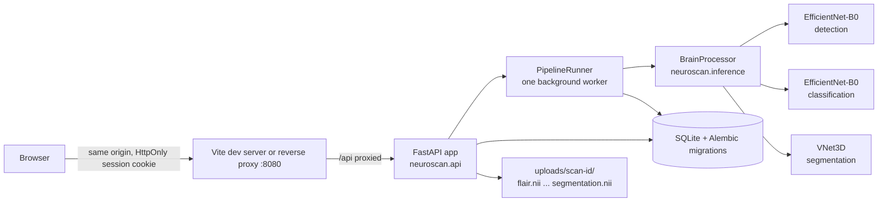

# NeuroScan AI

NeuroScan AI is a full-stack web application and research repository for brain tumour analysis from MRI scans. A user uploads MRI files in NIfTI format, and the backend runs three PyTorch models in sequence:

1. **Detection**: an EfficientNet-B0 decides whether a tumour is present.
2. **Classification**: a second EfficientNet-B0 labels the tumour as glioma, meningioma or pituitary.
3. **Segmentation**: a 3D VNet outlines the Whole Tumour (WT), Tumour Core (TC) and Enhancing Tumour (ET) when all four modalities (FLAIR, T1, T1CE, T2) are uploaded.

The React frontend shows the results, a 2D slice viewer with the segmentation overlay and a 3D volume viewer. The repository also holds the Kaggle notebooks that benchmarked 21 model runs across the three tasks, and the LaTeX sources of the related papers.

No clinical validation is recorded in this repository. Treat every output as a research result, not a diagnosis.

## Contents

- [Quick start](#quick-start)
- [How it works](#how-it-works)
- [Technology stack](#technology-stack)
- [Repository structure](#repository-structure)
- [Configuration](#configuration)
- [Running the application](#running-the-application)
- [API reference](#api-reference)
- [Data storage](#data-storage)
- [Research notebooks and results](#research-notebooks-and-results)
- [Papers and presentation materials](#papers-and-presentation-materials)
- [Testing and code quality](#testing-and-code-quality)
- [Troubleshooting](#troubleshooting)
- [Known limitations](#known-limitations)
- [Security notes](#security-notes)
- [Project metrics](#project-metrics)
- [Contributing](#contributing)

## Quick start

These steps start the backend on `127.0.0.1:8000` and the frontend on `localhost:8080` on one machine. Run every command from the repository root.

### Prerequisites

| Tool    | Version                                                        | Why                                                 |
| ------- | -------------------------------------------------------------- | --------------------------------------------------- |
| Python  | 3.11 (pinned in [`.python-version`](.python-version))          | Runs the FastAPI backend and PyTorch                |
| Node.js | 22 or newer; CI uses 24 ([`Frontend/.nvmrc`](Frontend/.nvmrc)) | Runs `npm run dev`, the Vite 8 dev server and build |
| npm     | Comes with Node.js                                             | Installs frontend packages from `package-lock.json` |
| Git     | Any recent version                                             | Clones the repository                               |

### Steps

1. **Place the three model weight files.** The root [`.gitignore`](.gitignore) excludes `*.pth`, so a fresh clone does **not** contain them. Default paths (override with the variables in [Configuration](#configuration)):

   | File                                          | Size (bytes) | Used for         |
   | --------------------------------------------- | ------------ | ---------------- |
   | `Backend/Binary Detection/EfficientNetB0.pth` | 16,342,545   | Tumour detection |
   | `Backend/Classification/EfficientNetB0.pth`   | 16,359,363   | Tumour type      |
   | `Backend/Segmentation/VNet.pth`               | 5,617,589    | 3D segmentation  |

   No download location is recorded in the repository. Obtain the files from the project maintainer. The backend loads them with `torch.load(weights_only=True)`, so a weights file cannot run code. Without them the app still starts: missing detection or classification weights disable uploads, and a missing segmentation file skips segmentation.

2. **Set up and start everything.**

   ```sh
   npm run dev
   ```

   The first run creates `.venv`, installs `Backend/requirements-dev.txt` into it (PyTorch makes this a large download), runs `npm ci` in `Frontend/`, and writes a development `.env` with freshly generated `JWT_SECRET` and `DATA_ENCRYPTION_KEY` values (the file is Git-ignored). On Windows it then opens a separate PowerShell window for the backend and one for the frontend, each showing that service's logs; on macOS and Linux both run in the same terminal with each log line prefixed `[backend]` or `[frontend]`. It opens `http://localhost:8080` once both services respond. Press `Ctrl+C` in the terminal where you ran `npm run dev`, or close it, to stop both services and close their windows.

3. **Use the app.** Register at `http://localhost:8080/register`, then upload the four modality files of one case on the Upload page. Processing runs in the background; the scan page updates itself until the results appear. In development mode the API documentation is at `http://127.0.0.1:8000/docs`.

If something fails, see [Troubleshooting](#troubleshooting).

## How it works

### Architecture



Module boundaries, dependency rules, and design decisions are in [`ARCHITECTURE.md`](ARCHITECTURE.md).

At start-up the backend validates its configuration (it refuses to start with a missing or example secret), applies database migrations, loads the models, and re-queues any scan left unfinished by a previous run. If a model file is missing, the error is logged, `/api/ready` reports `models: false`, and uploads return `503`.

### What happens when a scan is uploaded

`POST /api/process-mri` ([`neuroscan/api/scans.py`](Backend/neuroscan/api/scans.py)):

1. Assigns each file to a modality from its filename, case-insensitively, in this order: contains `FLAIR` -> flair; `T1CE` or `T1C` -> t1ce; `T2` -> t2; `T1` -> t1. A file that matches nothing, or a second file for the same modality, rejects the upload with `400`.
2. Streams each file to `uploads/scan-<32 hex>/<modality>.nii` (or `.nii.gz` when the content is gzip). The client's filename is never used as a path. Each file is capped at `MAX_UPLOAD_FILE_MB`, and its NIfTI header must describe a 3D or 4D volume with sides up to 1024 and at most 32 Mi voxels; anything else is deleted and rejected.
3. Creates the `Scan` row with status `queued`, returns it with `202`, and hands the job to the single background worker. When `MAX_PENDING_JOBS` are already waiting, the upload is kept as `failed` with a "server is busy" message so it can be retried later, and the request returns `503`.

The worker ([`neuroscan/scans/pipeline.py`](Backend/neuroscan/scans/pipeline.py)) then updates `pipelineStep` and `progress` as it goes:

4. Picks one representative file (flair first, then t1ce, t2, t1), takes the **middle axial slice** (the first frame of a 4D series), rescales it to 0-255 and converts it to a 3-channel image.
5. **Detection:** crops the brain with an OpenCV threshold and contour, resizes to 224 x 224, applies ImageNet normalisation and runs the detection model. `sigmoid(output) > 0.5` means a tumour is present.
6. **Classification:** runs the classification model on the same slice and takes the softmax argmax over `glioma`, `meningioma`, `pituitary`. The class is reported only if detection found a tumour; otherwise the result says `No Tumour Detected` with confidence `1 - P(tumour)`.
7. **Segmentation** (only when all four modalities are present): z-scores each volume over non-zero voxels, resizes it to 128 x 128 x 128, runs VNet, thresholds each output channel at 0.5, and saves `segmentation.nii` resized back to the FLAIR volume's shape (label 1 = WT, 2 = TC, 3 = ET, later labels overwriting earlier ones). A segmentation failure is logged and leaves the volumes at `0.0`.
8. Marks the scan `completed`. Any other failure marks it `failed` with a generic message; the details go only to the server log. Failed scans can be retried from the scan page.

The refactored pipeline was checked against results the original code had stored for a BraTS 2020 case: detection, class, confidence, all three volumes, and the saved mask (voxel for voxel) are identical.

The reported volumes (`wtVolume`, `tcVolume`, `etVolume`, `tumorVolume`) are the number of voxels above 0.5 in the 128^3 grid divided by 1,000. They are not scaled by the scan's voxel spacing, even though the frontend labels them as cubic centimetres.

### Frontend pages

Routes are defined in [`Frontend/src/App.tsx`](Frontend/src/App.tsx). Everything except login and registration requires a session; signed-in pages are loaded on demand.

| Route                 | Page                        | Purpose                                                                                          |
| --------------------- | --------------------------- | ------------------------------------------------------------------------------------------------ |
| `/login`, `/register` | `Login.tsx`, `Register.tsx` | Sign in (with a second step for the authenticator code when 2FA is on) or create an account      |
| `/`                   | `Index.tsx`                 | Dashboard: stats cards, recent scans, tumour volume chart                                        |
| `/upload`             | `Upload.tsx`                | Drag-and-drop NIfTI upload                                                                       |
| `/scans`              | `ScanLibrary.tsx`           | List, search, edit and delete scans                                                              |
| `/scan/:id`           | `ScanDetail.tsx`            | Live processing status, retry, 2D slice viewer with overlay, 3D viewer (vtk.js), PDF/CSV reports |
| `/reports`            | `Reports.tsx`               | Completed scans with PDF reports (open in a new tab), CSV downloads, and "Export All" as one CSV |
| `/settings`           | `Settings.tsx`              | Profile, theme and overlay colours, password change, two-factor authentication                   |

## Technology stack

### Backend

Pinned in [`Backend/requirements.txt`](Backend/requirements.txt) (runtime) and [`Backend/requirements-dev.txt`](Backend/requirements-dev.txt) (tooling).

| Package                                              | Version                    | Role in this project                                                                |
| ---------------------------------------------------- | -------------------------- | ----------------------------------------------------------------------------------- |
| FastAPI, Starlette, Uvicorn                          | 0.141.1, 1.6.0, 0.53.0     | HTTP API, middleware, ASGI server                                                   |
| SQLModel, SQLAlchemy                                 | 0.0.42, 2.0.54             | Tables (`User`, `Scan`) and sessions                                                |
| Alembic                                              | 1.20.0                     | Versioned schema migrations, applied at start-up                                    |
| Pydantic, email-validator                            | 2.13.5, 2.3.0              | Request validation and settings                                                     |
| PyJWT                                                | 2.15.0                     | HS256 session tokens (replaces `python-jose`, which pulled in a vulnerable `ecdsa`) |
| bcrypt                                               | 5.0.0                      | Password hashing (cost 12)                                                          |
| PyOTP, qrcode, cryptography                          | 2.10.0, 8.2, 50.0.1        | TOTP two-factor auth, enrolment QR code, Fernet encryption of TOTP secrets          |
| reportlab                                            | 5.0.1                      | PDF reports                                                                         |
| PyTorch, torchvision                                 | 2.14.0, 0.29.0             | The three models                                                                    |
| nibabel, NumPy, OpenCV, Pillow                       | see file                   | NIfTI I/O, arrays, cropping and image encoding                                      |
| pytest, ruff, mypy, import-linter, bandit, pip-audit | see `requirements-dev.txt` | Tests, lint and format, strict types, architecture contracts, security checks       |

### Frontend

Ranges from [`Frontend/package.json`](Frontend/package.json); exact versions are in `package-lock.json`.

| Package                                                 | Version range   | Role                                                      |
| ------------------------------------------------------- | --------------- | --------------------------------------------------------- |
| React, React DOM                                        | ^19.3.0         | UI                                                        |
| TypeScript (strict mode)                                | ~6.0.3          | Type checking                                             |
| Vite with `@vitejs/plugin-react-swc`                    | ^8.3.1          | Dev server with `/api` proxy, production build            |
| vite-plugin-glsl                                        | ^1.6.1          | Loads the `.glsl` shaders that vtk.js imports             |
| React Router DOM                                        | ^7.18.4         | Client-side routing                                       |
| TanStack React Query                                    | ^5.103.1        | Scan queries, polling while processing, mutations         |
| Tailwind CSS 4, Radix UI primitives                     | see file        | Styling and accessible components in `src/components/ui/` |
| @kitware/vtk.js, nifti-reader-js                        | ^37.3.0, ^0.8.0 | 3D volume rendering                                       |
| Recharts, sonner, lucide-react                          | see file        | Chart, toasts, icons                                      |
| Vitest, Testing Library, jsdom, ESLint, Prettier, jscpd | see file        | Tests, lint, format, duplicate detection                  |

### Research notebooks

The notebooks run on Kaggle with 2x Tesla T4 GPUs. Binary Detection and Classification runs record Python 3.12.13, torch 2.10.0+cu128 and CUDA 12.8, and use torchvision, timm, scikit-learn, imagehash and TensorBoard. Segmentation notebooks use plain PyTorch, nibabel and scikit-learn. See each folder's README for details.

## Repository structure

```text
NeuroScan-AI/
|-- README.md, ARCHITECTURE.md
|-- .env.example              Every backend setting, with how to generate secrets
|-- .github/                  CI workflow (SHA-pinned actions) and Dependabot
|-- .pre-commit-config.yaml   gitleaks secret scan before each commit
|-- .gitattributes            LF line endings on every OS, matching Prettier
|-- pyproject.toml            black settings matching ruff, for `black .` from the root
|-- package.json              `npm run dev`: sets up and starts backend and frontend
|-- scripts/dev.mjs           The setup and launch script behind `npm run dev`
|-- Backend/
|   |-- main.py               ASGI entry point (uvicorn main:app)
|   |-- neuroscan/            Application package (see ARCHITECTURE.md)
|   |   |-- app.py            Application factory: middleware, routers, lifespan
|   |   |-- config.py         Settings from the environment, validated at start-up
|   |   |-- api/              Routers (auth, scans, health), dependencies, middleware
|   |   |-- scans/            File storage, background pipeline, CSV/PDF exports
|   |   |-- inference/        Networks, NIfTI handling, BrainProcessor
|   |   |-- security/         Passwords, tokens, TOTP, rate limiting
|   |   |-- migrations/       Alembic environment and versioned migrations
|   |   `-- cli.py            Operator commands: reset password, unlock, disable 2FA
|   |-- tests/                pytest suite (no model weights needed)
|   |-- pyproject.toml        ruff, mypy, pytest and import-linter configuration
|   |-- requirements*.txt     Pinned runtime and development dependencies
|   |-- Binary Detection/, Classification/, Segmentation/   Notebooks, outputs, deployed weights
|   `-- Materials/            LaTeX papers, report, review decks and build-latex.ps1
`-- Frontend/
    |-- vite.config.ts        Port 8080, /api proxy, security headers for preview
    `-- src/
        |-- App.tsx           Routes, lazy loading, ProtectedRoute
        |-- pages/            Route pages listed above
        |-- components/       auth, dashboard, layout, scan, settings, upload, ui
        |-- hooks/            use-scans, use-overlay-colors, use-report-download
        |-- lib/              api.ts (the only HTTP client), types, formatting helpers
        `-- test/             Vitest tests
```

Runtime data (`Backend/neuroscan.db`, `Backend/uploads/`, `.env`) is Git-ignored.

## Configuration

The backend reads settings from the environment and from a `.env` file found by searching upward from `Backend/neuroscan/`, so a root `.env` is used. Invalid or insecure values stop start-up with a clear error. [`.env.example`](.env.example) documents every variable; the important ones:

| Variable                                                               | Required | Default                            | Purpose                                                                                                     |
| ---------------------------------------------------------------------- | -------- | ---------------------------------- | ----------------------------------------------------------------------------------------------------------- |
| `JWT_SECRET`                                                           | Yes      | none                               | Signs session tokens. At least 32 characters; the example value is refused. Rotating it signs everyone out. |
| `DATA_ENCRYPTION_KEY`                                                  | Yes      | none                               | Fernet key that encrypts TOTP secrets at rest. Rotating it invalidates 2FA enrolments.                      |
| `ENVIRONMENT`                                                          | No       | `production`                       | `development` enables `/docs`; `production` disables it and sends HSTS.                                     |
| `DATABASE_URL`                                                         | No       | `sqlite:///<Backend>/neuroscan.db` | SQLAlchemy URL                                                                                              |
| `UPLOAD_DIR`                                                           | No       | `<Backend>/uploads`                | Scan file storage; keep it outside any web-served folder                                                    |
| `DETECTION_WEIGHTS` etc.                                               | No       | paths in the Quick start           | Relative paths resolve against `Backend/`                                                                   |
| `CORS_ORIGINS`                                                         | No       | empty (no CORS)                    | Only for a frontend on a different origin. `*` is refused because requests carry cookies.                   |
| `COOKIE_SECURE`                                                        | No       | `true`                             | Browsers treat `localhost` as secure, so this works in development too                                      |
| `ACCESS_TOKEN_EXPIRE_MINUTES`                                          | No       | `30`                               | Session lifetime                                                                                            |
| `ALLOW_REGISTRATION`                                                   | No       | `true`                             | Set `false` once staff accounts exist                                                                       |
| `MAX_UPLOAD_FILE_MB`, `MAX_PENDING_JOBS`, `AUTH_RATE_LIMIT_PER_MINUTE` | No       | `300`, `8`, `10`                   | Upload, queue and brute-force limits                                                                        |

The frontend calls `/api` on its own origin. `VITE_API_URL` (in `Frontend/.env`) overrides that base URL at build time, and `VITE_DEV_API_TARGET` changes where the dev server proxies `/api` (default `http://127.0.0.1:8000`).

## Running the application

### Option 1: `npm run dev`

See [Quick start](#quick-start). [`scripts/dev.mjs`](scripts/dev.mjs) uses only Node.js built-ins and:

- Creates `.venv` with Python 3.11 (or a newer Python 3 if 3.11 is missing) when it does not exist.
- Installs `Backend/requirements-dev.txt` (the runtime `requirements.txt` plus test, lint and `black[jupyter]` tooling) into `.venv` and runs `npm ci` in `Frontend/` only when those files or `Frontend/package-lock.json` changed since the last install, tracked by SHA-256 stamps in `.venv/` and `Frontend/node_modules/`.
- Creates a development `.env` with random secrets if there is none, and warns about missing model weights.
- Keeps the pip and npm download caches in `.cache/` (Git-ignored) unless `PIP_CACHE_DIR` or `npm_config_cache` is already set.
- Starts `uvicorn main:app --reload --host 127.0.0.1 --port 8000 --log-config log-config.dev.json` in `Backend/` (the log config gives the reloader the same readable format as the app) and `npm run dev` in `Frontend/`.
- On Windows, runs each service in its own PowerShell window that stays open after a crash so its log remains readable. `Ctrl+C`, `Ctrl+Break` or closing the launching terminal closes both windows and their process trees; closing both windows ends the launcher.
- On macOS and Linux, runs both in the launching terminal with prefixed logs. If either service exits, the other is stopped; `Ctrl+C` stops both process trees.

### Option 2: two terminals

Create a `.env` from `.env.example` first. Backend, from the repository root:

```powershell
.\.venv\Scripts\Activate.ps1
cd Backend
uvicorn main:app --reload --host 127.0.0.1 --port 8000
```

Frontend, in a second terminal:

```powershell
cd Frontend
npm run dev
```

On macOS or Linux, activate the environment with `source .venv/bin/activate`; the other commands are the same.

### Production deployment

- Build the frontend with `npm run build` and serve `Frontend/dist/` and the API **from one HTTPS origin** through a reverse proxy (for example `/` to the static files and `/api` to Uvicorn), so the `SameSite=Strict` session cookie stays first-party and no CORS is needed.
- Send the same security headers as `vite.config.ts` (`preview.headers`) from the proxy, including the Content-Security-Policy.
- Run Uvicorn behind the proxy with `--proxy-headers --forwarded-allow-ips=<proxy address>` so rate limiting sees real client addresses.
- Run **one** backend process. The pipeline queue and the per-IP rate limiter live in process memory, and SQLite suits a single writer. Scaling out needs a shared job queue and a server database first (see `ARCHITECTURE.md`).
- Probe `GET /api/health` (liveness) and `GET /api/ready` (database and models).

### Account recovery

There is no email service, so forgotten passwords and lost authenticators are handled by an operator on the server, from `Backend/` with the virtual environment active:

```powershell
python -m neuroscan.cli reset-password <username>   # prompts for the new password
python -m neuroscan.cli unlock <username>           # clears a login lockout
python -m neuroscan.cli disable-2fa <username>      # lost authenticator device
```

Each command signs the user out of all sessions.

## API reference

Routes live in [`Backend/neuroscan/api/`](Backend/neuroscan/api/) under `/api`. In development, generated documentation is at `/docs` and `/openapi.json`; both are off in production.

**Sessions.** Register, login, password change and 2FA changes set an `HttpOnly`, `SameSite=Strict`, `Secure` cookie named `neuroscan_session` (path `/api`). The token is an HS256 JWT with issuer, audience, expiry and a per-user version; logout, password change and 2FA changes bump the version, which revokes every earlier token. Tokens are never returned in a response body and never accepted in a URL.

**CSRF.** Every `POST`, `PUT` and `DELETE` must send `X-Requested-With: NeuroScan`, or the API returns `403`.

**Errors.** `401` when not signed in; scan routes return `404` both for missing scans and for other users' scans, so IDs cannot be probed. Validation errors return `422` without echoing submitted values. Unexpected errors return `500 {"detail": "Internal server error", "requestId": "..."}`; the same ID is in the `X-Request-ID` header and the server log.

**Logs.** In production the backend writes one JSON object per line. With `ENVIRONMENT=development` it writes aligned, coloured lines instead (time, level, source, message, fields, and the first 8 characters of the request ID); `NO_COLOR` turns colour off and `FORCE_COLOR` turns it on for piped output. Each request is logged once, by the app, with its status and duration.

| Method | Route                                           | Purpose                                                                                         |
| ------ | ----------------------------------------------- | ----------------------------------------------------------------------------------------------- |
| POST   | `/api/auth/register`                            | Create an account (`201`); `403` when registration is disabled                                  |
| POST   | `/api/auth/login`                               | JSON `username`, `password`, optional `otp`                                                     |
| POST   | `/api/auth/logout`                              | End the session and revoke all tokens (`204`)                                                   |
| GET    | `/api/auth/me`                                  | Current user                                                                                    |
| PUT    | `/api/auth/me`                                  | Update `fullName`, `email`, `title`, `department`, `institution`                                |
| POST   | `/api/auth/password`                            | `currentPassword`, `newPassword`                                                                |
| POST   | `/api/auth/2fa/setup`                           | `password`; returns `secret`, `otpauthUri`, `qrSvg`                                             |
| POST   | `/api/auth/2fa/enable`                          | `code` from the authenticator app                                                               |
| POST   | `/api/auth/2fa/disable`                         | `password` and `code`                                                                           |
| GET    | `/api/scans?limit=&offset=`                     | Your scans, newest first; `limit` 1-500 (default 100), total in `X-Total-Count`                 |
| GET    | `/api/scans/export.csv`                         | All completed scans as CSV                                                                      |
| POST   | `/api/process-mri`                              | Upload and queue (`202`)                                                                        |
| GET    | `/api/scans/{scan_id}`                          | One scan (poll this for progress)                                                               |
| PUT    | `/api/scans/{scan_id}`                          | Change `patientName` or `patientId`                                                             |
| DELETE | `/api/scans/{scan_id}`                          | Delete the scan and its files                                                                   |
| POST   | `/api/scans/{scan_id}/retry`                    | Re-queue a failed scan (`202`); `409` otherwise                                                 |
| GET    | `/api/scans/{scan_id}/slice/{slice_idx}`        | Axial MRI slice as JPEG; `?modality=` is `flair`, `t1`, `t1ce` or `t2`; header `X-Total-Slices` |
| GET    | `/api/scans/{scan_id}/segmentation/{slice_idx}` | Segmentation slice as PNG                                                                       |
| GET    | `/api/scans/{scan_id}/download/{key}`           | `key` is `flair`, `t1`, `t1ce`, `t2` or `segmentation`                                          |
| GET    | `/api/scans/{scan_id}/report.pdf`               | Formal MRI brain report, see below (`409` until completed)                                      |
| GET    | `/api/scans/{scan_id}/report.csv`               | CSV report (`409` until completed)                                                              |
| GET    | `/api/health`, `/api/ready`                     | Liveness; readiness of database and models (`503` when not ready)                               |

### Rules worth knowing

- **PDF report:** a paginated MRI brain report with a letterhead (the requesting user's department and institution), patient and study details, an impression, the sequences received with matrix size and voxel spacing, detection probability, per-class probabilities, WT/TC/ET volumes with their axial extent, key images with the segmentation overlay, methodology, limitations and a radiologist sign-off block. It is served inline, so the app opens it in a new browser tab, and it is marked preliminary until a radiologist signs it. Per-class and detection probabilities are stored for scans processed after this report version; older scans show only the predicted class and its confidence.
- **Passwords:** 12 to 72 bytes (bcrypt's limit). Usernames: 3 to 32 of `A-Z a-z 0-9 _ . -`, unique regardless of case; emails are stored lower case and unique.
- **Login protection:** 5 wrong passwords or codes lock the account for 15 minutes; the lock message is shown only to someone who then enters the right password. Login, registration, password and 2FA routes also allow `AUTH_RATE_LIMIT_PER_MINUTE` requests per client per minute (`429` beyond that).
- **2FA codes** are standard 30-second TOTP codes with one step of clock drift allowed; a code cannot be used twice.
- **Request size:** 1 MB for JSON routes; `MAX_UPLOAD_FILE_MB` x 4 plus 1 MB for uploads (`413` beyond).
- **CSV exports** prefix cells that start with `=`, `+`, `-`, `@`, tab or carriage return with `'`, so spreadsheets never execute them.

### Scan object

| Field                      | Notes                                                                                                    |
| -------------------------- | -------------------------------------------------------------------------------------------------------- |
| `id`                       | `scan-` followed by 32 hex characters (older scans have 6)                                               |
| `patientId`, `patientName` | Given at upload or generated (`PT-<year>-<4 hex>`, `Uploaded Scan`)                                      |
| `scanDate`, `createdAt`    | Upload date `YYYY-MM-DD`; UTC timestamp                                                                  |
| `modalities`               | For example `["FLAIR", "T1", "T1CE", "T2"]`                                                              |
| `status`                   | `queued`, `processing`, `completed` or `failed`                                                          |
| `pipelineStep`, `progress` | `queued`, `detection`, `classification`, `segmentation`, `complete`; 0-100                               |
| `results`                  | `detected`, `classification`, `confidence`, `tumorVolume`, `wtVolume`, `tcVolume`, `etVolume`, or `null` |
| `hasSegmentation`          | Whether a segmentation mask exists                                                                       |
| `errorMessage`             | User-facing reason when `failed`                                                                         |

Server file paths and the owner ID are never returned.

```powershell
curl.exe -c cookies.txt -H "X-Requested-With: NeuroScan" -H "Content-Type: application/json" `
  -d '{\"username\":\"demo\",\"password\":\"a-long-passphrase\"}' http://localhost:8080/api/auth/login
curl.exe -b cookies.txt -H "X-Requested-With: NeuroScan" `
  -F "files=@BraTS20_Training_001_flair.nii" -F "files=@BraTS20_Training_001_t1.nii" `
  -F "files=@BraTS20_Training_001_t1ce.nii" -F "files=@BraTS20_Training_001_t2.nii" `
  -F "patientName=Case 001" http://localhost:8080/api/process-mri
```

## Data storage

- **Database:** SQLite at `Backend/neuroscan.db` by default, in WAL mode so the background worker and API requests do not block each other. The schema is managed by Alembic migrations in `Backend/neuroscan/migrations/versions/`, applied automatically at start-up. A database created before migrations existed is recognised, stamped at the baseline, and upgraded in place; the upgrade only adds columns and an index. To author a new migration, run `..\.venv\Scripts\alembic revision --autogenerate -m "describe change"` from `Backend/`.
- **Files:** `<UPLOAD_DIR>/<scan_id>/` holds one file per modality (`flair.nii`, `t1ce.nii.gz`, ...) and `segmentation.nii` when segmentation ran. Scans uploaded by earlier versions keep their original file names and still work.

## Research notebooks and results

Each research folder has its own README with the full cell-by-cell walkthrough, every metric and every saved plot. The notebooks target Kaggle and were not executed for these READMEs; all numbers come from their saved outputs.

| Stage                                              | Folder                                                           | Notebooks                                                                                                      | Best test result                                                                             | Deployed model  |
| -------------------------------------------------- | ---------------------------------------------------------------- | -------------------------------------------------------------------------------------------------------------- | -------------------------------------------------------------------------------------------- | --------------- |
| Detection (tumour vs no tumour, 2D)                | [Backend/Binary Detection](Backend/Binary%20Detection/README.md) | 9 (EfficientNetB0, DenseNet121, ResNet50, CoAtNet-0, InceptionV3, SwinBase, ViT-B16, MobileNetV3-Large, VGG16) | Accuracy 0.9939 on 488 images, shared by DenseNet121, ResNet50, EfficientNetB0 and CoAtNet-0 | EfficientNet-B0 |
| Classification (glioma, meningioma, pituitary, 2D) | [Backend/Classification](Backend/Classification/README.md)       | 6 (EfficientNetB0, ResNet50, InceptionV3, CoAtNet-0, SwinBase, ViT-B16)                                        | Accuracy 0.9858 on 706 images (SwinBase); EfficientNetB0 0.9759                              | EfficientNet-B0 |
| Segmentation (WT, TC, ET, 3D BraTS 2020)           | [Backend/Segmentation](Backend/Segmentation/README.md)           | 7 (UNet, nnU-Net style, VNet, VNet re-run with plots, UNETR, Swin-UNETR, TransBTS)                             | Mean Dice 0.7999 on 56 cases (3D UNet); VNet 0.7655                                          | VNet            |

Points to keep in mind:

- **The deployed `.pth` files are not traced to a notebook run.** The detection and classification weights have the same byte size as the EfficientNetB0 notebook outputs but different MD5 hashes, and no notebook writes `VNet.pth`. Their exact test scores are therefore not recorded. The folder READMEs give the details.
- **Training and serving preprocessing differ.** The notebooks resize whole 2D JPG slices; the backend takes the middle slice of a NIfTI volume and crops the brain with an OpenCV contour before resizing. How this affects accuracy was not measured.
- **The Swin-UNETR notebook has no test result** because its test cell failed.

## Papers and presentation materials

[`Backend/Materials/`](Backend/Materials/) contains three LaTeX paper projects (each with `main.tex`, `highlights.tex`, `graphical_abstract.tex` and a `figures/` folder), a project report (`Report.md`, `Report.pdf`), review decks and templates.

`build-latex.ps1` compiles `main.tex` (or every `.tex` file) in each project folder with a local `tectonic.exe`. The `.exe` is Git-ignored, so download [Tectonic](https://tectonic-typesetting.github.io/) and place `tectonic.exe` in `Backend/Materials/` first.

```powershell
.\Backend\Materials\build-latex.ps1              # all projects
.\Backend\Materials\build-latex.ps1 -Project Revised   # folders whose name contains "Revised"
```

The paper texts were not reviewed for this README; their numbers may differ from the notebook outputs.

## Testing and code quality

CI ([`.github/workflows/ci.yml`](.github/workflows/ci.yml)) runs all of these on every push and pull request, plus a gitleaks scan of the full Git history.

| Check                     | Command                                                                                   | Result when this README was written                                              |
| ------------------------- | ----------------------------------------------------------------------------------------- | -------------------------------------------------------------------------------- |
| Backend tests             | `pytest` (in `Backend/`)                                                                  | 60 passed; they use a fake inference engine, so no weights are needed            |
| Backend lint and format   | `ruff check neuroscan tests main.py`, `ruff format --check ...`                           | Clean                                                                            |
| Backend types             | `mypy` (strict)                                                                           | Clean                                                                            |
| Architecture contracts    | `lint-imports`                                                                            | 3 contracts kept                                                                 |
| Backend security          | `bandit -q -r neuroscan main.py`, `pip-audit -r requirements.txt -r requirements-dev.txt` | No findings                                                                      |
| Everything frontend       | `npm run check` (in `Frontend/`)                                                          | Strict typecheck, lint, Prettier, jscpd (0 clones), 18 tests, and build all pass |
| Frontend dependency audit | `npm audit`                                                                               | 0 vulnerabilities                                                                |

From the repository root, `black .` and `npx prettier . --write` produce the same output CI checks: black uses ruff's 100-character line length from the root `pyproject.toml`, and `.gitattributes` checks files out with LF so Prettier does not rewrite line endings on Windows.

## Troubleshooting

| Problem                                                                             | Likely cause                                                                                    | Fix                                                                                             |
| ----------------------------------------------------------------------------------- | ----------------------------------------------------------------------------------------------- | ----------------------------------------------------------------------------------------------- |
| Backend exits with a `ValidationError` naming `jwt_secret` or `data_encryption_key` | `.env` is missing, empty, or still has the example value                                        | Delete `.env` and run `npm run dev`, or generate the values with the commands in `.env.example` |
| `sqlite3.OperationalError: unable to open database file`                            | `DATABASE_URL` points to a folder that does not exist, or uses a Git Bash path such as `/d/...` | Use a Windows path such as `sqlite:///D:/data/neuroscan.db` and create the folder               |
| Upload returns `503 AI models are not loaded`                                       | A `.pth` file is missing or does not match the architecture                                     | Check the start-up log and `GET /api/ready`; place the weights and restart                      |
| Upload returns `400 Cannot tell the modality of ...`                                | A filename has none of FLAIR, T1CE, T1C, T2 or T1                                               | Rename the files                                                                                |
| Upload returns `400 ... not a readable NIfTI image`                                 | The file is not NIfTI (for example DICOM)                                                       | Convert to NIfTI (`.nii` or `.nii.gz`) first                                                    |
| Upload returns `413`                                                                | A file is larger than `MAX_UPLOAD_FILE_MB`                                                      | Raise the limit in `.env` if the file is legitimate                                             |
| Scan stays `failed`                                                                 | The pipeline raised an error                                                                    | Find the scan ID in the backend log, fix the cause, then press Retry                            |
| Volumes are `0.0` and there is no overlay                                           | Fewer than four modalities, or segmentation failed                                              | Upload all four modalities; check the log for `Segmentation failed`                             |
| Every request returns `401` after login                                             | Browser blocked the `Secure` cookie on plain HTTP other than `localhost`                        | Use HTTPS, or `localhost` in development                                                        |
| `403 Missing or invalid X-Requested-With header`                                    | A script called the API without the CSRF header                                                 | Send `X-Requested-With: NeuroScan` on `POST`, `PUT` and `DELETE`                                |
| Locked out, or lost the authenticator                                               | Lockout after 5 failures, or 2FA device lost                                                    | Wait 15 minutes, or use the [account recovery](#account-recovery) commands                      |
| `build-latex.ps1` says `tectonic.exe not found`                                     | The binary is Git-ignored                                                                       | Download Tectonic and place `tectonic.exe` in `Backend/Materials/`                              |

## Known limitations

- **Detection and classification use a single 2D slice** (the middle slice of one modality), not the whole volume.
- **Volumes are voxel counts at 128^3 divided by 1,000**, not physical volumes.
- **DICOM is not supported**; convert to NIfTI first.
- **One backend process.** The job queue and rate limiter are in memory and SQLite has one writer. See `ARCHITECTURE.md` for what to change before running several instances.
- **No email service**, so there is no self-service password reset; operators use the recovery CLI.

## Security notes

A security review of the whole repository (code, dependencies, and Git history) was carried out and its findings fixed. What protects the application now:

- Passwords hashed with bcrypt (cost 12), a 12-character minimum, account lockout, per-client rate limits, and timing-equalised login for unknown users.
- Sessions in `HttpOnly`, `SameSite=Strict`, `Secure` cookies with revocable, audience- and issuer-bound JWTs; nothing sensitive in `localStorage`; a required CSRF header on state-changing requests.
- Optional TOTP two-factor authentication with encrypted secrets and replay protection.
- Every scan route checks ownership and hides other users' scans behind `404`; response models never include password hashes, secrets or file paths.
- Uploads are streamed with size limits, stored under server-chosen names, and validated as bounded NIfTI volumes before any processing; model weights load with `weights_only=True`.
- Security headers on every response (CSP, `nosniff`, `X-Frame-Options`, `Referrer-Policy`, `no-store`, HSTS in production), API docs off in production, generic error bodies with request IDs, and structured audit logs for sign-in and account events.
- Configuration is validated at start-up; example secrets and wildcard CORS are refused.
- Pinned dependencies with no known vulnerabilities at the time of writing, Dependabot updates, CI with SHA-pinned actions and a read-only token, and gitleaks in CI and as a pre-commit hook.

Keep `.env` out of Git (it is already ignored) and rotate `JWT_SECRET` and `DATA_ENCRYPTION_KEY` if they are ever exposed.

## Project metrics

| Metric                    | Value                                                                                                                          | Source                                                |
| ------------------------- | ------------------------------------------------------------------------------------------------------------------------------ | ----------------------------------------------------- |
| API routes                | 23                                                                                                                             | `Backend/neuroscan/api/`                              |
| Database tables           | 2 (`user`, `scan`), 2 migrations                                                                                               | `Backend/neuroscan/models.py`, `migrations/versions/` |
| Frontend routes           | 9 including the 404 page                                                                                                       | `Frontend/src/App.tsx`                                |
| Backend tests             | 60                                                                                                                             | `Backend/tests/`                                      |
| Frontend tests            | 18                                                                                                                             | `Frontend/src/test/`                                  |
| Research notebooks        | 22 (9 detection, 6 classification, 7 segmentation)                                                                             | `Backend/*/*.ipynb`                                   |
| Deployed model parameters | Detection and classification: EfficientNet-B0 (4,008,829 and 4,011,391 in the notebook versions); segmentation: VNet 1,398,761 | Notebook `model_profile.json` files                   |
| Session lifetime          | 30 minutes by default                                                                                                          | `ACCESS_TOKEN_EXPIRE_MINUTES`                         |
| Ports                     | 8000 (API, localhost only), 8080 (Vite dev)                                                                                    | `scripts/dev.mjs`, `vite.config.ts`                   |
| Processing time per scan  | About 4 seconds for one four-modality BraTS 2020 case on the development machine (CPU, no CUDA), measured once end to end      | Local end-to-end run                                  |

## Contributing

- Read [`ARCHITECTURE.md`](ARCHITECTURE.md) for where new code goes and which imports are allowed.
- Keep API response shapes in `Backend/neuroscan/schemas.py` and `Frontend/src/lib/types.ts` in sync.
- Schema changes need a new Alembic migration; never edit an applied one.
- Do not commit `.pth`, `.db`, `.nii` or `.nii.gz` files; `.gitignore` already excludes them. Install the pre-commit hook with `pre-commit install`.
- Changing `VNet3D` or the EfficientNet head in `neuroscan/inference/networks.py` breaks loading of the existing weight files.
- Before opening a pull request, run the checks in [Testing and code quality](#testing-and-code-quality).

No licence file is present in the repository.
