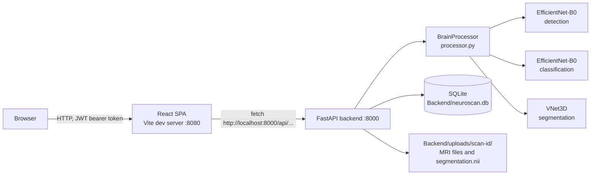

# NeuroScan AI

NeuroScan AI is a full-stack web application and research repository for brain tumour analysis from MRI scans. A user uploads MRI files in NIfTI format, and the backend runs three PyTorch models in sequence:

1. **Detection**: an EfficientNet-B0 decides whether a tumour is present.
2. **Classification**: a second EfficientNet-B0 labels the tumour as glioma, meningioma or pituitary.
3. **Segmentation**: a 3D VNet outlines the Whole Tumour (WT), Tumour Core (TC) and Enhancing Tumour (ET) when all four modalities (FLAIR, T1, T1CE, T2) are uploaded.

The React frontend shows the results, a 2D slice viewer with the segmentation overlay and a 3D volume viewer. The repository also holds the Kaggle notebooks that benchmarked 21 model runs across the three tasks, and the LaTeX sources of the related papers.

No clinical validation is recorded in this repository. Treat every output as a research result, not a diagnosis.

## Contents

- [Quick start (Windows)](#quick-start-windows)
- [How it works](#how-it-works)
- [Technology stack](#technology-stack)
- [Repository structure](#repository-structure)
- [Configuration](#configuration)
- [Running the application](#running-the-application)
- [API reference](#api-reference)
- [Data storage](#data-storage)
- [Research notebooks and results](#research-notebooks-and-results)
- [Papers and presentation materials](#papers-and-presentation-materials)
- [Testing and code quality](#testing-and-code-quality)
- [Troubleshooting](#troubleshooting)
- [Known limitations](#known-limitations)
- [Security notes](#security-notes)
- [Project metrics](#project-metrics)
- [Contributing](#contributing)

## Quick start (Windows)

These steps start the backend on port 8000 and the frontend on port 8080 on one Windows machine. Run every command from the repository root in PowerShell unless a step says otherwise.

### Prerequisites

| Tool    | Version                              | Why                                                                            |
| ------- | ------------------------------------ | ------------------------------------------------------------------------------ |
| Python  | 3.11 (the local `.venv` uses 3.11.9) | Runs the FastAPI backend and PyTorch                                           |
| Node.js | 20.19 or newer, or 22.12 or newer    | Vite 7.3.1 declares `"node": "^20.19.0 \|\| >=22.12.0"` in its `engines` field |
| npm     | Comes with Node.js                   | Installs frontend packages (`package-lock.json` is committed)                  |
| Git     | Any recent version                   | Clones the repository                                                          |

### Steps

1. **Create the Python virtual environment** in the repository root.

   ```powershell
   python -m venv .venv
   ```

   Expected result: a `.venv` folder appears. `start.ps1` refuses to run without it.

2. **Install the backend dependencies.**

   ```powershell
   .\.venv\Scripts\pip install -r Backend\requirements.txt
   ```

   Expected result: pip installs FastAPI, PyTorch, nibabel, OpenCV and the other packages. `requirements.txt` has no version pins, so pip installs the latest releases. The CPU build of PyTorch is enough; the backend falls back to CPU when CUDA is not available.

3. **Install the frontend dependencies.**

   ```powershell
   cd Frontend
   npm install
   cd ..
   ```

   Expected result: a `Frontend/node_modules` folder appears.

4. **Place the three model weight files.** The root [`.gitignore`](.gitignore) excludes `*.pth`, so a fresh clone does **not** contain them. The backend expects exactly these paths:

   | File                                          | Size (bytes) | Used for         |
   | --------------------------------------------- | ------------ | ---------------- |
   | `Backend/Binary Detection/EfficientNetB0.pth` | 16,342,545   | Tumour detection |
   | `Backend/Classification/EfficientNetB0.pth`   | 16,359,363   | Tumour type      |
   | `Backend/Segmentation/VNet.pth`               | 5,617,589    | 3D segmentation  |

   No download location is recorded in the repository. Obtain the files from the project maintainer.

5. **(Optional) Create a `.env` file** from the template. Without a `.env`, the backend allows all CORS origins and uses a built-in JWT secret, which is fine for local testing only. The template allows only `http://localhost:8080`, the Vite dev server (see [Configuration](#configuration)).

   ```powershell
   Copy-Item .env.example .env
   ```

6. **Start both services.**

   ```powershell
   .\start.ps1
   ```

   Expected result: the script prints the Node.js and Python versions, starts the backend and frontend as PowerShell background jobs, opens `http://localhost:8080` in the browser, and streams both logs with `[NeuroScan-Backend]` and `[NeuroScan-Frontend]` prefixes. Press `Ctrl+C` to stop both.

7. **Use the app.** Register an account at `http://localhost:8080/register`, then upload the four modality files of one case on the Upload page. The interactive API documentation is at `http://localhost:8000/docs`.

If something fails, see [Troubleshooting](#troubleshooting).

## How it works

### Architecture



At start-up, the backend creates the database tables and loads the three models from the paths above. If any model fails to load, the error is swallowed and the server still starts; uploads then fail with `503 AI models not loaded.`

### What happens when a scan is uploaded

`POST /api/process-mri` in [`Backend/main.py`](Backend/main.py) does the following:

1. Creates `Backend/uploads/scan-<6 hex chars>/` and saves every uploaded file there under its original filename.
2. Assigns each file to a modality from its filename, case-insensitively, in this order: contains `FLAIR` -> flair; contains `T1CE` or `T1C` -> t1ce; contains `T2` -> t2; contains `T1` -> t1. Files that match nothing are saved but ignored.
3. Picks one representative file (flair first, then t1ce, t2, t1), takes the **middle slice** along the third axis, rescales it to 0-255 and converts it to a 3-channel image.
4. **Detection:** crops the brain with an OpenCV threshold and contour, resizes to 224 x 224, applies ImageNet normalisation and runs the detection model. `sigmoid(output) > 0.5` means a tumour is present.
5. **Classification:** runs the classification model on the same slice and takes the softmax argmax over `glioma`, `meningioma`, `pituitary`. The class is reported only if detection found a tumour; otherwise the result says `No Tumour Detected` with confidence `1 - P(tumour)`.
6. **Segmentation** (only when all four modalities are present): z-scores each volume over non-zero voxels, resizes it to 128 x 128 x 128, runs VNet, thresholds each output channel at 0.5, and saves `segmentation.nii` resized back to the FLAIR volume's shape (label 1 = WT, 2 = TC, 3 = ET, later labels overwriting earlier ones).
7. Stores a `Scan` row with the results and returns it.

The reported volumes (`wtVolume`, `tcVolume`, `etVolume`, `tumorVolume`) are the number of voxels above 0.5 in the 128^3 grid divided by 1,000. They are not scaled by the scan's voxel spacing, even though the frontend labels them as cubic centimetres.

### Frontend pages

Routes are defined in [`Frontend/src/App.tsx`](Frontend/src/App.tsx). Everything except login and registration requires a token.

| Route                 | Page                        | Purpose                                                                        |
| --------------------- | --------------------------- | ------------------------------------------------------------------------------ |
| `/login`, `/register` | `Login.tsx`, `Register.tsx` | Sign in or create an account                                                   |
| `/`                   | `Index.tsx`                 | Dashboard: stats cards, recent scans, tumour volume chart                      |
| `/upload`             | `Upload.tsx`                | Drag-and-drop upload and processing                                            |
| `/scans`              | `ScanLibrary.tsx`           | List, search, edit and delete scans                                            |
| `/scan/:id`           | `ScanDetail.tsx`            | 2D slice viewer with overlay, 3D viewer (vtk.js), pipeline view and report tab |
| `/reports`            | `Reports.tsx`               | List of completed scans                                                        |
| `/settings`           | `Settings.tsx`              | Profile settings                                                               |

## Technology stack

### Backend

`Backend/requirements.txt` lists packages without versions. The "local version" column is what `pip list` reports in this repository's `.venv`, not a requirement.

| Package                | Local version | Role in this project                                                 |
| ---------------------- | ------------- | -------------------------------------------------------------------- |
| FastAPI                | 0.141.1       | HTTP API, request parsing, dependency injection and the `/docs` page |
| Uvicorn                | 0.53.0        | ASGI server that runs `main:app`                                     |
| SQLModel               | 0.0.42        | Table models (`User`, `Scan`) and sessions on SQLite                 |
| Pydantic               | 2.13.5        | Request and response validation (through FastAPI and SQLModel)       |
| python-jose            | 3.5.0         | Creates and verifies HS256 JWT access tokens                         |
| bcrypt                 | 5.0.0         | Password hashing                                                     |
| python-multipart       | not checked   | Parses multipart uploads and the login form                          |
| python-dotenv          | not checked   | Loads `.env`                                                         |
| PyTorch                | 2.14.0        | Runs the three models; uses CUDA when available, otherwise CPU       |
| torchvision            | 0.29.0        | EfficientNet-B0 architecture and image transforms                    |
| nibabel                | 5.4.2         | Reads and writes NIfTI files                                         |
| opencv-python-headless | not checked   | Brain cropping, slice rotation, JPEG and PNG encoding                |
| NumPy                  | 2.4.6         | Array handling                                                       |
| Pillow                 | not checked   | Converts slices for torchvision transforms                           |
| scikit-image, black    | not checked   | Listed in `requirements.txt` but not imported by the backend code    |

### Frontend

Versions are the ranges in [`Frontend/package.json`](Frontend/package.json).

| Package                                                             | Version range      | Role                                               |
| ------------------------------------------------------------------- | ------------------ | -------------------------------------------------- |
| React, React DOM                                                    | ^18.3.1            | UI                                                 |
| TypeScript                                                          | ^5.6.0             | Type checking                                      |
| Vite with `@vitejs/plugin-react-swc`                                | ^7.3.1             | Dev server on port 8080 and production build       |
| vite-plugin-glsl                                                    | ^1.5.5             | Loads the `.glsl` shaders that vtk.js imports      |
| React Router DOM                                                    | ^6.30.1            | Client-side routing                                |
| TanStack React Query                                                | ^5.83.0            | Fetches and caches the scan list                   |
| Tailwind CSS, tailwindcss-animate                                   | ^3.4.17, ^1.0.7    | Styling                                            |
| Radix UI primitives, class-variance-authority, clsx, tailwind-merge | see `package.json` | shadcn/ui-style components in `src/components/ui/` |
| @kitware/vtk.js                                                     | ^35.2.0            | 3D volume rendering                                |
| nifti-reader-js                                                     | ^0.8.0             | Parses NIfTI files downloaded for the 3D viewer    |
| Recharts                                                            | ^2.15.4            | Dashboard volume chart                             |
| sonner                                                              | ^1.7.4             | Toast notifications                                |
| lucide-react                                                        | ^0.462.0           | Icons                                              |
| Vitest, Testing Library, jsdom                                      | ^3.2.4             | Test runner                                        |
| ESLint with typescript-eslint                                       | ^9.32.0            | Linting                                            |

### Research notebooks

The notebooks run on Kaggle with 2x Tesla T4 GPUs. Binary Detection and Classification runs record Python 3.12.13, torch 2.10.0+cu128 and CUDA 12.8, and use torchvision, timm, scikit-learn, imagehash and TensorBoard. Segmentation notebooks use plain PyTorch, nibabel and scikit-learn. See each folder's README for details.

## Repository structure

```text
NeuroScan-AI/
|-- README.md                 This file
|-- AGENTS.md                 Conventions for coding agents working in this repository
|-- .env.example              Template for the root .env file
|-- start.ps1                 Starts backend and frontend together on Windows
|-- Backend/
|   |-- main.py               FastAPI app: auth, scan and upload routes, CORS, model loading
|   |-- processor.py          BrainProcessor: preprocessing, detection, classification, VNet3D segmentation, slice rendering
|   |-- models.py             SQLModel tables (User, Scan) and request schemas
|   |-- database.py           SQLite engine and session dependency
|   |-- requirements.txt      Backend Python packages (unpinned)
|   |-- Binary Detection/     9 detection notebooks, their outputs, and the deployed EfficientNetB0.pth
|   |-- Classification/       6 classification notebooks, their outputs, and the deployed EfficientNetB0.pth
|   |-- Segmentation/         7 segmentation notebooks and the deployed VNet.pth
|   |-- Materials/            LaTeX papers, report, review decks and build-latex.ps1
|   |-- uploads/              Runtime: one folder per scan (Git-ignored)
|   |-- Input/                Local sample BraTS files (Git-ignored)
|   `-- neuroscan.db          Runtime SQLite database (Git-ignored)
`-- Frontend/
    |-- package.json          npm scripts and dependencies
    |-- vite.config.ts        Port 8080, GLSL plugin, @ alias to src/
    |-- vitest.config.ts      jsdom test environment
    `-- src/
        |-- App.tsx           Routes and the ProtectedRoute guard
        |-- pages/            Route pages listed above
        |-- components/       auth, dashboard, layout, scan, upload, ui
        |-- hooks/            use-data (scan query), use-config, use-toast
        |-- lib/              api.ts, config.ts (UI text and navigation), types.ts, utils.ts, mock-data.ts (not imported)
        `-- test/             Vitest setup and one example test
```

## Configuration

The backend calls `load_dotenv()`, which searches for a `.env` file starting in `Backend/` and moving up to parent folders, so a `.env` in the repository root is used. The frontend reads `VITE_API_URL` from `Frontend/.env`, because Vite loads env files from the `Frontend/` folder.

| Variable       | Used by                   | Required    | Default when unset                               | Purpose and format                                                                                                                       | Safe example                        |
| -------------- | ------------------------- | ----------- | ------------------------------------------------ | ---------------------------------------------------------------------------------------------------------------------------------------- | ----------------------------------- |
| `JWT_SECRET`   | `Backend/main.py`         | Recommended | `neuroscan-secret-key-change-this-in-production` | Secret used to sign HS256 tokens. Use a long random string and never commit it.                                                          | `replace-with-a-long-random-string` |
| `CORS_ORIGINS` | `Backend/main.py`         | No          | `*` (all origins)                                | Comma-separated list of allowed browser origins, no spaces                                                                               | `http://localhost:8080`             |
| `DATABASE_URL` | `Backend/database.py`     | No          | `sqlite:///<Backend folder>/neuroscan.db`        | SQLAlchemy URL. The engine sets `check_same_thread=False`, which is SQLite-specific.                                                     | `sqlite:///C:/path/to/neuroscan.db` |
| `VITE_API_URL` | `Frontend/src/lib/api.ts` | No          | `http://localhost:8000/api`                      | API base URL baked into the frontend at build time. Only the functions in `api.ts` use it (see [Known limitations](#known-limitations)). | `http://localhost:8000/api`         |

`.env.example` sets `CORS_ORIGINS=http://localhost:8080`. Add any other origin you open the frontend from, such as `http://localhost:4173` for `npm run preview`.

Other fixed settings in code: token lifetime 30 minutes (`ACCESS_TOKEN_EXPIRE_MINUTES`), JWT algorithm HS256, backend port 8000, frontend dev port 8080, and model paths as listed in the [Quick start](#quick-start-windows).

## Running the application

### Option 1: `start.ps1` (Windows)

See [Quick start](#quick-start-windows). What the script does, from [`start.ps1`](start.ps1):

- Exits if `.venv` or `.venv\Scripts` is missing. It does not create the environment.
- In the backend job, runs `python -c "import fastapi, uvicorn, torch, nibabel, sqlmodel"` and runs `pip install -r requirements.txt` if that import fails.
- In the frontend job, runs `npm install` if `node_modules` is missing.
- Starts `python -m uvicorn main:app --reload --host 0.0.0.0 --port 8000` in `Backend/` and `npm run dev` in `Frontend/`.
- Opens `http://localhost:8080` and prints combined, prefixed logs until `Ctrl+C`.

### Option 2: two terminals

Backend, from the repository root:

```powershell
.\.venv\Scripts\Activate.ps1
cd Backend
uvicorn main:app --reload --host 0.0.0.0 --port 8000
```

Frontend, in a second terminal:

```powershell
cd Frontend
npm run dev
```

On macOS or Linux, activate the environment with `source .venv/bin/activate` instead; the other commands are the same. `start.ps1` is Windows-only.

### Production build of the frontend

```powershell
cd Frontend
npm run build
```

Output goes to `Frontend/dist/`. `npm run preview` serves the built files locally.

## API reference

All routes are in [`Backend/main.py`](Backend/main.py) under the `/api` prefix. FastAPI also serves generated documentation at `/docs` and `/openapi.json`.

**Authentication.** Protected routes accept a JWT in either the `Authorization: Bearer <token>` header or a `token` query parameter. Tokens are HS256, carry the username in `sub`, and expire after 30 minutes. A missing, invalid or expired token, or a token for a deleted user, returns `401 {"detail": "Could not validate credentials"}`. Scan routes return `404` when the scan does not exist and `403 {"detail": "Access denied"}` when it belongs to another user.

| Method | Route                                           | Auth | Purpose                                     |
| ------ | ----------------------------------------------- | ---- | ------------------------------------------- |
| POST   | `/api/auth/register`                            | No   | Create an account and receive a token       |
| POST   | `/api/auth/login`                               | No   | Exchange username and password for a token  |
| GET    | `/api/auth/me`                                  | Yes  | Current user                                |
| PUT    | `/api/auth/me`                                  | Yes  | Update profile fields                       |
| GET    | `/api/scans`                                    | Yes  | List your scans, newest first               |
| GET    | `/api/scans/{scan_id}`                          | Yes  | One scan                                    |
| POST   | `/api/process-mri`                              | Yes  | Upload MRI files and run the pipeline       |
| GET    | `/api/scans/{scan_id}/slice/{slice_idx}`        | Yes  | One MRI slice as JPEG                       |
| GET    | `/api/scans/{scan_id}/segmentation/{slice_idx}` | Yes  | One segmentation slice as a coloured PNG    |
| GET    | `/api/scans/{scan_id}/download/{key}`           | Yes  | Download a stored file                      |
| PUT    | `/api/scans/{scan_id}`                          | Yes  | Rename the patient or change the patient ID |
| DELETE | `/api/scans/{scan_id}`                          | Yes  | Delete a scan and its files                 |

### POST /api/auth/register

JSON body (`UserCreate` in [`models.py`](Backend/models.py)). All fields are strings with no length or format checks in the backend.

| Field                                | Required            |
| ------------------------------------ | ------------------- |
| `username`                           | Yes, must be unique |
| `email`                              | Yes, must be unique |
| `password`                           | Yes                 |
| `fullName`                           | Yes                 |
| `title`, `department`, `institution` | No                  |

Responses:

- `200` with `{"access_token": "...", "token_type": "bearer", "user": {"id", "username", "fullName", "email", "title"}}`.
- `400 {"detail": "Username already registered"}`.
- A duplicate email is not checked before insert, so it fails at the database unique constraint and returns `500`.

```powershell
Invoke-RestMethod -Method Post -Uri http://localhost:8000/api/auth/register -ContentType "application/json" `
  -Body '{"username":"demo","email":"demo@example.com","password":"change-me","fullName":"Demo User"}'
```

### POST /api/auth/login

Form body (`application/x-www-form-urlencoded`) with `username` and `password`, as defined by `OAuth2PasswordRequestForm`.

- `200` with the same shape as register.
- `401 {"detail": "Incorrect username or password"}`.

```powershell
curl.exe -X POST http://localhost:8000/api/auth/login -d "username=demo&password=change-me"
```

### GET /api/auth/me and PUT /api/auth/me

- `GET` returns the full `User` row: `id`, `username`, `email`, `hashed_password`, `fullName`, `title`, `department`, `institution`, `createdAt`. See [Security notes](#security-notes) about `hashed_password`.
- `PUT` takes a JSON body with any of `fullName`, `email`, `title`, `department`, `institution`. Only fields that are present and not `null` are changed. Returns the updated `User`, or `400 {"detail": "Email already in use"}`.

### GET /api/scans and GET /api/scans/{scan_id}

Return `Scan` objects. Fields:

| Field                                | Type                | Notes                                                                                                                                                                                                                                                        |
| ------------------------------------ | ------------------- | ------------------------------------------------------------------------------------------------------------------------------------------------------------------------------------------------------------------------------------------------------------ |
| `id`                                 | string              | `scan-` followed by 6 hex characters                                                                                                                                                                                                                         |
| `patientId`                          | string              | Given at upload, or generated as `PT-2026-` plus 4 hex characters                                                                                                                                                                                            |
| `patientName`                        | string              | Default `Uploaded Scan`                                                                                                                                                                                                                                      |
| `scanDate`                           | string              | Upload date, `YYYY-MM-DD`                                                                                                                                                                                                                                    |
| `modalities`                         | list of strings     | Detected modalities in upper case, for example `["FLAIR", "T1", "T1CE", "T2"]`                                                                                                                                                                               |
| `filePaths`                          | object              | Modality -> path relative to `Backend/uploads`                                                                                                                                                                                                               |
| `status`, `progress`, `pipelineStep` | string, int, string | Always `completed`, `100`, `complete` after a successful upload                                                                                                                                                                                              |
| `results`                            | object              | `detected` (bool), `classification` (`glioma`, `meningioma`, `pituitary` or `No Tumour Detected`), `confidence` (0-1, 4 decimals), `tumorVolume`, `wtVolume`, `tcVolume`, `etVolume` (2 decimals, see [How it works](#what-happens-when-a-scan-is-uploaded)) |
| `createdAt`                          | datetime            | UTC                                                                                                                                                                                                                                                          |
| `userId`                             | int                 | Owner                                                                                                                                                                                                                                                        |

### POST /api/process-mri

Multipart form data:

| Field         | Required         | Notes                                                                                                                           |
| ------------- | ---------------- | ------------------------------------------------------------------------------------------------------------------------------- |
| `files`       | Yes, one or more | NIfTI files. Filenames must contain `FLAIR`, `T1CE`/`T1C`, `T2` or `T1` to be recognised. All four are needed for segmentation. |
| `patientName` | No               | Default `Uploaded Scan`                                                                                                         |
| `patientId`   | No               | Generated when missing                                                                                                          |

Responses:

- `200` with the new `Scan`.
- `503 {"detail": "AI models not loaded."}` when the detection or classification model did not load.
- `500` with the error text for any processing failure. The scan folder is deleted in that case. A request with no recognisable modality also ends up as `500` with detail `"400: No valid MRI modality found."`, because the internal `400` error is caught by the general error handler.
- A segmentation error is only printed to the server log; the scan is still saved with all volumes set to `0.0`.

```powershell
curl.exe -X POST http://localhost:8000/api/process-mri -H "Authorization: Bearer <token>" `
  -F "files=@BraTS20_Training_001_flair.nii" -F "files=@BraTS20_Training_001_t1.nii" `
  -F "files=@BraTS20_Training_001_t1ce.nii" -F "files=@BraTS20_Training_001_t2.nii" `
  -F "patientName=Case 001"
```

### GET /api/scans/{scan_id}/slice/{slice_idx}

- Query parameter `modality` (default `flair`). An unknown modality falls back to the first stored one.
- Returns `image/jpeg` of axial slice `slice_idx` (third axis), intensity-clipped at the 99.5th percentile and rotated 90 degrees counter-clockwise, with header `X-Total-Slices`.
- `404` if the scan or file is missing; `500 {"detail": "Failed to extract slice"}` for an out-of-range index.

### GET /api/scans/{scan_id}/segmentation/{slice_idx}

Returns `image/png` of the saved `segmentation.nii` slice, rotated to match the MRI slice. Colours: WT voxels outside TC red, TC voxels outside ET yellow, ET white, background black. `404 {"detail": "Segmentation not found"}` when segmentation did not run.

### GET /api/scans/{scan_id}/download/{key}

`key` is `segmentation`, a stored modality (`flair`, `t1`, `t1ce`, `t2`), or a filename inside that scan's folder (checked with `realpath` to stay inside `Backend/uploads`). Returns the file as `application/octet-stream`, or `404 {"detail": "File not found"}`. The 3D viewer uses this route.

### PUT /api/scans/{scan_id} and DELETE /api/scans/{scan_id}

- `PUT` takes JSON with optional `patientName` and `patientId` and returns the updated `Scan`.
- `DELETE` removes the scan folder and the database row and returns `{"message": "Scan deleted successfully"}`.

## Data storage

- **Database:** SQLite at `Backend/neuroscan.db` (Git-ignored), created on start-up with `SQLModel.metadata.create_all`. There are no migrations; schema changes need a new database or a manual migration. Tables: `user` and `scan` (`scan.userId` references `user.id`). `models.py` also defines `UserLogin` and `ScanCreate`, which no route uses.
- **Files:** `Backend/uploads/<scan_id>/` holds the uploaded files under their original names and `segmentation.nii` when segmentation ran. The folder is Git-ignored.

## Research notebooks and results

Each research folder has its own README with the full cell-by-cell walkthrough, every metric and every saved plot. The notebooks target Kaggle and were not executed for these READMEs; all numbers come from their saved outputs.

| Stage                                              | Folder                                                           | Notebooks                                                                                                      | Best test result                                                                             | Deployed model  |
| -------------------------------------------------- | ---------------------------------------------------------------- | -------------------------------------------------------------------------------------------------------------- | -------------------------------------------------------------------------------------------- | --------------- |
| Detection (tumour vs no tumour, 2D)                | [Backend/Binary Detection](Backend/Binary%20Detection/README.md) | 9 (EfficientNetB0, DenseNet121, ResNet50, CoAtNet-0, InceptionV3, SwinBase, ViT-B16, MobileNetV3-Large, VGG16) | Accuracy 0.9939 on 488 images, shared by DenseNet121, ResNet50, EfficientNetB0 and CoAtNet-0 | EfficientNet-B0 |
| Classification (glioma, meningioma, pituitary, 2D) | [Backend/Classification](Backend/Classification/README.md)       | 6 (EfficientNetB0, ResNet50, InceptionV3, CoAtNet-0, SwinBase, ViT-B16)                                        | Accuracy 0.9858 on 706 images (SwinBase); EfficientNetB0 0.9759                              | EfficientNet-B0 |
| Segmentation (WT, TC, ET, 3D BraTS 2020)           | [Backend/Segmentation](Backend/Segmentation/README.md)           | 7 (UNet, nnU-Net style, VNet, VNet re-run with plots, UNETR, Swin-UNETR, TransBTS)                             | Mean Dice 0.7999 on 56 cases (3D UNet); VNet 0.7655                                          | VNet            |

Points to keep in mind:

- **The deployed `.pth` files are not traced to a notebook run.** The detection and classification weights have the same byte size as the EfficientNetB0 notebook outputs but different MD5 hashes, and no notebook writes `VNet.pth`. Their exact test scores are therefore not recorded. The folder READMEs give the details.
- **Training and serving preprocessing differ.** The notebooks resize whole 2D JPG slices; the backend takes the middle slice of a NIfTI volume and crops the brain with an OpenCV contour before resizing. How this affects accuracy was not measured.
- **The Swin-UNETR notebook has no test result** because its test cell failed.

## Papers and presentation materials

[`Backend/Materials/`](Backend/Materials/) contains three LaTeX paper projects (each with `main.tex`, `highlights.tex`, `graphical_abstract.tex` and a `figures/` folder), a project report (`Report.md`, `Report.pdf`), review decks and templates.

`build-latex.ps1` compiles `main.tex` (or every `.tex` file) in each project folder with a local `tectonic.exe`. The `.exe` is Git-ignored, so download [Tectonic](https://tectonic-typesetting.github.io/) and place `tectonic.exe` in `Backend/Materials/` first.

```powershell
.\Backend\Materials\build-latex.ps1              # all projects
.\Backend\Materials\build-latex.ps1 -Project Revised   # folders whose name contains "Revised"
```

The paper texts were not reviewed for this README; their numbers may differ from the notebook outputs.

## Testing and code quality

| Check            | Command (run in `Frontend/`) | Result when this README was written                                                                                |
| ---------------- | ---------------------------- | ------------------------------------------------------------------------------------------------------------------ |
| Unit tests       | `npm run test`               | 1 test file, 1 test passed. The only test is a placeholder (`expect(true).toBe(true)`).                            |
| Lint             | `npm run lint`               | 1 error (`@typescript-eslint/no-explicit-any` in `src/components/scan/VolumeViewer3D.tsx`) and 4 warnings          |
| Production build | `npm run build`              | Succeeds, with a warning that the main chunk is 1,364.78 kB (380.39 kB gzipped), above Vite's 500 kB warning limit |
| Watch mode       | `npm run test:watch`         | Not run                                                                                                            |

The backend has no automated tests. Loading the three weight files into `BrainProcessor` was checked manually and succeeds on CPU. `black` is listed in `requirements.txt` for formatting; no configuration file for it is committed. Frontend formatting uses Prettier with `prettier-plugin-tailwindcss` ([`.prettierrc.json`](.prettierrc.json)).

## Troubleshooting

| Problem                                                      | Likely cause                                                                                | How to check                                                                  | Fix                                                                                                    |
| ------------------------------------------------------------ | ------------------------------------------------------------------------------------------- | ----------------------------------------------------------------------------- | ------------------------------------------------------------------------------------------------------ |
| `start.ps1` prints `Virtual environment not found`           | `.venv` does not exist in the repository root                                               | `Test-Path .venv`                                                             | `python -m venv .venv`, then install requirements                                                      |
| Upload returns `503 AI models not loaded.`                   | A `.pth` file is missing or does not match the architecture; the start-up error is silenced | `Test-Path "Backend\Binary Detection\EfficientNetB0.pth"` (and the other two) | Place all three weight files at the exact paths in the [Quick start](#quick-start-windows) and restart |
| Browser console shows CORS errors on `http://localhost:8080` | `.env` sets `CORS_ORIGINS` without `http://localhost:8080`                                  | `Get-Content .env`                                                            | Add `http://localhost:8080` to `CORS_ORIGINS`, or remove the line to allow all origins locally         |
| Login works but every page returns to `/login`               | Token expired (30 minutes) or `JWT_SECRET` changed                                          | Browser dev tools, Application > Local Storage > `token`                      | Log in again                                                                                           |
| Upload succeeds but volumes are `0.0` and no overlay appears | Fewer than four modalities recognised, or segmentation failed                               | Check the scan's `modalities`; read the backend log for `Segmentation error:` | Name the files so they contain `flair`, `t1`, `t1ce` and `t2`                                          |
| Upload returns `500` with `No valid MRI modality found`      | No filename contains FLAIR, T1CE, T1C, T2 or T1                                             | Check the filenames                                                           | Rename the files                                                                                       |
| DICOM upload fails                                           | The upload box accepts `.dcm`, but the backend reads files only with nibabel (NIfTI)        | Backend log                                                                   | Convert DICOM to NIfTI first                                                                           |
| `npm run dev` fails with a Node.js version error             | Node.js older than 20.19                                                                    | `node --version`                                                              | Install Node.js 20.19+ or 22.12+                                                                       |
| Frontend cannot reach the API from another machine           | Most components call `http://localhost:8000` directly                                       | Browser network tab                                                           | Open the app on the machine running the backend, or change the hard-coded URLs to use `VITE_API_URL`   |
| `build-latex.ps1` says `tectonic.exe not found`              | The binary is Git-ignored                                                                   | `Test-Path Backend\Materials\tectonic.exe`                                    | Download Tectonic and place `tectonic.exe` there                                                       |

## Known limitations

- **Hard-coded API URL in the frontend.** Only `fetchScans`, `fetchScan` and `processMRI` in `src/lib/api.ts` use `VITE_API_URL`. Login, registration, profile, upload (`DropZone.tsx`), scan edit and delete, slice viewer and 3D viewer call `http://localhost:8000/api/...` directly. The app therefore works only when the browser can reach the backend at `localhost:8000`.
- **Report export is not implemented.** The "Download PDF", "Export CSV", "PDF", "CSV" and "Export All" buttons on the scan detail and Reports pages have no action.
- **DICOM is not supported** by the backend, although the upload box accepts `.dcm` files.
- **Detection and classification use a single 2D slice** (the middle slice of one modality), not the whole volume.
- **Volumes are voxel counts at 128^3 divided by 1,000**, not physical volumes.
- **Processing is synchronous.** The upload request blocks until all three models finish; there is no job queue.
- **`src/lib/mock-data.ts` is not imported** anywhere.

## Security notes

These are observations from reading the code, not the result of a security audit.

- `GET /api/auth/me` and `PUT /api/auth/me` return the `User` table model, which includes `hashed_password`.
- If `JWT_SECRET` is unset, tokens are signed with a default secret that is visible in `main.py`.
- Without `CORS_ORIGINS`, every origin is allowed.
- `POST /api/process-mri` writes each upload to `os.path.join(scan_dir, file.filename)` without sanitising the filename.
- There is no upload size limit, rate limiting or password policy in the backend.
- Tokens are stored in browser `localStorage` and can also be passed in the URL query string, where they may appear in logs.

Follow the [Configuration](#configuration) section and keep `.env` out of Git (it is already ignored).

## Project metrics

| Metric                              | Value                                                                                                                          | Source                                                            |
| ----------------------------------- | ------------------------------------------------------------------------------------------------------------------------------ | ----------------------------------------------------------------- |
| API routes                          | 12                                                                                                                             | `Backend/main.py`                                                 |
| Database tables                     | 2 (`user`, `scan`)                                                                                                             | `Backend/models.py`                                               |
| Frontend routes                     | 9 including the 404 page                                                                                                       | `Frontend/src/App.tsx`                                            |
| Environment variables               | 4                                                                                                                              | `main.py`, `database.py`, `api.ts`                                |
| npm scripts                         | 7 (`dev`, `build`, `build:dev`, `lint`, `preview`, `test`, `test:watch`)                                                       | `Frontend/package.json`                                           |
| Frontend tests                      | 1 placeholder test                                                                                                             | `Frontend/src/test/example.test.ts`                               |
| Backend tests                       | 0                                                                                                                              | Repository search                                                 |
| Research notebooks                  | 22 (9 detection, 6 classification, 7 segmentation)                                                                             | `Backend/*/*.ipynb`                                               |
| Deployed model parameters           | Detection and classification: EfficientNet-B0 (4,008,829 and 4,011,391 in the notebook versions); segmentation: VNet 1,398,761 | Notebook `model_profile.json` files and `processor.py` load check |
| JWT lifetime                        | 30 minutes                                                                                                                     | `ACCESS_TOKEN_EXPIRE_MINUTES` in `main.py`                        |
| Ports                               | 8000 (API), 8080 (Vite dev)                                                                                                    | `main.py`, `vite.config.ts`                                       |
| End-to-end processing time per scan | Not measured in the current repository.                                                                                        |                                                                   |

## Contributing

- Read [`AGENTS.md`](AGENTS.md) for the coding conventions: typed Python, device-agnostic PyTorch, ownership checks on scan routes, `@/` imports and shared types in `src/lib/types.ts` on the frontend.
- Keep API response shapes in `Backend/models.py` and `Frontend/src/lib/types.ts` in sync.
- Do not commit `.pth`, `.db`, `.nii` or `.nii.gz` files; `.gitignore` already excludes them.
- Changing `VNet3D` or the EfficientNet head in `processor.py` breaks loading of the existing weight files.
- Before opening a pull request, run `npm run lint`, `npm run test` and `npm run build` in `Frontend/`.

No licence file is present in the repository.
