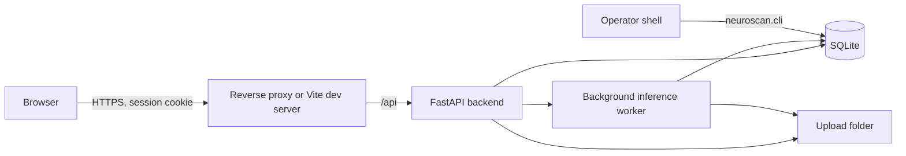

# Security

Purpose: how this project is protected and what risk remains. Read when: touching authentication, input handling, secrets, dependencies, CI, or infrastructure.

The security posture of NeuroScan AI: how to report a problem, what the application protects and how, which checks run, and what risk remains. Setup is in the [README](README.md); module boundaries are in [ARCHITECTURE.md](ARCHITECTURE.md).

NeuroScan AI handles patient health information (MRI volumes, patient names and IDs). It has no recorded clinical validation and is not a medical device; treat its output as research results.

## Contents

- [Reporting a vulnerability](#reporting-a-vulnerability)
- [Threat model](#threat-model)
- [Controls in place](#controls-in-place)
- [Scanners and guardrails](#scanners-and-guardrails)
- [Latest review](#latest-review)
- [Checklist status](#checklist-status)
- [Fixed findings](#fixed-findings)
- [Residual risks](#residual-risks)
- [Required actions for operators](#required-actions-for-operators)

## Reporting a vulnerability

Do not open a public issue. Report privately through GitHub's private vulnerability reporting on [parthmital/NeuroScan-AI](https://github.com/parthmital/NeuroScan-AI/security) (Security tab, "Report a vulnerability"), with the affected version or commit, steps to reproduce, and impact. No other contact address is recorded in the repository. No response time or bounty is promised.

Only the latest commit on `main` is supported.

## Threat model

| Item             | Details                                                                                                                                                                                                                                                          |
| ---------------- | ---------------------------------------------------------------------------------------------------------------------------------------------------------------------------------------------------------------------------------------------------------------- |
| Assets           | Patient MRI files, patient names and IDs, AI results and reports, user accounts, `JWT_SECRET`, `DATA_ENCRYPTION_KEY`, TOTP secrets                                                                                                                               |
| Actors           | Anonymous internet users; signed-in users (all have the same role); the operator with shell access                                                                                                                                                               |
| Trust boundaries | Browser to backend (all input untrusted); uploaded files to the NIfTI parser and models; environment and weight files (operator-trusted)                                                                                                                         |
| Entry points     | 23 HTTP routes under `/api` ([`Backend/neuroscan/api/`](Backend/neuroscan/api/)); the operator CLI; `.env`; model weight files                                                                                                                                   |
| Main threats     | Credential stuffing and brute force; session theft and CSRF; reading another user's scans (IDOR); malicious uploads (path traversal, parser abuse, oversized volumes); formula injection in exports; leaking internals in errors; compromised dependencies or CI |
| Out of scope     | Host and network hardening, TLS termination, backups and disk encryption (deployment responsibilities); the Kaggle research notebooks, which are not deployed                                                                                                    |

## Controls in place

| Area               | Control                                                                                                                                                                                                                                                                                 | Where                                      |
| ------------------ | --------------------------------------------------------------------------------------------------------------------------------------------------------------------------------------------------------------------------------------------------------------------------------------- | ------------------------------------------ |
| Passwords          | bcrypt cost 12; 12 characters to 72 bytes; dummy hash for unknown users so timing does not reveal usernames                                                                                                                                                                             | `security/passwords.py`, `schemas.py`      |
| Brute force        | Lockout for 15 minutes after 5 wrong passwords or codes; per-client limit of `AUTH_RATE_LIMIT_PER_MINUTE` on login, register, password and 2FA routes; lock state shown only after a correct password                                                                                   | `api/auth.py`, `security/rate_limit.py`    |
| Sessions           | HS256 JWT with issuer, audience, expiry and a per-user version, in an `HttpOnly`, `Secure`, `SameSite=Strict` cookie scoped to `/api`; logout, password change and 2FA changes revoke every earlier token; tokens never appear in bodies or URLs                                        | `security/tokens.py`, `api/deps.py`        |
| Two-factor         | TOTP with one step of drift, reuse of a step rejected; secrets encrypted with Fernet                                                                                                                                                                                                    | `security/totp.py`                         |
| CSRF               | `X-Requested-With: NeuroScan` required on every unsafe method, plus `SameSite=Strict`                                                                                                                                                                                                   | `api/middleware.py`                        |
| Authorisation      | Every scan route goes through `owned_scan`; other users' scans return `404`                                                                                                                                                                                                             | `api/scans.py`                             |
| Input              | Strict Pydantic models reject unknown fields (no mass assignment); allowlisted scan IDs, download keys, modalities and slice bounds                                                                                                                                                     | `schemas.py`, `api/scans.py`               |
| Uploads            | Streamed with a per-file cap; stored as `<scan-id>/<modality>.nii[.gz]`, never under the client name; NIfTI header must describe a 3D or 4D volume, sides up to 1024, at most 32 Mi voxels, checked before data is read; stored paths are resolved and must stay inside the upload root | `scans/storage.py`, `inference/volumes.py` |
| Request size       | 1 MB for JSON; `MAX_UPLOAD_FILE_MB` x 4 plus 1 MB for uploads; enforced even without `Content-Length`                                                                                                                                                                                   | `api/middleware.py`, `app.py`              |
| Model files        | `torch.load(weights_only=True)`, so a weight file cannot run code                                                                                                                                                                                                                       | `inference/processor.py`                   |
| Queue              | One worker and a bounded queue (`MAX_PENDING_JOBS`); `503` with `Retry-After` when full                                                                                                                                                                                                 | `scans/pipeline.py`                        |
| Exports            | CSV cells starting with `=`, `+`, `-`, `@`, tab or carriage return get a `'` prefix; PDF text is HTML-escaped before ReportLab parses it                                                                                                                                                | `scans/exports.py`                         |
| Errors             | Generic `500` with a request ID; validation errors do not echo values; pipeline failures store a generic message                                                                                                                                                                        | `api/middleware.py`, `scans/pipeline.py`   |
| Logging            | One line per request; audit events for registration, login success and failure, lockout, logout, password and 2FA changes, by user ID, never with passwords or tokens                                                                                                                   | `api/auth.py`, `observability.py`          |
| Headers (API)      | `nosniff`, `X-Frame-Options: DENY`, `Referrer-Policy: no-referrer`, `Cross-Origin-Resource-Policy`, `Permissions-Policy`, `Content-Security-Policy: default-src 'none'`, `Cache-Control: no-store`; HSTS in production                                                                  | `api/middleware.py`                        |
| Headers (frontend) | CSP with `script-src 'self'`, `frame-ancestors 'none'`, `object-src 'none'`, plus the same header set, for `vite preview`; production hosting must send the same                                                                                                                        | `Frontend/vite.config.ts`                  |
| Frontend           | No tokens in `localStorage` (only theme and overlay colours, validated on read); no `dangerouslySetInnerHTML`; the 2FA QR SVG is shown as an `img` data URL; `noindex` and `no-referrer` meta                                                                                           | `Frontend/src/`                            |
| Configuration      | Production is the default; start-up fails on a missing, short or example `JWT_SECRET`, an invalid Fernet key, or `*` in `CORS_ORIGINS`; API docs off in production                                                                                                                      | `config.py`, `app.py`                      |
| Accounts           | Registration can be closed with `ALLOW_REGISTRATION=false`; recovery only through the operator CLI, which revokes sessions                                                                                                                                                              | `cli.py`                                   |

## Scanners and guardrails

| Guardrail                 | What it does                                                                                                                                                                                   | Where                                                  |
| ------------------------- | ---------------------------------------------------------------------------------------------------------------------------------------------------------------------------------------------- | ------------------------------------------------------ |
| gitleaks in CI            | Scans the full Git history on every push and pull request; the binary is checksum-verified                                                                                                     | [`.github/workflows/ci.yml`](.github/workflows/ci.yml) |
| gitleaks pre-commit hook  | Blocks commits containing secrets after `pre-commit install`                                                                                                                                   | [`.pre-commit-config.yaml`](.pre-commit-config.yaml)   |
| bandit                    | Python static security analysis                                                                                                                                                                | CI backend job                                         |
| pip-audit, npm audit      | Known-vulnerability checks on Python and npm dependencies (npm fails at moderate)                                                                                                              | CI backend and frontend jobs                           |
| Dependabot                | Weekly grouped updates for pip, npm and GitHub Actions, with a 7-day cooldown                                                                                                                  | [`.github/dependabot.yml`](.github/dependabot.yml)     |
| CI hardening              | `contents: read` token, actions pinned to commit SHAs, `persist-credentials: false`, no `pull_request_target`                                                                                  | `ci.yml`                                               |
| Pinned dependencies       | Exact versions in `Backend/requirements*.txt`; `Frontend/package-lock.json` with `npm ci`                                                                                                      |                                                        |
| Security regression tests | Backend tests cover each control above (for example `test_scans_are_isolated_between_users`, `test_client_file_name_never_becomes_a_path`, `test_csv_export_neutralises_spreadsheet_formulas`) | [`Backend/tests/`](Backend/tests/)                     |

## Latest review

Review of the whole repository on 2 October 2026, at commit `0a5a530`.

| Tool or check                                           | Result                                                                                                             |
| ------------------------------------------------------- | ------------------------------------------------------------------------------------------------------------------ |
| `gitleaks git .` (v8.30.1, 69 commits)                  | No leaks                                                                                                           |
| `gitleaks dir .` (working tree)                         | Hits only in third-party `.venv` files, local caches and the Git-ignored development `.env`; none in tracked files |
| `bandit -q -r neuroscan main.py`                        | No findings                                                                                                        |
| `pip-audit -r requirements.txt -r requirements-dev.txt` | No known vulnerabilities                                                                                           |
| `npm audit --audit-level=moderate`                      | 0 vulnerabilities                                                                                                  |
| `pytest` (backend)                                      | 61 passed                                                                                                          |
| `npm run check` (frontend)                              | Typecheck, lint, format, jscpd (0 clones), 39 tests and build pass                                                 |
| Manual review                                           | Every checklist category below; no new exploitable finding                                                         |

Not run: semgrep, osv-scanner, trufflehog, CodeQL and zizmor (not installed; their categories were reviewed by hand); trivy, checkov and hadolint (no container or infrastructure files exist).

## Checklist status

| Category                      | Status         | Notes                                                                                                       |
| ----------------------------- | -------------- | ----------------------------------------------------------------------------------------------------------- |
| Secrets                       | Clean          | History and tracked files clean; secrets come only from `.env`                                              |
| Authentication                | Clean          | See controls; residual risks R1, R2, R7                                                                     |
| Authorisation                 | Clean          | Owner check on every scan route; single role (R4)                                                           |
| Injection                     | Clean          | ORM queries only; no shell, `eval` or templates on user input; CSV and PDF escaping                         |
| Web client                    | Clean          | CSP, no unsafe HTML sinks, CSRF header, framing denied; `style-src 'unsafe-inline'` remains (R8)            |
| Server parsing                | Clean          | No XML, no outbound requests from user input; bounded NIfTI headers; `weights_only` loading                 |
| Files                         | Clean          | Server-chosen names, root containment, size caps, NIfTI validation                                          |
| API                           | Clean          | Strict schemas, response models without secrets, pagination capped at 500, body limits, rate limits on auth |
| Logic and concurrency         | Clean          | Retry only from `failed`; bounded queue; idempotent jobs                                                    |
| Crypto                        | Clean          | bcrypt, HS256 with a 32+ character secret, Fernet, `secrets`, constant-time TOTP comparison                 |
| Errors and privacy            | Clean          | Generic errors, audit logs without secrets; PHI at rest unencrypted (R3)                                    |
| Supply chain                  | Clean          | Pinned, audited, Dependabot with cooldown; weight downloads hash-pinned, loaded files not verified (R5)     |
| CI/CD                         | Clean          | Read-only token, SHA-pinned actions, no fork secrets                                                        |
| Containers and infrastructure | Not applicable | No Dockerfile, compose or infrastructure code                                                               |
| Config                        | Clean          | Validated at start-up, secure defaults; production headers depend on the proxy (R9)                         |
| DoS                           | Clean          | Body, upload, voxel, queue and page limits; R1 for multi-instance                                           |
| LLM and agents                | Not applicable | No LLM features                                                                                             |
| Mobile and extensions         | Not applicable | Web only                                                                                                    |

## Fixed findings

These were fixed in commit `f73b2b0` ("Harden security and restructure the app into tested modules"). IDs and severities were assigned when writing this document from that commit's description; the code before the fix was not re-audited.

| ID     | Severity | CWE      | Finding                                                    | Fix and proof                                                                                                 |
| ------ | -------- | -------- | ---------------------------------------------------------- | ------------------------------------------------------------------------------------------------------------- |
| SEC-01 | High     | CWE-22   | Upload path traversal through client file names            | Server-chosen paths, root containment; `test_client_file_name_never_becomes_a_path`                           |
| SEC-02 | High     | CWE-200  | Password hashes, file paths and owner IDs in API responses | Response models; `test_me_never_returns_password_hash`                                                        |
| SEC-03 | Medium   | CWE-922  | Session tokens stored in `localStorage`                    | `HttpOnly` cookie sessions; `test_register_sets_httponly_strict_cookie_and_hides_secrets`                     |
| SEC-04 | Medium   | CWE-307  | No brute-force protection on login                         | Lockout and rate limits; `test_account_locks_after_repeated_failures`, `test_auth_endpoints_are_rate_limited` |
| SEC-05 | Medium   | CWE-1395 | `python-jose` pulled in a vulnerable `ecdsa`               | Replaced with PyJWT; `pip-audit` clean                                                                        |
| SEC-06 | Medium   | CWE-502  | Model weights loaded without `weights_only`                | `torch.load(weights_only=True)`                                                                               |
| SEC-07 | Medium   | CWE-915  | Request bodies accepted unknown fields                     | `extra="forbid"` models; `test_mass_assignment_rejected`                                                      |
| SEC-08 | Medium   | CWE-1236 | CSV exports could carry spreadsheet formulas               | Cell prefixing; `test_csv_export_neutralises_spreadsheet_formulas`                                            |
| SEC-09 | Medium   | CWE-1188 | Insecure or example secrets and wildcard CORS accepted     | Start-up validation; `test_insecure_configuration_is_refused`                                                 |
| SEC-10 | Low      | CWE-209  | Internal error details returned to clients                 | Generic `500` with request ID; `test_unhandled_errors_return_generic_message`                                 |
| SEC-11 | Low      | CWE-693  | Missing security headers                                   | Header middleware; `test_security_headers_on_api_responses`                                                   |

## Residual risks

| ID  | Severity | Risk                                                                                                                                                                                                                                            | Next step                                                                                                                                               |
| --- | -------- | ----------------------------------------------------------------------------------------------------------------------------------------------------------------------------------------------------------------------------------------------- | ------------------------------------------------------------------------------------------------------------------------------------------------------- |
| R1  | Medium   | The auth rate limiter is in process memory and keys on the client address. Behind a proxy without `--proxy-headers`, every client shares one address; with several instances, limits multiply. Account lockout (in the database) still applies. | Run one instance with `--proxy-headers --forwarded-allow-ips=<proxy>`; move the limiter to shared storage before scaling out (see ARCHITECTURE.md)      |
| R2  | Low      | Registration answers `409` for a taken username or email, so accounts can be enumerated at the rate limit (CWE-204).                                                                                                                            | Set `ALLOW_REGISTRATION=false` once staff accounts exist                                                                                                |
| R3  | Medium   | MRI files and patient details are stored unencrypted in the upload folder and SQLite (CWE-311).                                                                                                                                                 | Use an encrypted disk or volume and restrict file permissions to the service account                                                                    |
| R4  | Low      | All users share one role; there is no admin or per-institution separation.                                                                                                                                                                      | Add an authorisation layer next to `owned_scan` when roles are needed                                                                                   |
| R5  | Low      | Weight files already on disk are not checked against a known hash; a replaced file cannot run code but could change results.                                                                                                                    | `scripts/dev.mjs` pins SHA-256 hashes and verifies files it downloads from the `weights-v1` release; the backend does not yet verify files at load time |
| R6  | Low      | No email service, so password reset needs the operator CLI; a weak operator process becomes the recovery path.                                                                                                                                  | Restrict shell access; replace with a verified email reset when email exists                                                                            |
| R7  | Low      | Failed codes on `/2fa/enable` and failed current passwords on `/password` are limited only by the per-client rate limit, not the lockout. Both need a valid session first.                                                                      | Count them towards the lockout if this becomes a concern                                                                                                |
| R8  | Low      | The frontend CSP keeps `style-src 'unsafe-inline'`.                                                                                                                                                                                             | Narrow it after confirming which libraries inject style elements                                                                                        |
| R9  | Medium   | Production security headers and TLS depend on reverse-proxy configuration, which is not in the repository.                                                                                                                                      | Configure the proxy to send the headers in `vite.config.ts` and serve HTTPS only                                                                        |

## Required actions for operators

- Generate fresh `JWT_SECRET` and `DATA_ENCRYPTION_KEY` values for every deployment (commands in [`.env.example`](.env.example)) and rotate them if exposed. Rotating `JWT_SECRET` signs everyone out; rotating `DATA_ENCRYPTION_KEY` disables every 2FA enrolment.
- Keep `ENVIRONMENT=production` and `COOKIE_SECURE=true` outside a developer machine.
- Serve the frontend and API from one HTTPS origin through a reverse proxy that sends the security headers (R9).
- Set `ALLOW_REGISTRATION=false` after creating staff accounts (R2).
- Store `UPLOAD_DIR` and the database on encrypted storage outside any web-served folder (R3).
- Enable GitHub private vulnerability reporting, secret scanning and Dependabot alerts in the repository settings, and require the CI workflow on `main`.
- Install the pre-commit hook with `pre-commit install`.
